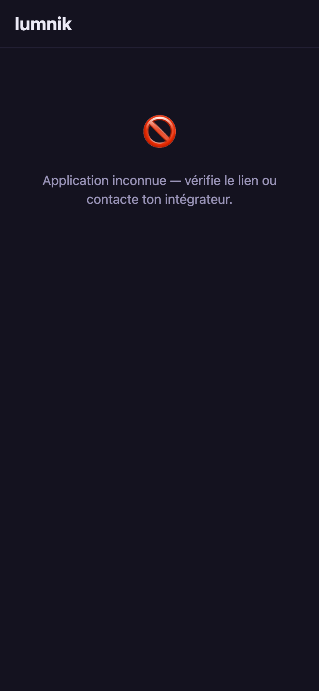
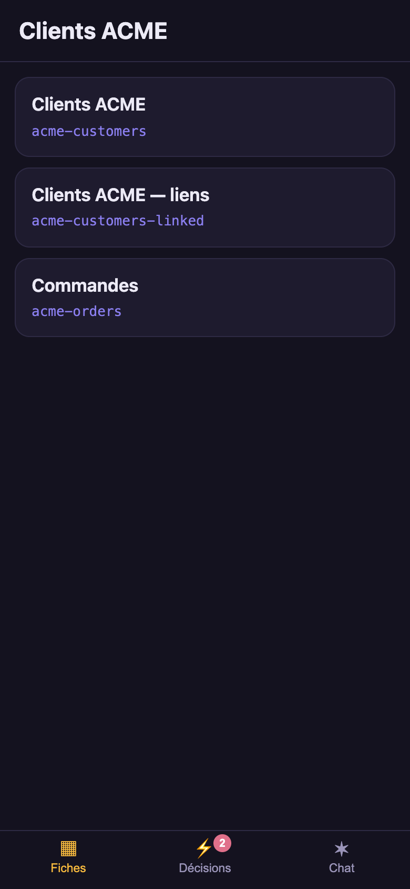
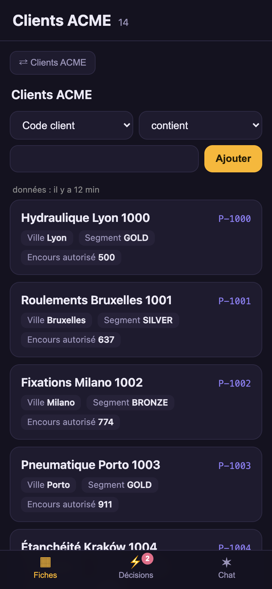
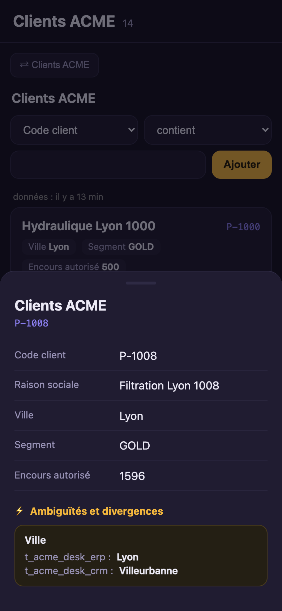
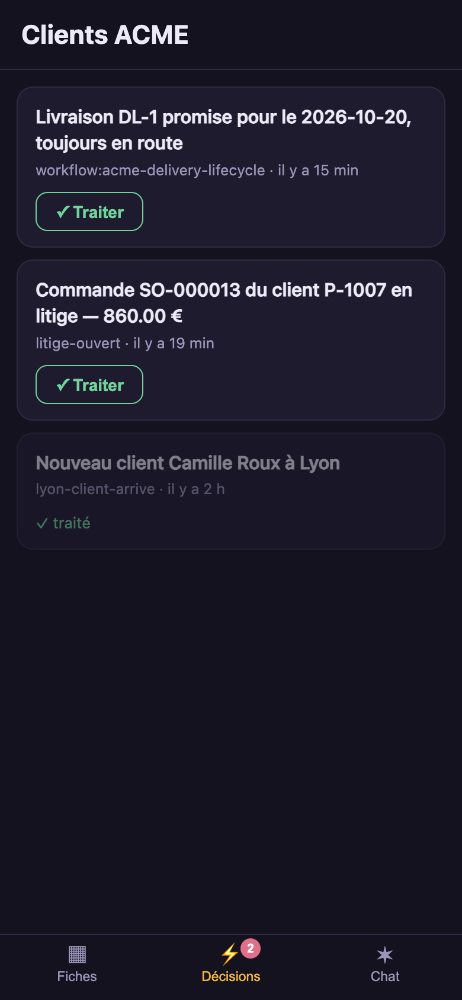
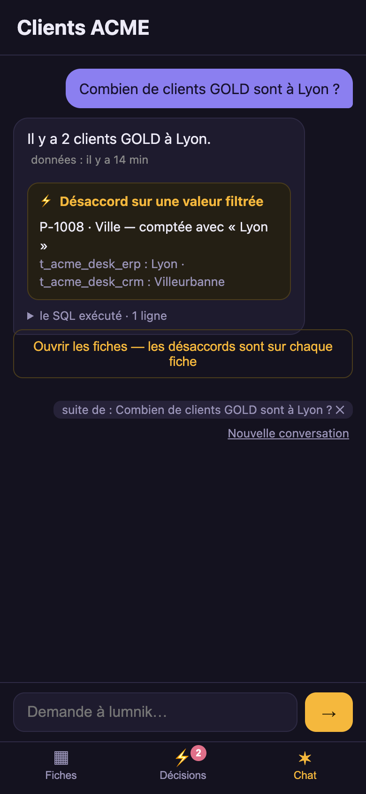

# The PWA — your data in your pocket

The hub rendered on a phone. `/app/` is served by the hub itself: no app store, no build step.
It installs from the browser like any PWA. One hub can serve several teams; `?m=` selects the app.
The demo app uses French labels, but the app definition is language-neutral.

## Declare a business app

A business app is a `kind: App` manifest: a title, a scope, an icon. The demo desk's:

```yaml
--8<-- "docs/apps/demo/apps/20-desk.yaml"
```

```
$ lm app apply -f docs/apps/demo/apps/20-desk.yaml
Applied app "desk" → scope desk
  default app — "clients" is no longer the default
$ lm app list
NAME     TITLE         SCOPE    ICON     ACCENT   BACKGROUND  DEFAULT  TABS
clients  Clients       clients  clients  #8b7ff0  #14121f              (all)
desk     Clients ACME  desk     clients  #8b7ff0  #14121f     yes      (all)
stock    Stock         stock    stock    #8b7ff0  #14121f              (all)
```

Then two more gestures, or the app opens empty:

1. **Apply the views** that the app reads: `lm view apply -f docs/apps/demo/views/10-customers.yaml`
   ([Views](views.md)).
2. **Grant the users** the `scope:desk` role in Keycloak
   ([Tenants, users & scopes](../security/identity-admin.md#grant-or-revoke-a-business-scope)).

The PWA reads the apps at every login: no rebuild, no redeploy.

| Field | Says |
|---|---|
| `icon` | one of `clients`, `stock`, `generic`, `event`, `alert`, `contract`. No upload. |
| `theme` | `accentColor` and `backgroundColor`, both optional. The accent is checked for contrast: it is also the chat bubble's background. |
| `default` | the app an address without `?m=` opens. At most one. To move it, apply another app with `default: true`. |
| `tabs` | which tabs, in which order. Absent: every tab the hub offers. [Choosing the tabs](#choosing-the-tabs). |

- Change an app: `lm app get desk > desk.yaml`, edit, `lm app apply -f desk.yaml`.
- Remove it: `lm app rm desk`.

## Open it on a phone

```
https://<your-host>/app/            # the app declared default: true
https://<your-host>/app/?m=desk     # the desk app
```

A phone installs a PWA only from an `https` address. The self-host stack has a
[TLS proxy](../deploy.md#one-https-origin-the-tls-proxy) for that; on a LAN address, the phone
must trust its certificate first ([how](../deploy.md#trust-the-local-certificate-on-a-phone)).

1. Open `https://<host>/app/?m=desk` and sign in.
2. **iOS Safari:** Share → *Add to Home Screen*. **Android Chrome:** the install prompt, or ⋮ →
   *Add to Home screen*.
3. The icon and name are the app's own. Each app is its own home-screen icon.

For a fleet of phones, push the proxy's certificate and the app's address through your MDM.

An unknown `?m=`, or an app of a scope the user does not hold:

{ width="260" }

## What the business user sees

The screens below are the desk app on a phone, against the demo desk.

### Records — the saved views

{ width="260" }
{ width="260" }
{ width="260" }

- **One view** for the app's scope: it opens directly. **Several:** a picker. **None:** an amber
  message asking for one.
- A view opens on its first 50 rows. **Next ›** and **‹ Previous** move a page.
- **Filters are built, not typed:** a column, an operator, a value. A text column offers
  *contains* and *=*; a number or a date also offers `<` and `>`; declared values use a list. Each filter is
  a chip; tap it to remove it.
- **Tap a row:** its record opens, ending with its conflicts and ambiguities — here, the city of P-1008: *Lyon*
  in the ERP, *Villeurbanne* in the CRM.
- The data age is the time since the last run that fed the scope.

### Inbox — decisions

{ width="260" }

- Newest first. **✓ Acknowledge** is the same ack as `lm inbox ack`. Acknowledged decisions are dimmed.
- The badge on the tab counts the open decisions.
- It shows decisions from every scope the user holds, not only the open app's scope
  ([who sees which decision](inbox.md#who-sees-which-decision)).

### Chat — ask your data (Pro)

{ width="260" }

- The same guarded ask as `lm ask`, bound to the app's scope. The SQL is folded under the answer.
- When the answer filters on a disputed value, an amber block names the record and the value used.
- A follow-up such as *And in Paris?* continues the previous question. lumnik shows the full question
  it answered; read it before trusting the figure.
- The context chip shows the question that the next message continues. Tap it to ask on its own.
  **New conversation** clears the thread. A reload forgets it; nothing is stored.
- A phrase such as *the second one* points at a result row that lumnik does not keep. The chat asks
  for an explicit value instead.

### Search

Present on a hub with [Search](../search/querying.md), for a user who may read an index. A word or
two, then **Search**: ranked results, matched words highlighted.

- It searches only the app's scope.
- Counted values (a city, a segment) appear as chips: tap one to narrow.
- A result opens its record, read-only, with each source's value where they disagree.

## Choosing the tabs

| Tab | Shown |
|---|---|
| Records | always |
| Inbox | always |
| Chat | on lumnik Pro, AI on |
| Search | on a hub with Search, for a user who may read an index |

To show fewer, or reorder them, list them in the app's manifest:

```yaml
spec:
  tabs: [fiches, inbox]
```

- The manifest names are `fiches`, `inbox`, `chat`, and `search`.
- The app opens on the first tab of the list that the hub has.
- A tab the hub does not have is accepted, with a warning. It appears the day the hub has it, so
  the same manifest works on Open and on Pro:

    ```
    $ lm app apply -f desk-app.yaml
    Applied app "desk" → scope desk
      tabs: fiches, inbox, search
    ! desk-app.yaml — 0 error(s), 1 warning(s)

      WARN     spec.tabs[2]
              tab 'search' is not offered by this hub; the declaration is kept and takes effect when a module offering it is active
              → offered here: [fiches, inbox]
    ```

- Hiding a tab locks nothing: who may read what is still decided by roles and scopes.
- What a hub offers in the first place: [Choosing what your hub offers](../choosing-what-your-hub-offers.md).

### Enabling Search for an app

1. **A Search provider in the hub** ([choosing a provider](../search/search-indexes.md#choosing-a-provider)).
2. **Entities carrying the app's scope.**
3. **A search index over them:** `lm search apply -f index.yaml` ([declare one](../search/search-indexes.md)).
   The hub builds it within a minute.
4. **The tab in the app's list,** if the app lists its tabs: add `search`.

`lm search status` shows whether each index is built and fresh.

## On a tablet, on a display

| Width | Records | Navigation | Record |
|---|---|---|---|
| phone | cards | bottom tabs | bottom sheet |
| tablet (≥ 640 px) | table | bottom tabs | bottom sheet |
| display (≥ 900 px) | table | left rail | side panel |

## Sign-in, offline

- Users sign in with their Keycloak account. Closing the tab ends the session.
- A refused scope shows the amber refusal, never a broken screen.
- **Your own IdP:** its client for the app needs the audience `lumnik-backend`
  ([Bring your own IdP](../security/byo-idp.md)).
- Offline, the app reports that data will return with the network and offers **Retry**. It never
  shows stale rows: only the app shell is kept on the phone.

## See also

- [kind: View](views.md) — the lists the Records tab shows.
- [Inbox](inbox.md) — the decisions behind the Inbox tab.
- [Scopes](../rag/scopes.md) — the boundary the whole app lives within.
