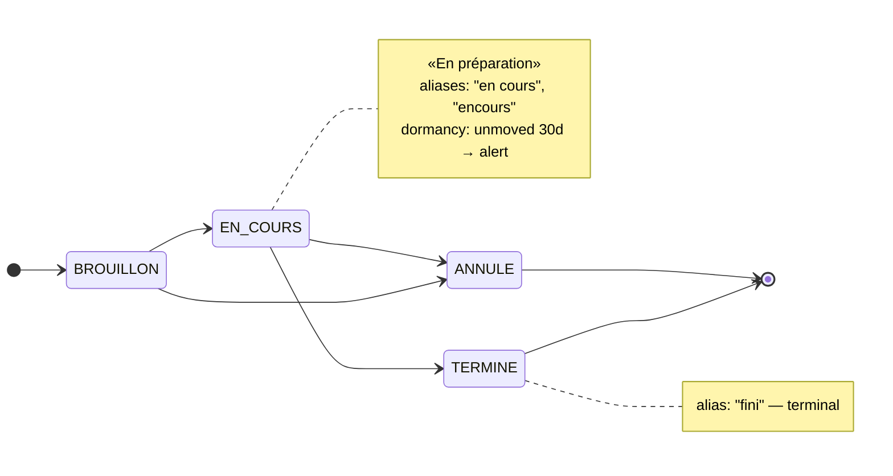

# kind: Workflow — declare

> The fourth rung, and the first that adds no surface: a **declarative document lifecycle** over
> a status column ingestion already landed — states, aliases for the spellings the legacy source
> really uses, the transition graph, and a threshold past which a document that has not moved
> is a decision. Views let you see, processes react, the inbox decides; a workflow adds
> *knowledge*, and grounds the other three.

| | |
|---|---|
| **Kind** | `Workflow` — `apps.lumnik.io/v1` |
| **Over** | one column of one table: a raw `connector.t_*`, or a fused `connector.v_*` (taxonomy only) |
| **Declares** | states with aliases, transitions, `provenance: declared`; optionally a business key and a dormancy threshold |
| **Produces** | a data-truth report at apply; one chunk in the scope's corpus; `decision.dormant.<name>` alerts and an observation tape when watched |
| **Apply** | `lm workflow apply` — `lm_integrator`, scope-bound like every app-ladder door; one lifecycle per column |
| **Edition** | Open |

Twenty years of an ERP's exports do not carry clean statuses — `En cours`, `encours`, `fini`,
`TERMINE ` with a trailing space — and the lifecycle they imply lives in somebody's head, not in
a schema. Ask a model *"pourquoi je ne peux pas clôturer cette commande ?"* against a corpus with
no declared lifecycle and it answers anyway, inventing a plausible one. Declaring the graph turns
head-knowledge into ground truth the chat can cite, and removes its option to invent.

## Features

- **[Dirty values resolve to declared states.](#alias-semantics)** Alias matching is trim and
  case-insensitive: `TERMINE `, `fini` and `En cours` collapse onto three codes without a cleanup
  pass.
- **[A data-truth report that never blocks.](#the-data-truth-report-never-blocks)** Apply confronts
  the declaration with the column as it is today — undeclared values, unobserved codes, blanks —
  and stores the manifest either way. Reality does not ask the manifest's permission.
- **[Grounded answers.](#what-the-chat-answers-from-it)** The lifecycle is one chunk in the
  scope's corpus; the semantic door answers transitions from the declared graph, the analytic
  door answers a document's state from the table.
- **[Dormancy — the memory of the breathing.](#dormancy-the-memory-of-the-breathing)** A key and
  a threshold turn the declaration into a watch: a document unmoved in a non-terminal state past
  the threshold, counted from lumnik's first sighting, is a `decision.dormant.*` in the inbox.
- **[A tape that outlives the alert.](#reading-the-tape)** Every watched document's state, since
  when, and whether it alerted — stillest first.
- **[One column, one lifecycle.](#one-column-one-lifecycle)** Two contradictory graphs for the
  same column can never both be in the corpus; the second is refused, naming the first.

## Quickstart

!!! note "Every screen on this page reads the demo desk that ships with the repo"
    An order book whose `status` column carries seven spellings and one blank, under
    `docs/apps/demo/`. Land it first — [The demo desk](demo-desk.md) has the three commands and
    the hand count of what the report must say.

```yaml
--8<-- "docs/apps/demo/workflows/10-order-lifecycle.yaml"
```

The same manifest, as the graph it declares:



```
$ lm workflow apply -f docs/apps/demo/workflows/10-order-lifecycle.yaml
{"name":"acme-order-lifecycle","scope":"desk","table":"connector.t_acme_desk_orders","column":"status","dataTruth":{"undeclared":[{"value":"EN LITIGE","rows":3},{"value":"Terminé","rows":1}],"unobserved":["ANNULE"],"nullOrBlank":1,"tableMissing":false,"keyColumnMissing":false,"keyNullOrBlank":0,"checkUnavailable":false,"unavailableReason":null}}
$ lm workflow list
NAME                  TABLE                         COLUMN  SCOPE  ENABLED
acme-order-lifecycle  connector.t_acme_desk_orders  status  desk   true
```

One `200`, and it says everything the declaration and the data disagree on. `EN LITIGE` sits on
three orders and nobody declared it; `Terminé` — with its accent — on one; `ANNULE` is declared
and no order has ever reached it; one order has no status at all. The manifest is stored, the
lifecycle is indexed, and none of that was refused: a fact about the data is not a contradiction
in the declaration.

`EN LITIGE` is deliberately **not** in the graph above. It stays visible in the report instead of
being silently absorbed into a lifecycle it was never part of — and, as the
[dormancy sweep](#an-undeclared-value-can-never-be-terminal) sees it, it is exactly as watchable
as a declared state.

## The manifest

| Field | Required | Meaning |
|---|---|---|
| `metadata.name` | yes | kebab-case identifier (`[a-z0-9-]+`) — the name `apply` updates under, and the alert's `decision.dormant.<name>` |
| `spec.scope` | yes | the métier scope the lifecycle belongs to; must be a **discovered** scope — [below](#the-scope-must-exist-the-table-need-not) |
| `spec.provenance` | yes | **must be `declared`** — v1 accepts no other value; [why it exists at all](#provenance-and-why-it-exists-for-a-single-accepted-value) |
| `spec.on.table` | yes | the table to watch — an ingest table (`connector.t_<table>`) or a fused entity view (`connector.v_<entity>`, always lower-case) |
| `spec.on.column` | yes | the column whose values this taxonomy explains — **whatever the source called it** |
| `spec.on.key` | no (required by `dormancy`) | the business key linking a document's successive versions |
| `spec.dormancy.after` | no (required by `dormancy`) | the sweep threshold, `[0-9]+[mhd]` (`30d`) — requires `spec.on.key`, and an ingest table, not a fused view |
| `spec.states[]` | yes (≥ 1) | the declared states |
| `spec.transitions[]` | no | the allowed edges of the graph |

**`states[]`** — `code` (required; unique, case- and trim-insensitive), `label`, `aliases[]` (the
dirty spellings that resolve to this code), `initial` (**exactly one** state must set it `true`),
`terminal` (a terminal state may carry no outgoing transition).

**`transitions[]`** — `from[]` (one edge can fan in from several states) and `to`.

That table is the whole surface, closed at every level:

```
$ lm workflow apply -f docs/apps/demo/workflows/67-refused-unknown-key.yaml
Error: API error 400: unknown key(s) in the manifest: spec.after — kind:Workflow honors root {apiVersion, kind, metadata, spec}, metadata {name}, spec {dormancy, on, provenance, scope, states, transitions}, spec.on {column, key, table}, spec.dormancy {after}, states[] {aliases, code, initial, label, terminal}, transitions[] {from, to}
```

An `after:` that slid out of `dormancy:` would otherwise be a lifecycle silently missing its
threshold. The `apiVersion:` envelope is accepted and ignored.

### The scope must exist, the table need not

`spec.scope` is checked against the tenant's discovered scopes. An unknown one is a **404** — the
same code and wording [`kind:Process`](processes.md) answers with, because it is the same
condition:

```
$ lm workflow apply -f docs/apps/demo/workflows/65-refused-unknown-scope.yaml
Error: API error 404: no schema for scope 'dsk' — run discovery first
```

The reason is the chunk: it is tagged with `spec.scope`, so a typo would index the lifecycle
under a tag nobody holds. Nothing would fail, and the chat would quietly go back to inventing.
The applied scope comes back in the response so you can see the tag that was written.

Only the **scope** is checked. The trigger table is deliberately *not* required to be in the
scope's card — declaring a lifecycle **before** ingesting the data is a legitimate order of
operations, and that is what `tableMissing` in the report is for. (`kind:Process` does require its
table, because a process fires on rows; a workflow only describes them.)

### Names the source chose

`on.column` and `on.key` are the names **your source** uses, copied as they are. A Kafka message's
JSON keys become columns verbatim — that connector has no mapping block to rename one — so
`Statut Commande`, `MONTANT_€` and `c_bpartner.id` are columns you may really have, and each can
carry a lifecycle:

```yaml
on:
  table: connector.t_Commandes
  column: "Statut Commande"
  key: "N° Commande"
```

Quote them in the YAML if they contain spaces or punctuation — that is YAML's quoting, not SQL's:
write the name the way the column is really spelled, and the hub adds the SQL quotes.

One thing is **not** free: `on.table` must name a table **ingestion owns** — `connector.t_<table>`,
or `connector.v_<entity>` for a fused entity view. Spell it the way the hub created it (a
connector's target keeps your capitals, a fused view is always lower case, neither ever contains
a space). A workflow watches the data the hub took in, never the hub itself: the dormancy sweep
reads on a privileged connection, so anything else is refused at apply, by name —

```
$ lm workflow apply -f docs/apps/demo/workflows/66-refused-foreign-table.yaml
Error: API error 400: spec.on.table is required and must name a table in the 'connector' schema that ingestion owns (connector.t_<table>) or a fused entity view (connector.v_<entity>, always lower-case), spelled the way the hub created it (letters, digits and underscores — a space is a typo): identity.app_user
```

— which covers another schema and equally the hub's own tables inside `connector`
(`connector.schema_card`, `connector.connector_credential`).

A fused view can carry a **taxonomy** but not a `dormancy`, and apply says so rather than letting
you wait: the sweep picks a document's latest version by its ingest order, and a view carries
none. Declare the dormancy on the ingest table the entity fuses, or keep the taxonomy and drop
`spec.dormancy`.

### One column, one lifecycle

Two workflows on the same `on.table` + `on.column` would put two contradictory graphs in the
corpus for the same column — both retrieved, the chat forced to choose. A *different* name
declaring an already-declared column is refused, naming the holder:

```
$ lm workflow apply -f docs/apps/demo/workflows/64-refused-same-column.yaml
Error: API error 400: column connector.t_acme_desk_orders.status already has a declared lifecycle: workflow 'acme-order-lifecycle' — a column has exactly one lifecycle; re-apply under the name 'acme-order-lifecycle' to update it
```

Renaming a workflow therefore means re-applying it under the existing name — `apply` on the same
name **is** the update path — and the boundary is per tenant. The check is backstopped at the
database (`UNIQUE (tenant_id, on_table, on_column)`), so two concurrent applies can never both
succeed: the loser still gets a `400`, just without the winner's name.

## Alias semantics

Alias and code matching is **trim + case-insensitive**: `"TERMINE "`, `"fini"`, `"En cours"` all
resolve. That normalization is the whole point — it is what lets twenty years of dirty input
collapse onto a handful of declared states without a cleanup pass first. On the demo desk:

| Status as written | Rows | Resolves to |
|---|---|---|
| `En cours`, `encours` | 4 | `EN_COURS` |
| `fini`, `TERMINE ` | 2 | `TERMINE` |
| `BROUILLON` | 2 | `BROUILLON` |
| `EN LITIGE` | 3 | **undeclared** |
| `Terminé` | 1 | **undeclared** — an accent is not an alias anyone declared |
| *(empty)* | 1 | `nullOrBlank` |

Two declaration-time contradictions are refused, not silently resolved, and so are two
structural ones on the graph:

```
$ lm workflow apply -f docs/apps/demo/workflows/61-refused-alias-collision.yaml
Error: API error 400: alias 'en_cours' on state BROUILLON collides with state code
$ lm workflow apply -f docs/apps/demo/workflows/60-refused-two-initial.yaml
Error: API error 400: exactly one state must be initial: true (found 2)
$ lm workflow apply -f docs/apps/demo/workflows/62-refused-terminal-outgoing.yaml
Error: API error 400: terminal state 'TERMINE' has an outgoing transition
```

- an alias that **collides with a state code** — the same string would mean two things;
- an alias **declared on two different states** — ambiguous by construction;
- **exactly one** `initial: true`;
- a `terminal: true` state with an outgoing `transitions[].from` — a "closed" state that could
  still move is a contradiction in the declaration.

## The data-truth report — never blocks

`apply` parses and stores the manifest first, then **confronts** it with what the column actually
contains — and that confrontation never becomes a refusal:

| Field | Meaning | On the demo desk |
|---|---|---|
| `undeclared` | values seen in the data with no matching state or alias, each with its row count. This is reality; reality does not ask the manifest's permission | `EN LITIGE` ×3, `Terminé` ×1 |
| `unobserved` | declared codes never once seen in the column — a state that is never actually reached | `ANNULE` |
| `nullOrBlank` | rows carrying no status at all. Its own bucket, never folded into silence: a column `NULL` on 90 % of its rows would otherwise report `undeclared: []`, which *reads* as agreement | `1` |
| `tableMissing` | the trigger table does not exist yet, or any more. Still `200` | `false` |
| `keyColumnMissing` | `spec.on.key` names a column the table does not have — the **only** signal a typo'd key ever produces; `key: order_n` satisfies the grammar, applies clean, and then makes the sweep fail on every tick with nothing but a log line to show for it | `false` |
| `keyNullOrBlank` | rows whose `spec.on.key` is `NULL` or blank — the documents the dormancy sweep skips, permanently. Counted with the sweep's own predicate, so it says how much of the table dormancy cannot cover. `null` means *not measured* (no key declared, the key column or the table missing, or the check unavailable); `0` means measured, and no such row. Counted independently of the status: a row with neither belongs to both counters, so do not add them up. It shows the key is *there*, not that it is unique or stable over time | `0` |
| `checkUnavailable` + `unavailableReason` | the confrontation could not run — a statement timeout on a huge table, a dropped column, a revoked grant. It means *"we could not confront the data"*, **not** *"the data agrees"*; the other fields are empty out of ignorance. Re-apply once the cause is gone | `false` |

All of it lands in the same `200`, always — even when the probe itself fails: the declaration is
already stored, and a report that cannot be produced must not cost the integrator the
lifecycle. Refusal is reserved for a genuine contradiction in the declaration itself.

**Coverage bound:** the confrontation groups the column's values and looks at the **top 200
distinct values by row count**. On a status column that is exhaustive in practice; on a
high-cardinality one, a rare undeclared value can rank below the cut. A clean report covers what
it checked, not the whole column.

## What the chat answers from it

Applying a workflow (re)indexes it as **one chunk** in the manifest's scope, spelling out the
states, the aliases, the transitions and the provenance. Two doors read it differently, and it is
worth knowing which is which:

- **The semantic door** — `POST /api/rag/chat` with the scope, `lm chat` —
  retrieves the chunk and answers about the *graph*:

    ```
    $ curl -s localhost:8080/api/rag/chat -H "Authorization: Bearer $TOKEN" -H 'Content-Type: application/json' \
        -d '{"question":"Pourquoi je ne peux pas clôturer la commande SO-000004 ? Quelles sont les étapes avant TERMINE ?","scope":"desk"}'
    Les étapes autorisées pour passer du statut BROUILLON sont : BROUILLON -> EN_COURS, BROUILLON -> ANNULE.
    Les étapes autorisées pour passer du statut EN_COURS sont : EN_COURS -> ANNULE, EN_COURS -> TERMINE.
    Aucune étape n'est autorisée pour passer directement de BROUILLON à TERMINE. […]
    ```

    Every transition it names is one the manifest declares — `ANNULE` included, which no order has
    ever reached. What it hedges on is the *document*: the chunk carries the graph, not the
    table, so *"SO-000004 is in BROUILLON"* is a guess it flags as one.

- **The analytic door** — `lm ask`, the PWA's chat panel, `mode: analytic` — generates SQL over
  the scope's card and answers about the *rows*:

    ```
    $ lm ask --scope desk "Dans quel statut est la commande SO-000004 ?"
    La commande SO-000004 est dans le statut BROUILLON.
      data as of: 2026-09-13T00:49:13.894142Z (last completed run)

      SQL: SELECT status FROM "connector"."t_acme_desk_orders" WHERE order_no = 'SO-000004'
    LIMIT 500
    ```

    It does not read the lifecycle chunk: a *"why can't I close it"* question, asked here, is met
    with the honesty guards' abstention rather than an invented answer.

What is fixed run to run is the ground truth an answer must agree with — the declared states,
aliases and transitions — never an invented lifecycle. Ask the graph question through the
semantic door with the scope set (`lm scope set desk` gives `lm chat` a default), and the state
question through the analytic one.

## Dormancy — the memory of the breathing

Legacy systems destroy time: a status is overwritten in place, so nothing in the raw table says an
order has sat in `EN_COURS` for six weeks — only that it currently *is* `EN_COURS`. lumnik cannot
recover that lost history. It starts a **new** time axis instead, forward from the moment it
starts watching: a scheduled sweep (every 15 minutes by default, `lumnik.workflow.sweep.every` —
[Observability](../operations/observability.md#scheduled-background-work)) records each
document's declared state and alerts when it has sat, unmoved, in a non-terminal state past a
**declared** threshold, counted from **lumnik's own first sighting** of that document.

Two fields turn a declaration into a watch: `spec.on.key` (`order_no` — the business key that
links a document's successive raw rows, so the sweep can tell "the same order, later" from "a
different order") and `spec.dormancy.after` (`30d`, or any `[0-9]+[mhd]`). One requires the
other:

```
$ lm workflow apply -f docs/apps/demo/workflows/63-refused-dormancy-no-key.yaml
Error: API error 400: spec.dormancy requires spec.on.key (dormancy is per-document; the key links a document's versions)
```

**The clock starts at lumnik's first sighting, not at the actual stall.** The first sweep to see a
document records "since now" for whatever state it is in — it has no way to know how long that
document had already been sitting. Declare `after: 14d` this morning against repair orders that
have been stuck for weeks, and the earliest any of them alert is fourteen days from now.

The tape after the first sweep that saw the demo desk:

```
$ lm observations list
WORKFLOW              DOC        STATE      SINCE             ALERTED
acme-order-lifecycle  SO-000001  EN_COURS   2026-09-13 02:45  
acme-order-lifecycle  SO-000002  TERMINE    2026-09-13 02:45  
acme-order-lifecycle  SO-000003  TERMINE    2026-09-13 02:45  
acme-order-lifecycle  SO-000004  BROUILLON  2026-09-13 02:45  
acme-order-lifecycle  SO-000005  EN_COURS   2026-09-13 02:45  
acme-order-lifecycle  SO-000006  EN LITIGE  2026-09-13 02:45  
acme-order-lifecycle  SO-000007  EN_COURS   2026-09-13 02:45  
acme-order-lifecycle  SO-000008  Terminé    2026-09-13 02:45  
acme-order-lifecycle  SO-000010  EN LITIGE  2026-09-13 02:45  
acme-order-lifecycle  SO-000011  BROUILLON  2026-09-13 02:45  
acme-order-lifecycle  SO-000012  EN_COURS   2026-09-13 02:45  
acme-order-lifecycle  SO-000013  EN LITIGE  2026-09-13 02:45  
$ lm observations stats
WORKFLOW              WATCHED  DORMANT  MEDIAN_DETECTION_S
acme-order-lifecycle  12       0        -
```

Twelve documents, every one "since" the same minute — the minute lumnik first looked — and
`SO-000009` absent: it has no status, so there is no state to observe sitting still. The states
are the **resolved** codes where an alias matched (`fini` reads `TERMINE`) and the raw value where
none did (`EN LITIGE`, `Terminé`).

For the screen below the threshold was shortened to `after: 1m` and the manifest re-applied under
the same name, so the sweep could fire without a real thirty-day wait — the shipped manifest still
declares `30d`. The tick fifteen minutes later:

```
$ lm observations list
WORKFLOW              DOC        STATE      SINCE             ALERTED
acme-order-lifecycle  SO-000001  EN_COURS   2026-09-13 02:45  2026-09-13 03:00
acme-order-lifecycle  SO-000002  TERMINE    2026-09-13 02:45  
acme-order-lifecycle  SO-000003  TERMINE    2026-09-13 02:45  
acme-order-lifecycle  SO-000004  BROUILLON  2026-09-13 02:45  2026-09-13 03:00
acme-order-lifecycle  SO-000005  EN_COURS   2026-09-13 02:45  2026-09-13 03:00
acme-order-lifecycle  SO-000006  EN LITIGE  2026-09-13 02:45  2026-09-13 03:00
acme-order-lifecycle  SO-000007  EN_COURS   2026-09-13 02:45  2026-09-13 03:00
acme-order-lifecycle  SO-000008  Terminé    2026-09-13 02:45  2026-09-13 03:00
acme-order-lifecycle  SO-000010  EN LITIGE  2026-09-13 02:45  2026-09-13 03:00
acme-order-lifecycle  SO-000011  BROUILLON  2026-09-13 02:45  2026-09-13 03:00
acme-order-lifecycle  SO-000012  EN_COURS   2026-09-13 02:45  2026-09-13 03:00
acme-order-lifecycle  SO-000013  EN LITIGE  2026-09-13 02:45  2026-09-13 03:00
acme-order-lifecycle  SO-000014  EN LITIGE  2026-09-13 03:00  2026-09-13 03:15
$ lm observations stats
WORKFLOW              WATCHED  DORMANT  MEDIAN_DETECTION_S
acme-order-lifecycle  13       11       900
```

Eleven alerts — ten at the first tick past the threshold, one more for the newcomer a tick later —
one per document that sat unmoved past the threshold in a non-terminal state. The two
`TERMINE` orders never alert — a terminal state is excluded by construction. `SO-000008` **does**:
`Terminé`, accent and all, matched no alias, and [an undeclared value can never be
terminal](#an-undeclared-value-can-never-be-terminal). `SO-000014` arrived with the third
morning's export and was first seen at the same tick; its clock started there, and it alerted one
tick later. The median detection delay is 900 s — one sweep interval, which is the floor. What
each alert says, in the inbox:

```
$ lm inbox --limit 3
ID    QUAND  PROCESS                        MESSAGE                                                                                                                                            ENTITY_KEY
1946  55min  workflow:acme-order-lifecycle  SO-000014 : observé immobile en « EN LITIGE » depuis le 2026-09-13 (première observation 2026-09-13) — seuil déclaré 1m dans acme-order-lifecycle  SO-000014
1945  1h     workflow:acme-order-lifecycle  SO-000013 : observé immobile en « EN LITIGE » depuis le 2026-09-13 (première observation 2026-09-13) — seuil déclaré 1m dans acme-order-lifecycle  SO-000013
1944  1h     workflow:acme-order-lifecycle  SO-000012 : observé immobile en « EN_COURS » depuis le 2026-09-13 (première observation 2026-09-13) — seuil déclaré 1m dans acme-order-lifecycle   SO-000012
```

The PWA's *Décisions* tab shows the same rows to anyone holding `lm_user`; `ENTITY_KEY` is the
business key, not a row hash. The wording never asserts how long the order sat in the ERP — only the date
lumnik started watching, the date it first saw the document, and the threshold it was declared
against.

## Applying it

```bash
lm workflow apply -f docs/apps/demo/workflows/10-order-lifecycle.yaml
lm workflow list
lm workflow get acme-order-lifecycle      # the stored manifest, verbatim — the edit round-trip
lm observations list                      # the tape: what has not moved, stillest first
lm observations stats                     # per workflow: watched, dormant, median detection delay
lm inbox                                  # where decision.dormant.<name> lands
```

`lm workflow apply` prints the hub's response verbatim; `lm workflow list` shows
`NAME · TABLE · COLUMN · SCOPE · ENABLED`; `lm workflow get NAME` fetches the stored YAML
byte-for-byte, comments included.

The whole `/api/workflows` surface (`POST /apply`, `GET` list, `GET /{name}/manifest`) requires
**`lm_integrator`** — declaring a lifecycle is integrator work, not the tenant-wide admin door
`kind:Process` sits behind. Every apply is recorded in the audit trail (actor, name, the
manifest's SHA-256). Apply and list are **métier-scope-bound**, the same boundary and the same
words as view apply: a scope-bound integrator holding no `scope:desk` gets the uniform
`403 {"error":"scope not granted"}`, and `lm workflow list` shows only the granted scopes'
workflows. `lm observations` is a
different surface (`/api/platform/workflows/observations`) and needs `lm_admin` or
`lm_superadmin` **on top of** `lm_integrator` — [Reading the tape](#reading-the-tape).

## How to…

### Declare the lifecycle a legacy status column already has

```bash
lm workflow apply -f docs/apps/demo/workflows/10-order-lifecycle.yaml
lm workflow get acme-order-lifecycle
```

**Result:** the manifest is parsed, stored and (re)indexed into the scope's corpus in one `200`,
beside a data-truth report confronting the declared states with what the column contains today.
The semantic chat in that scope now answers transition questions from the declared graph.

### Get told when a document stops moving

The demo manifest already carries `spec.on.key` and `spec.dormancy.after`, so applying it is
enough to switch the sweep on:

```bash
lm workflow apply -f docs/apps/demo/workflows/10-order-lifecycle.yaml
lm observations list          # the tape — needs lm_admin/lm_superadmin too
lm inbox                      # the decision.dormant alerts land here, newest first
```

**Result:** the sweep watches every non-terminal state in that lifecycle. Nothing is pushed to
you by default — an alert rides the same outbox → webhook pipeline as every other decision, so it
reaches an external system only once a webhook endpoint is registered for the tenant; otherwise
`lm inbox` (or the PWA's *Décisions* tab) is where you go looking. The inbox is **tenant-wide**:
any `lm_user` sees every alert, not only someone holding this workflow's scope.

**Don't treat the inbox as a standing register of everything asleep.** A document alerts once per
stall, not on every tick, and that alert ages out of `lm inbox` with the rest of the event log
(`lumnik.events.retention-days`, 30 days by default). If you need to promise "we'll know", triage
into your own tracker — see [Re-alert semantics](#re-alert-semantics).

### Add the value the report says nobody declared

`dataTruth.undeclared` named `EN LITIGE`. Add it as a state (or as an alias of one), re-apply
under the same name. **Result:** the next report no longer lists it, the chat knows what it
means, and the sweep watches it as a declared non-terminal state rather than a raw value.

## Checking a proposal dossier

A business person can describe a problem on lumnik.fr and download a **proposal dossier**: a file of
their answers, and of what lumnik could do about them. Before you turn it into manifests, you can ask
the hub what it can establish on your data. The gesture, once you have applied the workflow you
want to check it against:

```bash
curl -X POST "$HUB/api/proposal/check?workflow=<name>" \
  -H "Authorization: Bearer $TOKEN" \
  --data-binary @dossier.md > dossier-checked.md
```

You name a workflow **you already applied**; lumnik reads it and the table it names, read-only, and
never applies anything. The answer is the same file, checked: it can be sent back as input, and the
original answers are untouched. Without `workflow=`, the answer is the dossier recomputed and nothing
more.

What can change, and only that:

- *a status column exists* — **confirmed** when the confrontation query read the column, **refuted**
  when the table is there and the column is not;
- *an identifier column exists* — **confirmed** when the table has the column your workflow names in
  `spec.on.key`, **refuted** when the table is there and does not have it. It is judged only when the
  status probe could run: if the status column is missing, the identifier is left alone;
- *the target is accepted by the watch validation* — **confirmed** by the stored workflow; never
  refuted, because a refused apply leaves nothing to read.

What never changes: a condition only a person can establish (*the column describes the document's
lifecycle*, *the identifier stays the same for one document over time*) stays *to be established* —
the proof is not a judgement. A table not ingested yet, a timeout or a missing grant leave the state
where it was: **not finding is not proving absence**.

Good to know:

- The proof is about your data **today**, not about the report `lm workflow apply` printed when you
  applied.
- A dossier written for another catalogue version than the one this hub holds is still returned
  (recomputed), without verification; so is one whose proposal no longer matches the catalogue's.
- The answer is the same whether the workflow does not exist, is not yours to read, or no longer
  parses: nothing is said about a workflow you cannot see.
- A dossier that breaks the format is refused with `400` and the reason (for example `duplicate-key`),
  never with the content of the file.
- The file is read as UTF-8, whatever charset the request declares. A file that is not valid UTF-8 (a
  copy saved as Latin-1, say) is refused with `400` and `malformed-header` rather than answered with its
  accents silently replaced.

## Drafting a manifest from a dossier

Once you hold a proposal dossier — checked or not — `lm` can write the **start** of the manifest it
proposes. It is a draft generator, not a dry-run: it does not contact the hub, does not call apply,
and does not claim that the table you give it exists.

```bash
lm proposal draft dossier.md \
  --name orders-lifecycle --scope sales \
  --table connector.t_commandes --column statut --key n_commande --after 14d \
  -o orders-lifecycle.yaml
```

Every flag is optional. What the dossier cannot know — the workflow's name, its scope, the table, the
status column, the key, the threshold — comes from the flags; a value you leave out is **left out of
the file**, with a comment saying where it goes. The states and transitions are never generated:
you write them, and until you do the file is not a manifest `lm workflow apply` will accept. A
dormancy (`--after`) needs its key: `--after` without `--key` is accepted here, and apply refuses it
until you add the key (`--key` alone is fine).

The comments at the top list what the dossier says about each point, **in the order that needs you
first**: refuted, then missing, then unverified, then what the hub confirmed. They state what the
dossier *carries* — a confirmation is "carried by the dossier (schema 1 does not date it)", never
"verified now" — and a point nobody can check by tool (*the column describes the document's
lifecycle*, *the identifier stays the same*) is marked **to establish yourself**.

`-o` refuses an existing file and leaves it untouched; without it the draft goes to stdout, and the
dossier can come from stdin:

```bash
curl -X POST "$HUB/api/proposal/check?workflow=orders-lifecycle" \
  -H "Authorization: Bearer $TOKEN" --data-binary @dossier.md | lm proposal draft -
```

The hub confirms only against a workflow it has already stored, so the first draft is mostly open
points. The loop is:

1. `lm proposal draft dossier.md …` — an incomplete draft with its open points.
2. You complete it (name, scope, graph, whatever the flags left) and run `lm workflow apply -f`.
3. `curl … /api/proposal/check?workflow=<name>` — the hub replays the stored manifest on today's
   data and returns the checked dossier.
4. `lm proposal draft` again on the checked dossier, to a new file: the same draft, now with the
   confirmations and refutations the hub could establish.

If the dossier carries no `stalled-documents@1` lead, or carries it twice, `lm` refuses rather than
choose. Other leads are named on stderr and not drafted.

## Troubleshooting

| Symptom | Cause | Gesture |
|---|---|---|
| apply refused: `unknown key(s) in the manifest: …` | a misspelled or misplaced field | the message lists what `kind:Workflow` honors, level by level |
| apply refused `404`: `no schema for scope '…' — run discovery first` | `spec.scope` is not a discovered scope | `lm source rediscover --scope <tag>` (needs **both** `lm_integrator` and `lm_admin`, and the scope must be one the caller holds), then re-apply |
| apply refused: `column … already has a declared lifecycle: workflow '…'` | a *different* name declares this `on.table` + `on.column` | re-apply under the existing name, or point at a different column |
| apply refused: `column … already has a declared lifecycle, in a métier you do not hold` | the same, but the workflow holding that column was declared in a scope your `scope:` roles do not cover — its name is not yours to read | ask the integrator who owns that scope, or watch another column |
| apply refused: `spec.dormancy requires spec.on.key …` | `spec.dormancy.after` without `spec.on.key` | add `spec.on.key` naming the business-key column |
| apply refused: `spec.dormancy cannot be declared on a fused entity view …` | `on.table` is a `connector.v_*` view with `spec.dormancy` set | declare the dormancy on the ingest table the entity fuses, or drop it |
| apply refused: `spec.on.table … must name a table in the 'connector' schema that ingestion owns` | another schema, or one of the hub's own tables | the ingest table's full name, `connector.t_<the connector's target>` |
| apply refused: `alias '…' … collides with state code` / `exactly one state must be initial` / `terminal state '…' has an outgoing transition` | a contradiction in the declaration | fix the graph |
| dormancy declared, but no alert ever arrives | `spec.on.key` names a column the table does not have | check `keyColumnMissing` in the apply response |
| a document that has *already* been stuck for weeks does not alert on day one | the threshold counts from lumnik's own first sighting | wait out `after` from the apply date; `lm observations list` shows `SINCE` per document |
| a document is missing from `lm observations list` | its key or its status is `NULL` or blank — there is nothing to follow it by | give it a key and a status at the source; `keyNullOrBlank` counts the first, `nullOrBlank` the second |
| a status value never shows up in chat answers | real but undeclared — no state or alias matches it | check `dataTruth.undeclared`, add it, re-apply |
| `lm ask` abstains on a "why can't I close it" question | the analytic door does not read the lifecycle chunk | ask through the semantic door with the scope — `lm chat` after `lm scope set <tag>` (the PWA's chat panel is on the analytic door) |
| `403 {"error":"scope not granted"}` on a read that touches this scope | you do not hold the `spec.scope` role | ask an integrator to grant that `scope:` role |
| `403` with an **empty body** | you do not hold `lm_integrator` (apply) or `lm_admin` on top (observations) | `GET /api/bff/v1/me` returns your roles under `roles` |

## See also

- [The demo desk](demo-desk.md) — the order book every screen here reads
- [Processes](processes.md) — react to a row landing; a workflow explains the values a process's `when` conditions match against
- [Inbox](inbox.md) — where a `decision.dormant.<workflow>` alert surfaces
- [CLI & TUI reference](../cli/lm-reference.md) — `lm observations list` and the `:observations` screen
- [Ask & honesty](../transparency/ask-honesty.md) — the abstention contract a grounded answer serves

## Advanced: the sweep's internals

The lean version above is enough to declare a lifecycle, watch it, and know what a threshold
actually counts from. What follows is the sweep's fine print — what it can and cannot see, the
exact wording it alerts with, how long an alert survives, the tape that outlives it, its scale
bound, and the provenance field's rationale. Collapsed by default; open it for the exact
mechanics before a first dormancy deployment, or later when an alert needs explaining or never
arrives.

??? note "The sweep's internals — cold start, the tape, alerting, scale, and provenance"

    ### What the sweep does not see

    The sweep reads one row per business key, and it skips a document outright when either half of
    the pair is empty: **a NULL or blank `spec.on.key` value, or a NULL or blank status value**. An
    order whose key is NULL is therefore invisible to dormancy — permanently, not "until the next
    tick". It is not that lumnik decides it is fine; it is that there is no key to follow the document
    by, so "the same order, later" cannot be established at all. Same for a NULL status: there is no
    state to observe sitting still — `SO-000009` on the demo desk.

    Those rows are not hidden from you — `apply`'s report counts blank statuses in
    [`nullOrBlank`](#the-data-truth-report-never-blocks), so a column that is NULL on most of its rows
    says so at declaration time. A NULL or blank *key* has its own counter,
    [`keyNullOrBlank`](#the-data-truth-report-never-blocks): when it is above zero, dormancy covers
    only the rows that have a key. It counts presence only — a key that is there may still not be a
    stable identity for the document.

    **The threshold is declared, not learned.** This is the same posture as
    [`provenance: declared`](#provenance-and-why-it-exists-for-a-single-accepted-value) below:
    the sweep does not (yet) infer "orders usually close in 4 days" from observed history and alert
    on a deviation — that is the next rung on lumnik's time-defrost staircase, out of scope here.
    What ships today alerts on the number an integrator wrote down.

    ### Cold start counts from observation

    The very first sweep to see a document records "since now" for its current state — it does
    not, and cannot, know how long that document sat there before lumnik ever looked. So nothing
    can be dormant before `after` elapses **from lumnik's own first observation**, never from the
    source's history. Every claim the sweep ever makes is **observation-relative**, and it says so
    in the alert itself.

    ### The alert, verbatim

    Captured from the demo desk, with `dormancy.after` shortened to `1m` so the sweep could fire
    without a real thirty-day wait — the committed manifest still declares `30d`; only the replay's
    clock ran fast, and the line below is quoted exactly as the outbox produced it, threshold
    included:

    ```
    SO-000004 : observé immobile en « BROUILLON » depuis le 2026-09-13 (première observation 2026-09-13) — seuil déclaré 1m dans acme-order-lifecycle
    ```

    That shape — `<key> : observé immobile en « <state> » depuis le <date> (première observation
    <date>) — seuil déclaré <after> dans <workflow>` — never asserts a source-absolute duration.
    It names the date lumnik started watching this state and the date it first ever saw the
    document; the reader draws the "how long" from those two dates, not from a number lumnik
    invented about the ERP's past.

    The alert is emitted as `decision.dormant.<workflow-name>`, `source=workflow:<workflow-name>` —
    the same outbox → inbox → webhook pipeline every other decision rides. See [Inbox](inbox.md).

    ### Re-alert semantics

    Once a document alerts, it does not alert again on every subsequent sweep tick — an
    `alerted_at` marker gates re-emission. It clears only when the document is observed to have
    **moved**: a state change resets the "since" clock and clears the marker in the same write.
    So a document alerts again only after it left the stale state and then sat unmoved, past the
    threshold, in a (possibly different) non-terminal state once more — not every 15 minutes
    forever.

    **Known limitation — a dormant document alerts once, and the alert ages out.**
    `alerted_at` stays set until the document moves, but the alert itself is an ordinary
    outbox event — subject to the tenant's [event retention](inbox.md)
    (`lumnik.events.retention-days`, 30 by default: the inbox is a work surface, not an
    archive).

    | | |
    |---|---|
    | **A permanently stuck document** | alerts exactly once, then ages out of `GET /api/inbox` roughly a month later — the most stuck dossier in the building eventually becomes the most invisible one |
    | **Why v1 ships this way** | a re-alert policy (re-emit every N days while still dormant? escalate? never expire a dormancy alert?) is a design decision, not a bug fix — guessing at it would trade one silence for a different noise |
    | **Until it's decided** | treat the inbox as a stream to triage, not a standing register of everything asleep |
    | **Mitigation** | **ack the alert into your own tracker**, or set `lumnik.events.retention-days` long enough that it outlives your review cadence |

    ### Reading the tape

    The alert ages out of the inbox; the **observation** behind it does not. `alerted_at` stays set
    until the document moves, so the ledger itself is the standing register the inbox deliberately
    is not — and it is readable directly:

    ```
    GET /api/platform/workflows/observations
    ```

    Needs **both** roles, not just the integrator door: `lm_integrator` gates every
    `/api/platform/*` route first, and this endpoint's own check additionally requires
    `lm_admin` or `lm_superadmin` — so declaring a workflow (`lm_integrator` alone) is not enough
    to read its tape. `lm observations list` carries the same double requirement. The tenant comes
    from the request context, never a parameter. Returns the tape flattened across every declared
    workflow, **stillest first** — the longest-unmoved document at the top:

    ```json
    [{"workflow": "acme-order-lifecycle",
      "docKey": "SO-000006",
      "state": "EN LITIGE",
      "since": "2026-09-13T00:45:00Z",
      "firstObservedAt": "2026-09-13T00:45:00Z",
      "alertedAt": null}]
    ```

    - `?limit=` — default 200, clamped 1…1000; the ordering is the server's, so a page is the
      stillest N, not an arbitrary slice.
    - `alertedAt` is `null` for a document the sweep has not alerted on — either it has not crossed
      its threshold, or it moved since.
    - `since` is **when lumnik started observing this state**, never a claim about the source
      system's own history.

    From `lm`: `lm observations list` prints it with raw timestamps for scripting; the
    `:observations` screen shows `WORKFLOW · DOC · STATE · SINCE · ALERTED` with humanised ages,
    stillest first, alerted rows marked.

    ### Scale: the sweep reads every document, every tick

    Each tick, for each workflow, the database computes the latest state of **every** business key,
    joins it to the observation ledger, and the hub reads the result a thousand rows at a time. The
    hub's heap does not depend on how many documents the workflow has. What does grow with the table
    is the **database's** work: a full sort of the source table per workflow per tick, and a copy of
    the whole result into temporary storage (both spill to disk past `work_mem`, and the copy counts
    against `temp_file_limit`). The source table is locked for that read, not for the reconciliation
    that follows. On a table with millions of distinct documents, lengthen
    `lumnik.workflow.sweep.every` rather than expecting the hub to feel it. The ledger and the transition
    journal are unbounded on purpose in v1 (the tape is the asset the next rung of the time staircase
    computes on).

    A workflow whose source table has been dropped, or whose declared status or key column no longer
    exists, is skipped and said **once**: the first failed tick logs a warning
    (`dormancy sweep standing down for tenant … workflow …`) naming what is missing, and the sweep then
    stays silent about that workflow while the condition stands. Once the table is readable again —
    re-ingest the source, or re-apply the workflow over a table that exists — the sweep resumes by itself
    and logs one line saying so. Any other failure (a statement timeout, a revoked grant, an exhausted
    pool) is not a state but an incident: it keeps logging an error on every tick
    (`dormancy sweep failed for tenant … workflow … — skipped`) so that an operator sees it recur.
    Other workflows are never affected.

    ### An undeclared value can never be terminal

    `EN LITIGE` — the value the demo desk's report names as undeclared — has no `terminal: true`
    anywhere in the manifest, because the manifest never declared it at all. An undeclared value can
    therefore never be terminal, so a document sitting in `EN LITIGE` is exactly as watchable as one
    sitting in a declared non-terminal state — and arguably the sickest dossier in the building: it
    is not just stalled, it is stalled *and* off the map the integrator drew. `apply`'s report names
    the value the moment the manifest is applied; the dormancy sweep is what turns "this value
    exists and nobody declared it" into "and here is the specific document that has been asleep in it
    since \<date\>".

    ### Provenance, and why it exists for a single accepted value

    `spec.provenance` is required, and v1 accepts only `declared`. That looks redundant — why
    require a field with one legal value? — but the field is there for what it prevents: if
    `provenance` is ever going to mean "observed from data" or "inferred by the model" (neither
    exists yet), citing *how* a lifecycle is known must never be a retrofit bolted on after the
    fact. The chunk indexed into the corpus spells the value out verbatim
    ("declared by the integrator"), so the chat can already distinguish a declared graph from an
    observed fact — even though, today, every graph in the system is declared.
