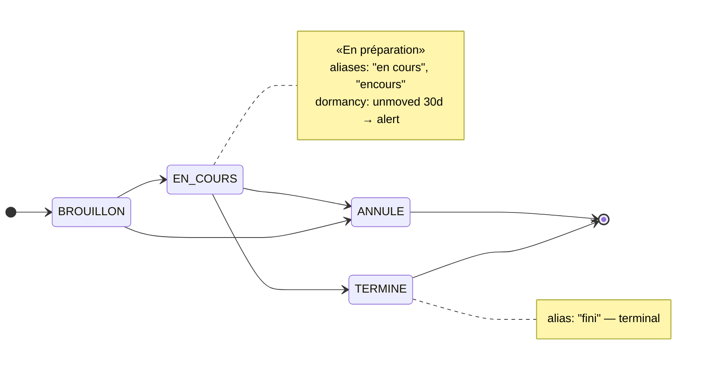

# kind: Workflow — declare

> The fourth rung: a **declarative document lifecycle** over a status column ingestion already
> landed — states, aliases for the spellings the source really uses, the transition graph, and a
> threshold past which a document that has not moved is a decision.

| | |
|---|---|
| **Kind** | `Workflow` — `apps.lumnik.io/v1` |
| **Over** | one column of one table: a raw `connector.t_*`, or a fused `connector.v_*` (dormancy there needs `spec.on.order`) |
| **Declares** | states with aliases, transitions, `provenance: declared`; optionally a business key and a dormancy threshold |
| **Produces** | a report at apply on what the data holds, and after each import when asked (`workflow.undeclared.<name>`); answers in the chat (Pro); `decision.dormant.<name>` and `decision.overdue.<name>` alerts, and an observation tape, when watched |
| **Commands** | `lm workflow apply` · `list` · `get` · `disable` · `enable` · `rm` — `lm_integrator`, scope-bound; one lifecycle per column |
| **Edition** | Open |

Legacy exports carry dirty statuses — `En cours`, `encours`, `fini`, `TERMINE ` with a trailing
space. A workflow declares what they mean, so the chat answers lifecycle questions from a
declared graph instead of inventing one.

## Features

- **[Dirty values resolve to declared states.](#alias-semantics)** Alias matching is trim and
  case-insensitive.
- **[A data-truth report that never blocks.](#the-data-truth-report-never-blocks)** Apply
  compares the declaration with the column — undeclared values, unobserved codes, blanks — and
  stores the manifest either way.
- **[The same check after each import.](#after-each-import-speccheck)** `spec.check.trigger: ingestion`
  re-checks the column when a run writes it, and a value no report named raises
  `workflow.undeclared.<name>`.
- **[Grounded answers](#what-the-chat-answers-from-it) (Pro).** The chat answers lifecycle
  questions from the declared graph.
- **[Dormancy.](#dormancy-the-memory-of-the-breathing)** A key and a threshold turn the
  declaration into a watch: a document unmoved in a non-terminal state past the threshold is a
  `decision.dormant.*` in the inbox.
- **[A tape that outlives the alert.](#reading-the-tape)** Every watched document's state, since
  when, and whether it alerted.
- **[One column, one lifecycle.](#one-column-one-lifecycle)** A second lifecycle on the same
  column is refused, naming the first.

## Quickstart

!!! note "Every screen on this page reads the demo desk that ships with the repo"
    An order book whose `status` column carries seven spellings and one blank, under
    `docs/apps/demo/`. Land it first — [The demo desk](demo-desk.md#landing-the-sources) has the
    commands and the hand count. The screens below start on **day 1**.

```yaml
--8<-- "docs/apps/demo/workflows/10-order-lifecycle.yaml"
```

The same manifest, as the graph it declares:



`lm workflow apply` prints what it stored, then the report: one line per disagreement between the
declaration and the data. With `-o json`, the hub's answer: the report is under `dataTruth`.

```
$ lm workflow apply -f docs/apps/demo/workflows/10-order-lifecycle.yaml
Applied workflow "acme-order-lifecycle" → connector.t_acme_desk_orders.status, scope desk
  in the data, not declared: EN LITIGE (2 rows), Terminé (1 row)
  declared, not in the data: ANNULE
  status null or blank: 1 row
$ lm workflow list
NAME                  TABLE                         COLUMN  SCOPE  ENABLED
acme-order-lifecycle  connector.t_acme_desk_orders  status  desk   true
```

One `200`, stored and indexed, with what the declaration and the data disagree on:

- `EN LITIGE` sits on two orders and nobody declared it; `Terminé` (with its accent) on one;
- `ANNULE` is declared and no order has reached it;
- one order has no status at all.

`EN LITIGE` is deliberately **not** in the graph: it stays visible in the report, and the
[dormancy sweep](#an-undeclared-value-can-never-be-terminal) still watches it.

## The manifest

| Field | Required | Meaning |
|---|---|---|
| `metadata.name` | yes | kebab-case identifier (`[a-z0-9-]+`) — the name `apply` updates under, and the alert's `decision.dormant.<name>` |
| `spec.scope` | yes | the business scope the lifecycle belongs to; must be a **discovered** scope — [below](#the-scope-must-exist-the-table-need-not) |
| `spec.provenance` | yes | **must be `declared`** — the only accepted value; the chat cites it |
| `spec.on.table` | yes | the table to watch — an ingest table (`connector.t_<table>`) or a fused entity view (`connector.v_<entity>`, always lower-case) |
| `spec.on.column` | yes | the column whose values this taxonomy explains — **whatever the source called it** |
| `spec.on.key` | no (required by `dormancy` and `due`) | the business key linking a document's successive versions |
| `spec.on.order` | no (required by `dormancy` on a fused view) | the column ordering a document's versions: a date, a timestamp, a number, or ISO 8601 text with `Z` or an offset — requires `spec.on.key`, [below](#the-current-version-speconorder) |
| `spec.check.trigger` | no | `ingestion`: re-check the declaration after each completed run that writes `spec.on.table` — [below](#after-each-import-speccheck). The apply always checks; any other value is refused |
| `spec.dormancy.after` | no (required by `dormancy`) | the sweep threshold, `[0-9]+[mhd]` (`30d`) — requires `spec.on.key`, and `spec.on.order` on a fused view |
| `spec.dormancy.message` | no | the alert text, in the team's language: `{doc_key}`, `{state}`, `{state_label}`, `{since}`, `{first_observed_at}`, `{threshold}`, `{workflow}`; any other `{name}` is a column of `spec.on.table`, checked at apply when the table exists — [what a decision carries](#what-a-decision-carries). Absent: the English default [below](#the-alert-verbatim) |
| `spec.dormancy.fields` | no | columns of `spec.on.table` sent in the payload's `fields` and not in the sentence (`[owner_email]`) |
| `spec.due.column` | no (required by `due`) | the column whose date is the document's deadline — an ingest table or a fused view |
| `spec.due.states` | no (required by `due`) | the declared, **non-terminal** state codes in which a passed date makes the document overdue (`[CONFIRMED]`); an alias, an undeclared or a terminal state is refused |
| `spec.due.zone` | no | the time zone a date-only column is read in (`Europe/Paris`): due at the end of that day there. Absent: `UTC`. An unknown zone is refused |
| `spec.due.message` | no | the alert's sentence: `{doc_key}`, `{state}`, `{state_label}`, `{due}`, `{workflow}`; any other `{name}` is a column of `spec.on.table`, checked at apply when the table exists |
| `spec.due.fields` | no | columns of `spec.on.table` sent in the payload's `fields` and not in the sentence |
| `spec.states[]` | yes (≥ 1) | the declared states |
| `spec.transitions[]` | no | the allowed edges of the graph |

**`states[]`** — `code` (required; unique, case- and trim-insensitive), `label`, `aliases[]` (the
dirty spellings that resolve to this code), `initial` (**exactly one** state must set it `true`),
`terminal` (a terminal state may carry no outgoing transition).

**`transitions[]`** — `from[]` (one edge can fan in from several states) and `to`.

An unknown key is refused, at every level:

```
$ lm workflow apply -f docs/apps/demo/workflows/67-refused-unknown-key.yaml
Error: API error 400: unknown key(s) in the manifest: spec.after — kind:Workflow honors root {apiVersion, kind, metadata, spec}, metadata {name}, spec {check, dormancy, due, on, provenance, scope, states, transitions}, spec.on {column, key, order, table}, spec.check {trigger}, spec.dormancy {after, fields, message}, spec.due {column, fields, message, states, zone}, states[] {aliases, code, initial, label, terminal}, transitions[] {from, to}
```

### The scope must exist, the table need not

`spec.scope` must be a discovered scope; an unknown one is a `404`, as for a process:

```
$ lm workflow apply -f docs/apps/demo/workflows/65-refused-unknown-scope.yaml
Error: API error 404: no schema for scope 'dsk' — run discovery first
```

The table is **not** checked: you may declare a lifecycle before ingesting the data. The report
then says `the table is not there yet`.

### Names the source chose

`on.column` and `on.key` are the names **your source** uses, copied as they are — a Kafka
message's JSON keys become columns verbatim:

```yaml
on:
  table: connector.t_Commandes
  column: "Statut Commande"
  key: "N° Commande"
```

Quote them in the YAML if they contain spaces or punctuation; the hub adds the SQL quotes.

`on.table` must be a table ingestion owns — `connector.t_<table>`, or `connector.v_<entity>` —
spelled the way the hub created it (a connector's target keeps your capitals, a fused view is
lower case, neither contains a space). Anything else is refused, the hub's own tables included:

```
$ lm workflow apply -f docs/apps/demo/workflows/66-refused-foreign-table.yaml
Error: API error 400: spec.on.table is required and must name a table in the 'connector' schema that ingestion owns (connector.t_<table>) or a fused entity view (connector.v_<entity>, always lower-case), spelled the way the hub created it (letters, digits and underscores — a space is a typo): identity.app_user
```

A fused view carries a **taxonomy** as it is. A `dormancy` on one needs `spec.on.order`, because a
view has no ingest order: [the current version](#the-current-version-speconorder).

### One column, one lifecycle

A *different* name declaring an already-declared `on.table` + `on.column` is refused, naming the
holder:

```
$ lm workflow apply -f docs/apps/demo/workflows/64-refused-same-column.yaml
Error: API error 400: column connector.t_acme_desk_orders.status already has a declared lifecycle: workflow 'acme-order-lifecycle' — a column has exactly one lifecycle; re-apply under the name 'acme-order-lifecycle' to update it
```

`apply` on the same name **is** the update. The rule is per tenant.

## Alias semantics

Alias and code matching is **trim + case-insensitive**: `"TERMINE "`, `"fini"`, `"En cours"` all
resolve. On the demo desk, day 1:

| Status as written | Rows | Resolves to |
|---|---|---|
| `En cours`, `encours` | 4 | `EN_COURS` |
| `fini`, `TERMINE ` | 2 | `TERMINE` |
| `BROUILLON` | 2 | `BROUILLON` |
| `EN LITIGE` | 2 | **undeclared** |
| `Terminé` | 1 | **undeclared** — an accent is not an alias anyone declared |
| *(empty)* | 1 | `nullOrBlank` |

Contradictions in the declaration are refused:

```
$ lm workflow apply -f docs/apps/demo/workflows/61-refused-alias-collision.yaml
Error: API error 400: alias 'en_cours' on state BROUILLON collides with state code
$ lm workflow apply -f docs/apps/demo/workflows/60-refused-two-initial.yaml
Error: API error 400: exactly one state must be initial: true (found 2)
$ lm workflow apply -f docs/apps/demo/workflows/62-refused-terminal-outgoing.yaml
Error: API error 400: terminal state 'TERMINE' has an outgoing transition
```

- an alias that **collides with a state code**;
- an alias **declared on two different states**;
- not **exactly one** `initial: true`;
- a `terminal: true` state with an outgoing transition.

## The data-truth report — never blocks

`apply` stores the manifest first, then compares it with what the column contains. The
comparison never becomes a refusal. Read three lines:

| Line | `-o json` field | Means | On the demo desk (day 1) |
|---|---|---|---|
| `in the data, not declared` | `undeclared` | values in the data that no state declares, each with its row count | `EN LITIGE` ×2, `Terminé` ×1 |
| `declared, not in the data` | `unobserved` | declared states never seen in the data | `ANNULE` |
| `<column> null or blank` | `nullOrBlank` | rows with no status | `status null or blank: 1 row` |

Nothing to report: `the data matches the declaration`.

??? note "The other lines"
    | Line | `-o json` field | Means |
    |---|---|---|
    | `the table is not there yet` | `tableMissing` | the table does not exist yet |
    | `spec.on.key: the table has no such column` | `keyColumnMissing` | `spec.on.key` names a column the table does not have |
    | `key null or blank` | `keyNullOrBlank` | rows with no key: the dormancy watch skips them |
    | `spec.due.column …` | `dueProblem` | why `spec.due.column` cannot give a deadline; `null` when it can |
    | `spec.on.order: N rows with no valid order, their documents are never watched` | `invalidOrderValues` | rows whose order value cannot place them; `null` without `spec.on.order` |
    | `N keys hold several rows: declare spec.on.order to pick one` | `keysWithSeveralRows` | a due date over a view without `spec.on.order`: the sweep reads every one of those rows |
    | `not verified until the table exists: …` | `columnsUnverified` | the declared columns an absent table left unchecked |
    | `the data could not be checked` | `checkUnavailable`, `unavailableReason` | the comparison could not run: the other fields are empty, **not** "the data agrees". Re-apply once fixed |

    The comparison reads the 200 most frequent values: a rare undeclared value can be missed.

## After each import — `spec.check`

The report above is computed when you apply. Without more, a spelling that the next night's export
brings stays unseen until someone re-applies. `spec.check.trigger: ingestion` runs the same comparison after
each completed run that writes `spec.on.table`:

```yaml
spec:
  on:
    table: connector.t_orders
    column: status
  check:
    trigger: ingestion
```

- A value that no earlier report named raises **one** `workflow.undeclared.<name>` event.
- What the last apply reported is not said again: you have read it. A value still undeclared on the
  next run is not said twice.
- A re-apply resets what is known to its own report. A value the new declaration covers is forgotten,
  and is news again if a later declaration drops it.
- A failed or cancelled run checks nothing. A fused view (`connector.v_*`) is checked after a run that
  writes a table its entity fuses or looks up.

The event reaches what you subscribe to it, like any other: `lm integration add --events 'workflow.undeclared.*'`
or an e-mail rule ([Outputs](../outputs.md)). It never appears in the inbox, which holds `decision.*` only.
Its payload:

| Field | Meaning |
|---|---|
| `message` | `1 new value of connector.t_orders.status matches no state of workflow orders-status — declare it as an alias, or correct the source`. It counts the values and never quotes them |
| `workflow`, `table`, `column` | what was checked |
| `values` | the new values, each `{value, rows}` |
| `undeclared` | how many undeclared values the column holds now, new or not |
| `null_or_blank` | rows with no status |
| `run_id` | the run that triggered the check |

The comparison costs one `GROUP BY` on the column per completed run of the table. On a large table
imported every minute, that is one aggregate a minute.

## What the chat answers from it

**lumnik Pro.** Two gestures, two kinds of answer:

| You ask with | It answers about |
|---|---|
| `lm chat`, then `:scope desk` | the **lifecycle**: states, aliases, transitions |
| `lm ask --scope desk "…"`, the PWA's Chat tab | the **rows**: a document's current status |

The lifecycle, asked in the chat:

```
$ lm chat
[corpus=* scope=default topK=10] > :scope desk
scope → desk

[corpus=* scope=desk topK=10] > quels sont les états d une commande et quelles transitions sont autorisées ?
Les états d'une commande sont :

* Brouillon
* En cours
* Terminée (ou finie)
* Annulée

 Les transitions autorisées entre ces états sont :

* Du brouillon vers l'état en cours ou l'état annulé
* De l'état en cours vers l'état annulé ou le terme
```

Every transition it names is declared. The wording varies from one run to the next; the states
and transitions must match the manifest. The chat does not know which state an order is in. `lm ask`
does:

```
$ lm ask --scope desk "Dans quel statut est la commande SO-000004 ?"
La commande SO-000004 est en statut "BROUILLON".
  data as of: 2026-10-16T08:43:46.474408Z (last completed run)

  STATUS
  BROUILLON
  1 row returned

  SQL: SELECT status FROM "connector"."t_acme_desk_orders" WHERE order_no = 'SO-000004'
LIMIT 500
```

## Dormancy — the memory of the breathing

A legacy status is overwritten in place: the raw table says an order *is* `EN_COURS`, not since
when. A scheduled sweep records each document's state from the moment lumnik starts watching,
and alerts when one has sat unmoved, in a non-terminal state, past the declared threshold.

- Two fields switch it on: `spec.on.key` (`order_no` — links a document's successive rows) and
  `spec.dormancy.after` (`30d`, any `[0-9]+[mhd]`).
- The sweep runs every 15 minutes (`lumnik.workflow.sweep.every`,
  [Observability](../operations/observability.md#scheduled-background-work)).
- **The clock starts at lumnik's first sighting**, not at the real stall: declare `after: 14d`
  today over orders stuck for weeks, and the earliest alert is in fourteen days.

```
$ lm workflow apply -f docs/apps/demo/workflows/63-refused-dormancy-no-key.yaml
Error: API error 400: spec.dormancy requires spec.on.key (dormancy is per-document; the key links a document's versions)
```

The tape after the first sweep that saw the desk (day 1):

```
$ lm observations list
WORKFLOW              DOC        STATE      SINCE             ALERTED
acme-order-lifecycle  SO-000001  EN_COURS   2026-10-19 01:51  
acme-order-lifecycle  SO-000002  TERMINE    2026-10-19 01:51  
acme-order-lifecycle  SO-000003  TERMINE    2026-10-19 01:51  
acme-order-lifecycle  SO-000004  BROUILLON  2026-10-19 01:51  
acme-order-lifecycle  SO-000005  EN_COURS   2026-10-19 01:51  
acme-order-lifecycle  SO-000006  EN LITIGE  2026-10-19 01:51  
acme-order-lifecycle  SO-000007  EN_COURS   2026-10-19 01:51  
acme-order-lifecycle  SO-000008  Terminé    2026-10-19 01:51  
acme-order-lifecycle  SO-000010  EN LITIGE  2026-10-19 01:51  
acme-order-lifecycle  SO-000011  BROUILLON  2026-10-19 01:51  
acme-order-lifecycle  SO-000012  EN_COURS   2026-10-19 01:51  
$ lm observations stats
WORKFLOW              WATCHED  DORMANT  MEDIAN_DETECTION_S
acme-order-lifecycle  11       0        -
```

SO-000009 is absent: it has no status, so there is no state to watch. The states are the
**resolved** codes where an alias matched (`fini` reads `TERMINE`), the raw value where none did.

For the next screens the threshold was shortened to `after: 1m` and the manifest re-applied
under the same name (the shipped file keeps `30d`). Then **day 2** was loaded:

```bash
docker compose -f docker-compose.selfhost.yml cp docs/apps/demo/data/acme-orders-day2.csv hub:/tmp/acme-desk/acme-orders.csv
lm connector run acme-desk-orders
```

Two ticks later:

```
$ lm observations list
WORKFLOW              DOC        STATE      SINCE             ALERTED
acme-order-lifecycle  SO-000001  EN_COURS   2026-10-19 01:51  2026-10-19 02:06
acme-order-lifecycle  SO-000002  TERMINE    2026-10-19 01:51  
acme-order-lifecycle  SO-000003  TERMINE    2026-10-19 01:51  
acme-order-lifecycle  SO-000004  BROUILLON  2026-10-19 01:51  2026-10-19 02:06
acme-order-lifecycle  SO-000005  EN_COURS   2026-10-19 01:51  2026-10-19 02:06
acme-order-lifecycle  SO-000006  EN LITIGE  2026-10-19 01:51  2026-10-19 02:06
acme-order-lifecycle  SO-000007  EN_COURS   2026-10-19 01:51  2026-10-19 02:06
acme-order-lifecycle  SO-000008  Terminé    2026-10-19 01:51  2026-10-19 02:06
acme-order-lifecycle  SO-000010  EN LITIGE  2026-10-19 01:51  2026-10-19 02:06
acme-order-lifecycle  SO-000011  BROUILLON  2026-10-19 01:51  2026-10-19 02:06
acme-order-lifecycle  SO-000012  EN_COURS   2026-10-19 01:51  2026-10-19 02:06
acme-order-lifecycle  SO-000013  EN LITIGE  2026-10-19 02:06  2026-10-19 02:21
$ lm observations stats
WORKFLOW              WATCHED  DORMANT  MEDIAN_DETECTION_S
acme-order-lifecycle  12       10       900
```

- **Ten alerts**: nine at the first tick past the threshold, then `SO-000013` — new on day 2,
  first seen at 02:06 — one tick later.
- The two `TERMINE` orders never alert: a terminal state is excluded.
- `SO-000008` **does** alert: `Terminé`, with its accent, matched no alias, and [an undeclared
  value can never be terminal](#an-undeclared-value-can-never-be-terminal).
- The median detection delay is 900 s — one sweep interval, the floor.

What each alert says, in the inbox:

```
$ lm inbox --limit 3
ID  WHEN      PROCESS                        MESSAGE                                                                                                                                  ENTITY_KEY
47  just now  workflow:acme-order-lifecycle  SO-000013: observed unmoved in "EN LITIGE" since 2026-10-19 (first observed 2026-10-19) — declared threshold 1m in acme-order-lifecycle  SO-000013
46  15min     workflow:acme-order-lifecycle  SO-000012: observed unmoved in "EN_COURS" since 2026-10-18 (first observed 2026-10-18) — declared threshold 1m in acme-order-lifecycle   SO-000012
45  15min     workflow:acme-order-lifecycle  SO-000011: observed unmoved in "BROUILLON" since 2026-10-18 (first observed 2026-10-18) — declared threshold 1m in acme-order-lifecycle  SO-000011
note: result hit the limit of 3 — there may be more
```

`ENTITY_KEY` is the business key. The wording names the date lumnik started watching, the date
it first saw the document and the declared threshold — never how long the order sat in the ERP.
The message's dates are UTC, while `lm observations list` shows your terminal's time zone: the
01:51 (Paris) sighting was 23:51 UTC the day before.

## Due date — a deadline the data carries

Dormancy counts from the day lumnik first saw a document. A due date counts from a date the data
carries: a delivery promised for 20 October, still on the road on the 24th, is late.

The desk's carrier export holds a promised date per delivery:

```csv
--8<-- "docs/apps/demo/data/acme-deliveries.csv"
```

**Type the date at the door.** A CSV column is text, and a due date must be a date. The connector
types it with [`parse-date`](../connectors/transformers.md#parse-date-dates-are-31122019):

```yaml
  mapping:
    cell:
      - parse-date: { column: promised_on, formats: ["yyyy-MM-dd"] }
```

Without it, the apply says so, and no alert is ever raised:

```
  spec.due.column promised_on is text, not a date: no deadline can be read from it
```

The workflow declares the deadline:

```yaml
--8<-- "docs/apps/demo/workflows/20-delivery-lifecycle.yaml"
```

```
$ lm connector run acme-desk-deliveries
$ lm workflow apply -f docs/apps/demo/workflows/20-delivery-lifecycle.yaml -o json | jq -r .dataTruth.dueProblem
null
$ lm inbox --type decision.overdue.acme-delivery-lifecycle
ID  WHEN      PROCESS                           MESSAGE                                                       ENTITY_KEY
66  just now  workflow:acme-delivery-lifecycle  Livraison DL-1 promise pour le 2026-10-20, toujours en route  DL-1
```

- **DL-1** is late: promised for 20 October, still `EN_ROUTE`. `DL-2` is delivered. `DL-3` is
  promised for 2030. `DL-4` has no date. None of them alerts.
- The check runs every 15 minutes, like dormancy: the alert lands in the inbox within that time.
- **One alert per deadline.** A date moved to another past day alerts again; a date moved to the
  future waits.
- `zone` says where the deadline falls: a date passes at the end of that day in `zone`. Without
  `zone`, UTC.
- A fused entity view is accepted. With several rows per key, declare `spec.on.order`: without it the
  sweep reads every row, and the apply report counts the keys concerned.
- Files: `data/acme-deliveries.csv`, `sources/80-deliveries.yaml`,
  `workflows/20-delivery-lifecycle.yaml`, landed like the [demo desk](demo-desk.md#landing-the-sources).

## The current version — `spec.on.order`

A sweep needs one version per document. On an ingest table it takes the last one ingested. That is
wrong when the source sends events out of order, as Kafka can, and impossible on a fused view, which
has no ingest order and may hold one row per event. `spec.on.order` names the column that orders a
document's versions:

```yaml
spec:
  on:
    table: connector.v_freezerdoorevent
    column: door_state
    key: door_incident_id
    order: occurred_at
  dormancy:
    after: 1m
```

| Watched | Without `order` | With `order` |
|---|---|---|
| `connector.t_*` | the last version ingested | the greatest `order` value; ingestion breaks a tie |
| `connector.v_*`, dormancy | refused at apply | the greatest `order` value; a tie follows the rule below |
| `connector.v_*`, due date | every row, as before | the greatest `order` value; a tie follows the rule below |

**The column.** A date, a timestamp or a number orders as itself, when it is finite: `NaN` and
`infinity` are no position. Text must be an ISO 8601 instant with an explicit offset, and is
compared as an instant, never as text:

- read: `2026-10-26T10:00:00Z`, `2026-10-26T10:00:00.123Z`, `2026-10-26T11:00:00+01:00`;
- never read: `2026-10-26T10:00:00` (no zone), `2026-10-26` (a date, not an instant), `01/07/2026`, a blank.

`2026-10-26T12:00:00+03:00` is `09:00Z`: it comes before `2026-10-26T10:00:00Z`. Two offsets of one
instant are a tie.

**A tie on a view.** When the latest rows of one document disagree on the state, or on the deadline
for a due date, the document is ambiguous: nothing is decided about it. When they agree, one row is
picked by the view's canonical key. That pick is deterministic, not "the latest".

**Unreadable documents.** A document with one version whose order value is invalid or empty is not
watched: lumnik cannot tell which version is current, and a bad date must never make an older state
current. It raises nothing, its `SINCE` restarts on every sweep while it stays unreadable, and its
history stays on the tape. When it is readable again, its clock runs from there.

On an ingest table, a later valid version does not clear the bad one: the table keeps every version.

```text
OPEN    2026-10-26T10:00:00Z
CLOSED  not-a-date
CLOSED  2026-10-26T10:05:00Z     ← the document stays unreadable
```

Correct or remove the malformed source row, or rebuild the table from a corrected full export. The
hub log names the documents: `dormancy: 1 documents of tenant 1 workflow … are not watched: a version
has no valid spec.on.order value — correct or remove the malformed source rows (e.g. DOOR-17)`. It says
so again only when their number changes.

**What it costs.** At apply, the report reads the whole table to count the invalid values. On a fused
view, every sweep computes the view once and ranks it: about 2 seconds for 100,000 documents, on top of
the observations it writes.

## What a decision carries

A dormancy or due decision can say where the document is and who must act. A `{name}` its message
does not reserve is a column of `spec.on.table`, read from the very version the decision is about;
on a fused view, that includes the columns its entity joins. `fields` lists columns the payload
carries and the sentence does not:

```yaml
spec:
  on:
    table: connector.v_freezerdoorevent
    column: door_state
    key: door_incident_id
    order: occurred_at
  dormancy:
    after: 1m
    message: "{freezer_id} ({laboratory}): door {state} since {since}. Owner: {owner}"
    fields: [owner_email]
```

```text
FZ-17 (Cryobiology Lab): door OPEN since 2026-10-26. Owner: Dr. Lina Moreau
```

The payload keeps its usual keys and gains `fields`: each cited or declared column, once, with its
value.

- **A reserved name wins in the sentence.** With `message: "{doc_key} is still {state}"` and
  `fields: [state]`, `{state}` is the workflow's resolved state (`OPEN`) and `fields.state` is the
  raw value of a source column named `state` (`open `). The two differ by design.
- An empty value renders as nothing in the sentence and stays `null` in `fields`. A timestamp is
  its UTC instant in both. A number loses its trailing zeros in the sentence (`-67.4`); `fields`
  keeps it as the column holds it (`-67.4000`). A [Process](processes.md) decision does the same.
- The order of the keys in `fields` is not part of the contract: the event log stores the payload
  as `jsonb`.
- Without a cited column or `fields`, the payload is exactly what it was before.
- At apply, a cited or declared name the table lacks is refused, naming it. A sentence's refusal
  also lists the reserved names, in case one was misspelt (`{sinse}`). A table not ingested yet is
  not checked: the report says `not verified until the table exists`, with the names.
- A cited column the table no longer has, after an entity re-apply, renders empty: the alert still
  fires, and the hub log says so once (`… cites owner, which … no longer has: it renders empty`).
  Stop citing it and cite it again while it is still missing: the log says it again. So does a
  workflow disabled or deleted, then applied again.

!!! warning "Who receives `fields`"
    Fields included in a decision payload can leave the hub through tenant-wide webhooks, e-mail
    rules and the administrative event stream. Declare only the columns those outputs may receive.
    The inbox shows a decision to the workflow's scope; the event itself carries no scope.

## Applying it

```bash
lm workflow apply -f docs/apps/demo/workflows/10-order-lifecycle.yaml
lm workflow list
lm workflow get acme-order-lifecycle      # the stored manifest, verbatim, comments included
lm observations list                      # the tape: what has not moved, stillest first
lm observations stats                     # per workflow: watched, dormant, median detection delay
lm inbox                                  # where decision.dormant.<name> lands
```

Turn it off, or remove it:

```
$ lm workflow disable acme-order-lifecycle
workflow acme-order-lifecycle enabled=false
$ lm workflow list
NAME                  TABLE                         COLUMN  SCOPE  ENABLED
acme-order-lifecycle  connector.t_acme_desk_orders  status  desk   false
$ lm workflow enable acme-order-lifecycle
workflow acme-order-lifecycle enabled=true
$ lm workflow rm acme-order-lifecycle
workflow acme-order-lifecycle deleted
$ lm workflow rm acme-order-lifecycle
Error: API error 404: unknown workflow: acme-order-lifecycle
```

`disable` stops the sweep (no new alerts) and removes the lifecycle from chat, keeping the
manifest and the tape; `enable` restores both. `rm` removes it for good, with no prompt — its
tape too (`lm observations stats` no longer lists it). Each gesture, and every apply, is recorded in the [audit trail](../security/index.md#the-audit-trail).

| Command | Role | Scope-bound |
|---|---|---|
| `lm workflow apply`, `list`, `get`, `disable`, `enable`, `rm` | `lm_integrator` | yes — outside your grants, `403 scope not granted`; `list` shows only your scopes |
| `lm observations list`, `stats` | `lm_integrator` **and** `lm_admin` (or `lm_superadmin`) | yes — they list only the workflows of your scopes |

## How to…

### Declare the lifecycle a legacy status column already has

```bash
lm workflow apply -f docs/apps/demo/workflows/10-order-lifecycle.yaml
lm workflow get acme-order-lifecycle
```

**Result:** the manifest is stored and indexed in one `200`, with the data-truth report. The
semantic chat in that scope now answers transition questions from the declared graph.

### Get told when a document stops moving

The demo manifest already carries `spec.on.key` and `spec.dormancy.after`: applying it switches
the sweep on. Alerts land in `lm inbox` (and the PWA's *Inbox* tab) for users holding the
workflow's scope and for users with no `scope:` role. To push them to an external system,
`lm integration add` ([Processes](processes.md#delivery-is-opt-in)).

**Don't treat the inbox as a register of everything asleep.** A document alerts once per stall,
and the alert ages out with the event log (30 days by default). The tape keeps it — see
[Re-alert semantics](#re-alert-semantics).

### Add the value the report says nobody declared

The report named `EN LITIGE` (`in the data, not declared`). Add it as a state (or an alias of one) and re-apply
under the same name. **Result:** the report no longer lists it, the chat knows what it means, and
the sweep watches it as a declared state. The documents the tape held as `EN LITIGE`, and the source still
holds, read the declared code from the next tick; a meaning is not a movement, so their `SINCE`, their alert and
the transition journal stay as they were.

### Get told when a new spelling arrives

Add `check: { trigger: ingestion }` under `spec` and re-apply. **Result:** the apply reports what is undeclared
today; each later run that brings a value nobody declared raises `workflow.undeclared.<name>`, once.

## From a proposal dossier

A business person can describe a problem on lumnik.fr and download a **proposal dossier**. Turning
it into a workflow, and checking it against your data: [Proposal dossiers](proposal-dossier.md).

## Troubleshooting

| Symptom | Cause | Gesture |
|---|---|---|
| apply refused: `unknown key(s) in the manifest: …` | a misspelled or misplaced field | the message lists what `kind:Workflow` honors, level by level |
| apply refused `404`: `no schema for scope '…' — run discovery first` | `spec.scope` is not a discovered scope | `lm source rediscover --scope <tag>` (`lm_integrator` + `lm_admin`, a scope you hold), then re-apply |
| apply refused: `column … already has a declared lifecycle: workflow '…'` | a *different* name declares this `on.table` + `on.column` | re-apply under the existing name, or point at a different column |
| apply refused: `column … already has a declared lifecycle, in a scope you do not hold` | the same, in a scope you do not hold | ask the integrator who owns that scope |
| apply refused: `spec.dormancy requires spec.on.key …` | `spec.dormancy.after` without `spec.on.key` | add `spec.on.key` |
| apply refused: `spec.dormancy on a fused view needs spec.on.order …` | `on.table` is a `connector.v_*` view with `spec.dormancy` | add `spec.on.order`, the column that orders a document's versions |
| apply refused: `spec.on.order … is not a column of …` | the table exists and has no such column | name a column it has |
| apply refused: `spec.on.order … is boolean: a date, a timestamp, a number, or ISO 8601 text with an offset can order versions` | a column of another type | order by a date, a timestamp, a number or an ISO 8601 text column |
| apply refused: `spec.on.table … must name a table in the 'connector' schema that ingestion owns` | another schema, or one of the hub's own tables | `connector.t_<the connector's target>` |
| apply refused: `alias '…' … collides with state code` / `exactly one state must be initial` / `terminal state '…' has an outgoing transition` | a contradiction in the declaration | fix the graph |
| apply refused: `spec.check.trigger must be 'ingestion' …` | another trigger, `apply` included: the apply always checks | write `ingestion`, or drop `spec.check` |
| apply refused: `spec.due requires spec.on.key …` | `spec.due` without `spec.on.key` | add `spec.on.key` |
| apply refused: `spec.due.states names …` | an alias, an undeclared or a terminal state, or one named twice | name the declared, non-terminal codes once |
| apply refused: `spec.due.zone has no effect on …` | a `zone` over a `timestamptz` column | drop `spec.due.zone` |
| due date declared, but no alert ever arrives | the column is missing or not a date | the apply report names it: `spec.due.column …` |
| dormancy declared, but no alert ever arrives | `spec.on.key` names a column the table does not have | the apply report says `spec.on.key: the table has no such column` |
| a document stuck for weeks does not alert on day one | the threshold counts from lumnik's first sighting | wait `after` from the apply date; `lm observations list` shows `SINCE` |
| a document is missing from `lm observations list` | its key or its status is `NULL` or blank | fix it at the source; the apply report counts them: `key null or blank`, `<column> null or blank` |
| with `spec.on.order`, a document's `SINCE` keeps restarting and it never alerts | one of its versions has no valid order, or its latest versions disagree | the hub log names it (`… are not watched: …`); correct or remove the source row |
| apply refused: `spec.dormancy.message references {…} — not a column of …` (or `spec.due.message`) | the message cites a column the table does not have | fix the name, or use a reserved one |
| apply refused: `spec.dormancy.fields names … — not a column of …` (or `spec.due.fields`) | a declared field the table does not have | fix the name, or drop it |
| a decision's sentence has an empty gap where a column was | the column left the table after apply | the hub log names it (`… cites …, which … no longer has`); re-ingest, or re-apply without it |
| apply refused: `spec.on.order requires spec.on.key …` | an order with no key | add `spec.on.key`: the order sorts the versions of the document the key names |
| a status value never shows up in chat answers | undeclared | the apply report lists it under `in the data, not declared`; add it, re-apply |
| `lm ask` abstains on a "why can't I close it" question | `lm ask` reads the rows, not the lifecycle | `lm chat` with the scope |
| `403 … scope not granted` | you do not hold the `spec.scope` role | ask for that `scope:` role |
| `API error 403 (forbidden): no details from the server` | you lack `lm_integrator`, or `lm_admin` for `lm observations` | ask your administrator; no `lm` command lists your roles (`GET /api/bff/v1/me` returns them under `roles`) |

## See also

- [The demo desk](demo-desk.md) — the order book every screen here reads
- [Processes](processes.md) — react to a row landing
- [Inbox](inbox.md) — where a `decision.dormant.<workflow>` alert surfaces
- [CLI & TUI reference](../cli/lm-reference.md) — `lm observations list` and the `:observations` screen
- [Ask & honesty](../transparency/ask-honesty.md) — the abstention contract a grounded answer serves

## Advanced: the sweep in detail

??? note "What the sweep skips, the alert's wording, re-alerts, the tape, and scale"

    ### What the sweep does not see

    A document with a `NULL` or blank **key**, or a `NULL` or blank **status**, is skipped —
    permanently: there is nothing to follow it by, or no state to watch (`SO-000009` on the demo
    desk). The apply report counts both: `key null or blank` and `status null or blank`.

    ### The alert, verbatim

    From the demo desk, with `dormancy.after` shortened to `1m`:

    ```
    SO-000004: observed unmoved in "BROUILLON" since 2026-10-18 (first observed 2026-10-18) — declared threshold 1m in acme-order-lifecycle
    ```

    The default shape — `<key>: observed unmoved in "<state>" since <date> (first observed <date>)
    — declared threshold <after> in <workflow>` — never asserts how long the document sat in the
    source. It is emitted as `decision.dormant.<workflow>` and appears in the [inbox](inbox.md) as
    `workflow:<workflow>`.

    A workflow writes the sentence in the team's language with `spec.dormancy.message`:

    ```yaml
    dormancy:
      after: 14d
      message: "{doc_key} : immobile en « {state_label} » depuis le {since} — seuil {threshold}"
    ```

    `{state_label}` is the state's declared `label` (its code when the state is undeclared); dates
    are the UTC day. Any other `{name}` is a column of the watched table:
    [what a decision carries](#what-a-decision-carries).

    ### Re-alert semantics

    A document alerts **once** per stall. It alerts again only after it moved (a new state resets
    its clock) and then sat unmoved past the threshold once more.

    | | |
    |---|---|
    | **A permanently stuck document** | alerts once; the alert leaves `lm inbox` with the event retention (`lumnik.events.retention-days`, 30 by default) |
    | **What to do** | ack the alert into your own tracker, or raise `lumnik.events.retention-days` beyond your review cadence |
    | **What stays** | the tape: `lm observations list` keeps `ALERTED` until the document moves |

    ### Reading the tape

    `lm observations list` — the watched documents of every workflow in your scopes, **stillest
    first** (`--workflow`, `--limit`: default 200, at most 1000). `SINCE` is when lumnik started observing that
    state; `ALERTED` is empty until the sweep alerts. `lm observations stats` sums it up per workflow. The TUI's
    `:observations` screen shows the same, with humanized ages. Both need `lm_admin` (or
    `lm_superadmin`) on top of `lm_integrator`.

    `lm observations transitions` reads the journal: every observed move, **newest first**
    (`--workflow`, `--doc`, `--limit`). `IN_FROM_S` is the seconds the document spent in `FROM`,
    from `ENTERED` — its previous move, or its first observation for its first one (a lower bound,
    like `SINCE`). Moves are seen at sweep granularity: a document that moved twice between two
    ticks shows one move.

    ### Scale

    - On a table with millions of documents, lengthen `lumnik.workflow.sweep.every` (15 minutes by
      default).
    - The tape is kept until `lm workflow rm`.
    - A workflow whose table is gone is skipped, and comes back by itself when the table returns.
      The other workflows are never affected. The hub log names the workflow.

    ### An undeclared value can never be terminal

    `EN LITIGE` is not declared, so it cannot be `terminal: true`: a document sitting in it is
    watched like any non-terminal state. The apply report names the value; the sweep names the
    documents asleep in it.
