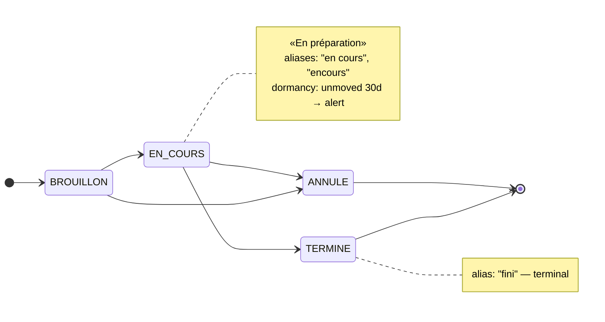

# kind: Workflow — declare

> The fourth rung: a **declarative document lifecycle** over a status column ingestion already
> landed — states, aliases for the spellings the source really uses, the transition graph, and a
> threshold past which a document that has not moved is a decision.

| | |
|---|---|
| **Kind** | `Workflow` — `apps.lumnik.io/v1` |
| **Over** | one column of one table: a raw `connector.t_*`, or a fused `connector.v_*` (taxonomy only) |
| **Declares** | states with aliases, transitions, `provenance: declared`; optionally a business key and a dormancy threshold |
| **Produces** | a report at apply on what the data holds; answers in the chat (Pro); `decision.dormant.<name>` and `decision.overdue.<name>` alerts, and an observation tape, when watched |
| **Commands** | `lm workflow apply` · `list` · `get` · `disable` · `enable` · `rm` — `lm_integrator`, scope-bound; one lifecycle per column |
| **Edition** | Open |

Legacy exports carry dirty statuses — `En cours`, `encours`, `fini`, `TERMINE ` with a trailing
space. A workflow declares what they mean, so the chat answers lifecycle questions from a
declared graph instead of inventing one.

## Features

- **[Dirty values resolve to declared states.](#alias-semantics)** Alias matching is trim and
  case-insensitive.
- **[A data-truth report that never blocks.](#the-data-truth-report-never-blocks)** Apply
  compares the declaration with the column — undeclared values, unobserved codes, blanks — and
  stores the manifest either way.
- **[Grounded answers](#what-the-chat-answers-from-it) (Pro).** The chat answers lifecycle
  questions from the declared graph.
- **[Dormancy.](#dormancy-the-memory-of-the-breathing)** A key and a threshold turn the
  declaration into a watch: a document unmoved in a non-terminal state past the threshold is a
  `decision.dormant.*` in the inbox.
- **[A tape that outlives the alert.](#reading-the-tape)** Every watched document's state, since
  when, and whether it alerted.
- **[One column, one lifecycle.](#one-column-one-lifecycle)** A second lifecycle on the same
  column is refused, naming the first.

## Quickstart

!!! note "Every screen on this page reads the demo desk that ships with the repo"
    An order book whose `status` column carries seven spellings and one blank, under
    `docs/apps/demo/`. Land it first — [The demo desk](demo-desk.md#landing-the-sources) has the
    commands and the hand count. The screens below start on **day 1**.

```yaml
--8<-- "docs/apps/demo/workflows/10-order-lifecycle.yaml"
```

The same manifest, as the graph it declares:



`lm workflow apply` prints what it stored, then the report: one line per disagreement between the
declaration and the data. With `-o json`, the hub's answer: the report is under `dataTruth`.

```
$ lm workflow apply -f docs/apps/demo/workflows/10-order-lifecycle.yaml
Applied workflow "acme-order-lifecycle" → connector.t_acme_desk_orders.status, scope desk
  in the data, not declared: EN LITIGE (2 rows), Terminé (1 row)
  declared, not in the data: ANNULE
  status null or blank: 1 row
$ lm workflow list
NAME                  TABLE                         COLUMN  SCOPE  ENABLED
acme-order-lifecycle  connector.t_acme_desk_orders  status  desk   true
```

One `200`, stored and indexed, with what the declaration and the data disagree on:

- `EN LITIGE` sits on two orders and nobody declared it; `Terminé` (with its accent) on one;
- `ANNULE` is declared and no order has reached it;
- one order has no status at all.

`EN LITIGE` is deliberately **not** in the graph: it stays visible in the report, and the
[dormancy sweep](#an-undeclared-value-can-never-be-terminal) still watches it.

## The manifest

| Field | Required | Meaning |
|---|---|---|
| `metadata.name` | yes | kebab-case identifier (`[a-z0-9-]+`) — the name `apply` updates under, and the alert's `decision.dormant.<name>` |
| `spec.scope` | yes | the business scope the lifecycle belongs to; must be a **discovered** scope — [below](#the-scope-must-exist-the-table-need-not) |
| `spec.provenance` | yes | **must be `declared`** — the only accepted value; the chat cites it |
| `spec.on.table` | yes | the table to watch — an ingest table (`connector.t_<table>`) or a fused entity view (`connector.v_<entity>`, always lower-case) |
| `spec.on.column` | yes | the column whose values this taxonomy explains — **whatever the source called it** |
| `spec.on.key` | no (required by `dormancy` and `due`) | the business key linking a document's successive versions |
| `spec.dormancy.after` | no (required by `dormancy`) | the sweep threshold, `[0-9]+[mhd]` (`30d`) — requires `spec.on.key`, and an ingest table, not a fused view |
| `spec.dormancy.message` | no | the alert text, in the team's language: `{doc_key}`, `{state}`, `{state_label}`, `{since}`, `{first_observed_at}`, `{threshold}`, `{workflow}`; any other `{name}` is refused at apply. Absent: the English default [below](#the-alert-verbatim) |
| `spec.due.column` | no (required by `due`) | the column whose date is the document's deadline — an ingest table or a fused view |
| `spec.due.states` | no (required by `due`) | the declared, **non-terminal** state codes in which a passed date makes the document overdue (`[CONFIRMED]`); an alias, an undeclared or a terminal state is refused |
| `spec.due.zone` | no | the time zone a date-only column is read in (`Europe/Paris`): due at the end of that day there. Absent: `UTC`. An unknown zone is refused |
| `spec.due.message` | no | the alert's sentence: `{doc_key}`, `{state}`, `{state_label}`, `{due}`, `{workflow}`; any other `{name}` is refused at apply |
| `spec.states[]` | yes (≥ 1) | the declared states |
| `spec.transitions[]` | no | the allowed edges of the graph |

**`states[]`** — `code` (required; unique, case- and trim-insensitive), `label`, `aliases[]` (the
dirty spellings that resolve to this code), `initial` (**exactly one** state must set it `true`),
`terminal` (a terminal state may carry no outgoing transition).

**`transitions[]`** — `from[]` (one edge can fan in from several states) and `to`.

An unknown key is refused, at every level:

```
$ lm workflow apply -f docs/apps/demo/workflows/67-refused-unknown-key.yaml
Error: API error 400: unknown key(s) in the manifest: spec.after — kind:Workflow honors root {apiVersion, kind, metadata, spec}, metadata {name}, spec {dormancy, due, on, provenance, scope, states, transitions}, spec.on {column, key, table}, spec.dormancy {after, message}, spec.due {column, message, states, zone}, states[] {aliases, code, initial, label, terminal}, transitions[] {from, to}
```

### The scope must exist, the table need not

`spec.scope` must be a discovered scope; an unknown one is a `404`, as for a process:

```
$ lm workflow apply -f docs/apps/demo/workflows/65-refused-unknown-scope.yaml
Error: API error 404: no schema for scope 'dsk' — run discovery first
```

The table is **not** checked: you may declare a lifecycle before ingesting the data. The report
then says `the table is not there yet`.

### Names the source chose

`on.column` and `on.key` are the names **your source** uses, copied as they are — a Kafka
message's JSON keys become columns verbatim:

```yaml
on:
  table: connector.t_Commandes
  column: "Statut Commande"
  key: "N° Commande"
```

Quote them in the YAML if they contain spaces or punctuation; the hub adds the SQL quotes.

`on.table` must be a table ingestion owns — `connector.t_<table>`, or `connector.v_<entity>` —
spelled the way the hub created it (a connector's target keeps your capitals, a fused view is
lower case, neither contains a space). Anything else is refused, the hub's own tables included:

```
$ lm workflow apply -f docs/apps/demo/workflows/66-refused-foreign-table.yaml
Error: API error 400: spec.on.table is required and must name a table in the 'connector' schema that ingestion owns (connector.t_<table>) or a fused entity view (connector.v_<entity>, always lower-case), spelled the way the hub created it (letters, digits and underscores — a space is a typo): identity.app_user
```

A fused view can carry a **taxonomy** but not a `dormancy`: declare the dormancy on the ingest
table the entity fuses, or drop `spec.dormancy`.

### One column, one lifecycle

A *different* name declaring an already-declared `on.table` + `on.column` is refused, naming the
holder:

```
$ lm workflow apply -f docs/apps/demo/workflows/64-refused-same-column.yaml
Error: API error 400: column connector.t_acme_desk_orders.status already has a declared lifecycle: workflow 'acme-order-lifecycle' — a column has exactly one lifecycle; re-apply under the name 'acme-order-lifecycle' to update it
```

`apply` on the same name **is** the update. The rule is per tenant.

## Alias semantics

Alias and code matching is **trim + case-insensitive**: `"TERMINE "`, `"fini"`, `"En cours"` all
resolve. On the demo desk, day 1:

| Status as written | Rows | Resolves to |
|---|---|---|
| `En cours`, `encours` | 4 | `EN_COURS` |
| `fini`, `TERMINE ` | 2 | `TERMINE` |
| `BROUILLON` | 2 | `BROUILLON` |
| `EN LITIGE` | 2 | **undeclared** |
| `Terminé` | 1 | **undeclared** — an accent is not an alias anyone declared |
| *(empty)* | 1 | `nullOrBlank` |

Contradictions in the declaration are refused:

```
$ lm workflow apply -f docs/apps/demo/workflows/61-refused-alias-collision.yaml
Error: API error 400: alias 'en_cours' on state BROUILLON collides with state code
$ lm workflow apply -f docs/apps/demo/workflows/60-refused-two-initial.yaml
Error: API error 400: exactly one state must be initial: true (found 2)
$ lm workflow apply -f docs/apps/demo/workflows/62-refused-terminal-outgoing.yaml
Error: API error 400: terminal state 'TERMINE' has an outgoing transition
```

- an alias that **collides with a state code**;
- an alias **declared on two different states**;
- not **exactly one** `initial: true`;
- a `terminal: true` state with an outgoing transition.

## The data-truth report — never blocks

`apply` stores the manifest first, then compares it with what the column contains. The
comparison never becomes a refusal. Read three lines:

| Line | `-o json` field | Means | On the demo desk (day 1) |
|---|---|---|---|
| `in the data, not declared` | `undeclared` | values in the data that no state declares, each with its row count | `EN LITIGE` ×2, `Terminé` ×1 |
| `declared, not in the data` | `unobserved` | declared states never seen in the data | `ANNULE` |
| `<column> null or blank` | `nullOrBlank` | rows with no status | `status null or blank: 1 row` |

Nothing to report: `the data matches the declaration`.

??? note "The other lines"
    | Line | `-o json` field | Means |
    |---|---|---|
    | `the table is not there yet` | `tableMissing` | the table does not exist yet |
    | `spec.on.key: the table has no such column` | `keyColumnMissing` | `spec.on.key` names a column the table does not have |
    | `key null or blank` | `keyNullOrBlank` | rows with no key: the dormancy watch skips them |
    | `spec.due.column …` | `dueProblem` | why `spec.due.column` cannot give a deadline; `null` when it can |
    | `the data could not be checked` | `checkUnavailable`, `unavailableReason` | the comparison could not run: the other fields are empty, **not** "the data agrees". Re-apply once fixed |

    The comparison reads the 200 most frequent values: a rare undeclared value can be missed.

## What the chat answers from it

**lumnik Pro.** Two gestures, two kinds of answer:

| You ask with | It answers about |
|---|---|
| `lm chat`, then `:scope desk` | the **lifecycle**: states, aliases, transitions |
| `lm ask --scope desk "…"`, the PWA's Chat tab | the **rows**: a document's current status |

The lifecycle, asked in the chat:

```
$ lm chat
[corpus=* scope=default topK=10] > :scope desk
scope → desk

[corpus=* scope=desk topK=10] > quels sont les états d une commande et quelles transitions sont autorisées ?
Les états d'une commande sont :

* Brouillon
* En cours
* Terminée (ou finie)
* Annulée

 Les transitions autorisées entre ces états sont :

* Du brouillon vers l'état en cours ou l'état annulé
* De l'état en cours vers l'état annulé ou le terme
```

Every transition it names is declared. The wording varies from one run to the next; the states
and transitions must match the manifest. The chat does not know which state an order is in. `lm ask`
does:

```
$ lm ask --scope desk "Dans quel statut est la commande SO-000004 ?"
La commande SO-000004 est en statut "BROUILLON".
  data as of: 2026-10-16T08:43:46.474408Z (last completed run)

  STATUS
  BROUILLON
  1 row returned

  SQL: SELECT status FROM "connector"."t_acme_desk_orders" WHERE order_no = 'SO-000004'
LIMIT 500
```

## Dormancy — the memory of the breathing

A legacy status is overwritten in place: the raw table says an order *is* `EN_COURS`, not since
when. A scheduled sweep records each document's state from the moment lumnik starts watching,
and alerts when one has sat unmoved, in a non-terminal state, past the declared threshold.

- Two fields switch it on: `spec.on.key` (`order_no` — links a document's successive rows) and
  `spec.dormancy.after` (`30d`, any `[0-9]+[mhd]`).
- The sweep runs every 15 minutes (`lumnik.workflow.sweep.every`,
  [Observability](../operations/observability.md#scheduled-background-work)).
- **The clock starts at lumnik's first sighting**, not at the real stall: declare `after: 14d`
  today over orders stuck for weeks, and the earliest alert is in fourteen days.

```
$ lm workflow apply -f docs/apps/demo/workflows/63-refused-dormancy-no-key.yaml
Error: API error 400: spec.dormancy requires spec.on.key (dormancy is per-document; the key links a document's versions)
```

The tape after the first sweep that saw the desk (day 1):

```
$ lm observations list
WORKFLOW              DOC        STATE      SINCE             ALERTED
acme-order-lifecycle  SO-000001  EN_COURS   2026-10-19 01:51  
acme-order-lifecycle  SO-000002  TERMINE    2026-10-19 01:51  
acme-order-lifecycle  SO-000003  TERMINE    2026-10-19 01:51  
acme-order-lifecycle  SO-000004  BROUILLON  2026-10-19 01:51  
acme-order-lifecycle  SO-000005  EN_COURS   2026-10-19 01:51  
acme-order-lifecycle  SO-000006  EN LITIGE  2026-10-19 01:51  
acme-order-lifecycle  SO-000007  EN_COURS   2026-10-19 01:51  
acme-order-lifecycle  SO-000008  Terminé    2026-10-19 01:51  
acme-order-lifecycle  SO-000010  EN LITIGE  2026-10-19 01:51  
acme-order-lifecycle  SO-000011  BROUILLON  2026-10-19 01:51  
acme-order-lifecycle  SO-000012  EN_COURS   2026-10-19 01:51  
$ lm observations stats
WORKFLOW              WATCHED  DORMANT  MEDIAN_DETECTION_S
acme-order-lifecycle  11       0        -
```

SO-000009 is absent: it has no status, so there is no state to watch. The states are the
**resolved** codes where an alias matched (`fini` reads `TERMINE`), the raw value where none did.

For the next screens the threshold was shortened to `after: 1m` and the manifest re-applied
under the same name (the shipped file keeps `30d`). Then **day 2** was loaded:

```bash
docker compose -f docker-compose.selfhost.yml cp docs/apps/demo/data/acme-orders-day2.csv hub:/tmp/acme-desk/acme-orders.csv
lm connector run acme-desk-orders
```

Two ticks later:

```
$ lm observations list
WORKFLOW              DOC        STATE      SINCE             ALERTED
acme-order-lifecycle  SO-000001  EN_COURS   2026-10-19 01:51  2026-10-19 02:06
acme-order-lifecycle  SO-000002  TERMINE    2026-10-19 01:51  
acme-order-lifecycle  SO-000003  TERMINE    2026-10-19 01:51  
acme-order-lifecycle  SO-000004  BROUILLON  2026-10-19 01:51  2026-10-19 02:06
acme-order-lifecycle  SO-000005  EN_COURS   2026-10-19 01:51  2026-10-19 02:06
acme-order-lifecycle  SO-000006  EN LITIGE  2026-10-19 01:51  2026-10-19 02:06
acme-order-lifecycle  SO-000007  EN_COURS   2026-10-19 01:51  2026-10-19 02:06
acme-order-lifecycle  SO-000008  Terminé    2026-10-19 01:51  2026-10-19 02:06
acme-order-lifecycle  SO-000010  EN LITIGE  2026-10-19 01:51  2026-10-19 02:06
acme-order-lifecycle  SO-000011  BROUILLON  2026-10-19 01:51  2026-10-19 02:06
acme-order-lifecycle  SO-000012  EN_COURS   2026-10-19 01:51  2026-10-19 02:06
acme-order-lifecycle  SO-000013  EN LITIGE  2026-10-19 02:06  2026-10-19 02:21
$ lm observations stats
WORKFLOW              WATCHED  DORMANT  MEDIAN_DETECTION_S
acme-order-lifecycle  12       10       900
```

- **Ten alerts**: nine at the first tick past the threshold, then `SO-000013` — new on day 2,
  first seen at 02:06 — one tick later.
- The two `TERMINE` orders never alert: a terminal state is excluded.
- `SO-000008` **does** alert: `Terminé`, with its accent, matched no alias, and [an undeclared
  value can never be terminal](#an-undeclared-value-can-never-be-terminal).
- The median detection delay is 900 s — one sweep interval, the floor.

What each alert says, in the inbox:

```
$ lm inbox --limit 3
ID  WHEN      PROCESS                        MESSAGE                                                                                                                                  ENTITY_KEY
47  just now  workflow:acme-order-lifecycle  SO-000013: observed unmoved in "EN LITIGE" since 2026-10-19 (first observed 2026-10-19) — declared threshold 1m in acme-order-lifecycle  SO-000013
46  15min     workflow:acme-order-lifecycle  SO-000012: observed unmoved in "EN_COURS" since 2026-10-18 (first observed 2026-10-18) — declared threshold 1m in acme-order-lifecycle   SO-000012
45  15min     workflow:acme-order-lifecycle  SO-000011: observed unmoved in "BROUILLON" since 2026-10-18 (first observed 2026-10-18) — declared threshold 1m in acme-order-lifecycle  SO-000011
note: result hit the limit of 3 — there may be more
```

`ENTITY_KEY` is the business key. The wording names the date lumnik started watching, the date
it first saw the document and the declared threshold — never how long the order sat in the ERP.
The message's dates are UTC, while `lm observations list` shows your terminal's time zone: the
01:51 (Paris) sighting was 23:51 UTC the day before.

## Due date — a deadline the data carries

Dormancy counts from the day lumnik first saw a document. A due date counts from a date the data
carries: a delivery promised for 20 October, still on the road on the 24th, is late.

The desk's carrier export holds a promised date per delivery:

```csv
--8<-- "docs/apps/demo/data/acme-deliveries.csv"
```

**Type the date at the door.** A CSV column is text, and a due date must be a date. The connector
types it with [`parse-date`](../connectors/transformers.md#parse-date-dates-are-31122019):

```yaml
  mapping:
    cell:
      - parse-date: { column: promised_on, formats: ["yyyy-MM-dd"] }
```

Without it, the apply says so, and no alert is ever raised:

```
  spec.due.column promised_on is text, not a date: no deadline can be read from it
```

The workflow declares the deadline:

```yaml
--8<-- "docs/apps/demo/workflows/20-delivery-lifecycle.yaml"
```

```
$ lm connector run acme-desk-deliveries
$ lm workflow apply -f docs/apps/demo/workflows/20-delivery-lifecycle.yaml -o json | jq -r .dataTruth.dueProblem
null
$ lm inbox --type decision.overdue.acme-delivery-lifecycle
ID  WHEN      PROCESS                           MESSAGE                                                       ENTITY_KEY
66  just now  workflow:acme-delivery-lifecycle  Livraison DL-1 promise pour le 2026-10-20, toujours en route  DL-1
```

- **DL-1** is late: promised for 20 October, still `EN_ROUTE`. `DL-2` is delivered. `DL-3` is
  promised for 2030. `DL-4` has no date. None of them alerts.
- The check runs every 15 minutes, like dormancy: the alert lands in the inbox within that time.
- **One alert per deadline.** A date moved to another past day alerts again; a date moved to the
  future waits.
- `zone` says where the deadline falls: a date passes at the end of that day in `zone`. Without
  `zone`, UTC.
- A fused entity view is accepted, unlike dormancy.
- Files: `data/acme-deliveries.csv`, `sources/80-deliveries.yaml`,
  `workflows/20-delivery-lifecycle.yaml`, landed like the [demo desk](demo-desk.md#landing-the-sources).

## Applying it

```bash
lm workflow apply -f docs/apps/demo/workflows/10-order-lifecycle.yaml
lm workflow list
lm workflow get acme-order-lifecycle      # the stored manifest, verbatim, comments included
lm observations list                      # the tape: what has not moved, stillest first
lm observations stats                     # per workflow: watched, dormant, median detection delay
lm inbox                                  # where decision.dormant.<name> lands
```

Turn it off, or remove it:

```
$ lm workflow disable acme-order-lifecycle
workflow acme-order-lifecycle enabled=false
$ lm workflow list
NAME                  TABLE                         COLUMN  SCOPE  ENABLED
acme-order-lifecycle  connector.t_acme_desk_orders  status  desk   false
$ lm workflow enable acme-order-lifecycle
workflow acme-order-lifecycle enabled=true
$ lm workflow rm acme-order-lifecycle
workflow acme-order-lifecycle deleted
$ lm workflow rm acme-order-lifecycle
Error: API error 404: unknown workflow: acme-order-lifecycle
```

`disable` stops the sweep (no new alerts) and removes the lifecycle from chat, keeping the
manifest and the tape; `enable` restores both. `rm` removes it for good, with no prompt — its
tape too (`lm observations stats` no longer lists it). Each gesture, and every apply, is recorded in the [audit trail](../security/index.md#the-audit-trail).

| Command | Role | Scope-bound |
|---|---|---|
| `lm workflow apply`, `list`, `get`, `disable`, `enable`, `rm` | `lm_integrator` | yes — outside your grants, `403 scope not granted`; `list` shows only your scopes |
| `lm observations list`, `stats` | `lm_integrator` **and** `lm_admin` (or `lm_superadmin`) | yes — they list only the workflows of your scopes |

## How to…

### Declare the lifecycle a legacy status column already has

```bash
lm workflow apply -f docs/apps/demo/workflows/10-order-lifecycle.yaml
lm workflow get acme-order-lifecycle
```

**Result:** the manifest is stored and indexed in one `200`, with the data-truth report. The
semantic chat in that scope now answers transition questions from the declared graph.

### Get told when a document stops moving

The demo manifest already carries `spec.on.key` and `spec.dormancy.after`: applying it switches
the sweep on. Alerts land in `lm inbox` (and the PWA's *Inbox* tab) for users holding the
workflow's scope and for users with no `scope:` role. To push them to an external system,
`lm integration add` ([Processes](processes.md#delivery-is-opt-in)).

**Don't treat the inbox as a register of everything asleep.** A document alerts once per stall,
and the alert ages out with the event log (30 days by default). The tape keeps it — see
[Re-alert semantics](#re-alert-semantics).

### Add the value the report says nobody declared

The report named `EN LITIGE` (`in the data, not declared`). Add it as a state (or an alias of one) and re-apply
under the same name. **Result:** the report no longer lists it, the chat knows what it means, and
the sweep watches it as a declared state. The documents the tape held as `EN LITIGE`, and the source still
holds, read the declared code from the next tick; a meaning is not a movement, so their `SINCE`, their alert and
the transition journal stay as they were.

## From a proposal dossier

A business person can describe a problem on lumnik.fr and download a **proposal dossier**. Turning
it into a workflow, and checking it against your data: [Proposal dossiers](proposal-dossier.md).

## Troubleshooting

| Symptom | Cause | Gesture |
|---|---|---|
| apply refused: `unknown key(s) in the manifest: …` | a misspelled or misplaced field | the message lists what `kind:Workflow` honors, level by level |
| apply refused `404`: `no schema for scope '…' — run discovery first` | `spec.scope` is not a discovered scope | `lm source rediscover --scope <tag>` (`lm_integrator` + `lm_admin`, a scope you hold), then re-apply |
| apply refused: `column … already has a declared lifecycle: workflow '…'` | a *different* name declares this `on.table` + `on.column` | re-apply under the existing name, or point at a different column |
| apply refused: `column … already has a declared lifecycle, in a scope you do not hold` | the same, in a scope you do not hold | ask the integrator who owns that scope |
| apply refused: `spec.dormancy requires spec.on.key …` | `spec.dormancy.after` without `spec.on.key` | add `spec.on.key` |
| apply refused: `spec.dormancy cannot be declared on a fused entity view …` | `on.table` is a `connector.v_*` view with `spec.dormancy` | declare it on the ingest table, or drop it |
| apply refused: `spec.on.table … must name a table in the 'connector' schema that ingestion owns` | another schema, or one of the hub's own tables | `connector.t_<the connector's target>` |
| apply refused: `alias '…' … collides with state code` / `exactly one state must be initial` / `terminal state '…' has an outgoing transition` | a contradiction in the declaration | fix the graph |
| apply refused: `spec.due requires spec.on.key …` | `spec.due` without `spec.on.key` | add `spec.on.key` |
| apply refused: `spec.due.states names …` | an alias, an undeclared or a terminal state, or one named twice | name the declared, non-terminal codes once |
| apply refused: `spec.due.zone has no effect on …` | a `zone` over a `timestamptz` column | drop `spec.due.zone` |
| due date declared, but no alert ever arrives | the column is missing or not a date | the apply report names it: `spec.due.column …` |
| dormancy declared, but no alert ever arrives | `spec.on.key` names a column the table does not have | the apply report says `spec.on.key: the table has no such column` |
| a document stuck for weeks does not alert on day one | the threshold counts from lumnik's first sighting | wait `after` from the apply date; `lm observations list` shows `SINCE` |
| a document is missing from `lm observations list` | its key or its status is `NULL` or blank | fix it at the source; the apply report counts them: `key null or blank`, `<column> null or blank` |
| a status value never shows up in chat answers | undeclared | the apply report lists it under `in the data, not declared`; add it, re-apply |
| `lm ask` abstains on a "why can't I close it" question | `lm ask` reads the rows, not the lifecycle | `lm chat` with the scope |
| `403 … scope not granted` | you do not hold the `spec.scope` role | ask for that `scope:` role |
| `API error 403 (forbidden): no details from the server` | you lack `lm_integrator`, or `lm_admin` for `lm observations` | ask your administrator; no `lm` command lists your roles (`GET /api/bff/v1/me` returns them under `roles`) |

## See also

- [The demo desk](demo-desk.md) — the order book every screen here reads
- [Processes](processes.md) — react to a row landing
- [Inbox](inbox.md) — where a `decision.dormant.<workflow>` alert surfaces
- [CLI & TUI reference](../cli/lm-reference.md) — `lm observations list` and the `:observations` screen
- [Ask & honesty](../transparency/ask-honesty.md) — the abstention contract a grounded answer serves

## Advanced: the sweep in detail

??? note "What the sweep skips, the alert's wording, re-alerts, the tape, and scale"

    ### What the sweep does not see

    A document with a `NULL` or blank **key**, or a `NULL` or blank **status**, is skipped —
    permanently: there is nothing to follow it by, or no state to watch (`SO-000009` on the demo
    desk). The apply report counts both: `key null or blank` and `status null or blank`.

    ### The alert, verbatim

    From the demo desk, with `dormancy.after` shortened to `1m`:

    ```
    SO-000004: observed unmoved in "BROUILLON" since 2026-10-18 (first observed 2026-10-18) — declared threshold 1m in acme-order-lifecycle
    ```

    The default shape — `<key>: observed unmoved in "<state>" since <date> (first observed <date>)
    — declared threshold <after> in <workflow>` — never asserts how long the document sat in the
    source. It is emitted as `decision.dormant.<workflow>` and appears in the [inbox](inbox.md) as
    `workflow:<workflow>`.

    A workflow writes the sentence in the team's language with `spec.dormancy.message`:

    ```yaml
    dormancy:
      after: 14d
      message: "{doc_key} : immobile en « {state_label} » depuis le {since} — seuil {threshold}"
    ```

    `{state_label}` is the state's declared `label` (its code when the state is undeclared); dates
    are the UTC day. A placeholder outside the seven is refused at apply, naming it.

    ### Re-alert semantics

    A document alerts **once** per stall. It alerts again only after it moved (a new state resets
    its clock) and then sat unmoved past the threshold once more.

    | | |
    |---|---|
    | **A permanently stuck document** | alerts once; the alert leaves `lm inbox` with the event retention (`lumnik.events.retention-days`, 30 by default) |
    | **What to do** | ack the alert into your own tracker, or raise `lumnik.events.retention-days` beyond your review cadence |
    | **What stays** | the tape: `lm observations list` keeps `ALERTED` until the document moves |

    ### Reading the tape

    `lm observations list` — the watched documents of every workflow in your scopes, **stillest
    first** (`--workflow`, `--limit`: default 200, at most 1000). `SINCE` is when lumnik started observing that
    state; `ALERTED` is empty until the sweep alerts. `lm observations stats` sums it up per workflow. The TUI's
    `:observations` screen shows the same, with humanized ages. Both need `lm_admin` (or
    `lm_superadmin`) on top of `lm_integrator`.

    `lm observations transitions` reads the journal: every observed move, **newest first**
    (`--workflow`, `--doc`, `--limit`). `IN_FROM_S` is the seconds the document spent in `FROM`,
    from `ENTERED` — its previous move, or its first observation for its first one (a lower bound,
    like `SINCE`). Moves are seen at sweep granularity: a document that moved twice between two
    ticks shows one move.

    ### Scale

    - On a table with millions of documents, lengthen `lumnik.workflow.sweep.every` (15 minutes by
      default).
    - The tape is kept until `lm workflow rm`.
    - A workflow whose table is gone is skipped, and comes back by itself when the table returns.
      The other workflows are never affected. The hub log names the workflow.

    ### An undeclared value can never be terminal

    `EN LITIGE` is not declared, so it cannot be `terminal: true`: a document sitting in it is
    watched like any non-terminal state. The apply report names the value; the sweep names the
    documents asleep in it.
