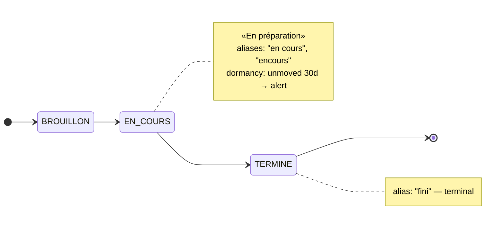

# kind: Workflow — declare the lifecycle

> The fourth rung, and the first that adds no surface: a **declarative document lifecycle** over
> a column already landed by ingestion. Views let you see, processes react, the inbox decides —
> a workflow adds none of those. It adds *knowledge*, and grounds the other three.

Twenty years of an ERP's Excel exports don't carry clean statuses — a legacy source is dirty
input, not error, and the lifecycle it implies usually lives in a head, not a schema. Declaring
it turns that head-knowledge into ground truth the chat can cite.

## Why it exists

Ask a model "pourquoi je ne peux pas clôturer cette commande ?" against a corpus with no
declared lifecycle, and it answers anyway — inventing a plausible one, because a lifecycle
*sounds* like the kind of thing a document has. A declared graph removes the option to invent:
the chat is grounded in the states and transitions the integrator actually declared, or it
abstains. See Act 3 of the [WOW demo](../demo/wow-customer/README.md) for the traced example
this page draws from.

## The real manifest (from the WOW demo — Act 3)

```yaml
--8<-- "docs/demo/wow-customer/commande-workflow.yaml"
```

`commandes.csv`, the source behind `connector.t_commandes_csv`, carries `En cours`, `fini`,
`TERMINE ` (trailing space), `BROUILLON`, `encours` — and twice, `EN LITIGE`, a value nobody
ever declared. This manifest is the lifecycle an integrator (standing in for the person who
used to keep it in her head) declares over that mess.

The same manifest, as the graph it declares:



`EN LITIGE` is deliberately **not** in this graph: nobody declared it. It stays
visible in the [data-truth report](#the-data-truth-report-never-blocks) instead of
being silently absorbed into a lifecycle it was never part of.

## Fields

| Field | Required | Meaning |
|---|---|---|
| `metadata.name` | yes | kebab-case identifier (`[a-z0-9-]+`) |
| `spec.scope` | yes | the métier scope this lifecycle belongs to; must be a **discovered** scope (see below) |
| `spec.provenance` | yes | **must be `declared`** — v1 accepts no other value (see [Provenance](#provenance-and-why-it-exists-for-a-single-accepted-value) below) |
| `spec.on.table` | yes | the raw ingest table, `connector.[a-z_][a-z0-9_]*` |
| `spec.on.column` | yes | the column whose values this taxonomy explains, `[a-z_][a-z0-9_]*` |
| `spec.on.key` | no (required by `dormancy`) | the business key linking a document's successive versions, `[a-z_][a-z0-9_]*` — see [Dormancy](#dormancy-the-memory-of-the-breathing) |
| `spec.dormancy.after` | no (required by `dormancy`) | declares the sweep threshold, `[0-9]+[mhd]` (e.g. `30d`) — requires `spec.on.key` — see below |
| `spec.states[]` | yes (≥1) | the declared states — see below |
| `spec.transitions[]` | no | the allowed edges of the graph — see below |

**`states[]`**

| Field | Required | Meaning |
|---|---|---|
| `code` | yes | the canonical state code; unique, case/trim-insensitive |
| `label` | no | a human label |
| `aliases[]` | no | dirty-data spellings that resolve to this code |
| `initial` | no | **exactly one** state across the manifest must set this `true` |
| `terminal` | no | a terminal state may not carry an outgoing transition |

**`transitions[]`**

| Field | Required | Meaning |
|---|---|---|
| `from[]` | yes (≥1) | source state code(s) — one edge can fan in from several states |
| `to` | yes | destination state code |

That table is the whole surface: `apply` **refuses a key it does not honor** and names it, so
a misspelled `provenence:` costs you a 400 rather than a lifecycle that's silently incomplete.
The `apiVersion:` envelope is accepted and ignored.

### The scope must exist, the table need not

`spec.scope` is checked against the tenant's discovered scopes (its `SchemaCard`s). An unknown
scope is a **404** — `no schema for scope 'demoo' — run discovery first`, the same code and the
same wording [`kind:Process`](processes.md) answers with, because it is the same condition — for
the same reason a misspelled key is refused: the chunk is tagged with `spec.scope`, so a typo
would index the lifecycle
under a tag nobody holds. Nothing would fail, and the chat would quietly go back to inventing.
The applied scope comes back in the response (`"scope"`) so you can see the tag that was written.

Only the **scope** is checked. The trigger table is deliberately *not* required to be in the
scope's card — declaring a lifecycle **before** ingesting the data is a legitimate order of
operations, and that is exactly what the `tableMissing` report below is for. (`kind:Process` does
require its trigger table, because a process fires on rows; a workflow only describes them.)

### One column, one lifecycle

Two workflows on the same `on.table` + `on.column` would put two contradictory declared graphs in
the corpus for the same column — both retrieved, the chat forced to choose. So a *different* name
declaring an already-declared column is a **400** naming the workflow that holds it. Renaming a
workflow therefore means re-applying it under the existing name (`apply` on the same name is the
update path); the boundary is per tenant.

That check is also backstopped at the database — `UNIQUE (tenant_id, on_table, on_column)` — so
two concurrent `apply` calls declaring different names on the same column can never both succeed:
the loser still gets a **400** ("a column has exactly one lifecycle"), just without the winner's
name, since the race is caught after the pre-check already found nothing.

## Alias semantics

Alias and code matching is **trim + case-insensitive** (`"TERMINE "`, `"fini"`, `"En cours"`
all resolve). That normalization is the whole point: it is what lets twenty years of dirty
Excel input collapse onto a handful of declared states without a cleanup pass first. Two
declaration-time contradictions are refused, not silently resolved:

- an alias that **collides with a state code** (declaring `aliases: [en_cours]` on a state
  other than `EN_COURS` would make the same string mean two things);
- an alias **declared on two different states** — ambiguous by construction.

Structural rules on the graph itself: **exactly one** state must be `initial: true`, and a
`terminal: true` state must have no outgoing `transitions[].from` entry — a "closed" state
that could still transition somewhere is a contradiction in the declaration, and `apply`
refuses it.

## Dormancy — the memory of the breathing

Legacy systems destroy time: a status is overwritten in place, so nothing in the raw table
says a commande has sat in `EN_COURS` for six weeks — only that it currently *is* `EN_COURS`.
lumnik cannot recover that lost history — it starts a **new** time axis instead, forward from
the moment it starts watching, because every ingestion is a dated observation: a scheduled
sweep (every 15 minutes by default, `lumnik.workflow.sweep.every` — see
[Observability](../operations/observability.md#scheduled-background-work)) watches each
document's declared state and alerts when it has sat, unmoved, in a non-terminal state past a
**declared** threshold, counted from **lumnik's own first sighting** of that document.

Two more fields turn a lifecycle declaration into a watched one:

```yaml
--8<-- "docs/demo/wow-customer/commande-workflow.yaml"
```

`spec.on.key` (`num` in the fixture) names the business key that links a document's successive
raw rows — the sweep needs it to tell "the same commande, later" from "a different commande".
`spec.dormancy.after` (`30d`, or any `[0-9]+[mhd]`: minutes/hours/days) declares the threshold;
`spec.dormancy` **requires** `spec.on.key` — dormancy is inherently per-document, so a workflow
with no key to follow documents by cannot declare one (refused at apply: "dormancy is per-document;
the key links a document's versions").

**The clock starts at lumnik's first sighting, not at the actual stall.** The very first sweep
to see a document simply records "since now" for whatever state it's in — it has no way to
know how long that document had already been sitting before lumnik ever looked. Declare
`after: 14d` this morning against a table of repair orders that have already been stuck for
weeks, and the earliest any of them alert is **fourteen days from now**, not tonight: the
threshold counts from the moment lumnik started watching, never from whenever the order
actually stalled in the source system.

The key must also **exist in the table** for the sweep to have anything to read. A typo (`key: nu`
for `num`) passes the identifier grammar and applies with a clean `200` — so `apply`'s data-truth
report names it as [`keyColumnMissing`](#the-data-truth-report-never-blocks). That is a *report*,
not a refusal: declaring a lifecycle before ingesting the data is legitimate, and the column may
simply not be there yet. But if you declared dormancy and the alerts never come, this field is the
first place to look.

The sweep's own mechanics — what it can't see, why cold start counts from observation, the alert's exact
wording, re-alert timing, reading the observation tape, the per-tick scale bound, why an
undeclared value is always watchable, and the provenance field's rationale — are gathered in
[Advanced: the sweep's internals](#advanced-the-sweeps-internals) at the foot of this page.

## Applying it

```bash
lm workflow apply -f commande-workflow.yaml
lm workflow list
lm workflow get commande-lifecycle
lm observations list          # the tape: what has not moved, stillest first
```

`lm workflow apply` prints the hub's response verbatim. Expected shape for the fixture above:

```json
{"name":"commande-lifecycle","scope":"demo","table":"connector.t_commandes_csv","column":"statut",
 "dataTruth":{"undeclared":[{"value":"EN LITIGE","rows":2}],"unobserved":[],"nullOrBlank":0,
              "tableMissing":false,"keyColumnMissing":false,
              "checkUnavailable":false,"unavailableReason":null}}
```

`lm workflow list` shows NAME | TABLE | COLUMN | SCOPE | ENABLED; `lm workflow get NAME`
fetches the stored manifest YAML verbatim (the edit round-trip: get, edit, apply again).

The whole `/api/workflows` surface (`POST /apply`, `GET` list, `GET /{name}/manifest`) requires
the **`lm_integrator`** role — declaring a lifecycle is integrator work, not the tenant-wide
admin door `kind:Process` sits behind. Every apply is recorded in the audit trail (actor,
name, and the manifest's SHA-256). One asymmetry with views, named on purpose: **view
apply is métier-scope-bound, workflow apply is not** — a scope-bound integrator cannot
publish a view outside their grants but *can* declare a workflow for any scope; nothing on
this surface checks `scope:<tag>` grants. `lm observations list` above is a different surface entirely
(`/api/platform/workflows/observations`) and needs `lm_admin`/`lm_superadmin` **on top of**
`lm_integrator` — see [Reading the tape](#reading-the-tape) in Advanced.

## The data-truth report — never blocks

`apply` parses and stores the manifest first, then **confronts** it with what the trigger
column actually contains — and that confrontation never turns into a refusal:

- **`undeclared`** — values seen in the data with no matching state or alias (`EN LITIGE`
  above), each with its row count. This is reality; reality doesn't ask the manifest's
  permission.
- **`unobserved`** — declared codes never once seen in the column. Had the fixture never
  carried a `TERMINE`/`fini` row, `TERMINE` would show up here instead: a declared code
  that's never actually reached.
- **`nullOrBlank`** — how many rows carry no status at all (NULL, or blank/whitespace). Its own
  bucket, never folded into silence: a column that is NULL on 90% of its rows would otherwise
  report `undeclared: []`, which *reads* as "the data agrees with the manifest" when in truth
  there was almost nothing to agree with.
- **`tableMissing`** — the trigger table doesn't exist (yet, or anymore). Still `200`.
- **`keyColumnMissing`** — `spec.on.key` names a column the table does not have. Same
  "declared but not yet real" family as `tableMissing`, and the **only** signal a typo'd key ever
  produces: `key: nu` for `num` satisfies the identifier grammar, applies with a clean `200`, and
  then makes the dormancy sweep fail on every tick with nothing but a server-side log line to show
  for it. Still `200` — declaring before ingesting is legitimate and the column may simply not be
  there yet — but if you declared dormancy and no alert ever arrives, check this field first.
- **`checkUnavailable`** (+ **`unavailableReason`**) — the confrontation could not be run at all:
  a statement timeout on a very large table, a dropped column, a revoked grant. It means
  **"we could not confront the data"** — *not* "the data agrees". The other fields of such a
  report are empty out of ignorance, not out of agreement; re-run the apply once the cause is
  gone if you want a real confrontation. The manifest is stored either way (see below), and the
  underlying error is logged server-side at WARN with its SQLSTATE.

All of them land in the same `200` response alongside the stored manifest — **200, not
blocked**, always. That holds even when the probe itself fails: the declaration is already
stored, and a report that cannot be produced must not cost the integrator the lifecycle.
Refusal is reserved for a genuine contradiction in the declaration itself (a bad alias, two
initial states, an unknown key, an unknown scope, a column already declared); a fact about the
data — or an accident of the database — is never one.

**Coverage bound**: the confrontation groups the column's values and looks at only the
**top 200 distinct values by row count** (a fixed cap). On a low-cardinality
status column this is exhaustive in practice; on a high-cardinality one, a rare undeclared
value can rank below the cut and never surface in `undeclared`. A clean report covers what it checked — the top 200 —
not the whole column.

Applying a workflow also (re)indexes it as one chunk in the manifest's scope, so:

```bash
lm ask --scope demo "pourquoi je ne peux pas clôturer la commande CMD-001 ?"
```

resolves against the declared graph — CMD-001's `En cours` is the state `EN_COURS`, and the
only transition out of `EN_COURS` goes to `TERMINE`; nothing in the declared lifecycle blocks
it. What's fixed run to run is the ground truth the answer must agree with — the states,
aliases and transitions in the manifest — never an invented lifecycle.

## How to…

### Declare the lifecycle a legacy status column already has

```bash
lm workflow apply -f commande-workflow.yaml
lm workflow get commande-lifecycle
```

**Result:** the manifest is parsed, stored, and (re)indexed into the scope's corpus in one
`200`, alongside a data-truth report confronting the declared states against what the column
actually contains today (see [The data-truth report](#the-data-truth-report-never-blocks)
above). `lm ask` in that scope now answers lifecycle questions from the declared graph
instead of inventing one.

### Get told when a document stops moving

A workflow becomes **watched**, not just declared, once its manifest carries `spec.on.key`
(the business key) and `spec.dormancy.after` (the threshold) — see
[Dormancy](#dormancy-the-memory-of-the-breathing) above. The fixture above already ships both,
so applying it is enough to switch the sweep on for it:

```bash
lm workflow apply -f commande-workflow.yaml
lm observations list          # the tape: what has not moved, stillest first — needs lm_admin/lm_superadmin too
lm observations stats         # per workflow: watched, dormant, median detection delay
lm inbox                      # the decision.dormant alerts land here, newest first
```

**Result:** the sweep starts watching every non-terminal state in that lifecycle. Nothing is
pushed to you by default — an alert rides the same outbox → webhook pipeline as every other
decision, so it reaches an external system only once a webhook endpoint is registered for the
tenant; otherwise `lm inbox` (or the PWA's Décisions tab) is where you go looking. The inbox is
also **tenant-wide**: any `lm_user` sees every alert, not only someone holding this workflow's
`scope:` grant — see [Inbox](inbox.md).

**Don't treat the inbox as a standing register of everything asleep.** A document alerts once
per stall, not on every sweep tick, and that alert ages out of `lm inbox` with the rest of the
event log (`lumnik.events.retention-days`, 30 days by default) — so a document that never moves
again alerts once and then, about a month later, quietly drops out of the inbox too. If you need
to promise "we'll know", triage into your own tracker rather than relying on the inbox to keep
remembering — see [the sweep's known limitation](#re-alert-semantics) in Advanced for the full
mechanics.

## Troubleshooting

| Symptom | Cause | Gesture |
|---|---|---|
| apply refused: `unknown key(s) in the manifest: …` | a misspelled field (e.g. `provenence:`) | the message lists what `kind:Workflow` honors — fix the spelling |
| apply refused `404`: `no schema for scope '…' — run discovery first` | `spec.scope` isn't a discovered scope | `lm source rediscover --scope <tag>` (needs **both** `lm_integrator` and `lm_admin`), then re-apply |
| apply refused: `… — a column has exactly one lifecycle; re-apply under its existing name` | a *different* workflow name already declares this `on.table` + `on.column` | re-apply under the existing name, or point the new manifest at a different column |
| apply refused: `spec.dormancy requires spec.on.key (dormancy is per-document; …)` | `spec.dormancy.after` is set without `spec.on.key` | add `spec.on.key` naming the business-key column |
| dormancy declared, but no alert ever arrives | `spec.on.key` names a column the table doesn't have | check `keyColumnMissing` in the apply response's `dataTruth` — see [the data-truth report](#the-data-truth-report-never-blocks) |
| a document that's *already* been stuck for weeks doesn't alert on day one | the threshold counts from lumnik's own first sighting, never from the source's real history | wait out `after` from the apply date, or check `firstObservedAt` per document with `lm observations list` |
| a status value in the data never shows up in `lm ask` answers | the value is real but undeclared — no state or alias matches it | check `dataTruth.undeclared` in the apply response, then add it as a state or alias and re-apply |
| `403 {"error":"scope not granted"}` on a read that touches this scope | you don't hold the `spec.scope` role | ask an integrator to grant that `scope:` role |
| `403` with an **empty body** (not `{"error": "…"}` like the scope refusal above) | you don't hold `lm_integrator` — the whole `/api/workflows` surface requires it | check your roles — `GET /api/bff/v1/me` returns them under `roles` — then ask whoever manages your Keycloak roles to grant `lm_integrator` |

## See also

- [Processes](processes.md) — react to a row landing; a workflow explains the values a
  process's `when` conditions match against.
- [Inbox](inbox.md) — where a `decision.dormant.<workflow>` alert surfaces for a human to see.
- [CLI & TUI reference](../cli/lm-reference.md) — `lm observations list` and the `:observations`
  screen, the tape that outlives the alert.
- [Ask & honesty](../transparency/ask-honesty.md) — the abstention contract a grounded answer
  serves.

## Advanced: the sweep's internals

The lean version above is enough to declare a lifecycle, watch it, and know what a threshold
actually counts from. What follows is the sweep's fine print — what it can and cannot see, the
exact wording it alerts with, how long an alert survives, the tape that outlives it, its scale
bound, and the provenance field's rationale. Collapsed by default; open it for the exact
mechanics before a first dormancy deployment, or later when an alert needs explaining or never
arrives.

??? note "The sweep's internals — cold start, the tape, alerting, scale, and provenance"

    ### What the sweep does not see

    The sweep reads one row per business key, and it skips a document outright when either half of the
    pair is empty: **a NULL or blank `spec.on.key` value, or a NULL or blank status value**. A commande
    whose `num` is NULL is therefore invisible to dormancy — permanently, not "until the next tick". It
    is not that lumnik decides it is fine; it is that there is no key to follow the document by, so
    "the same commande, later" cannot be established at all. Same for a NULL status: there is no state
    to observe sitting still.

    Those rows are not hidden from you — `apply`'s report counts blank statuses in
    [`nullOrBlank`](#the-data-truth-report-never-blocks), so a column that is NULL on most of its rows
    says so at declaration time. A NULL *key* has no equivalent counter in v1; if your source leaves
    business keys empty, dormancy silently covers only the rows that have one.

    **The threshold is declared, not learned.** This is the same posture as
    [`provenance: declared`](#provenance-and-why-it-exists-for-a-single-accepted-value) below:
    the sweep does not (yet) infer "commandes usually close in 4 days" from
    observed history and alert on a deviation — that is the next rung on lumnik's time-defrost
    staircase, out of scope here. What ships today alerts on the number an integrator wrote down.

    ### Cold start counts from observation

    The very first sweep to see a document records "since now" for its current state — it does
    not, and cannot, know how long that document sat there before lumnik ever looked. So nothing
    can be dormant before `after` elapses **from lumnik's own first observation**, never from the
    source's history: a commande that has silently sat in `EN_COURS` for a year in the ERP does not
    alert on ingestion day one; it alerts `30d` after the hub first saw it. Every claim the sweep
    ever makes is **observation-relative**, and it says so in the alert itself.

    ### The alert, verbatim

    Captured from a live replay against the WOW fixture (`docs/demo/wow-customer/commandes.csv`),
    with `dormancy.after` shortened to `1m` so the sweep could fire without a real 30-day wait —
    the committed manifest still declares `after: 30d`; only the replay's clock ran fast, and the
    line below is quoted exactly as the outbox produced it, threshold included:

    ```
    CMD-005 : observé immobile en « EN LITIGE » depuis le 2026-08-04 (première observation 2026-08-04) — seuil déclaré 1m dans commande-lifecycle
    ```

    That shape — `<key> : observé immobile en « <state> » depuis le <date> (première observation
    <date>) — seuil déclaré <after> dans <workflow>` — never asserts a source-absolute duration.
    It names the date lumnik started watching this state and the date it first ever saw the
    document; the reader draws the "how long" from those two dates, not from a number lumnik
    invented about the ERP's past.

    Five of the fixture's seven commandes alert this way: `CMD-001` (`EN_COURS`), `CMD-004`
    (`BROUILLON`), `CMD-005` (`EN LITIGE`), `CMD-006` (`EN_COURS`), `CMD-007` (`EN LITIGE`).
    `CMD-002` and `CMD-003` never do — both resolve to the terminal `TERMINE` (`fini` and
    `TERMINE ` are declared aliases of it), and the sweep excludes terminal states by
    construction. `CMD-005` and `CMD-007` are the pair worth a second look: they sleep in
    `EN LITIGE`, a value this manifest never declares anywhere — and they alert anyway, because
    [an undeclared value can never be terminal](#an-undeclared-value-can-never-be-terminal), so
    it is exactly as watchable as a declared non-terminal state.

    The alert is emitted as `decision.dormant.<workflow-name>` (`decision.dormant.commande-lifecycle`
    for the fixture), `source=workflow:commande-lifecycle` — the same outbox → inbox → webhook
    pipeline every other decision rides. See [Inbox](inbox.md).

    ### Re-alert semantics

    Once a document alerts, it does not alert again on every subsequent sweep tick — an
    `alerted_at` marker gates re-emission. It clears only when the document is observed to have
    **moved**: a state change resets the "since" clock and clears the marker in the same write.
    So a document alerts again only after it left the stale state and then sat unmoved, past the
    threshold, in a (possibly different) non-terminal state once more — not every 15 minutes
    forever.

    **Known limitation — a dormant document alerts once, and the alert ages out.**
    `alerted_at` stays set until the document moves, but the alert itself is an ordinary
    outbox event — subject to the tenant's [event retention](inbox.md)
    (`lumnik.events.retention-days`, 30 by default: the inbox is a work surface, not an
    archive).

    | | |
    |---|---|
    | **A permanently stuck document** | alerts exactly once, then ages out of `GET /api/inbox` roughly a month later — the most stuck dossier in the building eventually becomes the most invisible one |
    | **Why v1 ships this way** | a re-alert policy (re-emit every N days while still dormant? escalate? never expire a dormancy alert?) is a design decision, not a bug fix — guessing at it would trade one silence for a different noise |
    | **Until it's decided** | treat the inbox as a stream to triage, not a standing register of everything asleep |
    | **Mitigation** | **ack the alert into your own tracker**, or set `lumnik.events.retention-days` long enough that it outlives your review cadence |

    ### Reading the tape

    The alert ages out of the inbox; the **observation** behind it does not. `alerted_at` stays set
    until the document moves, so the ledger itself is the standing register the inbox deliberately
    is not — and it is readable directly:

    ```
    GET /api/platform/workflows/observations
    ```

    Needs **both** roles, not just the integrator door: `lm_integrator` gates every
    `/api/platform/*` route first, and this endpoint's own check additionally requires
    `lm_admin` or `lm_superadmin` — so declaring a workflow (`lm_integrator` alone, above) is
    not enough to read its tape. `lm observations list` carries the same double requirement,
    since it calls this endpoint. The tenant comes from the request context, never a parameter.
    Returns the tape flattened across every declared workflow, **stillest first** — the
    longest-unmoved document at the top:

    ```json
    [{"workflow": "commande-lifecycle",
      "docKey": "CMD-42",
      "state": "EN LITIGE",
      "since": "2026-07-02T09:14:00Z",
      "firstObservedAt": "2026-06-28T06:00:00Z",
      "alertedAt": "2026-08-01T03:00:00Z"}]
    ```

    - `?limit=` — default 200, clamped 1…1000; the ordering is the server's, so a page is the
      stillest N, not an arbitrary slice.
    - `alertedAt` is `null` for a document the sweep has not alerted on — either it has not crossed
      its threshold, or it moved since.
    - `since` is **when lumnik started observing this state**, never a claim about the source
      system's own history — the same observation-relative reading as everywhere in this page
      ([cold start counts from observation](#cold-start-counts-from-observation)).

    From `lm`: `lm observations list` prints it with raw timestamps for scripting; the `:observations`
    screen shows `WORKFLOW · DOC · STATE · SINCE · ALERTED` with humanised ages, stillest first,
    alerted rows marked.

    ### Scale: the sweep materialises every document, every tick

    Each tick, for each workflow, the sweep loads the latest state of **every** business key and the
    **whole** observation ledger for that workflow into memory — there is no `LIMIT`, no cursor and no
    batching in v1. The supporting indexes are in place, so this is a memory-footprint bound, not a
    query-plan one: free at demo and departmental scale, hundreds of megabytes on a table with millions
    of distinct documents. If you point dormancy at a table of that size, expect the hub's heap to feel
    it. Batching is deferred until a real deployment needs it — the same posture as the transition
    journal's retention policy, which v1 also leaves unbounded on purpose (the tape is the asset the
    next rung of the time staircase computes on).

    ### An undeclared value can never be terminal

    `EN LITIGE` — the value this fixture's own data-truth report names as undeclared — has no
    `terminal: true` anywhere in this manifest, because the manifest never declared it at all. An
    undeclared value can therefore never be terminal, so a document sitting in `EN LITIGE` is
    exactly as watchable as one sitting in a declared non-terminal state — and arguably the
    sickest dossier in the building: it isn't just stalled, it's stalled *and* off the map the
    integrator drew. `apply`'s data-truth report already names that value the moment the manifest
    is applied (`"undeclared":[{"value":"EN LITIGE","rows":2}]`); the dormancy sweep is what turns
    "this value exists and nobody declared it" into "and here is the specific document that has
    been asleep in it since \<date\>".

    ### Provenance, and why it exists for a single accepted value

    `spec.provenance` is required, and v1 accepts only `declared`. That looks redundant — why
    require a field with one legal value? — but the field is there for what it prevents: if
    `provenance` is ever going to mean "observed from data" or "inferred by the model" (neither
    exists yet), citing *how* a lifecycle is known must never be a retrofit bolted on after the
    fact. The chunk indexed into the corpus spells the value out verbatim
    ("declared by the integrator"), so the chat can already distinguish a declared graph from an
    observed fact — even though, today, every graph in the system is declared.

