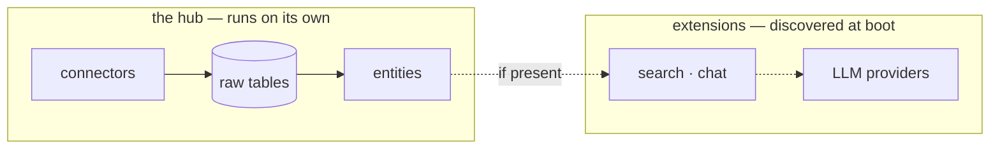

# Architecture — the why

Every page in this documentation describes a *what*. This one collects the *whys* —
the four design commitments everything else hangs from. If you are evaluating lumnik
for an exacting IT department, this is the page to argue with.

## Read-only first

Nobody signs off on an ERP migration; everybody signs off on a read. So ingestion is
built one-way: there is no write path back to your systems — not behind a flag, not
for administrators. The hub lands data in its own PostgreSQL and everything else
(fusion, chat, apps, events) works on that copy. Your system of record stays the
sole owner of its data.

The same posture extends downstream: the SQL that answers a chat question executes on
a **separate, physically read-only database connection** — see the next commitment.

## Isolation lives in the database

Multi-tenant isolation is not application code you have to trust; it is PostgreSQL
Row-Level Security, enforced by the layer that cannot be bypassed by a bug in the
layer above. Three database roles carry three trust levels:

- the request path runs **RLS-enforced**, and owns nothing;
- LLM-generated SQL runs on a role that can **only read**, with an empty
  `search_path`;
- deliberate cross-tenant work (migrations, purges) runs on a separate role that
  every code path must use *explicitly*.

The full mechanics — policies, the tenant GUC, what RLS does and does not protect
against — are on [RLS & database roles](security/rls.md).

## Honesty as architecture, not tone

The system prefers a refusal to a plausible guess, and that preference is
implemented, not promised:

- on the way **in**, a run's arithmetic always closes — a row is written, benignly
  skipped, or quarantined with its reason
  ([ingestion honesty](transparency/ingestion-honesty.md));
- on the way **out**, deterministic guards stand between a question and its answer,
  and an empty result is never phrased as a confident "there are none"
  ([the five guards](transparency/ask-honesty.md));
- disagreements between sources are preserved in a ledger instead of silently
  resolved ([entities](entities.md)).

## Declared over inferred

Where meaning enters the system, a human declares it: connectors, entities, views,
processes and lifecycles are all **manifests** an integrator applies — validated,
refusable, versionable in git. A [workflow](apps/workflows.md) even records *how* its
lifecycle is known (`provenance: declared`), so the day something is inferred instead,
the difference will be citable — not retrofitted.

## One hub, optional extensions

The hub consumes its extensions through optional interfaces and **degrades
gracefully** when one is absent: a hub without the chat extension still ingests,
fuses and serves — nothing half-works: even `lm view generate`, long the one exception,
now answers an absent chat model with a named abstention instead of raising. That seam is a boundary we enforce in the
build, not a diagram courtesy.

---

Ready to verify any of this against a running system? [Deploy](deploy.md) is one
command, and the [cheat sheet](cheat-sheet.md) is the minimum you need to poke at it.
