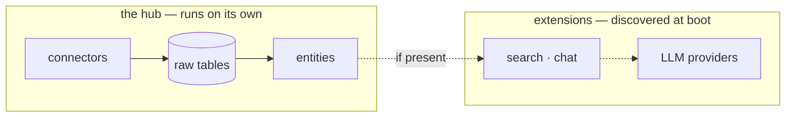

# Architecture — the why

Every other page describes a *what*. This one lists the design commitments everything else
hangs from — the page to read when evaluating lumnik.

## Read-only first

Ingestion is one-way. There is no write path back to your source systems — not behind a flag,
not for administrators.

- The hub lands the data in its own PostgreSQL.
- Fusion, chat, apps and events work on that copy.
- Your system of record stays the sole owner of its data.

The SQL that answers a chat question runs on a **separate, read-only database connection** — see
the next commitment.

## Isolation lives in the database

Tenant isolation is not application code you have to trust. PostgreSQL Row-Level Security enforces
it, below the application, so a bug in the application cannot bypass it. Three database roles carry
three trust levels:

- requests run **under RLS**, on a role that owns nothing;
- SQL written by the model runs on a role that can **only read**;
- migrations, table creation and purges run on a third role, which bypasses RLS.

Which work uses which role, and what RLS does not protect against:
[RLS & database roles](security/rls.md).

## Refusal over guessing

The system prefers a refusal to a plausible guess:

- on the way **in**, every row is counted: written, skipped, or set aside in the DLQ with
  its reason ([seeing what was ingested](transparency/ingestion-honesty.md));
- on the way **out**, guards stand between a question and its answer. An empty result
  is never phrased as a confident "there are none" ([when Ask refuses](transparency/ask-honesty.md));
- disagreements between sources are kept in the `_conflicts` ledger, never silently
  resolved ([entities](entities.md)).

## Declared over inferred

Where meaning enters the system, a human declares it. Connectors, entities, views,
processes and lifecycles are all **manifests** an integrator applies: validated,
refusable, versionable in git. A [workflow](apps/workflows.md) even says so in its manifest:
`provenance: declared` is required, and it is the only value accepted.

## One hub, optional extensions



A hub without the chat extension still ingests, fuses and serves. What needs a model says so:

```
$ lm view generate desk "les clients de Lyon" -o lyon.yaml
Error: API error 400: generation abstained: no chat model is available on this hub — view generation needs one
```

---

Ready to verify any of this against a running system? [Deploy](deploy.md) is one
command, and the [cheat sheet](cheat-sheet.md) is the minimum you need to poke at it.
