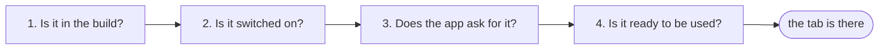

# Choosing what your hub offers

> The same hub can show a warehouse team two tabs and a sales team four, run with the AI
> switched off for a client who forbids a model, or carry Search when it was built in.
> Four questions, asked in order, decide what a métier app shows — and each has one gesture.

| | |
|---|---|
| **Who** | the integrator installing or tuning a hub |
| **Gestures** | the image you deploy, one environment variable, one line in a `kind: App` manifest — and, for Recherche, a `kind: SearchIndex` |
| **See the result** | `lm module list`, then the app itself |
| **Edition** | both — what differs is which answers are possible ([Open vs Pro](editions.md)) |

## The four questions

Questions 1 to 3 decide whether a tab is on an app. Question 4 decides whether it is worth showing:
Recherche checks it before it appears, while Fiches opens anyway and says what is missing. Read them top to
bottom; the first *no* is your answer when something is missing.



| # | Question | Who decides | Your gesture | Where you look |
|---|---|---|---|---|
| 1 | **Is it in the build?** | the image you deploy | pick Open or Pro; add a Search provider when you build the hub | `lm module list` |
| 2 | **Is it switched on?** | the operator | `LUMNIK_AI_ENABLED=false` turns the AI family off; absent means on | `lm module list` |
| 3 | **Does the app ask for it?** | the métier's `kind: App` | `spec.tabs: [...]`; leave it out to take everything the hub offers | `lm app apply` |
| 4 | **Is it ready to be used?** | the feature itself | for Recherche, declare a search index the user may read | the tab, and `lm search status` |

The tabs and who brings them:

| Tab | Shown as | Brought by | Needs |
|---|---|---|---|
| `fiches` | Fiches | every hub | a saved view for the app's scope (without one the tab opens and says so) |
| `inbox` | Décisions | every hub | — |
| `chat` | Chat | Pro (`rag` + `llm`) | the AI switched on |
| `search` | Recherche | a Search provider (`search_pg` or `search_opensearch`) | a search index the user may read |

## 1. Is it in the build?

What the image carries is fixed when the hub is built; no setting adds a module that is not there.
Ask the hub what it carries:

```
$ lm module list
NAME      VERSION  SCHEMA              STATUS  REASON
core      0.1.0    Platform            ACTIVE
identity  0.1.0    Identity & Tenancy  ACTIVE
llm       0.1.0    Model provider      ACTIVE
rag       0.1.0    Platform RAG        ACTIVE
```

That is a Pro hub: `llm` and `rag` are there, together. An Open hub lists `core` and `identity` only —
it has no Chat tab to offer, and nothing to switch on:

```
$ lm module list
NAME      VERSION  SCHEMA              STATUS  REASON
core      0.1.0    Platform            ACTIVE
identity  0.1.0    Identity & Tenancy  ACTIVE
```

Search is added when you build the hub: the published image never carries a provider. See
[Deploy](deploy.md) (`up.sh --search` or `--search-cluster`, closed edition) and
[choosing a provider](search/search-indexes.md#choosing-a-provider). The provider then appears in the list:

```
$ lm module list
NAME       VERSION  SCHEMA              STATUS  REASON
core       0.1.0    Platform            ACTIVE
identity   0.1.0    Identity & Tenancy  ACTIVE
llm        0.1.0    Model provider      ACTIVE
rag        0.1.0    Platform RAG        ACTIVE
search_pg  0.1.0    PostgreSQL search   ACTIVE
```

No `lm` command prints which tabs each module brings; the platform API does (integrator token).
The hub offers the tabs of the active modules — here a Pro hub with the AI switched off:

```
$ curl -s "$LUMNIK_URL/api/platform/modules" -H "Authorization: Bearer $TOKEN" \
    | jq -c '.modules[] | select((.tabs|length)>0) | {id, active, tabs}'
{"id":"core","active":true,"tabs":["fiches","inbox"]}
{"id":"rag","active":false,"tabs":["chat"]}
```

A Search provider adds `{"id":"search_pg","active":true,"tabs":["search"]}`.

## 2. Is it switched on?

One setting switches off the whole AI family — chat, ask, view generation, embeddings — without
rebuilding: `LUMNIK_AI_ENABLED=false`. The gesture per install is in
[Deploy — switch the AI off](deploy.md#switch-the-ai-off). It must be exactly `true` or `false`;
anything else stops the hub at startup. What you see, and what keeps running:
[Switching the AI off](rag/models.md#switching-the-ai-off).

The module list tells the difference between *switched off* and *not there*:

```
$ lm module list
NAME      VERSION  SCHEMA              STATUS    REASON
core      0.1.0    Platform            ACTIVE    
identity  0.1.0    Identity & Tenancy  ACTIVE    
llm       0.1.0    Model provider      INACTIVE  disabled:lumnik.ai.enabled
rag       0.1.0    Platform RAG        INACTIVE  disabled:lumnik.ai.enabled
```

- **Inactive** (Pro, switched off): the data is kept, the images are the same, and putting the setting back
  restores what you had. Content that needed indexing *while the AI was off* is not there when it returns —
  re-apply the workflow or re-ingest the file ([what comes back](rag/models.md#switching-the-ai-off)).
- **Absent** (Open): the module is not in the build, so it is not in the list at all.

Either way the Chat tab is gone from every app. Search is not part of this switch: turning the AI off leaves
Search exactly as it was.

## 3. Does the app ask for it?

Each métier app is a `kind: App` manifest. Without `tabs` it shows everything the hub offers (and
whatever a later release adds). To show fewer tabs, or to change their order, list them:

```yaml
kind: App
apiVersion: apps.lumnik.io/v1
metadata:
  name: stock
spec:
  title: Stock
  scope: stock
  icon: stock
  tabs: [fiches, inbox]        # no Chat for the warehouse
```

```
$ lm app apply -f stock.yaml
Applied app "stock" → scope stock
  tabs: fiches, inbox
```

A tab the hub does not offer is kept, and shows up the day the hub offers it. The apply warns
without failing — here `tabs: [fiches, inbox, chat]` on a hub without Chat:

```
$ lm app apply -f stock.yaml
Applied app "stock" → scope stock
  tabs: fiches, inbox, chat
! stock.yaml — 0 error(s), 1 warning(s)

  WARN     spec.tabs[2]
          tab 'chat' is not offered by this hub; the declaration is kept and takes effect when a module offering it is active
          → offered here: [fiches, inbox]
```

The last line is the hub's offer. Order, the opening tab and what is refused:
[Choosing the tabs](apps/pwa.md#choosing-the-tabs).

Hiding a tab hides it, nothing more: who may read what is still decided by roles and scopes.

## 4. Is it ready to be used?

| Tab | Ready when | Check |
|---|---|---|
| Fiches | a saved view exists for the app's scope (otherwise the tab opens and says so) | `lm view list --scope <app scope>` |
| Recherche | the user may read a search index (otherwise the tab is not shown) | `lm search status` |

Recherche's full checklist: [Enabling Recherche for an app](apps/pwa.md#enabling-recherche-for-an-app).

Whether Search is installed: the TUI's `:search` page says so in its banner, and a query on a hub
without a provider is refused, never answered with an empty list:

```
$ lm search query "Lyon"
Error: search is not installed on this hub — no Search provider is built into it, so there is nothing to query (this is not an empty result). The published hub image never carries one: build it from source with deploy/selfhost/up.sh --search (PostgreSQL) or --search-cluster (OpenSearch), both closed edition
```

## Recipes

**A warehouse app with no Chat, on a Pro hub.** Question 3 only: `tabs: [fiches, inbox]` in the app's
manifest, then `lm app apply -f`. The other apps keep their Chat.

**A client who forbids a model on their hub.** Question 2: [switch the AI off](deploy.md#switch-the-ai-off). Every
app loses its Chat tab at once, no manifest changes, and the rest of the hub (including Oracle, SCIM and
Search) is untouched.

**One métier searching, the others not** (questions 3 and 4, here for the `stock` app):

1. In the `stock` app's manifest, list `search` in `tabs`; `lm app apply -f`.
2. In each `kind: Entity` to search, set `scopes: [stock]` (the entity's `scopes` list — not the app's
   `scope`, not the users' `scope:<tag>` role); `lm entity apply -f`.
3. Declare a search index over those entities: `lm search apply -f`.
4. Give every *other* app a `tabs` list without `search`. An app that leaves `tabs` out shows Recherche
   to any user who may read some index.

!!! warning "*Aucun résultat* on every search"
    An app whose scope has nothing indexed still shows Recherche when its users can read another scope's
    index — and every search answers *Aucun résultat*. Check `lm search status` when a métier expects hits.

## When a tab is missing

Go down the questions; stop at the first one that answers *no*.

| What you see | Look at | Likely answer |
|---|---|---|
| No Chat tab on any app | `lm module list` | `llm` and `rag` missing: this is an Open build. Listed `INACTIVE` with `disabled:lumnik.ai.enabled`: [switch the AI back on](deploy.md#switch-the-ai-off). |
| No Recherche tab on any app | `lm module list` | no `search_pg` / `search_opensearch`: the hub was built without a Search provider. |
| No Recherche tab, yet `search_pg` is `ACTIVE` | `lm search status` | no `kind: SearchIndex` is declared yet (the list is empty), or the users may read none of the entities the indexes cover. |
| Recherche missing on one app only | that app's manifest | `tabs` leaves out `search`; or its users hold scopes that read none of the indexed entities (compare each entity's `scopes` with their `scope:<tag>` roles). |
| Recherche there, but always *Aucun résultat* | `lm search status` | the index is not built yet (`STATUS`, `DOCUMENTS`). |
| … and `STATUS` reads `invalid` | `lm search status` | an entity re-apply removed a column the index declares — [re-apply the index](search/search-indexes.md#when-the-entity-changes). |
| … and `STATUS` reads `withheld` | `lm search status` | an index re-apply removed or changed a field — [it serves again once rebuilt](search/search-indexes.md#removing-a-field-from-an-index). |
| … and the index is ready | `lm search status` | no index covers the entities of the app's scope. |
| A tab listed in `tabs` does not show | `lm app apply -f` again | the hub does not offer it (question 1 or 2): the apply warns. The warning reflects the offer when you apply; the tab appears once the hub offers it. |
| Chat tab present, answers fail | `lm rag status` | the tab shows whenever `rag` and `llm` are active; a model that is not reachable is a different problem ([models](rag/models.md)). |

## See also

- [The two editions](editions.md) — what Open and Pro each carry
- [The métier PWA](apps/pwa.md) — the tabs, from the user's side
- [Switching the AI off](rag/models.md#switching-the-ai-off) — the full effect, and what it restores
- [Declare a search index](search/search-indexes.md) · [Query it](search/querying.md)
