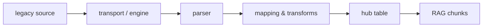

# Connectors

> Connectors ingest your legacy sources — files, databases, APIs, event topics — into
> hub tables, read-only and declaratively: one YAML manifest, three commands —
> validate, apply, run.

## Which connector for which source?

| Your source | Connector | Page |
|---|---|---|
| CSV exports — dropped locally, on SFTP, or in S3 | `csv-file` | [CSV & files](csv.md) |
| A live database — PostgreSQL; Oracle (**Pro**) | `jdbc-generic` | [JDBC](jdbc.md) |
| An HTTP/JSON API (Stripe, HubSpot, …) | `rest-generic` | [REST](rest.md) |
| A GraphQL API | `rest-generic`, GraphQL shape | [GraphQL](graphql.md) |
| A SOAP middleware (Siebel, SAP PI, …) | `rest-generic`, SOAP shape | [SOAP](soap.md) |
| An event broker (Kafka, Redpanda, Event Hubs) | `kafka` — **Pro** | [Kafka](kafka.md) |

There are **five connector types**: `csv-file`, `jdbc-generic`, `rest-generic`, `kafka` and
`hello-world` (a smoke-test connector with no page of its own). GraphQL and SOAP are not types:
they are request shapes of a `rest-generic` endpoint, with the same auth, retry and rate limits.

## The pipeline



Every connector reads the source and writes a hub table. Each tenant sees only its own rows.

- A `csv-file` connector can repair the data on the way: [Transformers](transformers.md).
- On lumnik Pro with the AI on, the table also feeds the [scoped chat](../rag/scopes.md).

## The lifecycle — every connector, same three commands

Assumes a deployed hub and an authenticated `lm` — see [Quickstart](../quickstart/installer.md).

1. Write a manifest (`kind: Connector`) — every connector uses the same envelope:

    ```yaml
    apiVersion: connectors.lumnik.io/v1
    kind: Connector
    metadata:
      name: <kebab-case-name>
      connector_type: <csv-file|jdbc-generic|rest-generic|kafka>
      scopes: [<scope>]                    # the scope(s) this connector's tables are askable in
    spec:
      # type-specific — see your connector's page
      ...
    ```

2. `lm validate -f manifest.yaml` — check it without touching anything.
3. `lm apply -f manifest.yaml` — register or update the connector (safe to re-run).
4. `lm connector run <name>` — run it now. Or schedule it:
    - `spec.schedule: "0 6 * * *"` — cron, evaluated in UTC (here: daily at 06:00 UTC).
    - `spec.window: "22:00-07:00"` — scheduled runs start only inside this UTC window; the end
      is exclusive, so `07:00` keeps the `06:00` slot inside.

    What the three commands print, on a small orders export:

    ```
    $ lm validate -f orders.yaml
    ✓ orders.yaml — valid
    $ lm apply -f orders.yaml
    Applied connector "orders" — 1 endpoint
    $ lm connector run orders
    run scheduled: 6806802f-ed3c-46d6-8eeb-a0f7cff94e77
    ```

    "Scheduled" is not "done" — the result lands in the run ledger a few seconds later:

    ```
    $ lm run list --connector orders
    ID        CONNECTOR  ENDPOINT  STATUS     IN  OUT  SKIPPED  DEAD-LETTERS  STARTED           ENDED
    6806802f  orders     default   Completed  10  8    2        2             2026-10-19 01:41  2026-10-19 01:41
    $ lm dlq list --run 6806802f-ed3c-46d6-8eeb-a0f7cff94e77
    ID        CONNECTOR  RUN       REASON           ATTEMPTS  RESOLUTION  MESSAGE
    7c863b7a  orders     6806802f  MalformedSource  1                     /tmp/exports/sales-orders.csv:10 — Record has 5 values but o…
    004c3b56  orders     6806802f  MalformedSource  1                     /tmp/exports/sales-orders.csv:7 — Record has 4 values but on…
    ```

    Ten rows read, eight written, two set aside in the dead-letter queue with their reason.

    `lm connector run` prints one run id. A connector with several endpoints starts one run
    per endpoint: `lm run list --connector <name>` shows them all.
5. Watch it in the TUI ([CLI & TUI](../cli/lm-reference.md)): `:sources` (connectors),
   `:runs` (history), `:dlq` (rejected rows).

### Several runs at once

- A hub runs at most **4** scheduled endpoints at once. The others wait; a waiting endpoint has
  no run in `lm run list` yet.
- `lm run cancel <id>` stops a run after its current batch of rows.
- Raising the limit, and queuing manual runs:
  [Turning on the run queue](../operations/upgrade.md#turning-on-the-run-queue).

### Freshness follows the schedule

A change in the source appears at the next run that reads it.

- A row deleted at the source stays in the hub table. One exception: a `csv-file` connector
  reading one local file, where the table follows the file ([full refresh](csv.md#one-file-is-the-table-full-refresh)).
- A JDBC watermark connector re-reads only the rows whose watermark moved.

## Validate before apply

| Command | Purpose |
|---|---|
| `lm validate -f manifest.yaml` | Validate without applying. Exit 0 if valid (warnings allowed), 1 if errors. |
| `lm apply -f manifest.yaml` | Apply. The server runs the same checks: on errors nothing is written and you get the same report. Warnings do not block the apply. |
| `lm describe connector-type <kind>` | Show the schema (fields, types, required/optional, docs) of a connector type. |

### Valid

```
$ lm validate -f stripe.yaml
✓ stripe.yaml — valid
```

### Errors only

```
$ lm validate -f bad.yaml
✗ bad.yaml — 2 error(s), 0 warning(s)

  ERROR    spec.auth.token_env
          bearer auth requires token_env (or inline token_value)
          → Use `lm secret set <NAME> ...` then reference via token_env: <NAME>

  ERROR    spec.endpoints[0].id
          must match kebab-case identifier

Fix errors above before running 'lm apply -f bad.yaml'.
Error: validation failed: 2 error(s)
```

### Warnings only (still valid, exit 0)

```
$ lm validate -f noscopes.yaml
! noscopes.yaml — 0 error(s), 1 warning(s)

  WARN     metadata.scopes
          no scopes declared — the connector's tables will not be askable in any scope
          → Add: scopes: [compta]  (users need the scope:compta role)
```

`lm apply` prints the same warnings, and applies. A warning never fails `lm validate` or
`lm apply`.

### Exit codes

| Exit | Meaning |
|---|---|
| 0 | No errors (warnings allowed) |
| 1 | Validation errors, and every other failure (file not found, unparsable YAML, hub unreachable) |
