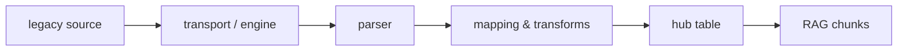

# Connectors

> Connectors ingest your legacy sources — files, databases, APIs, event topics — into
> hub tables, read-only and declaratively: one YAML manifest, three commands —
> validate, apply, run.

## Which connector for which source?

| Your source | Connector | Page |
|---|---|---|
| CSV exports — dropped locally, on SFTP, or in S3 | `csv-file` | [CSV & files](csv.md) |
| A live database (PostgreSQL — the only dialect in v1) | `jdbc-generic` | [JDBC](jdbc.md) |
| An HTTP/JSON API (Stripe, HubSpot, …) | `rest-generic` | [REST](rest.md) |
| A GraphQL API | `rest-generic`, GraphQL shape | [GraphQL](graphql.md) |
| A SOAP middleware (Siebel, SAP PI, …) | `rest-generic`, SOAP shape | [SOAP](soap.md) |
| An event broker (Kafka, Redpanda, Event Hubs) | `kafka` — **Pro** | [Kafka](kafka.md) |

There are **five connector types** (`csv-file`, `jdbc-generic`, `rest-generic`, `kafka`,
`hello-world`). GraphQL and SOAP are not types — they are per-endpoint *request shapes*
on the REST engine, sharing its auth, retry, rate-limiting and storage. (`hello-world` is
the smoke-test connector — it has no manifest page of its own.)

## The pipeline



Every connector follows the same path: read from the source, parse, optionally
transform ([Transformers](transformers.md)), write to a tenant-isolated hub table,
index into the RAG corpus for [scoped chat](../rag/scopes.md).

## The lifecycle — every connector, same three commands

Assumes a deployed hub and an authenticated `lm` — see [Quickstart](../quickstart/installer.md)
if you haven't set those up yet.

1. Write a manifest (`kind: Connector`) — every connector uses the same envelope:

    ```yaml
    apiVersion: connectors.lumnik.io/v1
    kind: Connector
    metadata:
      name: <kebab-case-name>
      connector_type: <csv-file|jdbc-generic|rest-generic|kafka>
      scopes: [<métier>]          # the scope(s) this connector's tables are askable in
    spec:
      # type-specific — see your connector's page
      ...
    ```

2. `lm validate -f manifest.yaml` — check it without touching anything.
3. `lm apply -f manifest.yaml` — register or update the connector (idempotent —
   safe to re-run).
4. `lm connector run <name>` — run it now; or declare `spec.schedule: "0 6 * * *"`
   (add `spec.window: "22:00-07:00"` to fence scheduled runs into a UTC time window —
   the end is exclusive, so `07:00` keeps that `06:00` slot inside)
   (cron, evaluated in UTC — this example fires daily at 06:00 UTC).

    What the three commands print, on a small orders export:

    ```
    $ lm validate -f orders.yaml
    ✓ orders.yaml — valid
    $ lm apply -f orders.yaml
    {"name":"orders","connectorId":"487ed9d1-58d5-4120-969c-dc448910e1f2","endpointsApplied":1}
    $ lm connector run orders
    run scheduled: f0466804-0824-4eb4-8aa2-54e263dccafe
    ```

    "Scheduled" is not "done" — the ledger is where the result lands, a few seconds later:

    ```
    $ lm run list --connector orders
    ID        CONNECTOR  STATUS     IN  OUT  SKIPPED  DEAD-LETTERS  STARTED           ENDED
    f0466804  orders     Completed  10  8    2        2             2026-09-05 05:38  2026-09-05 05:38
    ```

    Ten rows read, eight written, two set aside with their reason (`lm dlq list`).
5. Watch it in the TUI ([CLI & TUI](../cli/lm-reference.md)): `:sources` (connectors),
   `:runs` (history), `:dlq` (rejected rows — set aside instead of failing the run,
   inspected with `lm dlq list`).

**Freshness follows the schedule**: a change in the source appears at the next run *that
reads it* — deletes never propagate, and watermark mode only re-reads rows whose
watermark advanced. How the *user* perceives that age is an open question the
[PWA page answers](../apps/pwa.md#how-old-is-what-im-looking-at).

## Validate before apply

| Command | Purpose |
|---|---|
| `lm validate -f manifest.yaml` | Validate without applying. Exit 0 if valid (warnings allowed), 1 if errors. |
| `lm apply -f manifest.yaml` | Apply — the same checks gate the server: on errors nothing is written and you get the same field-by-field report. |
| `lm describe connector-type <kind>` | Show the schema (fields, types, required/optional, docs) for a connector type — run it any time, before writing a single line of YAML. |

### Valid

```
$ lm validate -f stripe.yaml
✓ stripe.yaml — valid
```

### Errors only

```
$ lm validate -f bad.yaml
✗ bad.yaml — 2 error(s), 0 warning(s)

  ERROR    spec.auth.token_env
           required field missing (required when kind = bearer)

  ERROR    spec.endpoints[0].id
           must match kebab-case identifier

Fix errors above before running 'lm apply -f bad.yaml'.
```

### Warnings only (still valid, exit 0)

```
$ lm validate -f noscopes.yaml
! noscopes.yaml — 0 error(s), 1 warning(s)

  WARN     metadata.scopes
           no scopes declared — the connector's tables will not be askable in any métier
           → Add: scopes: [compta]  (the métier a user must hold as scope:compta)
```

### Exit codes

| Exit | Meaning |
|---|---|
| 0 | No errors (warnings allowed) |
| 1 | One or more validation errors |
| 2 | Reserved: parse failure, file not found, server unreachable |
