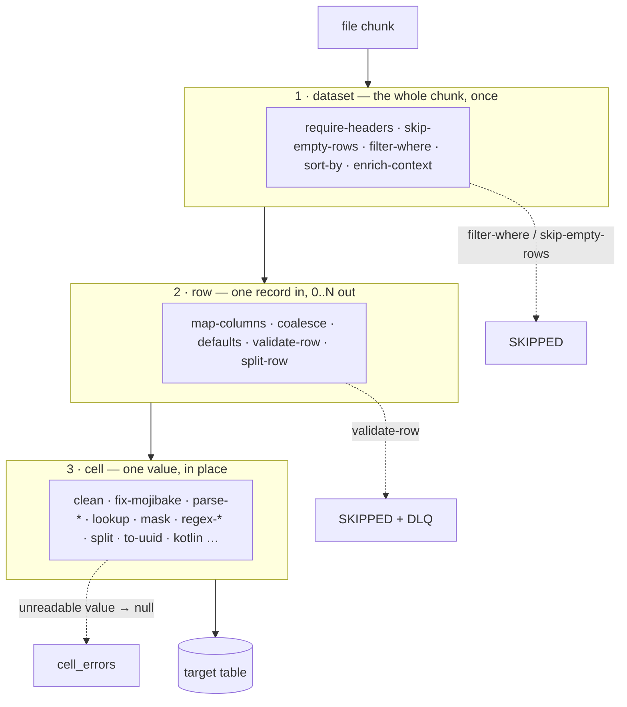

# Transformers

> Repair legacy data as it flows in — mojibake, `DD/MM/YYYY` dates, numbers in parentheses —
> declared in the manifest's `spec.mapping` block, no code.

## Where this applies

- **`csv-file` connector runs only.** The csv-file connector applies the `spec.mapping` hooks
  before writing.
- **jdbc and kafka write a 1:1 dump** — no `spec.mapping`. jdbc has one narrow knob for a source
  column colliding with a hub system column: `source.tables[].rename`, see
  [JDBC: the hub table](jdbc.md#the-hub-table).
- **REST/GraphQL/SOAP** transform in the `promote:` block's `transform:` enum — a short fixed
  list, see [REST: the `transform:` enum](#rest-the-transform-enum).
- **Not the one-shot `lm csv ingest`.** That path writes directly; its `spec.mapping` (if any)
  is ignored. To transform, apply a `csv-file` connector manifest and run it.
- **Dirty status values are a different tool's job** — declare them as
  [workflow aliases](../apps/workflows.md#alias-semantics), which map legacy statuses without
  touching the data.
- **Rehearse before the live feed.** [`lm validate`](index.md#the-lifecycle-every-connector-same-three-commands)
  checks the manifest's shape, not your data. Run against a sample file first, read the result,
  then point the same manifest at the real feed.

## Three tiers, one order

```yaml
spec:
  mapping:
    dataset:                    # tier 1 — the whole chunk, once
      - skip-empty-rows: {}
    row:                        # tier 2 — one record; may emit 0..N rows
      - map-columns: { rename: { CUST_NM: name } }
    cell:                       # tier 3 — one value, mutated in place
      - fix-mojibake: { columns: [name] }
```



- **Across tiers the order is fixed**: dataset → row → cell, always.
- **Within a tier, hooks run top to bottom** as listed — order is yours, and it matters
  (`validate-row` before `split-row`; `regex-extract` before the `default` that fills its misses).
- **One entry per hook**: `- hook-name: { params }`. A misspelled name passes `lm validate` and
  fails the run: `✖ run failed: unknown cell hook: fix-mojibak`.

Three exits, three counters — nothing is dropped silently:

| what happens to the row | hook | counted in |
|---|---|---|
| excluded by a declared filter | `filter-where`, `skip-empty-rows` | `SKIPPED` |
| dropped for a missing field | `validate-row` | `SKIPPED` **and** the DLQ |
| written, one value `null` | a cell hook that cannot read the value | `cell_errors` |

## Dataset hooks — the whole chunk, once

- Run **once per chunk** (500 rows), before the row and cell tiers. A dataset hook never sees
  the whole file.
- So `sort-by` orders **within a chunk** — not the file, not the run. On a local glob run a
  chunk may hold the end of one file and the start of the next.

### `require-headers` — refuse a file with the wrong shape

```yaml
dataset:
  - require-headers: { columns: [c_bpartner_id, name], any-of: [created, isactive] }
```

| the file's header | result |
|---|---|
| `c_bpartner_id,name,created,isactive` | passes |
| `c_bpartner_id,name,created` | passes — `columns` all present, one of `any-of` present |
| `c_bpartner_id,name` | **fails the run**: `none of required headers found: [created, isactive]` |
| `name,created` | **fails the run**: `required header missing: c_bpartner_id` |

- `columns` — every name must exist. `any-of` — at least one must.
- With `has_header: false`, "the header" is the `parser.columns` list you declared.
- An empty chunk passes: there is no header to check.

### `skip-empty-rows` — blank lines in the export

```yaml
dataset:
  - skip-empty-rows: {}
```

Before:

```csv
code,name
C1,Acme Corp
,
C2,Globex
```

After: `C1` and `C2`. The blank row (every cell null or whitespace) is counted in `SKIPPED`,
not dead-lettered.

### `filter-where` — keep only the rows you asked for

```yaml
dataset:
  - filter-where: { column: status, in: [ACTIVE, PENDING] }
```

| `status` | `in: [ACTIVE, PENDING]` | `equals: ACTIVE` | `regex: "[0-9]+"` |
|---|---|---|---|
| `ACTIVE` | kept | kept | dropped |
| `PENDING` | kept | dropped | dropped |
| `1042` | dropped | dropped | kept |
| `10a` | dropped | dropped | dropped — `regex` is a **full** match |
| *(null)* | dropped | dropped | dropped — a null compares as `""` |

- Declare any of `equals`, `in`, `regex`; several combine with **AND**.
- A dropped row is counted in `SKIPPED`, not dead-lettered.
- A bad `regex` is refused when the run starts, naming the hook and the knob.

### `sort-by` — order within the chunk

```yaml
dataset:
  - sort-by: { columns: [c_bpartner_id] }        # max-rows: 100000 by default
```

| before | after |
|---|---|
| `1000280`, `1000001`, *(null)*, `1000117` | *(null)*, `1000001`, `1000117`, `1000280` |

- Lexicographic (text order — `9` sorts after `10`), **within the 500-row chunk**: a longer
  file is sorted piecewise, never as a whole.
- Nulls sort first, as empty strings.
- Over `max-rows` the run refuses: `sort-by max-rows exceeded: <n> > <max> (input must be
  pre-sorted or increase max-rows)`.

### `enrich-context` — stamp provenance on every row

```yaml
dataset:
  - enrich-context: { source_system: siebel, ingested_at: "${now}" }
```

Before:

```csv
code,name
C1,Acme Corp
```

After:

```csv
code,name,source_system,ingested_at
C1,Acme Corp,siebel,2026-08-20T14:03:11.482Z
```

- Adds a constant column to every row of the chunk; `${now}` resolves once, to the ingestion
  instant.
- An existing value in that column is **never overwritten**.
- Handy to feed a cell hook a test value — the
  [full example](#one-manifest-every-transformer) mints its dirty inputs this way.

## Row hooks — one record in, 0..N out

A row hook can drop, duplicate, or reshape rows.

### `map-columns` — legacy column names (`CUST_NM`)

```yaml
row:
  - map-columns:
      rename: { CUST_NM: name, CUST_CITY: city }
      drop: [internal_flag]
```

Before:

```csv
CUST_NM,CUST_CITY,internal_flag
Bénédict Martin,Montréal,X
```

After:

```csv
name,city
Bénédict Martin,Montréal
```

- Renames first, **then** drops — so `drop` names a renamed column by its **new** name. Naming
  the old one removes nothing.
- A renamed column always appears, even when the value is empty.
- Renaming a column **away** from a hub system column (`id`, `tenant_id`, `_row_hash`, …) is what
  this hook is for.

`lm validate` (and `lm apply`) refuse six shapes, naming the entry — here all six in one
manifest:

```yaml
row:
  - map-columns:
      rename: { CUST_NM: , CUST_CITY: 2city, CUST_ID: id, A: same, B: same }
      drop: internal_flag
  - map-columns:
      rename: [CUST_NM]
```

```
$ lm validate -f map-bad.yaml
✗ map-bad.yaml — 6 error(s), 0 warning(s)

  ERROR    spec.mapping.row[0].map-columns.rename.CUST_NM
          must name a target column — a colon with nothing after it is null, not a rename target, and 'null' would otherwise become the column's literal name
          → Example: map-columns: { rename: { CUST_NM: name }, drop: [flag] }

  ERROR    spec.mapping.row[0].map-columns.rename.CUST_CITY
          must be a plain identifier (letters, digits, underscore; not starting with a digit): 2city
          → Example: map-columns: { rename: { CUST_NM: name }, drop: [flag] }

  ERROR    spec.mapping.row[0].map-columns.rename.CUST_ID
          targets 'id', a hub system column (_ingested_at, _mapping_version, _row_hash, _run_id, _source, id, tenant_id) — renaming a source column AWAY from one of these is what the rename is for, renaming into one only recreates the collision
          → Example: map-columns: { rename: { CUST_NM: name }, drop: [flag] }

  ERROR    spec.mapping.row[0].map-columns.rename
          targets 'same' from more than one source column — one of them would be silently lost
          → Example: map-columns: { rename: { CUST_NM: name }, drop: [flag] }

  ERROR    spec.mapping.row[0].map-columns.drop
          must be a list of column names (got string) — for example drop: [internal_flag]
          → Example: map-columns: { rename: { CUST_NM: name }, drop: [flag] }

  ERROR    spec.mapping.row[1].map-columns.rename
          must be a map of source column to target column (got array) — for example rename: { CUST_NM: name }
          → Example: map-columns: { rename: { CUST_NM: name }, drop: [flag] }

Fix errors above before running 'lm apply -f map-bad.yaml'.
Error: validation failed: 6 error(s)
```

One shape depends on the data and is not refused: **the target already exists in the row**.
`rename: { customer_id: ref }` on a file that already has `ref` overwrites it and counts one
[cell error](#reference-cell-hooks) per row.

### `coalesce` — first non-blank of several columns

```yaml
row:
  - coalesce: { column: display_name, from: [trade_name, name] }
```

| `display_name` | `trade_name` | `name` | → `display_name` |
|---|---|---|---|
| *(absent)* | `Dupont` | `DUPONT SARL` | `Dupont` |
| *(absent)* | *(blank)* | `DUPONT SARL` | `DUPONT SARL` |
| `Kept` | `Dupont` | `DUPONT SARL` | `Kept` — a filled target is never touched |
| *(absent)* | *(absent)* | *(blank)* | *(absent)* — nothing to take |

- Copies the value **as it stands in the row tier**, before any cell hook: in the full example
  `display_name` keeps `DUPONT SARL` while `name` is title-cased.

### `defaults` — fill blanks in several columns

```yaml
row:
  - defaults: { is_active: "Y", country: FR }
```

| `is_active` | → |
|---|---|
| `N` | `N` — never overwrites |
| *(blank)* | `Y` |
| *(absent)* | `Y` — the column is created |

The cell-tier twin is [`default`](#default-fill-one-blank-column) (one column) — pick by where
you need it in the order.

### `validate-row` — rows missing mandatory fields

```yaml
row:
  - validate-row: { required: [code, name] }
```

Before:

```csv
code,name
C1,Acme Corp
C2,
```

After: `C1` only. `C2` (blank `name`) is counted in `SKIPPED` and dead-lettered:

```
$ lm run get fc9b4ba6
ID        CONNECTOR      ENDPOINT  STATUS     IN  OUT  SKIPPED  DEAD-LETTERS  STARTED           ENDED
fc9b4ba6  csv-customers  default   Completed  2   1    1        1             2026-10-19 07:19  2026-10-19 07:19
⚠ 1 rows quarantined — see: lm dlq list --run fc9b4ba6-5b32-49a3-af64-f96b8c344a2c

$ lm dlq list --run fc9b4ba6-5b32-49a3-af64-f96b8c344a2c
ID        CONNECTOR      RUN       REASON            ATTEMPTS  MESSAGE
c20e8610  csv-customers  fc9b4ba6  ValidationFailed  1         required column 'name' is missing or blank
```

- The dead letter holds the row **as it stood in the row tier** — raw, before any cell hook
  (`mask` included) ran.
- `lm dlq get <id>` shows it; `discard` drops it, `replayed` records that you re-sent it
  yourself. The hub never re-reads a dead letter ([`lm dlq`](../cli/lm-reference.md)).
- On a single-file connector (full refresh), a `validate-row` drop counts like an unreadable
  row: a run that would remove rows ends `Failed` and removes nothing —
  see [full refresh](csv.md#one-file-is-the-table-full-refresh). For example, after `C1` was deleted from the file and a row `C3,Beta Ltd` added:

```
$ lm run get 270592cb
ID        CONNECTOR      ENDPOINT  STATUS  IN  OUT  SKIPPED  DEAD-LETTERS  STARTED           ENDED
270592cb  csv-customers  default   Failed  2   1    1        1             2026-10-19 07:19  2026-10-19 07:19
⚠ 1 rows quarantined — see: lm dlq list --run 270592cb-c512-4601-9a1c-ba6927c4afd4
✖ run failed: 1 row(s) of the file went to the dead letters this run (lm dlq list --run 270592cb-c512-4601-9a1c-ba6927c4afd4): a full refresh removes nothing while a row of the file is in the dead letters, whatever its reason (unreadable, dropped by validate-row…) — nothing was removed. Fix the cause each dead letter reports (lm dlq get <id>) and run again.
```

`C3` is written; `C1` stays in the table.

`validate-row` placed **after** `split-row` is refused at validate (it would drop fragments,
not source rows). So is `aggregator`:

```yaml
row:
  - split-row: { by: tags, sep: ";" }
  - validate-row: { required: [code] }
  - aggregator: { emit-on-change: code }
```

```
$ lm validate -f order.yaml
✗ order.yaml — 2 error(s), 0 warning(s)

  ERROR    spec.mapping.row[2].aggregator
          aggregator is not supported on csv-file connector runs — each chunk commits separately, buffered rows would be silently lost at chunk boundaries
          → Pre-aggregate in the source (e.g. a grouped export), or drop the aggregator hook

  ERROR    spec.mapping.row[1].validate-row
          validate-row after split-row is not supported — validation would drop fanned fragments and corrupt the run arithmetic. Validate before splitting.
          → Validate before splitting, or drop the validate-row hook

Fix errors above before running 'lm apply -f order.yaml'.
Error: validation failed: 2 error(s)
```

### `split-row` — one row per value of `a;b;c`

```yaml
row:
  - split-row: { by: tags, sep: ";" }
```

Before:

```csv
id,tags
1,a;b;c
```

After:

```csv
id,tags
1,a
1,b
1,c
```

- Parts are trimmed; every other column is copied onto each fragment.
- `explode: <column>` does the same over a column that already holds a list.
- Its cell-tier cousin [`split`](#split-parts-into-new-columns) stays **within** the row.

### `aggregator` — exists, but csv-file runs refuse it

`lm validate` / `lm apply` refuse it on a csv-file connector (refusal shown
[above](#validate-row-rows-missing-mandatory-fields)). Pre-aggregate in the source (a grouped
export), or drop the hook.

## Cell hooks — one value, in place

Two parameter conventions:

- **Multi-column hooks** take `columns: [a, b]`; omitting `columns` (or `columns: ["*"]`)
  applies the hook to **every column** of the row.
- **Single-column hooks** take `column: <name>` and refuse to guess.

Cell hooks fail **soft**: the row is still written, nothing is dropped or dead-lettered, and
`cell_errors` counts what a hook did not deliver as declared —
[reading `cell_errors`](#reference-cell-hooks).

### `clean` — BOM, stray whitespace, control characters

```yaml
cell:
  - clean: { columns: [name, note], strip: true, remove-control-chars: true, normalize-unicode: NFC }
```

| in | out |
|---|---|
| `  hello\t` (a BOM, two spaces, a tab) | `hello` |
| `Café` as `e` + combining accent | `Café` as one precomposed `é` (`NFC`) |

- A leading BOM is **always** stripped; the three knobs are off by default.
- `remove-control-chars` also removes tabs and newlines inside a value.
- `normalize-unicode`: `NFC`, `NFD`, `NFKC` or `NFKD`. Use `NFC` when two exports spell the
  same accent two ways and your keys stop matching.

### `fix-mojibake` — accents came out as `Bénédict`

**Mojibake** is text written as UTF-8 and read back as Latin-1. This hook recovers it — and
only when it recognizes the pattern.

```yaml
cell:
  - fix-mojibake: { columns: [name, city] }
```

| in | out |
|---|---|
| `Bénédict Martin` | `Bénédict Martin` |
| `Côte d'Azur` | `Côte d'Azur` |
| `Bénédict Martin` | unchanged — no mojibake pattern, a clean value is never touched |
| `Bénédict €` | **unchanged**, +1 `cell_errors` — declined, see below |

- Not the parser's encoding detection ([CSV & files → Parser](csv.md#parser)): `fix-mojibake`
  fixes values already stored garbled in the source system.
- A multi-line cell (a quoted postal address) is one value: every line is repaired.

!!! tip "When the repair is declined"
    A value mixing mojibake with a character outside Latin-1 (Japanese, Cyrillic, Greek, `€`, an
    emoji) is **not repaired at all**:

    - it lands exactly as it arrived, and the run counts one `cell_errors`;
    - the fix is at the source: re-export with the right encoding.

### `decode-html-entities` — `&amp;` in text

```yaml
cell:
  - decode-html-entities: { columns: [slogan] }
```

| in | out |
|---|---|
| `Eau &amp; Soleil` | `Eau & Soleil` |
| `Coffee &lt;hot&gt;` | `Coffee <hot>` |
| `caf&eacute;` | `café` (the HTML4 entity set) |

### `replace-smart-quotes` — curly quotes from Word and Excel

```yaml
cell:
  - replace-smart-quotes: { columns: [slogan] }
```

| in | out |
|---|---|
| `“Eau & Soleil” – depuis 1998…` | `"Eau & Soleil" - depuis 1998...` |
| `l’été` | `l'été` |
| `«bonjour»` | `"bonjour"` |

Also: en/em dash → `-`, ellipsis → `...`, non-breaking space → space.

### `strip-invisible` — a code that "looks equal" but never matches

```yaml
cell:
  - strip-invisible: { columns: [code] }
```

| in | out |
|---|---|
| `AB​CD` (a zero-width space inside) | `ABCD` |
| `soft­hyphen` | `softhyphen` |

Removes every Unicode *format* character (`Cf`): zero-width space/joiner/non-joiner, BOM,
word joiner, soft hyphen.

### `remove-diacritics` — ASCII-only identifiers

```yaml
cell:
  - remove-diacritics: { columns: [city] }
```

| in | out |
|---|---|
| `Montréal` | `Montreal` |
| `ñoño` | `nono` |

### `upper` / `lower` / `titlecase` — case

```yaml
cell:
  - upper: { columns: [legal_form] }
  - lower: { columns: [city] }
  - titlecase: { columns: [name] }
```

| hook | in | out |
|---|---|---|
| `upper` | `sarl` | `SARL` |
| `lower` | `Montreal` | `montreal` |
| `titlecase` | `DUPONT SARL` | `Dupont Sarl` |
| `titlecase` | `MARTIN  DUPONT` (two spaces) | `Martin Dupont` — whitespace **normalised** |

- **Text cells only**: a date, a number or binary data is left as it is.
- Locale-independent folding.
- `titlecase` collapses runs of spaces, tabs and newlines to one space and drops trailing space.

### `truncate` — hard cut

```yaml
cell:
  - truncate: { column: name, length: 60 }
```

| in | out |
|---|---|
| a 75-character name | its first 60 characters |
| a 12-character name | unchanged |

A negative `length` is refused when the run starts.

### `regex-replace` — normalise with a pattern

```yaml
cell:
  - regex-replace: { column: name, pattern: "\\s+", replacement: " " }
```

| in | out |
|---|---|
| `DUPONT   SARL` | `DUPONT SARL` |
| `DUPONT\tSARL` | `DUPONT SARL` |

- `replaceAll` over the cell; `replacement` defaults to `""` (delete the match).
- In `replacement`, `$` and `\` are group references: a lone `$` or a group the pattern does
  not have fails the run naming the hook — escape them (`\\$`).
- A bad pattern is refused when the run starts.

### `regex-extract` — pull a piece into its own column

```yaml
cell:
  - regex-extract:
      column: name
      pattern: ".*\\b(SARL|SAS|EURL|SCI)\\b.*"
      groups: { 1: legal_form }
```

| `name` | → `legal_form` |
|---|---|
| `DUPONT SARL` | `SARL` |
| `Standard` | *(null)* — no match, **not** counted |
| *(empty)* | *(null)* — no cell, no extraction |

- Tries a full match, then a find; each `groups` entry writes one capture group into a named
  column (`0` is the whole match).
- **Every named column exists on every row** — matched, missed, or empty. An all-null column
  means the pattern never matched.
- A miss is **not** counted in `cell_errors`.
- Refused when the run starts: a `groups` key that is not a number, is negative, or exceeds the
  pattern's group count.
- Follow it with [`default`](#default-fill-one-blank-column) to give the misses a value.

### `default` — fill one blank column

```yaml
cell:
  - default: { column: legal_form, value: "NONE" }
```

| in | out |
|---|---|
| `SARL` | `SARL` — never overwrites |
| *(null or blank)* | `NONE` |

Row-tier twin, several columns at once: [`defaults`](#defaults-fill-blanks-in-several-columns).

### `lookup` — translate codes with an inline table

```yaml
cell:
  - lookup: { column: is_active, table: { "Y": true, "N": false }, on-missing: null }
```

| in | `on-missing: keep` *(default)* | `null` | `error` | `INACTIVE` (any literal) |
|---|---|---|---|---|
| `Y` | `true` | `true` | `true` | `true` |
| `?` | `?` | *(null)*, +1 `cell_errors` | **run fails**: `lookup: no match for '?' in column 'is_active'` | `INACTIVE` |

- `table` must be a map — a list or a scalar is refused when the run starts.
- Replacement values land as **text** (`true`, not a boolean).

### `parse-date` — dates are `31/12/2019`

```yaml
cell:
  - parse-date: { column: signup_date, formats: ["dd/MM/yyyy", "yyyy-MM-dd HH:mm:ss"] }
```

| in | out |
|---|---|
| `31/12/2019` | `2019-12-31` — a **date** |
| `2004-10-18 23:42:39` | `2004-10-18 23:42:39+00` — a **timestamp** |
| `12/31/2019` | *(null)*, +1 `cell_errors` — no format matched |
| already a date | unchanged |

- Formats are tried in order. A pattern with no `H`/`h`/`m`/`s` parses to a date; one with a
  time component parses to a timestamp.
- Cheat sheet: `dd` = day, `MM` = month — capital **M**, lowercase `mm` means *minutes*, the
  classic trap — `yyyy` = year. Add `H`/`h`/`m`/`s` only when the source carries a time.

#### Which time zone a time is in

An ERP export writes `2026-08-02 23:30:00` with no time zone. Say which one it is with `zone`:

```yaml
cell:
  - parse-date: { column: stamp, formats: ["yyyy-MM-dd HH:mm:ss"], zone: Europe/Paris }
```

| in | `zone` | stored (shown in UTC) |
|---|---|---|
| `2026-08-02 23:30:00` | *(none)* | `2026-08-02 23:30:00+00`: read as UTC |
| `2026-08-02 23:30:00` | `Europe/Paris` | `2026-08-02 21:30:00+00`: Paris is UTC+2 in summer |
| `2026-01-15 23:30:00` | `Europe/Paris` | `2026-01-15 22:30:00+00`: UTC+1 in winter |
| `2026-08-02` | `Europe/Paris` | `2026-08-02`: a date has no time, `zone` changes nothing |

- Without `zone` (or with an empty one), a time is always read as UTC, wherever the hub runs.
- Fused with an ERP's dates in an entity, see
  [Dates across sources](../entities.md#dates-across-sources): a date-only format makes the CSV
  agree with an ERP date, and a time parsed with the `zone` the ERP's connection declares agrees with
  an ERP time ([A time without a time zone](jdbc.md#a-time-without-a-time-zone)).
- An unknown zone stops the run before its first row:
  `parse-date hook: 'zone' is not a time zone: "Europe/Pariss" (for example Europe/Paris or UTC)`.

### `parse-number` — numbers are `1 234,56 €` or `(123)`

```yaml
cell:
  - parse-number: { column: balance, decimal-separator: ",", negatives-in-parens: true }
```

| in | out |
|---|---|
| `1 234,56 €` | `1234.56` |
| `(123)` | `-123` |
| `$1,234.50` with `decimal-separator: "."` | `1234.50` |
| `n/a` | *(null)*, +1 `cell_errors` |

- Strips currency symbols (`$€£¥`) and spaces, then resolves which of `.`/`,` is the decimal
  separator (`auto` by default). The result is a decimal.

### `parse-email` — trim, lowercase, validate

```yaml
cell:
  - parse-email: { column: contact_email, lower: true }
```

| in | out |
|---|---|
| `  Contact@Example.COM ` | `contact@example.com` |
| `contact at example` | *(null)*, +1 `cell_errors` |

### `parse-phone` — one format for every phone

```yaml
cell:
  - parse-phone: { column: phone, default-region: FR }     # default-region: US by default
```

| in | out |
|---|---|
| `06 12 34 56 78` | `+33612345678` |
| `+1 415 555 2671` | `+14155552671` — a full international number ignores the region |
| `abc` | *(null)*, +1 `cell_errors` |

`default-region` is the country assumed for a number with no `+` prefix — set it to the
source's country or every national number lands wrong.

### `mask` — a column holds card/PII data

```yaml
cell:
  - mask: { column: card_number, keep-last: 4 }       # keep-first: 0, mask-char: "*"
```

| in | out |
|---|---|
| `4556123498761234` | `************1234` |
| `contact@example.com` with `keep-first: 2, keep-last: 4` | `co*************.com` |
| `1234` | `1234` — **unmasked**: not longer than `keep-first + keep-last` |

Counts raw characters — spaces and separators in `4556 1234 9876 1234` count like digits.

!!! warning "Two things to know before trusting `mask` for PII"
    - **A value not longer than `keep-first + keep-last` passes through unmasked.** For a column
      that must never land readable, add a `regex-replace` matching the whole cell as a backstop.
    - **A dead-lettered row keeps its raw, unmasked value** — a malformed row or a `validate-row`
      drop never reaches the cell tier. What [`lm dlq`](../cli/lm-reference.md) shows is unmasked.

### `split` — parts into new columns

```yaml
cell:
  - split: { column: tags, by: ";", into: [tag1, tag2, tag3] }
```

| `tags` | `tag1` | `tag2` | `tag3` | `cell_errors` |
|---|---|---|---|---|
| `retail;online;b2b` | `retail` | `online` | `b2b` | — |
| `retail;online` | `retail` | `online` | *(null)* | **+1** — fewer parts than declared |
| `a;b;c;d` | `a` | `b` | `c` | **+1** — `d` has nowhere to go |

- Stays **within** the row; the original cell is untouched. The row-tier cousin
  [`split-row`](#split-row-one-row-per-value-of-abc) duplicates rows instead.
- Parts are trimmed. Every name in `into` gets its column on every row (`null` when unfilled).
- A **trailing separator produces a part**: `A,B,,` split on `,` is four values.
- `into-array: true` replaces the cell with an array instead:

| the chunk that creates the column | column type | later arrays |
|---|---|---|
| holds at least one array | `jsonb` — `WHERE tags @> '["A"]'` works, `USING GIN (tags)` indexes it | `jsonb` |
| holds only nulls | `text`, never widened | land as JSON text |

### `to-uuid` — an id column holds junk like `N/A` or `0`

Two separate knobs: `generate` decides an **empty** cell, `on-invalid` a cell holding junk.

```yaml
cell:
  - to-uuid:
      column: customer_id
      generate: true          # an EMPTY cell gets a fresh id
      on-invalid: keep        # a cell holding "N/A" is left alone for you to look at
```

| the cell holds | `generate` | `on-invalid` | result | `cell_errors` |
|---|---|---|---|---|
| a valid UUID | anything | anything | unchanged | — |
| nothing (empty) | `false` *(default)* | anything | stays empty | — |
| nothing (empty) | `true` | anything | a fresh id | — |
| `N/A` | anything | `null` *(default)* | emptied | **+1** |
| `N/A` | anything | `generate` | a fresh id **in place of** `N/A` | **+1** |
| `N/A` | anything | `keep` | `N/A`, untouched | — |

A column that does not exist yet counts as empty — `generate: true` on `row_uuid` mints one
per row.

!!! warning "`on-invalid: generate` invents an identifier — use it only for a surrogate key"
    - The minted id replaces a value your source sent, joins to **nothing** elsewhere, and looks
      like a real id. Each one counts in `cell_errors`.
    - Only a few rows dirty? Run once with `keep` and look at them first — `on-invalid` applies
      to the whole column.

### `kotlin` — the escape hatch

```yaml
cell:
  - kotlin:
      script: classpath:hooks/samples/normalize-date.kts
      context: { defaultCountry: FR }    # optional; the script reads it as `context`
```

| `signup_date` in | out |
|---|---|
| `31/12/2019` | `2019-12-31` |
| `2019-12-31` | unchanged — the sample script only rewrites `DD/MM/YYYY` |

Details in [Kotlin escape hatch](#kotlin-escape-hatch) below.

## One manifest, every transformer

Every transformer except `aggregator`, in one manifest over an S3 bucket: a headerless,
tab-separated business-partner export (four columns). Every other input is **minted by
`enrich-context`** so each hook has something to work on.

~~~~yaml
--8<-- "docs/connectors/csv/60-s3-every-transformer.yaml"
~~~~

```
$ lm validate -f docs/connectors/csv/60-s3-every-transformer.yaml
✓ 60-s3-every-transformer.yaml — valid
```

### One source row, column by column

One line of the file (tab-separated, no header), traced as it ran:

```
1000117	"DUPONT SARL"	"2004-10-18 00:00:00"	"N"
```

What lands in `connector.t_s3_c_bpartner_clean` — **twice**, because `split-row` fans
`web;store` into two rows — as `SELECT` shows it:

| column | arrives as | lands as | done by |
|---|---|---|---|
| `c_bpartner_id` | `1000117` | `1000117` | passes `filter-where` (`[0-9]+`), ordered by `sort-by` |
| `name` | `DUPONT SARL` | `Dupont Sarl` | `clean` → `fix-mojibake` → `regex-replace` → `titlecase` → `truncate` |
| `display_name` | — | `DUPONT SARL` | `coalesce` copied `name` in the row tier, **before** `titlecase` |
| `legal_form` | — | `SARL` | `regex-extract` on `name`, then `upper`; a name with no legal form gets `NONE` from `default` |
| `created` → `created_at` | `2004-10-18 00:00:00` | `2004-10-18 00:00:00+00` (timestamp) | `map-columns` rename, `parse-date` |
| `isactive` → `is_active` | `N` | `false` | `map-columns` rename, `defaults` (`Y` when blank), `lookup` |
| `channel_raw` | `web;store` | `web` on one row, `store` on the other | `split-row` |
| `contact_email` | `  Contact@Example.COM ` | `co*************.com` | `parse-email` (trim + lower), then `mask` 2/4 |
| `email_domain` | — | `example.com` | `regex-extract` — placed **before** `mask`, or it would see stars |
| `phone_raw` | `06 12 34 56 78` | `+33612345678` | `parse-phone`, `default-region: FR` |
| `balance_raw` | `1 234,56 €` | `1234.5600` | `parse-number` |
| `signup_date` | `31/12/2019` | `2019-12-31` (date) | `kotlin` script, then `parse-date` |
| `tags_raw` | `retail;online;b2b` | unchanged, plus `tag1`/`tag2`/`tag3` = `retail`/`online`/`b2b` | `split` |
| `region_raw` | `Côte d'Azur` | `Côte d'Azur` | `fix-mojibake` |
| `slogan_raw` | `“Eau &amp; Soleil” – depuis 1998…` | `"Eau & Soleil" - depuis 1998...` | `decode-html-entities`, `replace-smart-quotes` |
| `city_raw` | `Montréal` | `montreal` | `remove-diacritics`, `lower` |
| `code_raw` | `AB​CD` (zero-width space inside) | `ABCD` | `strip-invisible` |
| `note_raw` | a BOM, `  hello`, a tab | `hello` | `clean` |
| `row_uuid` | — | `c91c9560-6f8e-4572-89be-3a1397586a21` — a fresh one per row | `to-uuid`, `generate: true` |
| `ingested_from`, `loaded_at` | — | `erp-export-s3`, `2026-09-06T18:10:17.899174761Z` | `enrich-context` |
| `junk` | `dropped by map-columns` | *(no column)* | `map-columns` drop |

Three placements to notice:

- `validate-row` sits **before** `split-row` (the validator refuses the other order).
- `regex-extract` on `contact_email` sits **before** `mask` — after it, the domain is stars.
- `default: NONE` sits **after** `regex-extract` — a miss leaves `legal_form` null, and the
  default is what turns that null into a value.

### The run, as `lm` shows it

```
$ lm run get 53ec702e
ID        CONNECTOR            ENDPOINT  STATUS     IN     OUT    SKIPPED  DEAD-LETTERS  STARTED           ENDED
53ec702e  s3-c-bpartner-clean  default   Completed  19019  19014  5        5             2026-09-06 20:09  2026-09-06 20:10
⚠ 5 rows quarantined — see: lm dlq list --run 53ec702e-4c92-4eb6-877d-f66f5ea383f8
```

```
$ lm dlq list --run 53ec702e-4c92-4eb6-877d-f66f5ea383f8
ID        CONNECTOR            RUN       REASON           ATTEMPTS  MESSAGE
c47ecf87  s3-c-bpartner-clean  53ec702e  MalformedSource  1         billing/C_BPartner_Format_malformed.csv:10 — java.io.IOExc…
8870766c  s3-c-bpartner-clean  53ec702e  MalformedSource  1         billing/C_BPartner_Format_malformed.csv:7 — Index for head…
9c3d0c40  s3-c-bpartner-clean  53ec702e  MalformedSource  1         billing/C_BPartner_Format_malformed.csv:5 — Record has 5 v…
dee41893  s3-c-bpartner-clean  53ec702e  MalformedSource  1         billing/C_BPartner_Format_malformed.csv:4 — Index for head…
50548d10  s3-c-bpartner-clean  53ec702e  MalformedSource  1         billing/C_BPartner_Format_malformed.csv:2 — Record has 5 v…
```

How to read it:

- **`IN 19019`** — every record read from the two files under `billing/`: the export, and a
  small malformed one placed beside it.
- **`SKIPPED 5` = `DEAD-LETTERS 5`** — five malformed records (a fifth column, a missing one, an
  unclosed quote), rejected by the **reader** before any hook: reason `MalformedSource`.
- **`OUT 19014`** — the source rows that landed. The table holds **38 028** rows: `split-row`
  doubled each one, and the run counts source rows (`IN = OUT + SKIPPED`).
- **No `cell_errors` alert** — every parse hook read every value.

## Reference — cell hooks

`cell_errors` counts the cells a hook did not deliver as declared — one per cell:

| shape | hooks |
|---|---|
| **emptied** — written `null` | `parse-date`, `parse-number`, `parse-email`, `parse-phone`, `lookup` with `on-missing: null`, `to-uuid` with `on-invalid: null` (default) |
| **left as it arrived** | `fix-mojibake` declined; `split` found more or fewer parts than `into` |
| **replaced** by a value the source never sent | `to-uuid` with `on-invalid: generate` |
| **overwritten** | `map-columns` renamed onto a column the row already had |

A `parse-date` that cannot read `12/31/2019` with `formats: ["dd/MM/yyyy"]`:

```
$ lm run get ea396e45
ID        CONNECTOR    ENDPOINT  STATUS     IN  OUT  SKIPPED  DEAD-LETTERS  STARTED           ENDED
ea396e45  csv-signups  default   Completed  2   2    0        0             2026-10-19 01:40  2026-10-19 01:40
⚠ 1 cell(s) a hook did not deliver as declared — the rows were still written
```

- The alert prints only when the count is above zero, and does not name the hook.
- `lm run get <id> -o json` carries `cellErrors`; `-o yaml` carries `cellerrors`.
- The TUI's run describe panel (`:runs`, select a run, `d`) shows `cell_errors:`.
- It counts **cells**, not rows: it is not a column of the `lm run` table.

| Hook | Params (default) | One line |
|---|---|---|
| `clean` | `columns`; `strip` (false); `remove-control-chars` (false); `normalize-unicode` (off; `NFC`/`NFD`/`NFKC`/`NFKD`) | always strips a leading BOM; then optional trim, control-char removal, Unicode normalization |
| `fix-mojibake` | `columns` | `Bénédict` → `Bénédict`; declines (+1 `cell_errors`, value untouched) when a non-Latin-1 character would be lost |
| `decode-html-entities` | `columns` | `&amp;` → `&` (HTML4 entity set) |
| `replace-smart-quotes` | `columns` | curly quotes/guillemets → ASCII quotes, en/em dash → `-`, ellipsis → `...`, NBSP → space |
| `strip-invisible` | `columns` | removes every Unicode `Cf` character (ZWSP, ZWJ, BOM, soft hyphen…) |
| `remove-diacritics` | `columns` | `Café` → `Cafe` |
| `upper` / `lower` | `columns` | case, text cells only, locale-independent |
| `titlecase` | `columns` | `DUPONT SARL` → `Dupont Sarl`; text cells only; **normalises whitespace** |
| `truncate` | `column`; `length` (unlimited) | hard cut at `length` characters; negative refused |
| `regex-replace` | `column`; `pattern`; `replacement` (`""`) | `replaceAll` over the cell; `$`/`\` in `replacement` are group references |
| `regex-extract` | `column`; `pattern`; `groups` (map group-index → column) | capture groups into named columns; a miss writes `null`, **not** counted; bad `groups` keys refused at start |
| `default` | `column`; `value` | fills a null or blank cell; never overwrites |
| `lookup` | `column`; `table` (inline map); `on-missing` (`keep`; or `null` / `error` / any literal) | replaces via the map; on a miss: keep, null (+1), fail the run, or the literal |
| `parse-date` | `column`; `formats` (list of Java `DateTimeFormatter` patterns); `zone` (UTC) | first matching format wins; `H/h/m/s` → timestamp in `zone`, else date; no match → `null` +1 |
| `parse-number` | `column`; `decimal-separator` (`auto`; or `","`/`"."`); `negatives-in-parens` (false) | strips `$€£¥` and spaces, `(123)` → `-123`; decimal out; failure → `null` +1 |
| `parse-email` | `column`; `lower` (false) | trim, optional lowercase, validate; invalid → `null` +1 |
| `parse-phone` | `column`; `default-region` (`US`) | E.164 (`+33612345678`); failure → `null` +1 |
| `mask` | `column`; `keep-first` (0); `keep-last` (0); `mask-char` (`*`) | masks the middle; a value not longer than `keep-first + keep-last` is left untouched |
| `split` | `column`; `by` (`,`); `into` (list) or `into-array` (false) | parts into named columns (or an array); part-count mismatch → +1 |
| `to-uuid` | `column`; `generate` (false); `on-invalid` (`null`) | `generate` fills an **empty** cell; `on-invalid` decides a non-UUID — [every case](#to-uuid-an-id-column-holds-junk-like-na-or-0) |
| `kotlin` | `script` (required, `classpath:` only); `context` (map) | the escape hatch — [below](#kotlin-escape-hatch) |

## Reference — row hooks

| Hook | Params (default) | One line |
|---|---|---|
| `map-columns` | `rename` (map old → new); `drop` (list) | renames, then drops |
| `coalesce` | `column`; `from` (list of source columns) | when the target is null/blank, the first non-blank source value |
| `defaults` | a map `column: value` | fills every listed column that is null or blank |
| `validate-row` | `required` (list of columns) | drops the row: `SKIPPED` + DLQ (`ValidationFailed`, raw payload); refused after `split-row` |
| `split-row` | `by` (column) + `sep` (`,`) — or `explode` (column holding a list) | one row per part, the other columns copied |
| `aggregator` | `emit-on-change`; `keep-first`; `merge` | groups consecutive rows — **refused on csv-file runs** |

## Reference — dataset hooks

| Hook | Params (default) | One line |
|---|---|---|
| `require-headers` | `columns` (all must exist); `any-of` (at least one) | fails the run: `required header missing: <col>` / `none of required headers found: [...]` |
| `skip-empty-rows` | — | drops all-blank rows; counted in `SKIPPED`, no DLQ |
| `filter-where` | `column`; `equals`; `in` (list); `regex` (full match) | keeps rows matching **every** criterion; null compares as `""`; drops counted in `SKIPPED`, no DLQ |
| `sort-by` | `columns` (list); `max-rows` (100000) | lexicographic sort within the chunk, nulls first; over the cap the run refuses |
| `enrich-context` | a map `column: value`; `${now}` = the ingestion instant | adds constant columns; existing values are not overwritten |

## Kotlin escape hatch

When no built-in fits, a `kotlin` cell hook runs a `.kts` script over the whole row:

```yaml
mapping:
  cell:
    - kotlin:
        script: classpath:hooks/samples/normalize-date.kts
        context: { defaultCountry: FR }    # optional; the script reads it as `context`
```

The script that ships with the platform, the one the full example runs:

~~~~kotlin
--8<-- "docs/connectors/csv/hooks/normalize-date.kts"
~~~~

- The script gets `bindings["cells"]` (the row, mutable) and `bindings["context"]` (the hook's
  `context:` values, read-only by convention). Changes to `cells` reach the hooks that follow
  and the table.
- **Full JVM trust** — no sandbox, no timeout, no memory cap. A script failure fails the run.
- `classpath:` refs only — the script ships on the hub's classpath; a `file:` path is refused
  (`only classpath: scripts supported in v1`).
- Runnable example: `docs/connectors/csv/50-kotlin-row-hook.yaml`.

## REST: the `transform:` enum

REST/GraphQL/SOAP endpoints do not use `spec.mapping`. Their transformation point is the
`promote:` block of a hybrid target — each promoted column takes an optional `transform:`

| Value | Effect |
|---|---|
| `from_epoch` | Unix epoch **seconds** → timestamp (UTC); for milliseconds, divide upstream |
| `parse_iso8601` | ISO-8601 string → timestamp (UTC when the text carries no offset) |
| `to_lower` / `to_upper` | case conversion |
| `trim` | whitespace trim |
| `to_json_string` | serializes the extracted value to a JSON string |

`parse_iso8601` accepts these shapes:

| Source text | Stored instant |
|---|---|
| `2008-04-18T00:00:00` | `2008-04-18T00:00:00Z` — no offset means UTC |
| `2008-04-18 00:00:00` | `2008-04-18T00:00:00Z` — PostgreSQL's space separator |
| `2008-04-18` | `2008-04-18T00:00:00Z` — a date alone is midnight |
| `2026-08-01T14:30:00+02:00` | `2026-08-01T12:30:00Z` — an explicit offset is honoured |

Anything else fails the run, naming the column and the transform. A
[view filter](../apps/views.md) accepts the same shapes.

See the [REST connector](rest.md) for the `promote:` block itself.

## Troubleshooting

| Symptom | Cause | Fix |
|---|---|---|
| rows missing, but the DLQ is empty | `filter-where` or `skip-empty-rows` excluded them — counted in `SKIPPED`, not dead-lettered | check `SKIPPED` in `lm run get` (or the TUI's `:runs` RECORDS `in/out/skip`); find the filtering hook in `spec.mapping` |
| `DEAD-LETTERS` > 0 with reason `MalformedSource` | the **reader** rejected the row (wrong column count, unclosed quote) before any hook ran | `lm dlq get <id>` shows the raw line; fix the export or the `parser:` block |
| run fails: `unknown <tier> hook: <name>` (`lm validate` passed) | typo in a hook name, or the hook under the wrong tier | check the reference tables above for the exact name and its tier |
| single-file run `Failed`: `a full refresh removes nothing while a row of the file is in the dead letters` | a dead letter this run, whatever its reason, while rows would be removed — e.g. a malformed row or a `validate-row` drop | `lm dlq list --run <id>` names each reason; fix the cause each dead letter reports (`lm dlq get <id>`) and run again |
| mapping block seems to have no effect | applied via the one-shot `lm csv ingest`, which never runs `spec.mapping` | apply a [`csv-file` connector manifest](csv.md) and run it instead |
| `only classpath: scripts supported in v1` | a `kotlin` hook's `script:` points at a `file:` path | move the script under the platform classpath and reference it as `classpath:...` |
| a parsed column is blank for some rows, but the row itself landed | a cell hook could not read that value and wrote `null` | check `cell_errors`: `lm run get <id>` (stderr alert when > 0, or `-o json`/`-o yaml`), or the TUI describe panel (`:runs`, select the run, `d`) |
| a `regex-extract` column is null on every row | the pattern never matched — a miss is not counted, the empty column is the signal | test the pattern on a real value; remember the match is tried in full first, then as a find |

## See also

- [CSV & files](csv.md) — the envelope `spec.mapping` lives in.
- `docs/connectors/csv/` in the repository — the runnable manifests, including the full example.
