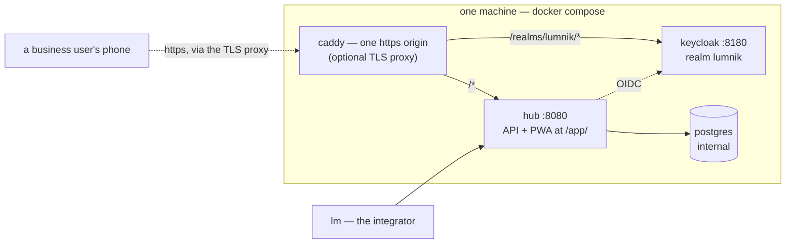

# Deploy lumnik

<section class="lm-hero" markdown>
<p class="lm-eyebrow">Installation</p>
<p class="lm-lead" markdown="span">Get the hub running: one command on a single host, or the Helm chart on Kubernetes.</p>
<div class="lm-meta" markdown>
<div class="lm-meta-item" markdown>
<strong>Fastest path</strong>

Self-host with Docker Compose and `./deploy/selfhost/up.sh`.
</div>
<div class="lm-meta-item" markdown>
<strong>What you get</strong>

Hub, Postgres, Keycloak, per-install secrets, and real OIDC.
</div>
<div class="lm-meta-item" markdown>
<strong>Then do this</strong>

Point `lm` at the hub and log in.
</div>
<div class="lm-meta-item lm-meta-item--accent" markdown>
<strong>Read this first</strong>

Back up the generated `.env`. Losing `LUMNIK_SECRET_MASTER_KEY` makes stored secrets unrecoverable.
</div>
</div>
</section>

Before anything: the [prerequisites checklist](quickstart/prerequisites.md).

## Choose the path

- **[Self-host](#self-host-one-command)** — one command, one machine. Start here.
- **[One HTTPS origin](#one-https-origin-the-tls-proxy)** — add it when phones must reach the hub.
- **[Kubernetes / Helm](#kubernetes-helm)** — the cloud edition, for a cluster.

## Self-host — one command

!!! tip "On a Windows PC?"
    Follow **[Deploy on Windows](deploy-windows.md)** instead. It starts from zero, WSL2 and
    Docker Desktop included. The commands below are for Linux or macOS.

```bash
git clone https://github.com/icreated/lumnik-open.git && cd lumnik-open
./deploy/selfhost/up.sh
```

**Which edition you get:**

| You run | You get |
|---|---|
| `up.sh` in a `lumnik-open` clone | **lumnik Open**: ingestion, entities, views, processes, workflows, outputs, the PWA. No chat, no `lm ask`, no Ollama. |
| `up.sh` in a lumnik Pro checkout | **lumnik Pro**: Open plus chat and `lm ask`. [Prepare Ollama first](quickstart/prerequisites.md#the-ai-layer-ollama). |

- **The Open image is public:** `ghcr.io/icreated/lumnik`, also `icreated/lumnik` on Docker Hub.
- **The Pro image is private:** `ghcr.io/icreated/lumnik-hub` pulls only if your GitHub account was
  granted access.
- **`up.sh --build` compiles the hub from source** instead of pulling it. It takes a few minutes, and
  needs only Docker.
- **On an ARM Linux server** (Raspberry Pi, AWS Graviton), use `--build`: the image is `linux/amd64`
  only. A Mac with Apple silicon runs it through Docker Desktop's emulation.

Check what runs with `lm module list` ([The two editions](editions.md)).

The stack you get:



What the launcher does:

<div class="lm-rail" markdown>
<article class="lm-step" markdown>
<div class="lm-step__num">1</div>
<div markdown>
<h3>Generate secrets safely</h3>

It writes your passwords and keys into `.env`, at the root of the clone. Only you can read it. It never overwrites an existing `.env`. **Back it up.**
</div>
</article>
<article class="lm-step" markdown>
<div class="lm-step__num">2</div>
<div markdown>
<h3>Pull and start the stack</h3>

It pulls the hub image, or builds it with `--build`. It starts hub + Postgres + Keycloak, and waits for the hub to be healthy. The first boot can take a minute.
</div>
</article>
<article class="lm-step" markdown>
<div class="lm-step__num">3</div>
<div markdown>
<h3>Mint per-install passwords</h3>

It sets the `hubadmin` and `integrator` passwords in Keycloak and prints the URLs.

<p class="lm-check" markdown="span">**You know it worked when:** the launcher ends like this:</p>

```
==> hub is healthy
  hubadmin: per-install password set (HUBADMIN_PASSWORD in .env)
  integrator: per-install password set (INTEGRATOR_PASSWORD in .env)
  tenant_id and user_id: admin-only

  Hub:       http://localhost:8080   (health: ./deploy/selfhost/health.sh)
  Keycloak:  http://localhost:8180/realms/lumnik
  Next:      point lm at the hub — server http://localhost:8080, OIDC http://localhost:8180/realms/lumnik
```
</div>
</article>
</div>

Stop the stack: `deploy/selfhost/down.sh`. Follow its logs: `deploy/selfhost/logs.sh hub`.
Re-run `up.sh` with the same flags at any time: your data and `.env` are kept.

!!! note "The bundled Keycloak"
    - It serves one machine. `backup.sh` saves it: [Backup & restore](operations/backup-restore.md).
    - The client's own directory (Keycloak, Okta, Entra ID): [Bring your own IdP](security/byo-idp.md).

## One HTTPS origin — the TLS proxy

A phone installs the PWA only from one https address. The proxy gives it one: the hub at `/`,
Keycloak's `lumnik` realm under `/realms/lumnik` and `/realms/lumnik/*`. Layer it on after `up.sh`:

```bash
LUMNIK_TLS_HOST=erp.example.com \
  docker compose -f docker-compose.selfhost.yml -f docker-compose.tls.yml up -d
```

- A public name gets a Let's Encrypt certificate by itself. Ports 80 and 443 must be reachable.
- A LAN IP or `localhost` gets a local certificate, for testing.
- The proxy listens on **every interface**, so phones on the LAN reach it.
  `LUMNIK_TLS_BIND=127.0.0.1` restricts it.
- **HSTS** is off by default. On a public name with its Let's Encrypt certificate, set
  `LUMNIK_TLS_HSTS=true` (exactly `true`): browsers then refuse plain http to that name for a
  year. Never on a LAN name or `localhost`: lose the local certificate and every device that
  saw the name is locked out, with no way past the warning.
- `up.sh` keeps the proxy: a later run re-applies the overlays the stack was started with.
- **Choose the address once.** Changing it changes who signs the tokens: users created through
  the old address must be migrated ([Keep the same public address](security/byo-idp.md#keep-the-same-public-address)).

### Trust the local certificate on a phone

With a LAN IP, the phone warns and refuses to install the PWA. Copy the certificate out:

```bash
docker compose -f docker-compose.selfhost.yml -f docker-compose.tls.yml \
  cp caddy:/data/caddy/pki/authorities/local/root.crt ./lumnik-local-ca.crt
```

Install `lumnik-local-ca.crt` on the phone. On iOS: AirDrop the file, then *Settings → General
→ VPN & Device Management*, then turn on full trust under *Certificate Trust Settings*.

## Point `lm` at the hub

[Install `lm`](quickstart/installer.md#1-install-lm), then give it the **server** and the
**OIDC issuer** — nothing else:

```bash
lm config set-context selfhost \
     --server http://localhost:8080 \
     --oidc-issuer http://localhost:8180/realms/lumnik
lm config use-context selfhost
lm login        # prints a URL + device code — open it, sign in as integrator
```

| User | Tenant | Password in `.env` |
|---|---|---|
| `integrator` | 1 | `INTEGRATOR_PASSWORD` — change it before anything real |
| `hubadmin` (superadmin) | 11 | `HUBADMIN_PASSWORD` |

`--oidc-client-id` defaults to `lm-cli`, the bundled realm's client. Set it only for your own IdP.
Check the login. On a fresh hub, the table is empty:

```
$ lm connector list
NAME  TYPE  TENANT  SCHED  WINDOW  STATUS  LAST RUN
```

## How to…

### Point the hub at an Ollama on another machine

Pro only. In `.env`, uncomment the `OLLAMA_BASE_URL=` line and set it to that machine, for
example `http://10.0.0.5:11434`. Then re-run `up.sh` with your flags. Left unset, the hub looks
for Ollama on the machine running Docker.

### Switch the AI off

The chat, the ask, view generation and the embeddings stop. The data is kept. The PWA drops its
Chat tab. The value is exactly `true` or `false`: anything else stops the hub at startup.

| Install | Gesture |
|---|---|
| Self-host | `LUMNIK_AI_ENABLED=false` in `.env`, then re-run `up.sh` with the flags you installed with (`--build`, `--search`…) |
| Helm (cloud edition), first install | `LUMNIK_AI_ENABLED=false ./deploy/helm/up.sh` (chart value `ai.enabled`) |
| Helm (cloud edition), running cluster | `helm upgrade <release> deploy/helm/lumnik --reuse-values --set-string ai.enabled=false`, then `kubectl rollout restart deployment/<release>-hub` |

- Without `--build`, `up.sh` pulls the hub image. Pin `LUMNIK_VERSION` in `.env` first, or the
  switch is also an upgrade.
- A plain `docker compose restart` keeps the old setting.
- On a running cluster, the Helm `up.sh` refuses to run: see [Kubernetes / Helm](#kubernetes-helm).

Check it with `lm module list`: `rag` and `llm` read `INACTIVE  disabled:lumnik.ai.enabled`.
What a switch back on restores: [Switching the AI off](rag/models.md#switching-the-ai-off).

### Show a map background

A [view on a map](apps/views.md#on-a-map) draws its dots on a grid. No request leaves your hub. To
draw a real map under them, name a tile server:

| Install | Gesture |
|---|---|
| Self-host | in `.env`: `LUMNIK_MAP_TILES=https://tile.openstreetmap.org/{z}/{x}/{y}.png` and `LUMNIK_MAP_ATTRIBUTION=© OpenStreetMap contributors`, then re-run `up.sh` with the flags you installed with |
| Helm (cloud edition) | chart values `map.tiles` and `map.attribution` (`--set map.tiles=…`) |

- **The tile server sees the areas your users look at.** That is where your customers are. Choose it
  as you would choose any other processor of that data.
- **The tile server also learns your hub's address**: the page's origin, never its path.
  OpenStreetMap refuses a tile request without it.
- **Every browser receives the URL.** A provider key written in it is public, never a secret.
- `https://` only (`http://` for `localhost`), with `{z}`, `{x}` and `{y}` and no other placeholder.
  Anything else stops the hub at startup, naming `lumnik.map.tiles`.
- The page allows images from that host only, and only once it is set.
- OpenStreetMap's own servers are for light use. For real traffic, use a tile provider or your own
  server.
- A browser sees a new tile server on its next load of the PWA. Once only, after upgrading from a
  release before v1.14.0, a browser may block the tiles for up to a day: it kept the old page.

### Turn on email delivery

Until you set two lines, the hub only pretends to send mail. In `.env`:

```bash
LUMNIK_SMTP_HOST=smtp.example.com
LUMNIK_SMTP_MOCK=false
# optional: LUMNIK_SMTP_PORT=587  LUMNIK_SMTP_USERNAME=…  LUMNIK_SMTP_PASSWORD=…
#           LUMNIK_SMTP_FROM=lumnik@example.com  LUMNIK_SMTP_STARTTLS=REQUIRED
```

Re-run `up.sh` with your flags. Then check the hub's log:

```bash
docker compose -f docker-compose.selfhost.yml logs hub | grep -E 'email delivery|LUMNIK_SMTP'
```

You want a line holding `"message":"email delivery live via smtp.example.com"`. Otherwise:

| You set | Every start logs |
|---|---|
| the host, not `LUMNIK_SMTP_MOCK=false` | `LUMNIK_SMTP_HOST is set but delivery is still mocked` |
| `LUMNIK_SMTP_MOCK=false`, no host | `LUMNIK_SMTP_MOCK=false but LUMNIK_SMTP_HOST is not set` |
| neither | nothing: the hub stays mocked |

To switch email back off, comment the host line out. An empty `LUMNIK_SMTP_HOST=` stops the hub
at startup.

**Rehearse without a mail provider.** Start the bundled test mailbox, then point `.env` at it:

```bash
docker compose --profile mailpit -f docker-compose.selfhost.yml up -d mailpit
# .env: LUMNIK_SMTP_HOST=mailpit  LUMNIK_SMTP_PORT=1025  LUMNIK_SMTP_MOCK=false
```

Re-run `up.sh` with your flags. Mail then shows at `http://127.0.0.1:8025`. What a failed send
does, and where to see it: [Email notifications](email.md#delivery-what-to-expect).

### Offer Kotlin scripts to the integrators

A `csv-file` connector, or a REST, GraphQL or SOAP endpoint, can run a Kotlin script by naming
it: `script: hooks:<name>.kts` ([Kotlin hooks](connectors/kotlin-hooks.md)). The scripts come
from you: copy the `.kts` files into `deploy/selfhost/hooks/`.

```bash
cp ean-check.kts deploy/selfhost/hooks/
```

| What | How |
|---|---|
| The hub sees the directory | read-only. Git ignores the files there. |
| A new or replaced script | taken up from the next batch of rows, without a restart |
| The integrator checks | `lm hook scripts` lists name, size and SHA-256. `lm apply` refuses a script that is missing or does not compile. |
| File names | lower-case letters, digits and hyphens, ending in `.kts`. Another name is not offered. |

A script runs with all of the hub's rights. Install only scripts you have read. On Helm, the
scripts come from a ConfigMap.

### Read local files, or change what the hub fetches

| Setting | What it does | Default |
|---|---|---|
| `LUMNIK_CSV_LOCAL_ROOT` | the folder a `local` csv transport reads ([CSV](connectors/csv.md)) | unset: none |
| `LUMNIK_OUTBOUND_MAX_RESPONSE_MB` | the largest REST response the hub reads | `64` |
| `LUMNIK_OUTBOUND_ALLOW_LOOPBACK` | `true` lets a source reach `localhost` | `false` |

- **Self-host:** `LUMNIK_CSV_LOCAL_ROOT` goes in `.env`, then re-run `up.sh`. It is a path inside
  the hub's container: a folder of the host needs a volume of your own ([CSV](connectors/csv.md)).
  The stack does not pass the other two from `.env`. Write them, and the volume, in a compose file
  of your own. In a container, `localhost` is the hub's own container: point a source at its host
  name instead.

    ```yaml
    # hub-settings.yml
    services:
      hub:
        environment:
          LUMNIK_OUTBOUND_MAX_RESPONSE_MB: "128"
        volumes:
          - /srv/lumnik-drop:/tmp/drop:ro   # only for LUMNIK_CSV_LOCAL_ROOT=/tmp/drop
    ```

    From the repository root, list the files the running stack was started with (the TLS proxy
    or Search add theirs). Start the hub with every one of them, in that order, and yours last.
    `up.sh` keeps them all on later runs.

    ```bash
    docker inspect --format '{{index .Config.Labels "com.docker.compose.project.config_files"}}' \
      "$(docker compose -f docker-compose.selfhost.yml ps -q hub)"
    docker compose -f docker-compose.selfhost.yml -f docker-compose.tls.yml -f hub-settings.yml up -d hub
    ```

- **Helm:** each one in `hub.extraEnv`. The chart mounts no folder for `LUMNIK_CSV_LOCAL_ROOT`
  and has no value to add one: on Helm, read files over `s3` or `sftp` instead.

What the hub refuses to reach: [Where the hub connects](security/outbound-addresses.md).

### Reach the hub from another machine

The hub (`8080`) and Keycloak (`8180`) listen on `127.0.0.1` only. Two ways in: an SSH
tunnel, or the [TLS proxy](#one-https-origin-the-tls-proxy) — the one a phone needs to install the PWA.

### Run against a managed or external PostgreSQL

Not on this path: self-host always runs its own Postgres. An external database is a job for
the Kubernetes / Helm path, below.

## Kubernetes / Helm

The **cloud edition** (commercial) ships a Kubernetes/Helm path — hub + Postgres + Keycloak
with real OIDC, sealed secrets, and a managed-PostgreSQL mode. It is not part of this
repository.
