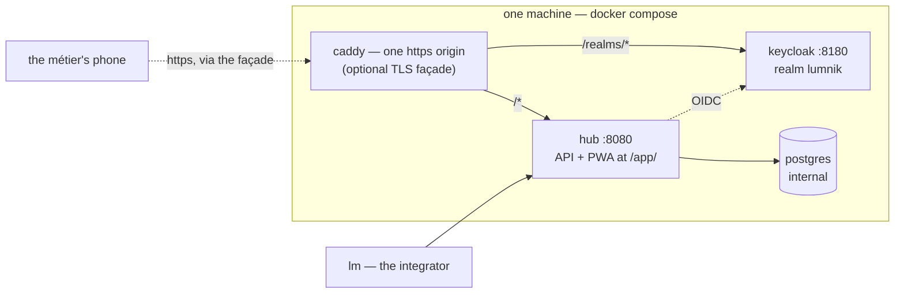

# Deploy lumnik

<section class="lm-hero" markdown>
<p class="lm-eyebrow">Installation</p>
<p class="lm-lead" markdown="span">Get the hub running. The self-host path is one command; the Kubernetes path is the cloud track. Start here when you want a healthy stack before connectors, chat, or apps.</p>
<div class="lm-meta" markdown>
<div class="lm-meta-item" markdown>
<strong>Fastest path</strong>

Self-host with Docker Compose and `./deploy/selfhost/up.sh --build`.
</div>
<div class="lm-meta-item" markdown>
<strong>What you get</strong>

Hub, Postgres, Keycloak, per-install secrets, and real OIDC.
</div>
<div class="lm-meta-item" markdown>
<strong>Then do this</strong>

Point `lm` at the hub and log in.
</div>
<div class="lm-meta-item lm-meta-item--accent" markdown>
<strong>Read this first</strong>

Back up the generated `.env`. Losing `LUMNIK_SECRET_MASTER_KEY` makes stored secrets unrecoverable.
</div>
</div>
</section>

Before anything: the [prerequisites checklist](quickstart/prerequisites.md) — what to
prepare so no half-day is lost to a missing model or port.

## Choose the path

<div class="lm-grid" markdown>
<article class="lm-card lm-card--accent" markdown>
<div class="lm-kicker">Recommended</div>
<h3 markdown="span">[Self-host](#self-host-one-command)</h3>

One command, local stack, fastest path to a real hub with real auth.
</article>
<article class="lm-card" markdown>
<div class="lm-kicker">Optional overlay</div>
<h3 markdown="span">[One HTTPS origin](#one-https-origin-the-tls-facade)</h3>

Add the TLS façade when phones or LAN devices need one origin and one token issuer.
</article>
<article class="lm-card" markdown>
<div class="lm-kicker">After boot</div>
<h3 markdown="span">[Connect the CLI](#point-lm-at-the-hub)</h3>

Set server and OIDC issuer once, then log in through device flow.
</article>
<article class="lm-card" markdown>
<div class="lm-kicker">Cloud track</div>
<h3 markdown="span">[Managed cluster](#kubernetes-helm)</h3>

Use the Helm chart when the target is a managed or scaled deployment.
</article>
</div>

## Self-host — one command

!!! tip "On a Windows PC?"
    Follow **[Deploy on Windows](deploy-windows.md)** instead — a from-zero
    walkthrough, WSL2 and Docker Desktop included, with the expected result
    spelled out after every step. The commands below are for a Linux or macOS
    shell.

```bash
git clone https://github.com/icreated/lumnik-open.git && cd lumnik-open
./deploy/selfhost/up.sh --build
```

!!! info "Which edition this is — and what it does not include"
    `icreated/lumnik-open` is the **open edition**. After cloning, list the tree: there is no
    `lumnik-rag/` and no `lumnik-llm-langchain/` module. That build **ingests, fuses, and
    serves views, processes, workflows, outputs and the métier PWA**, and this page deploys it
    — with one exception, the Ollama item under [How to…](#how-to), which an open-edition
    install has nothing to point at. What it does **not** carry is the way into the *Ask*
    rung: both chat doors
    (`POST /api/platform/rag/chat`, behind `lm ask` and TUI `:ask`; `POST /api/rag/chat`,
    behind the PWA chat), the semantic search over ingested chunks, and every
    `ChatPort`/`EmbeddingPort` implementation. The ask *pipeline itself* — the SQL translation
    and its five honesty guards — is native to the hub and stays; there is simply no door onto
    it and no model behind it. The hub degrades gracefully rather than failing at boot: a hub
    without those extensions still ingests, fuses and serves. They are closed extensions, not
    part of this repository — the full map is [The two editions](editions.md).

The stack you get:



**Run it with `--build`** — it works for everyone; the plain pull path needs access to the
(pre-launch, private) published image. What the launcher does:

<div class="lm-rail" markdown>
<article class="lm-step" markdown>
<div class="lm-step__num">1</div>
<div markdown>
<h3>Generate secrets safely</h3>

It creates a gitignored, owner-only (mode 600) `.env` with fresh random secrets — Postgres, Keycloak admin, both crypto keys, and `HUBADMIN_PASSWORD` / `INTEGRATOR_PASSWORD` — and never overwrites an existing one. **Back it up.**
</div>
</article>
<article class="lm-step" markdown>
<div class="lm-step__num">2</div>
<div markdown>
<h3>Build and start the stack</h3>

It builds the hub image from source (`--build`) or pulls the published one, starts hub + Postgres + Keycloak, and waits for the hub health check. Flyway migrations run at boot — the first boot can take a minute.
</div>
</article>
<article class="lm-step" markdown>
<div class="lm-step__num">3</div>
<div markdown>
<h3>Mint per-install passwords</h3>

It sets the `hubadmin` and `integrator` passwords through the Keycloak admin API — a known credential must never survive an install — and prints the hub and Keycloak URLs.

<p class="lm-check" markdown="span">**You know it worked when:** the launcher reports the stack healthy and prints both URLs.</p>
</div>
</article>
</div>

??? note "The launcher, line by line"

    ```bash
    --8<-- "deploy/selfhost/up.sh"
    ```

??? note "The full self-host README"

    ~~~~markdown
    --8<-- "deploy/selfhost/README.md"
    ~~~~

Stop / tail logs: `deploy/selfhost/down.sh`, `deploy/selfhost/logs.sh`.

!!! note "What the bundled Keycloak is — and is not"
    "Real OIDC" means real: JWTs are verified, dev-bypass is off. But the Keycloak this stack
    ships runs `start-dev` on a file-H2 store — made for a single-host install you operate
    yourself, not an enterprise identity deployment. For your own directory (Keycloak, Okta,
    Entra ID), see [Bring your own IdP](security/byo-idp.md) — JIT provisioning for an external
    issuer is not in the open edition. The H2 store's backup quirks are covered in
    [Backup & restore](operations/backup-restore.md).

## One HTTPS origin — the TLS façade

The base stack is loopback-only http. An optional overlay puts one Caddy origin in front of
everything — the hub (API + the `/app/` PWA) at `/`, Keycloak path-proxied under `/realms/*` —
so every device sees **one origin and one token issuer**, which is what installing the PWA on
a phone requires. One command layers it on:

```bash
LUMNIK_TLS_HOST=erp.example.com \
  docker compose -f docker-compose.selfhost.yml -f docker-compose.tls.yml up -d
```

- A public `LUMNIK_TLS_HOST` gets a Let's Encrypt certificate automatically.
- A LAN IP or `localhost` gets Caddy's internal CA for local testing.
- Deliberate posture change: unlike the base compose, the overlay binds 443/80 on **all
  interfaces** by default — serving phones on the LAN is its reason to exist — and
  `LUMNIK_TLS_BIND` restricts it.
- Re-running `up.sh` later composes the base file **alone** and un-stacks the overlay
  (the hub reverts to the localhost issuer) — on a façade install, always follow an
  `up.sh` run with the overlay command above.

Certificates, trusting the internal CA on a phone, and the change-of-issuer caveat are
covered in the façade's own README — reproduced here, so the answer never depends on the
repository being reachable:

??? note "The full TLS façade README"

    ~~~~markdown
    --8<-- "deploy/tls/README.md"
    ~~~~

## Point `lm` at the hub

Once the stack is healthy, wire the CLI to it. A context needs only the **server** and the
**OIDC issuer** — `lm login` discovers the device/token endpoints from the issuer's
`.well-known` document, so nothing else is hand-copied:

```bash
cd lm && go build -o lm ./cmd/lm          # build the CLI (Go 1.25+ — the floor is lm/go.mod)

./lm config set-context local \
     --server http://localhost:8080 \
     --oidc-issuer http://localhost:8180/realms/lumnik
./lm config use-context local
./lm login                                 # prints a URL + device code — open it, sign in as integrator (password: INTEGRATOR_PASSWORD in .env)
```

The bundled realm ships two demo users, both with **no password baked in**: `up.sh` mints a
per-install password for each through the Keycloak admin API once the stack is healthy.
Re-running `up.sh` heals older installs that still carry a historical default.

- `integrator` — tenant 1, password in `.env` as `INTEGRATOR_PASSWORD`; change it before anything real.
- `hubadmin` — admin, tenant 11, password in `.env` as `HUBADMIN_PASSWORD`.

(`--oidc-client-id` defaults to `lm-cli`, the bundled realm's client — set it only against
your own IdP.) After `lm login`, every `lm` call is Bearer-authenticated; verify with the
first authenticated smoke test:

```bash
./lm connector list
```

## How to…

### Pin the hub image instead of tracking `main`

Set `LUMNIK_VERSION` in `.env`. The generated file ships the line commented out
(`#LUMNIK_VERSION=main`) — uncomment it, give it the tag you want (once a `hub-v*` release is
tagged), and re-run the launcher:

```bash
./deploy/selfhost/up.sh
```

**Result:** the stack runs `ghcr.io/icreated/lumnik-hub:$LUMNIK_VERSION` instead of the
rolling `main` build. `up.sh` never rewrites an existing `.env`, so the line survives every
re-run.

### Point the hub at an Ollama that is not on this machine

Uncomment the `OLLAMA_BASE_URL=…` line in `.env` (the template ships it commented) and re-run
`up.sh`. Left unset, the hub looks for Ollama on the machine running Docker
(`http://host.docker.internal:11434`) — the default that makes chat and the analytic ask
work on a laptop. **On the open edition this knob has nothing to reach:** the extensions
that call Ollama are not in that build (see the edition note above), so an open-edition
install needs no Ollama at all.

### Turn on email delivery

Notification rules (`lm notify add`) route matching events to email. Delivery is **mocked
until both of these knobs are set** in `.env`:

```bash
LUMNIK_SMTP_HOST=smtp.example.com
LUMNIK_SMTP_MOCK=false
# optional: LUMNIK_SMTP_PORT=587  LUMNIK_SMTP_USERNAME=…  LUMNIK_SMTP_PASSWORD=…
#           LUMNIK_SMTP_FROM=lumnik@example.com  LUMNIK_SMTP_STARTTLS=REQUIRED
```

Re-run `up.sh` and the boot log answers with the posture (`email delivery live via …`).
Set only one of the two and the boot log **WARNs** instead of going half-live — a host
without `LUMNIK_SMTP_MOCK=false` delivers nothing; `MOCK=false` without a host loops
against `localhost`.
To rehearse without a provider, the stack bundles a dev mailer behind a compose profile:

```bash
docker compose --profile mailpit -f docker-compose.selfhost.yml up -d
# .env: LUMNIK_SMTP_HOST=mailpit  LUMNIK_SMTP_PORT=1025  LUMNIK_SMTP_MOCK=false
```

**Result:** rule-matched events land as mail — visible at `http://127.0.0.1:8025` on the
Mailpit drill, or in the recipient's real inbox once pointed at your provider. On the Helm
path the same knobs live under `values.smtp.*` (`up.sh` derives them from the same
`LUMNIK_SMTP_*` variables). A failed send is logged and skipped — best-effort by design;
the webhook channel is the one with retries and a delivery journal.

### Reach the hub from another machine

Not by changing a port: the hub (`8080`) and Keycloak (`8180`) are pinned to `127.0.0.1` in
`docker-compose.selfhost.yml`, deliberately — so that a remote host never exposes the
Keycloak admin console on all interfaces. Two ways out, both supported: an SSH tunnel, or
the [TLS façade](#one-https-origin-the-tls-facade) above — which is also the one that lets a
phone install the PWA.

### Run against a managed or external PostgreSQL

Not a knob on this path — the self-host stack wires the hub to its own Postgres container
(`DB_URL` is fixed in `docker-compose.selfhost.yml`). An external database is the
**Kubernetes / Helm** path's job — the next section.

## Kubernetes / Helm

The **cloud edition** (commercial) ships a Kubernetes/Helm path — hub + Postgres + Keycloak
with real OIDC, sealed secrets, and a managed-PostgreSQL mode. It is not part of this
repository.
