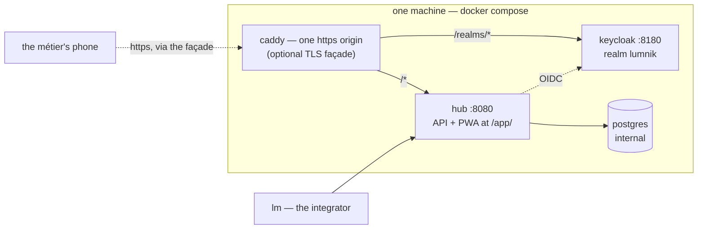

# Deploy lumnik

<section class="lm-hero" markdown>
<p class="lm-eyebrow">Installation</p>
<p class="lm-lead" markdown="span">Get the hub running: one command on a single host, or the Helm chart on Kubernetes.</p>
<div class="lm-meta" markdown>
<div class="lm-meta-item" markdown>
<strong>Fastest path</strong>

Self-host with Docker Compose and `./deploy/selfhost/up.sh --build`.
</div>
<div class="lm-meta-item" markdown>
<strong>What you get</strong>

Hub, Postgres, Keycloak, per-install secrets, and real OIDC.
</div>
<div class="lm-meta-item" markdown>
<strong>Then do this</strong>

Point `lm` at the hub and log in.
</div>
<div class="lm-meta-item lm-meta-item--accent" markdown>
<strong>Read this first</strong>

Back up the generated `.env`. Losing `LUMNIK_SECRET_MASTER_KEY` makes stored secrets unrecoverable.
</div>
</div>
</section>

Before anything: the [prerequisites checklist](quickstart/prerequisites.md).

## Choose the path

<div class="lm-grid" markdown>
<article class="lm-card lm-card--accent" markdown>
<div class="lm-kicker">Recommended</div>
<h3 markdown="span">[Self-host](#self-host-one-command)</h3>

One command, local stack, fastest path to a real hub with real auth.
</article>
<article class="lm-card" markdown>
<div class="lm-kicker">Optional overlay</div>
<h3 markdown="span">[One HTTPS origin](#one-https-origin-the-tls-facade)</h3>

Add the TLS façade when phones or LAN devices need one origin and one token issuer.
</article>
<article class="lm-card" markdown>
<div class="lm-kicker">After boot</div>
<h3 markdown="span">[Connect the CLI](#point-lm-at-the-hub)</h3>

Set server and OIDC issuer once, then log in through device flow.
</article>
<article class="lm-card" markdown>
<div class="lm-kicker">Cloud track</div>
<h3 markdown="span">[Managed cluster](#kubernetes-helm)</h3>

Use the Helm chart when the target is a managed or scaled deployment.
</article>
</div>

## Self-host — one command

!!! tip "On a Windows PC?"
    Follow **[Deploy on Windows](deploy-windows.md)** instead — a from-zero
    walkthrough, WSL2 and Docker Desktop included, with the expected result
    spelled out after every step. The commands below are for a Linux or macOS
    shell.

```bash
git clone https://github.com/icreated/lumnik-open.git && cd lumnik-open
./deploy/selfhost/up.sh --build
```

!!! info "This is the open edition"
    `icreated/lumnik-open` ingests, fuses, and serves views, processes, workflows, outputs and
    the métier PWA. It has no chat and no `lm ask`, and needs no Ollama.
    See [The two editions](editions.md).

The stack you get:



**Run it with `--build`**: it compiles the hub inside Docker. The published image is private: the plain
pull path works only if your GitHub account was granted access to it. What the launcher does:

<div class="lm-rail" markdown>
<article class="lm-step" markdown>
<div class="lm-step__num">1</div>
<div markdown>
<h3>Generate secrets safely</h3>

It creates an owner-only (mode 600) `.env` with fresh random secrets — Postgres, Keycloak admin, both crypto keys, the entity-resolution secret, the three database-role passwords, `HUBADMIN_PASSWORD` and `INTEGRATOR_PASSWORD`. It never overwrites an existing `.env`. **Back it up.**
</div>
</article>
<article class="lm-step" markdown>
<div class="lm-step__num">2</div>
<div markdown>
<h3>Build and start the stack</h3>

It builds the hub image (`--build`) or pulls it, starts hub + Postgres + Keycloak, and waits for the hub to be healthy. The first boot can take a minute.
</div>
</article>
<article class="lm-step" markdown>
<div class="lm-step__num">3</div>
<div markdown>
<h3>Mint per-install passwords</h3>

It sets the `hubadmin` and `integrator` passwords in Keycloak and prints the URLs.

<p class="lm-check" markdown="span">**You know it worked when:** the launcher ends like this:</p>

```
==> hub is healthy
  hubadmin: per-install password set (HUBADMIN_PASSWORD in .env)
  integrator: per-install password set (INTEGRATOR_PASSWORD in .env)

  Hub:       http://localhost:8080   (health: /q/health)
  Keycloak:  http://localhost:8180/realms/lumnik
  Next:      point lm at the hub — server http://localhost:8080, OIDC http://localhost:8180/realms/lumnik
```
</div>
</article>
</div>

??? note "The launcher, line by line"

    ```bash
    --8<-- "deploy/selfhost/up.sh"
    ```

??? note "The full self-host README"

    ~~~~markdown
    --8<-- "deploy/selfhost/README.md"
    ~~~~

Stop / tail logs: `deploy/selfhost/down.sh`, `deploy/selfhost/logs.sh`.

!!! note "The bundled Keycloak"
    - Tokens are verified for real; the Keycloak runs `start-dev` on a file-H2 store, for a
      single-host install. Its backup: [Backup & restore](operations/backup-restore.md).
    - For your own directory (Keycloak, Okta, Entra ID): [Bring your own IdP](security/byo-idp.md).
      JIT provisioning for an external issuer is not in the open edition.

## One HTTPS origin — the TLS façade

The base stack is loopback-only http. An optional overlay puts one Caddy origin in front of
everything — the hub (API + the `/app/` PWA) at `/`, Keycloak path-proxied under `/realms/*` —
so every device sees **one origin and one token issuer**, which is what installing the PWA on
a phone requires. One command layers it on:

```bash
LUMNIK_TLS_HOST=erp.example.com \
  docker compose -f docker-compose.selfhost.yml -f docker-compose.tls.yml up -d
```

- A public `LUMNIK_TLS_HOST` gets a Let's Encrypt certificate automatically.
- A LAN IP or `localhost` gets Caddy's internal CA for local testing.
- Unlike the base compose, the overlay binds 443/80 on **all interfaces** by default, for
  phones on the LAN. `LUMNIK_TLS_BIND` restricts it.
- Re-running `up.sh` later composes the base file **alone** and un-stacks the overlay
  (the hub reverts to the localhost issuer) — on a façade install, always follow an
  `up.sh` run with the overlay command above.

Certificates, trusting the internal CA on a phone, and the change-of-issuer caveat:

??? note "The full TLS façade README"

    ~~~~markdown
    --8<-- "deploy/tls/README.md"
    ~~~~

## Point `lm` at the hub

[Install `lm`](quickstart/installer.md#install-lm), then give it the **server** and the
**OIDC issuer** — nothing else:

```bash
lm config set-context local \
     --server http://localhost:8080 \
     --oidc-issuer http://localhost:8180/realms/lumnik
lm config use-context local
lm login        # prints a URL + device code — open it, sign in as integrator
```

| User | Tenant | Password in `.env` |
|---|---|---|
| `integrator` | 1 | `INTEGRATOR_PASSWORD` — change it before anything real |
| `hubadmin` (superadmin) | 11 | `HUBADMIN_PASSWORD` |

`--oidc-client-id` defaults to `lm-cli`, the bundled realm's client; set it only for your own IdP.
Check the login — on a fresh hub, headers only:

```
$ lm connector list
NAME  TYPE  TENANT  SCHED  WINDOW  STATUS  LAST RUN
```

## How to…

### Pin the hub image instead of tracking `main`

Set `LUMNIK_VERSION` in `.env`. The generated file ships the line commented out
(`#LUMNIK_VERSION=main`) — uncomment it, give it the tag you want (once a `hub-v*` release is
tagged), and re-run the launcher:

```bash
./deploy/selfhost/up.sh
```

**Result:** the stack runs `ghcr.io/icreated/lumnik-hub:$LUMNIK_VERSION` instead of the
rolling `main` build. `up.sh` never rewrites an existing `.env`, so the line survives every
re-run.

### Point the hub at an Ollama that is not on this machine

Uncomment the `OLLAMA_BASE_URL=…` line in `.env` and re-run `up.sh`. Left unset, the hub
looks for Ollama on the machine running Docker (`http://host.docker.internal:11434`).
The open edition does not use Ollama.

### Switch the AI off

The chat, the ask and the embeddings stop; the data is kept, and the PWA drops its Chat tab.
The value is exactly `true` or `false`.

| Install | Gesture |
|---|---|
| Self-host | `LUMNIK_AI_ENABLED=false` in `.env`, then re-run `up.sh` with the flags you installed with (`--build`, `--search`…). Re-apply the [TLS overlay](#one-https-origin-the-tls-facade) after it if you use one. A plain `docker compose restart` keeps the old setting. |
| Helm, first install | `LUMNIK_AI_ENABLED=false ./deploy/helm/up.sh` (chart value `ai.enabled`) |
| Helm, running cluster | `helm upgrade <release> deploy/helm/lumnik --reuse-values --set-string ai.enabled=false`, then `kubectl rollout restart deployment/<release>-hub`. `up.sh` refuses to run on a running cluster — see [Kubernetes / Helm](#kubernetes-helm) |

Check it with `lm module list`: `rag` and `llm` read `INACTIVE  disabled:lumnik.ai.enabled`.
What a switch back on restores: [Switching the AI off](rag/models.md#switching-the-ai-off).

### Turn on email delivery

Notification rules (`lm notify add`) route matching events to email. Delivery is **mocked
until both of these knobs are set** in `.env`:

```bash
LUMNIK_SMTP_HOST=smtp.example.com
LUMNIK_SMTP_MOCK=false
# optional: LUMNIK_SMTP_PORT=587  LUMNIK_SMTP_USERNAME=…  LUMNIK_SMTP_PASSWORD=…
#           LUMNIK_SMTP_FROM=lumnik@example.com  LUMNIK_SMTP_STARTTLS=REQUIRED
```

Re-run `up.sh`, then check the boot log:

```bash
docker compose -f docker-compose.selfhost.yml logs hub | grep -E 'email delivery|LUMNIK_SMTP'
# email delivery live via smtp.example.com
```

| Set | Result |
|---|---|
| host + `LUMNIK_SMTP_MOCK=false` | live delivery |
| host only | nothing delivered; the boot log warns |
| `LUMNIK_SMTP_MOCK=false` only | sends to `localhost`; the boot log warns |

To rehearse without a provider, start the bundled dev mailer:

```bash
docker compose --profile mailpit -f docker-compose.selfhost.yml up -d
# .env: LUMNIK_SMTP_HOST=mailpit  LUMNIK_SMTP_PORT=1025  LUMNIK_SMTP_MOCK=false
```

**Result:** rule-matched events land as mail — visible at `http://127.0.0.1:8025` on the
Mailpit drill, or in the recipient's inbox. On Helm the same knobs are `values.smtp.*`
(`up.sh` reads the same `LUMNIK_SMTP_*` variables). A failed send is not retried — see
[Email notifications](email.md).

### Reach the hub from another machine

The hub (`8080`) and Keycloak (`8180`) listen on `127.0.0.1` only. Two ways in: an SSH
tunnel, or the [TLS façade](#one-https-origin-the-tls-facade) — the one a phone needs to install the PWA.

### Run against a managed or external PostgreSQL

Not a knob on this path — the self-host stack wires the hub to its own Postgres container
(`DB_URL` is fixed in `docker-compose.selfhost.yml`). An external database is the
**Kubernetes / Helm** path's job — the next section.

## Kubernetes / Helm

The **cloud edition** (commercial) ships a Kubernetes/Helm path — hub + Postgres + Keycloak
with real OIDC, sealed secrets, and a managed-PostgreSQL mode. It is not part of this
repository.
