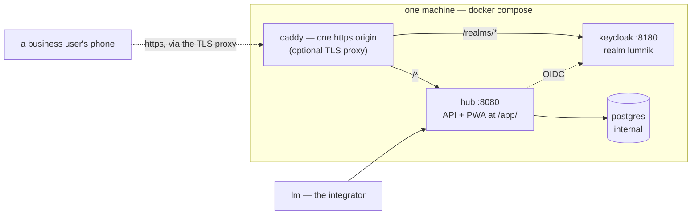

# Deploy lumnik

<section class="lm-hero" markdown>
<p class="lm-eyebrow">Installation</p>
<p class="lm-lead" markdown="span">Get the hub running: one command on a single host, or the Helm chart on Kubernetes.</p>
<div class="lm-meta" markdown>
<div class="lm-meta-item" markdown>
<strong>Fastest path</strong>

Self-host with Docker Compose and `./deploy/selfhost/up.sh --build`.
</div>
<div class="lm-meta-item" markdown>
<strong>What you get</strong>

Hub, Postgres, Keycloak, per-install secrets, and real OIDC.
</div>
<div class="lm-meta-item" markdown>
<strong>Then do this</strong>

Point `lm` at the hub and log in.
</div>
<div class="lm-meta-item lm-meta-item--accent" markdown>
<strong>Read this first</strong>

Back up the generated `.env`. Losing `LUMNIK_SECRET_MASTER_KEY` makes stored secrets unrecoverable.
</div>
</div>
</section>

Before anything: the [prerequisites checklist](quickstart/prerequisites.md).

## Choose the path

- **[Self-host](#self-host-one-command)** — one command, one machine. Start here.
- **[One HTTPS origin](#one-https-origin-the-tls-proxy)** — add it when phones must reach the hub.
- **[Kubernetes / Helm](#kubernetes-helm)** — the cloud edition, for a cluster.

## Self-host — one command

!!! tip "On a Windows PC?"
    Follow **[Deploy on Windows](deploy-windows.md)** instead. It starts from zero, WSL2 and
    Docker Desktop included. The commands below are for Linux or macOS.

```bash
git clone https://github.com/icreated/lumnik-open.git && cd lumnik-open
./deploy/selfhost/up.sh --build
```

**Which edition you get:**

| You run | You get |
|---|---|
| `up.sh --build` in a `lumnik-open` clone | **lumnik Open**: ingestion, entities, views, processes, workflows, outputs, the PWA. No chat, no `lm ask`, no Ollama. |
| `up.sh` without `--build`, with access to the published image | **lumnik Pro**: Open plus chat and `lm ask`. [Prepare Ollama first](quickstart/prerequisites.md#the-ai-layer-ollama). |

The published image is private: the pull works only if your GitHub account was granted access.
Check what runs with `lm module list` ([The two editions](editions.md)).

The stack you get:



What the launcher does:

<div class="lm-rail" markdown>
<article class="lm-step" markdown>
<div class="lm-step__num">1</div>
<div markdown>
<h3>Generate secrets safely</h3>

It writes your passwords and keys into `.env`, at the root of the clone. Only you can read it. It never overwrites an existing `.env`. **Back it up.**
</div>
</article>
<article class="lm-step" markdown>
<div class="lm-step__num">2</div>
<div markdown>
<h3>Build and start the stack</h3>

It builds the hub image (`--build`) or pulls it, starts hub + Postgres + Keycloak, and waits for the hub to be healthy. The first boot can take a minute.
</div>
</article>
<article class="lm-step" markdown>
<div class="lm-step__num">3</div>
<div markdown>
<h3>Mint per-install passwords</h3>

It sets the `hubadmin` and `integrator` passwords in Keycloak and prints the URLs.

<p class="lm-check" markdown="span">**You know it worked when:** the launcher ends like this:</p>

```
==> hub is healthy
  hubadmin: per-install password set (HUBADMIN_PASSWORD in .env)
  integrator: per-install password set (INTEGRATOR_PASSWORD in .env)

  Hub:       http://localhost:8080   (health: /q/health)
  Keycloak:  http://localhost:8180/realms/lumnik
  Next:      point lm at the hub — server http://localhost:8080, OIDC http://localhost:8180/realms/lumnik
```
</div>
</article>
</div>

Stop the stack: `deploy/selfhost/down.sh`. Follow its logs: `deploy/selfhost/logs.sh hub`.
Re-run `up.sh` with the same flags at any time: your data and `.env` are kept.

!!! note "The bundled Keycloak"
    - It serves one machine. `backup.sh` saves it: [Backup & restore](operations/backup-restore.md).
    - The client's own directory (Keycloak, Okta, Entra ID): [Bring your own IdP](security/byo-idp.md).

## One HTTPS origin — the TLS proxy

A phone installs the PWA only from one https address. The proxy gives it one: the hub at `/`,
Keycloak under `/realms/*`. Layer it on after `up.sh`:

```bash
LUMNIK_TLS_HOST=erp.example.com \
  docker compose -f docker-compose.selfhost.yml -f docker-compose.tls.yml up -d
```

- A public name gets a Let's Encrypt certificate by itself. Ports 80 and 443 must be reachable.
- A LAN IP or `localhost` gets a local certificate, for testing.
- The proxy listens on **every interface**, so phones on the LAN reach it.
  `LUMNIK_TLS_BIND=127.0.0.1` restricts it.
- `up.sh` keeps the proxy: a later run re-applies the overlays the stack was started with.
- **Choose the address once.** Changing it changes who signs the tokens: users created through
  the old address must be migrated ([Keep the same public address](security/byo-idp.md#keep-the-same-public-address)).

### Trust the local certificate on a phone

With a LAN IP, the phone warns and refuses to install the PWA. Copy the certificate out:

```bash
docker compose -f docker-compose.selfhost.yml -f docker-compose.tls.yml \
  cp caddy:/data/caddy/pki/authorities/local/root.crt ./lumnik-local-ca.crt
```

Install `lumnik-local-ca.crt` on the phone. On iOS: AirDrop the file, then *Settings → General
→ VPN & Device Management*, then turn on full trust under *Certificate Trust Settings*.

## Point `lm` at the hub

[Install `lm`](quickstart/installer.md#1-install-lm), then give it the **server** and the
**OIDC issuer** — nothing else:

```bash
lm config set-context selfhost \
     --server http://localhost:8080 \
     --oidc-issuer http://localhost:8180/realms/lumnik
lm config use-context selfhost
lm login        # prints a URL + device code — open it, sign in as integrator
```

| User | Tenant | Password in `.env` |
|---|---|---|
| `integrator` | 1 | `INTEGRATOR_PASSWORD` — change it before anything real |
| `hubadmin` (superadmin) | 11 | `HUBADMIN_PASSWORD` |

`--oidc-client-id` defaults to `lm-cli`, the bundled realm's client; set it only for your own IdP.
Check the login — on a fresh hub, headers only:

```
$ lm connector list
NAME  TYPE  TENANT  SCHED  WINDOW  STATUS  LAST RUN
```

## How to…

### Point the hub at an Ollama on another machine

Pro only. Uncomment `OLLAMA_BASE_URL=…` in `.env`, then re-run `up.sh` with your flags. Left
unset, the hub looks for Ollama on the machine running Docker.

### Switch the AI off

The chat, the ask and the embeddings stop; the data is kept, and the PWA drops its Chat tab.
The value is exactly `true` or `false`.

| Install | Gesture |
|---|---|
| Self-host | `LUMNIK_AI_ENABLED=false` in `.env`, then re-run `up.sh` with the flags you installed with (`--build`, `--search`…). It pulls the hub image: pin `LUMNIK_VERSION` first, or it is also an upgrade. A plain `docker compose restart` keeps the old setting. |
| Helm (cloud edition), first install | `LUMNIK_AI_ENABLED=false ./deploy/helm/up.sh` (chart value `ai.enabled`) |
| Helm (cloud edition), running cluster | `helm upgrade <release> deploy/helm/lumnik --reuse-values --set-string ai.enabled=false`, then `kubectl rollout restart deployment/<release>-hub`. `up.sh` refuses to run on a running cluster — see [Kubernetes / Helm](#kubernetes-helm) |

Check it with `lm module list`: `rag` and `llm` read `INACTIVE  disabled:lumnik.ai.enabled`.
What a switch back on restores: [Switching the AI off](rag/models.md#switching-the-ai-off).

### Turn on email delivery

Until you set two lines, the hub only pretends to send mail. In `.env`:

```bash
LUMNIK_SMTP_HOST=smtp.example.com
LUMNIK_SMTP_MOCK=false
# optional: LUMNIK_SMTP_PORT=587  LUMNIK_SMTP_USERNAME=…  LUMNIK_SMTP_PASSWORD=…
#           LUMNIK_SMTP_FROM=lumnik@example.com  LUMNIK_SMTP_STARTTLS=REQUIRED
```

Re-run `up.sh` with your flags. Then check the hub's log:

```bash
docker compose -f docker-compose.selfhost.yml logs hub | grep 'email delivery'
```

You want a line holding `"message":"email delivery live via smtp.example.com"`. If you set the host
but not `LUMNIK_SMTP_MOCK=false`, every start logs `LUMNIK_SMTP_HOST is set but delivery is still mocked`.
With neither set, the hub stays mocked and logs nothing about email. To switch email back off,
comment the host line out: an empty `LUMNIK_SMTP_HOST=` stops the hub at startup.

**Rehearse without a mail provider.** Start the bundled test mailbox, point `.env` at it, restart
the hub:

```bash
docker compose --profile mailpit -f docker-compose.selfhost.yml up -d
# .env: LUMNIK_SMTP_HOST=mailpit  LUMNIK_SMTP_PORT=1025  LUMNIK_SMTP_MOCK=false
docker compose -f docker-compose.selfhost.yml up -d hub
```

On a TLS install, run the proxy command instead of the last line.
Mail then shows at `http://127.0.0.1:8025`. A failed send is not retried:
[Email notifications](email.md).

### Offer Kotlin scripts to the integrators

A `csv-file` connector can run a Kotlin script by naming it, `script: hooks:<name>.kts`
([Kotlin hooks](connectors/kotlin-hooks.md)). The scripts come from
you: copy the `.kts` files into `deploy/selfhost/hooks/`.

```bash
cp ean-check.kts deploy/selfhost/hooks/
```

| What | How |
|---|---|
| The hub sees the directory | read-only. Git ignores the files there. |
| A new or replaced script | used from the next run, without a restart |
| The integrator checks | `lm hook scripts` lists name, size and SHA-256; `lm apply` refuses a script that is missing or does not compile |
| File names | lower-case letters, digits and hyphens, ending in `.kts`. Another name is not offered. |

A script runs with all of the hub's rights. Install only scripts you have read. On Helm, the
scripts come from a ConfigMap.

### Reach the hub from another machine

The hub (`8080`) and Keycloak (`8180`) listen on `127.0.0.1` only. Two ways in: an SSH
tunnel, or the [TLS proxy](#one-https-origin-the-tls-proxy) — the one a phone needs to install the PWA.

### Run against a managed or external PostgreSQL

Not on this path: self-host always runs its own Postgres. An external database is a job for
the Kubernetes / Helm path, below.

## Kubernetes / Helm

The **cloud edition** (commercial) ships a Kubernetes/Helm path — hub + Postgres + Keycloak
with real OIDC, sealed secrets, and a managed-PostgreSQL mode. It is not part of this
repository.
