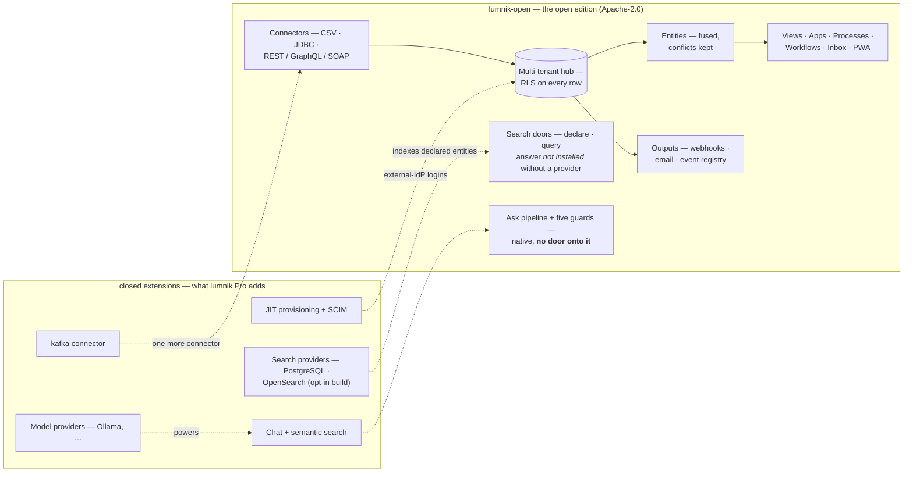

# The two editions

lumnik ships as two builds:

| Build | Licence | What it does |
|---|---|---|
| **`lumnik-open`** | Apache-2.0, public repository | ingest, fuse, react, serve the métier apps |
| **lumnik Pro** | commercial | adds *Ask* (natural-language chat over your data), model providers and the external-identity loop |

The open build has no Ask door at all: no stub, no licence key. One exception:
[direct Search](search/querying.md) has its commands in every build, and without a provider
they answer *not installed* (see [Feature by feature](#feature-by-feature)).

**lumnik Open** is the build behind the free **Hub** tier; **lumnik Pro** is the build behind both
paid tiers — see [Three tiers, two builds](#three-tiers-two-builds).



## Feature by feature

| | lumnik Open | lumnik Pro |
|---|---|---|
| Connectors: CSV (SFTP/S3), JDBC, REST + GraphQL/SOAP shapes | ✓ | ✓ |
| Connector: [kafka](connectors/kafka.md) | — | ✓ |
| JDBC dialect: [Oracle](connectors/jdbc.md#oracle) (driver included) | — | ✓ |
| Fusion: [entities](entities.md), `_conflicts` ledger | ✓ | ✓ |
| Apps ladder: [views](apps/views.md), [processes](apps/processes.md), [workflows](apps/workflows.md), [inbox](apps/inbox.md), [métier PWA](apps/pwa.md) | ✓ | ✓ |
| [Outputs](outputs.md): webhooks (signed, journaled, replay), [email notifications](email.md) | ✓ | ✓ |
| `lm` CLI / TUI, manifests, the whole integrator surface | ✓ | ✓ |
| Multi-tenancy & RLS, audit trail, [backup](operations/backup-restore.md), rate-limited `view-generate` | ✓ | ✓ |
| [Search](search/search-indexes.md): declare an index (`kind: SearchIndex`), the `search` and `capability` doors — a hub without a provider answers *not installed* | ✓ | ✓ |
| Search [provider](search/search-indexes.md#choosing-a-provider): PostgreSQL (`-Psearch`) or OpenSearch / Elasticsearch (`-Psearch-cluster`) — built in on request, **never in the published image**; it also brings the PWA's Recherche tab | — | ✓ opt-in build |
| **Ask**: [chat & analytic text-to-SQL doors](rag/http-api.md), semantic search, `rag.chunk` store | — | ✓ |
| Model providers ([Ollama & friends](rag/models.md)) | — | ✓ |
| [JIT provisioning](security/byo-idp.md) for external IdPs | — | ✓ |
| [SCIM deprovisioning](security/scim.md) | — | ✓ |
| Chat [rate-limit buckets](operations/rate-limits.md) | *(no such endpoints)* | ✓ |

The five [ask guards](transparency/ask-honesty.md) are in every build; the open edition has no
chat door onto them and no model behind them.

**Switched off is not absent.** A Pro hub can run with the AI switched off
(`LUMNIK_AI_ENABLED=false`): the data is kept, and `lm module list` shows `rag` and `llm` as
`INACTIVE`. An Open hub does not list them at all. Neither shows a Chat tab. How to switch it:
[Choosing what your hub offers](choosing-what-your-hub-offers.md).

## Which edition am I running?

```
$ lm module list
NAME      VERSION  SCHEMA              STATUS    REASON
core      0.1.0    Platform            ACTIVE    
identity  0.1.0    Identity & Tenancy  ACTIVE    
llm       0.1.0    Model provider      INACTIVE  disabled:lumnik.ai.enabled
rag       0.1.0    Platform RAG        INACTIVE  disabled:lumnik.ai.enabled
```

| What you see | Build |
|---|---|
| `core` + `identity` only | lumnik Open |
| plus `rag` + `llm` (always together) | lumnik Pro — `INACTIVE` means the AI is switched off, as above |
| plus `search_pg` or `search_opensearch` | a build with a Search provider |

The hub's boot log lists the installed modules too. More: [the full answer](security/index.md#which-edition-the-full-answer).

## Three tiers, two builds

The commercial ladder has three tiers; the builds are two:

| Tier | Runs the build | Who operates it |
|---|---|---|
| **Hub** — free, installed on your own machines | lumnik Open | your integrator, exploring and tooling up |
| **Pro** | lumnik Pro | your integrator, running it for a client |
| **Enterprise** — on quote | lumnik Pro | your own IT, in your own world |

**Enterprise is the Pro build**, sold with your identity directory
([external IdP](security/byo-idp.md), [SCIM](security/scim.md)), a Kubernetes delivery and
service commitments. These pages mark a capability **"not in the open edition"** — the build
you can check with [`lm module list`](#which-edition-am-i-running), not the tier.

Prices: **contact@lumnik.fr**. The open edition is the same hub, so an evaluation can start there.

## See also

- [How lumnik works](how-it-works.md) · [How lumnik breathes](respiration.md)
- [Deploy](deploy.md) — the same one-command stack for either build
- [Choosing what your hub offers](choosing-what-your-hub-offers.md) — which tabs and features a hub shows, and the gesture for each
- [Security overview](security/index.md) — every edition-dependent answer, marked
