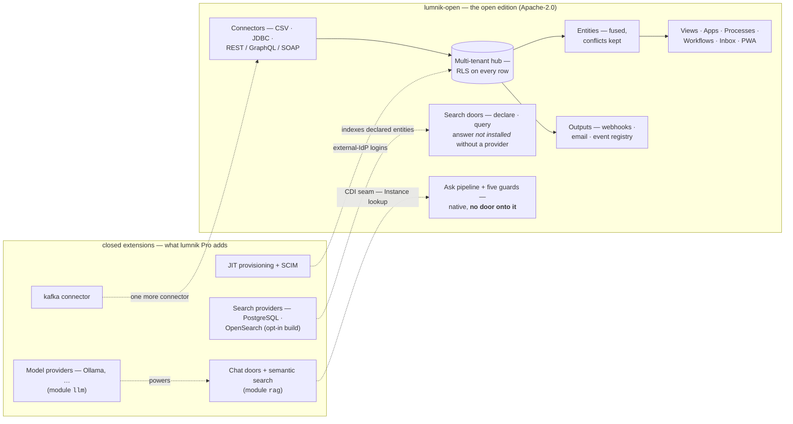

# The two editions

lumnik ships as two builds. **`lumnik-open`** (Apache-2.0, the public repository) is the
full data substrate — ingest, fuse, react, serve the métier — and a real product, not a
demo. **lumnik Pro** adds the *Ask* extensions (natural-language chat over your
data) and the external-identity loop. The boundary is architectural: the open build has
**no door and no stub** where the Ask extensions would be — nothing begs for a license key.
One honest exception, kept on purpose: [direct Search](search/querying.md) has its doors in
every build (declare an index, query, status), and without a provider they answer *not installed*
instead of a silent empty result (see the [Search rows](#feature-by-feature) below).

One name per axis, and you will meet both: **lumnik Open** is the build behind the free
**Hub** tier, and **lumnik Pro** is the build behind both paid ones. The commercial ladder
sits [at the foot of this page](#three-tiers-two-builds); everything between here and
there describes the builds.



## Feature by feature

| | lumnik Open | lumnik Pro |
|---|---|---|
| Connectors: CSV (SFTP/S3), JDBC, REST + GraphQL/SOAP shapes | ✓ | ✓ |
| Connector: [kafka](connectors/kafka.md) | — | ✓ |
| JDBC dialect: [Oracle](connectors/jdbc.md#oracle) (driver included) | — | ✓ |
| Fusion: [entities](entities.md), `_conflicts` ledger | ✓ | ✓ |
| Apps ladder: [views](apps/views.md), [processes](apps/processes.md), [workflows](apps/workflows.md), [inbox](apps/inbox.md), [métier PWA](apps/pwa.md) | ✓ | ✓ |
| [Outputs](outputs.md): webhooks (signed, journaled, replay), [email notifications](email.md) | ✓ | ✓ |
| `lm` CLI / TUI, manifests, the whole integrator surface | ✓ | ✓ |
| Multi-tenancy & RLS, audit trail, [backup](operations/backup-restore.md), rate-limited `view-generate` | ✓ | ✓ |
| [Search](search/search-indexes.md): declare an index (`kind: SearchIndex`), the `search` and `capability` doors — a hub without a provider answers *not installed* | ✓ | ✓ |
| Search [provider](search/search-indexes.md#choosing-a-provider): PostgreSQL (`-Psearch`) or OpenSearch / Elasticsearch (`-Psearch-cluster`) — built in on request, **never in the published image**; it also brings the PWA's Recherche tab | — | ✓ opt-in build |
| **Ask**: [chat & analytic text-to-SQL doors](rag/http-api.md), semantic search, `rag.chunk` store | — | ✓ |
| Model providers ([Ollama & friends](rag/models.md)) | — | ✓ |
| [JIT provisioning](security/byo-idp.md) for external IdPs | — | ✓ |
| [SCIM deprovisioning](security/scim.md) | — | ✓ |
| Chat [rate-limit buckets](operations/rate-limits.md) | *(no such endpoints)* | ✓ |

One nuance worth knowing: the ask *pipeline* — the SQL translation and its
[five guards](transparency/ask-honesty.md) — is native to the hub and present in **every**
build. What the open edition lacks is the **door** onto it (both chat endpoints) and any
model behind it. The principle ships everywhere; the extensions open the door.

**Switched off is not absent.** A Pro hub can run with the whole AI family turned off
(`LUMNIK_AI_ENABLED=false`) without changing the build: the jars stay, the data is kept, and
`lm module list` shows `rag` and `llm` as `INACTIVE` with the reason, where an Open hub does not list
them at all. The PWA has no Chat tab in either case. Open and Pro are decided when the hub is built;
what a Pro hub *offers* is yours to choose afterwards —
[Choosing what your hub offers](choosing-what-your-hub-offers.md).

## Which edition am I running?

Ask the hub, not the marketing:

```bash
lm login
TOKEN=$(awk '/^ *access:/ {print $2; exit}' ~/.lm/config.yaml)
curl -s https://your-hub.example.com/api/platform/health \
  -H "Authorization: Bearer $TOKEN" | jq .modules
```

An open-edition build answers `core` + `identity`; a chat-carrying build adds `rag` +
`llm`, always together ([the full answer](security/index.md#which-edition-the-full-answer)); a
build with a Search provider adds `search_pg` or `search_opensearch`. A module you switched off
is still listed, marked inactive. `lm module list` prints the same answer as a table, and the
boot log lists the installed modules too.

## How the boundary is built

The hub consumes every extension through CDI `Instance<>` lookups behind SPI seams
(`ExtractionSink`, `SearchPort`, `ChatPort`): when a module is absent the hub **degrades
gracefully** — the PWA shows no Chat tab at all, the API answers `404`, ingestion and
everything else runs untouched. The open edition is produced from the same monorepo by
extraction (`-DopenEdition` excludes the pro sources), and the boundary is enforced in CI
on every pull request (`scripts/check-bounded-contexts.sh`). No license
flags, no crippleware: what is absent is absent, and what an operator switches off is reported as
switched off, never passed for absent.

## Three tiers, two builds

The commercial ladder has three rungs; the builds above are two. They do not map
one-to-one, and the difference is worth holding:

| Tier | Runs the build | Who operates it |
|---|---|---|
| **Hub** — free, installed on your own machines | lumnik Open | your integrator, exploring and tooling up |
| **Pro** | lumnik Pro | your integrator, running it for a client |
| **Enterprise** — on quote | lumnik Pro | your own IT, in your own world |

**Enterprise is not a third build.** It is the same closed build as Pro, sold with what a
client's own world needs: your identity directory ([external IdP](security/byo-idp.md) and
[SCIM](security/scim.md) joiners and leavers), a Kubernetes delivery, and service
commitments. The commercial terms themselves —
organisations, métiers, SLA — are agreed with you, not encoded in the build.

This is why the pages here mark a capability **"not in the open edition"** rather than
naming a tier: what a running hub can prove is which *build* it is. Ask it — the gesture
is [above](#which-edition-am-i-running). The price list is a conversation, and it cannot
be read from `/api/platform/health`.

Write to **contact@lumnik.fr** — and rehearse everything else first: the open edition is
the same hub, so an evaluation that starts there loses nothing.

## See also

- [How lumnik works](how-it-works.md) · [How lumnik breathes](respiration.md)
- [Deploy](deploy.md) — the same one-command stack for either build
- [Choosing what your hub offers](choosing-what-your-hub-offers.md) — which tabs and features a hub shows, and the gesture for each
- [Security overview](security/index.md) — every edition-dependent answer, marked
