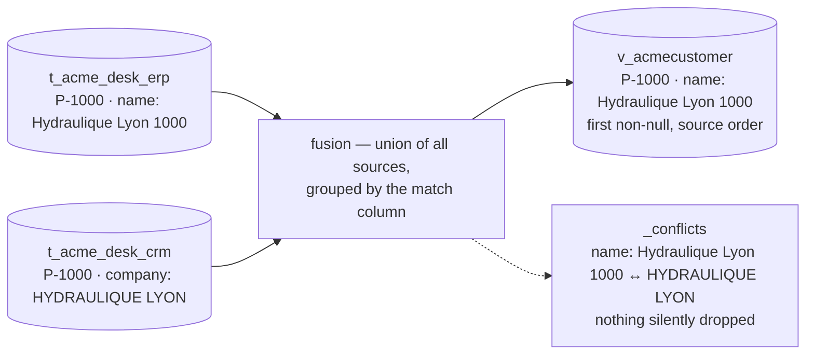

# kind: Entity — fuse

> Fuse N legacy tables into **one canonical, queryable thing**. Each source keeps landing in
> its own table; the manifest says how their columns map onto one shape and which column
> identifies the same real-world row across systems. The hub compiles that into a SQL view —
> and every disagreement between sources is kept in a `_conflicts` ledger on the row, never
> silently resolved.

| | |
|---|---|
| **Kind** | `Entity` |
| **Compiles to** | `connector.v_<name>` — a `security_invoker` view, RLS inherited from every source |
| **Sources** | any table in the `connector` schema: a CSV, JDBC or Kafka connector's `t_*` |
| **Lookups** | optional `joins[]` — a table that [enriches](#fuse-or-join) the fused rows without adding one |
| **Apply** | `lm entity apply` — `lm_admin`; validate-then-compile, atomic |
| **Read** | [`lm entity get NAME`](#read-api) — `lm_user`, scope-bound; also `lm view`, `lm ask`; the underlying door is `GET /api/entities/{name}` |
| **Edition** | Open |

The ERP has a customer table, the CRM has another, and the two have never agreed on a single
name. An entity does not pick a winner and forget the loser: it declares the priority, exposes
one row per customer, and writes down — per row, per column — where the systems still disagree.
That ledger is what a [`kind: View`](apps/views.md) shows under *Ambiguïtés et divergences*, and
what `lm conflicts list` aggregates across every entity you can read.

## Features

- **[Join without collapsing.](#fuse-or-join)** A lookup table enriches each fused row — one row per
  product with its category — and an ambiguous lookup key is *shown*, never guessed.
- **[Priority is the source order, per column.](#fusion-semantics)** The first source that has a
  value wins that column; a source that has none lets the next one fill the gap, which is never
  a conflict.
- **[Nothing is dropped.](#the-_conflicts-ledger)** Two distinct non-null values for one column land
  in the row's `_conflicts` ledger with the source that said each.
- **[Grounding for the surfaces above.](#the-columns-grounding-block)** Labels a view renders,
  descriptions the chat reads, and a `values` domain the filters enforce — refusing what is
  outside it rather than returning an empty table.
- **[Askable immediately.](#askable-immediately)** Applying an entity rediscovers its scopes'
  schema cards; the fused view is in the chat's vocabulary before the next question.
- **[Refused before compiled.](#refusals)** A manifest that cannot compile is not saved, and every
  refusal is a `400` that says exactly what to change.
- **[The delete interlock.](#remove)** A connector whose table feeds an entity cannot be deleted
  until the entity is — a `409` that names both.

## Quickstart

!!! note "Every screen on this page reads the demo desk that ships with the repo"
    Two customer exports that disagree and an order book, under `docs/apps/demo/`. Three
    commands land them; the hand count of what the fusion must give is on
    [The demo desk](apps/demo-desk.md).

```yaml
--8<-- "docs/apps/demo/entities/10-customer.yaml"
```

```
$ lm entity apply -f docs/apps/demo/entities/10-customer.yaml
Applied entity "AcmeCustomer" → connector."v_acmecustomer"
```

There is no `lm entity validate`: apply is validate-then-compile, and a manifest that would not
compile is refused before anything is written. Read the result with `lm entity get` — the view
is named after the entity, lower-cased, `--filter` is an exact match on a canonical column, and
`--limit`/`--offset` page beyond the first 100 rows:

```
$ lm entity get acmecustomer --filter city=Lyon -o json
[
  {
    "code": "P-1000",
    "name": "Hydraulique Lyon 1000",
    "city": "Lyon",
    "segment": "GOLD",
    "credit_limit": "500",
    "email": "contact@hydraulique-lyon.example",
    "_conflicts": "{\"name\": [{\"src\": \"t_acme_desk_erp\", \"value\": \"Hydraulique Lyon 1000\"}, {\"src\": \"t_acme_desk_crm\", \"value\": \"HYDRAULIQUE LYON\"}]}"
  },
  {
    "code": "P-1008",
    "name": "Filtration Lyon 1008",
    "city": "Lyon",
    "segment": "GOLD",
    "credit_limit": "1596",
    "email": "contact@filtration-lyon.example",
    "_conflicts": "{\"city\": [{\"src\": \"t_acme_desk_erp\", \"value\": \"Lyon\"}, {\"src\": \"t_acme_desk_crm\", \"value\": \"Villeurbanne\"}]}"
  }
]
```

Two customers in Lyon — and on each, the CRM disagrees with the ERP about something. The ERP
is listed first in `sources[]`, so its value is the one in the column; the CRM's is in the
ledger. Fourteen rows in all: twelve from the ERP, two the CRM alone knows, and the CRM's row
with no customer code is absent, because a `NULL` match key can be matched to nothing.

Where the systems disagree, across every entity at once:

```
$ lm conflicts list
ENTITY        KEY     COLUMNS  SOURCES
AcmeCustomer  P-1000  name     t_acme_desk_erp,t_acme_desk_crm
AcmeCustomer  P-1002  city     t_acme_desk_erp,t_acme_desk_crm
AcmeCustomer  P-1008  city     t_acme_desk_erp,t_acme_desk_crm
```

Three rows in dispute, exactly the three the hand count predicted. P-1005 is not one of them:
the ERP had no city for it, the CRM did, and the fused row simply carries Aarhus.

## The manifest

| Field | Required | Meaning |
|---|---|---|
| `kind` | yes | must be `Entity` |
| `name` | yes | a simple identifier (letters, digits, `_`) — becomes the view `connector.v_<name>`, lower-cased, and the name the chat advertises |
| `label` | no | the entity's human name — a `kind: View` that declares no `title:` is headed with it, and the schema card shows it beside the view name. Without one, both fall back to `name` |
| `description` | no | free text for humans |
| `match` | yes (≥ 1) | the canonical column(s) that identify the same real-world row across sources; several make a composite key. **Every source must map every match column, in the same case** |
| `sources[]` | yes (≥ 1) | ordered — **the order is the merge priority**; the first source wins a disagreement |
| `sources[].table` | yes | the source's dynamic table in the `connector` schema, without the schema prefix (`t_acme_desk_erp`) |
| `sources[].map` | yes (≥ 1) | `source column: canonical column`, per source |
| `joins[]` | no | relational lookups that **enrich** the fused rows — see [Fuse or join](#fuse-or-join). Never fused, never add a row |
| `joins[].table` | yes | the lookup's dynamic table in the `connector` schema; it must not also be a source |
| `joins[].from` | yes | a **canonical** column of the fused entity (it may be a `match` column) — the value looked up |
| `joins[].to` | yes | a **physical** column of the lookup table — the key it is matched on (it need not appear in `map`) |
| `joins[].map` | yes (≥ 1) | `lookup column: canonical column`; the new canonical names must not collide with any source column, any other join, or a reserved name, and none may be a `match` column |
| `scopes` | no | the métier scopes whose chat and views may read this entity — an entity with none is not discoverable by anyone |
| `columns` | no | per-canonical-column [grounding](#the-columns-grounding-block) |

The canonical shape is, in this order: first the union of every `sources[].map` value, in source
order, then every `joins[].map` value, in the order declared. `_conflicts`, `_src` and `_ord` are
reserved. Canonical names are case-sensitive SQL identifiers, so `email` in one
source and `Email` in another is refused as an accidental collision rather than silently split
into two columns. **Every value is `text`** in the compiled view — `credit_limit` reads `"500"`,
not `500` — which is what lets sources of different types fuse at all; cast where you consume.

The key set is closed: `scope:` for `scopes:` is named, not dropped —

```
$ lm entity apply -f docs/apps/demo/entities/63-refused-unknown-key.yaml
Error: API error 400: unknown key(s) in the manifest: scope — kind:Entity honors root {apiVersion, columns, description, joins, kind, label, match, name, resolution, scopes, sources}, sources[] {map, table}, joins[] {from, map, table, to}, resolution {cascade, identity}, resolution.cascade[] {exact, id, propose}, resolution.cascade[].exact {fields, normalize}, resolution.cascade[].propose {acceptAbove, provider, reviewAbove}
```

— because without that guard the entity would apply with an empty scope list and a clean 200,
visible to no métier and askable by nobody.

## Fusion semantics



The compiled view unions every source and groups by the `match` column(s):

- a source row whose match column is `NULL` is **excluded** — it cannot be matched to anything;
- for every other column, the representative is the **first non-null by source order**. The
  choice is made **per column, independently**: a source that wins `name` has no claim on `city`;
- a **`NULL` is not an opinion**: a source with no value lets the next one fill the gap, and that
  is never recorded as a conflict. Only two or more *distinct non-null* values are;
- when sources genuinely **disagree**, the representative still follows source order, and *all*
  the values land in the `_conflicts` ledger.

Flip the order and nothing but the representatives changes. `20-crm-first.yaml` lists the CRM
first over the same two tables:

```
$ lm entity apply -f docs/apps/demo/entities/20-crm-first.yaml
Applied entity "AcmeCustomerCrmFirst" → connector."v_acmecustomercrmfirst"
$ lm entity get acmecustomercrmfirst --filter code=P-1000 -o json
[
  {
    "code": "P-1000",
    "name": "HYDRAULIQUE LYON",
    "city": "Lyon",
    "email": "contact@hydraulique-lyon.example",
    "segment": "GOLD",
    "credit_limit": "500",
    "_conflicts": "{\"name\": [{\"src\": \"t_acme_desk_crm\", \"value\": \"HYDRAULIQUE LYON\"}, {\"src\": \"t_acme_desk_erp\", \"value\": \"Hydraulique Lyon 1000\"}]}"
  }
]
```

Same fourteen rows, same three disputes; P-1000 now reads `HYDRAULIQUE LYON`, and `segment` —
which the CRM does not carry — still comes from the ERP.

The view is compiled `security_invoker`, so it inherits each base table's row-level security:
every tenant sees only its own rows through the fusion, with no per-entity policy to maintain.

### The `_conflicts` ledger

One JSON object per row, one key per disputed column, `{}` — never `null` — when everyone
agrees:

```json
{
  "city": [
    { "src": "t_acme_desk_erp", "value": "Lyon" },
    { "src": "t_acme_desk_crm", "value": "Villeurbanne" }
  ]
}
```

It rides on every read of the entity, it is what a [`kind: View`](apps/views.md) renders at the
foot of a record's detail, and `GET /api/entities/conflicts` aggregates it — see
[Aggregated conflicts](#aggregated-conflicts). It is **not** a column the chat can query: the
schema card advertises the canonical columns and nothing else, so *"where do the ERP and the CRM
disagree?"* is a question for `lm conflicts list`, not for `lm ask`. What an answer does now is
name the disputed records it **filtered on**: when `lm ask` counts a record on a value a
source disagrees about, or leaves one out while a source holds the filtered value, the response
lists it with the ledger entries ([Disputed rows](transparency/ask-honesty.md#disputed-rows-a-disclosure-not-a-veto)).


## Fuse or join

Two different things happen between legacy tables, and an entity keeps them apart:

| | **Identity fusion** (`match` + `sources[]`) | **Relational enrichment** (`joins[]`) |
|---|---|---|
| The question | several systems describe the *same* object | one object *references* another |
| Example | the ERP's customer and the CRM's customer | a product and its category |
| Rows | merged into one per `match` key | the primary rows are never collapsed or multiplied |
| Disagreement | kept in `_conflicts`, first source wins the column | none — a lookup is not an opinion |

`match: [category_id]` is **not** enrichment: it would group every product of a category into one
identity and turn their differing names into conflicts. To keep one row per product and bring the
category's fields along, declare the category table as a *lookup*:

```yaml
--8<-- "docs/apps/demo/entities/30-product-with-category.yaml"
```

The fused entity is compiled exactly as before; the lookups are joined onto it afterwards as a
many-to-one `LEFT JOIN`. For each fused row, the lookup rows whose `to` column equals the row's
`from` value (see [how keys are compared](#how-join-keys-are-compared)) decide the outcome:

| Matching lookup rows | The joined columns | `_conflicts` |
|---|---|---|
| none, or `from` is empty | all empty (`NULL`) — the product is **kept** | nothing: an absence is not an opinion |
| exactly one | that row's values | nothing |
| **more than one** | all empty — even when the rows are identical | one entry per joined column, listing **every** duplicate row; a row with no value shows as `null` (`(empty)` on screen) |

A lookup that is not unique on its key is a defect of the lookup, so the entity answers with an
abstention rather than choosing a row: the product stays, its enrichment is empty, and the ledger
says why. The ledger entries are ordered deterministically, so the same data always reads the same
bytes. Because the ledger now records ambiguities as well as disagreements, `lm view` shows it under
*Ambiguïtés et divergences* and `lm conflicts list` lists both.

#### How join keys are compared

A key is compared as text, with one exception: **a key written as a plain decimal number is compared by
value**. `1000021`, `1000021.0` and `1000021.0000` are the same key, `1.5` and `1.50` too, so a `bigint` on
one source still finds the Oracle `NUMBER` that lands in the hub as `1000021.0000`. A different number never
matches — nothing is rounded: `1000021.5` is not `1000021.5001`.

The rule looks at the **shape of the value, not at the type of the column**. Two text identifiers that are
the same decimal number are therefore one key: `'1'` and `'1.0'` join, even in a `text` column. Anything
that is not a plain decimal is compared as text, exactly: `01` is not `1`, `007` is not `7`, `C1` is not
`c1`, and neither are `+5`, `1E7` or a number of more than 38 digits on either side of the point. Two lookup rows whose keys are the
same number (`5` and `5.0000`) are one ambiguous key, handled as in the table above.

The rule is compiled into the entity's view: **re-apply an entity that already declares `joins[]`** after upgrading, or it keeps comparing keys as plain text. The [search index](search/search-indexes.md) of a joined column follows the same rule.

Rules worth knowing:

- there is no `type:` — a join is a many-to-one left join; one needing anything else is not
  expressible yet;
- cycles cannot be declared: `joins[]` is flat and only reads the fused entity's columns;
- joined columns are readable, filterable, askable and exportable like any other, and tenant
  isolation applies to the lookup too (the view is `security_invoker`); the entity's `scopes` bound
  the whole entity;
- a joined column can be indexed by a [`kind: SearchIndex`](search/search-indexes.md): a lookup row that
  arrives later (the first row for a key, or one more row that makes the key ambiguous) re-projects the
  rows holding that key. The same holds on an entity that declares `resolution:`: the joins are read on
  top of the resolved view, the lookup change re-projects every resolved entity whose sources carry the
  key, and a source row nothing has resolved yet is not a document until its decision.

Apply errors, each naming what to change: a `400` when `from` is not a column the sources produce, a
joined name collides, or the lookup is also a source; a `400` naming the lookup table and the column
when `to` or a `map` key does not exist in it; the same `409` as for a source — *run the connectors
first* — when the lookup table does not exist yet.

### Deliver the joined entity to S3

A joined entity exports like any other: its joined columns are canonical columns, so an
[`Export`](apps/exports.md) can name them. The demo ships the whole case — two CSV files, the two
connectors that ingest them, the Entity above and an export of it:

```bash
docker exec lumnik-hub-1 mkdir -p /tmp/acme-catalogue
for f in m_product m_product_category; do docker cp docs/apps/demo/data/$f.csv lumnik-hub-1:/tmp/acme-catalogue/; done
lm apply -f docs/apps/demo/sources/40-products.yaml
lm apply -f docs/apps/demo/sources/50-product-categories.yaml
lm connector run products && lm connector run product-categories
# `connector run` answers once the run is accepted, not finished: wait for both to read Completed
lm run list --connector products
lm run list --connector product-categories
lm entity apply -f docs/apps/demo/entities/30-product-with-category.yaml
```

The join is proven in the terminal, before anything is delivered anywhere:

```
$ lm entity get ProductWithCategory --filter product_id=P1 -o table
PRODUCT_ID  CATEGORY_ID  PRODUCT_NAME  CATEGORY_NAME  CATEGORY_DESCRIPTION        _CONFLICTS
P1          C1           Pump 50       Pumps          Centrifugal and gear pumps  {}
```

`category_name` and `category_description` are not part of P1's source row — they are the
category lookup's columns, carried onto the product by the `LEFT JOIN` on `category_id`. The
column order is the fused columns first (declaration order of `sources[].map`), then the joined
ones (declaration order of `joins[].map`), then `_conflicts` last — every row carries it, `{}`
here since nothing disagrees.

```bash
lm secret set OUTBOUND_S3_ACCESS_KEY      # prompts without echo; the names the export references
lm secret set OUTBOUND_S3_SECRET_KEY
lm export apply -f docs/apps/exports/30-product-catalogue-s3.yaml   # edit bucket and region first
lm export run product-catalogue --wait
```

```yaml
--8<-- "docs/apps/exports/30-product-catalogue-s3.yaml"
```

The object has a header line, then one data row per product, in `product_id` order. With the demo data, `P1` and `P2` share
category `C1` and each carries its name and description; `P3` points at a category the lookup does
not have and `P4` at one it lists twice, so both are delivered with empty category cells. The run's
receipt gives the object's location, row count and SHA-256, computed over the bytes that were sent.
Only the caller's tenant's lookup rows take part, and the export's `scope` must be one of the
entity's — the same boundaries as for any export.

## The `columns:` grounding block

This is where you teach the surfaces what a column *means* — the input the
[ask guards](transparency/ask-honesty.md) enforce and the labels a view renders:

| Key | Meaning |
|---|---|
| `label` | the human name — a `kind: View` prints it as the column header and the detail's field name, [Recherche](search/search-indexes.md#human-names-for-fields) shows it on its results; the schema card shows it beside the raw name |
| `description` | the business meaning, fed to the SQL-generation prompt so the model stops guessing |
| `example` | an example value, same purpose |
| `values` | the allowed domain — a filter on any other value is **refused, not run** (the [domain guard](transparency/ask-honesty.md#6-domain-guard-the-declared-values-contract)) |

A terse lookup such as `status SO-000004` needs an `example` on the identifier column. A bare
connector table declares none, and the model has nothing tying that identifier's shape to a column, so it
abstains — honestly, not with a guessed filter. Declare a synthetic example (`example: SO-000001`) on the
column that holds the identifier. The hub does not sample connector rows to fill in schema-card
examples, so the card carries only what you declare. That is the only boundary this states: once a
question runs, the rows it returns are still sent to the configured model so it can phrase the answer —
with a cloud model, that means business data reaches it.

After the quickstart's manifest, the scope's card carries the labels:

```
$ lm source schema --scope desk
…
connector.v_acmecustomer
  code                     text           — Code client
  name                     text           — Raison sociale
  city                     text           — Ville
  segment                  text           — Segment
  credit_limit             text           — Encours autorisé
  email                    text           — Email
```

and a filter outside the declared domain is refused wherever the entity is read:

```
$ lm view -f docs/apps/demo/views/10-customers.yaml --filter segment=PLATINUM
Error: API error 400: 'PLATINUM' is not an allowed value for segment (allowed: GOLD, SILVER, BRONZE)
```

A grounded column must exist in the canonical shape (a typo is refused at apply), and a declared
value may not be blank or carry leading or trailing whitespace — it would never exact-match and
would silently zero-row:

```
$ lm entity apply -f docs/apps/demo/entities/64-refused-domain-whitespace.yaml
Error: API error 400: column 'segment' has an allowed value with leading/trailing whitespace (would never exact-match): ' SILVER'
```

## Askable immediately

If the entity declares `scopes`, apply rediscovers each scope's schema card for the calling
tenant, so the fused view is in the chat's vocabulary at once:

```
$ lm ask --scope desk "Combien de clients GOLD sont à Lyon, et quel est leur encours autorisé total ?"
Il y a 2 clients GOLD à Lyon et leur encours autorisé total est de 2096.
  data as of: 2026-10-09T14:55:10.790181Z (last completed run)

  disputed — a source disagrees on a value this answer filtered on:
    P-1008  city = 'Lyon'  counted  t_acme_desk_erp: Lyon · t_acme_desk_crm: Villeurbanne

  SQL: SELECT COUNT(*) AS gold_customers_count, SUM(credit_limit::numeric) AS total_credit_limit
FROM "connector"."v_acmecustomer"
WHERE city = 'Lyon' AND segment = 'GOLD'
LIMIT 500

  try: lm conflicts list --scope desk  — where this scope has source conflicts or lookup ambiguities, row by row
```

And when the filter matches nothing, a record the fused view filtered *out* is named too:

```
$ lm ask --scope desk "Quels clients sont à Villeurbanne ?"
The query returned no rows. That can mean there are genuinely none, or that the query did not capture your question — verify the SQL before reporting that there are none. Where this scope's entities record source conflicts or lookup ambiguities, it is written row by row, on each fused record, in a conflicts ledger that is deliberately not part of the schema above.
  data as of: 2026-10-09T15:02:04.336798Z (last completed run)

  disputed — a source disagrees on a value this answer filtered on:
    P-1008  city = 'Villeurbanne'  not counted  t_acme_desk_erp: Lyon · t_acme_desk_crm: Villeurbanne

  SQL: SELECT "name" FROM "connector"."v_acmecustomer" WHERE "city" = 'Villeurbanne'
LIMIT 500

  try: lm conflicts list --scope desk  — where this scope has source conflicts or lookup ambiguities, row by row
```

The phrasing prompt asks the model to answer in the language of the question and to quote
values from the rows exactly as written; the SQL, the `data as of` line and the deterministic
messages stay in English.

The chat still cannot query the `_conflicts` ledger, but an answer that filtered on a disputed
value now says so: it names the record and both sources' values in a `disputed` block, counted
or not counted, before the SQL (see [Disputed rows](transparency/ask-honesty.md#disputed-rows-a-disclosure-not-a-veto)).

The model read the label *Encours autorisé* from the grounding, cast the `text` column itself,
and answered over the fused view rather than either source. That refresh is best-effort: a
discovery failure never fails the apply, and `lm source rediscover --scope <tag>` rebuilds a card
by hand.

## Refusals

Every refusal is a `400` from apply, quoting the exact problem. The ones an integrator meets
first, each pinned by a file under `docs/apps/demo/entities/`:

```
$ lm entity apply -f docs/apps/demo/entities/60-refused-no-match-column.yaml
Error: API error 400: source 't_acme_desk_crm' does not map the match column: code
$ lm entity apply -f docs/apps/demo/entities/61-refused-case-collision.yaml
Error: API error 400: canonical column 'email' conflicts with 'Email' across sources (case-insensitive collision); use one consistent case
$ lm entity apply -f docs/apps/demo/entities/62-refused-reserved.yaml
Error: API error 400: source 't_acme_desk_erp': canonical column '_src' is reserved
$ lm entity apply -f docs/apps/demo/entities/65-refused-missing-table.yaml
Error: API error 409: source relation "connector.t_acme_desk_nowhere" does not exist — the entity fuses tables its source connectors create; run the source connectors first, then apply again
```

The last one is a `409`, not a `400`: the manifest is fine, the world is not ready for it yet.

| Refusal | Meaning | Fix |
|---|---|---|
| `kind must be 'Entity'` | wrong or missing `kind` | `kind: Entity` |
| `name must be a simple identifier (letters, digits, _) — it becomes the SQL view name v_<name> advertised to the chat: …` | the name flows into SQL and the chat | rename |
| `match must declare at least one column` | v1 needs one match rule | declare the join key |
| `match declares a duplicate column (case-insensitive): …` | the same key listed twice | remove the duplicate |
| `sources must have at least one source` / `source '…' map must have at least one column` | an entity fuses real tables | declare table + map |
| `source '…': canonical column '…' is reserved` | `_conflicts`, `_src`, `_ord` belong to the fusion machinery | pick another canonical name |
| `source '…' maps duplicate canonical column (case-insensitive): …` | two source columns feeding one canonical column in the same source | keep one |
| `canonical column '…' conflicts with '…' across sources (case-insensitive collision); use one consistent case` | `email` vs `Email` would silently become two SQL columns | one consistent spelling |
| `source '…' does not map the match column: …` | every source must produce the match column, same case — else its rows could never be matched | add it to that source's `map` |
| `scope must be lowercase, start with a letter, then letters/digits/_/- (max 41): …` | a scope is a Keycloak role name — the same rule as connector scopes, see [Scopes](rag/scopes.md) | rename the scope |
| `unknown key(s) in the manifest: …` | a key `kind:Entity` does not honor — `scope:` for `scopes:` | the message lists what it honors |
| `columns references unknown canonical column '…' (known: …)` | grounding for a column that does not exist — almost always a typo | use a canonical name |
| `column '…' has a blank allowed value` / `… has an allowed value with leading/trailing whitespace …` | a domain value that can never match makes the guard lie | trim or remove it |
| `409 source relation "…" does not exist — … run the source connectors first` | a `sources[].table` no connector has created yet | run the source connector, then re-apply |
| `400 source table …: column "…" does not exist — check the sources[].map keys …` | a `sources[].map` key the physical table does not have: a typo, or a column renamed upstream since the last apply | fix the key to the column the connector creates, then re-apply |

## Read API

```
GET /api/entities/{name}
```

[`lm entity get NAME`](cli/lm-reference.md) is the ordinary terminal door onto this endpoint —
reach for the endpoint directly only from a script or another system.

`lm_user`. The fused rows as JSON, every row carrying its `_conflicts` ledger as JSON text
(`"{}"` when no conflict). The lookup is case-insensitive; an unknown entity is a `404`.

- **Scope boundary** — the read is scope-bound like the rest of the app surface: a scope-bound
  user who holds none of the entity's scopes gets the uniform `403 {"error":"scope not granted"}`
  (see [Scopes](rag/scopes.md)).
- **Filters** — `?<canonical-col>=value`, exact match, repeatable across columns (AND). Unlike a
  view's filters, an unknown parameter is **ignored**, not refused; `_conflicts` is not filterable.
- **From a handle to the record's history.** Split the handle at its first `:` and pass the two halves:
  `lm entity history NAME SOURCE SOURCE_ID`, or `GET /api/entities/{name}/resolution/identity/{source}/{sourceId}`.
  A `setAside` entry on an event means the resolver passed over an entity that already holds another row of the same
  source (one entity takes one row per source): `{"entityId": …, "reason": "same-source", "rule": …}`, `rule` being the
  key rule that found it, or `null` for the partner of a `same` assertion. It is how a duplicated source row, which
  mints its own entity, is told apart from a plain new record; `lm entity history` lists the ids in `SET_ASIDE`,
  `-o json` the whole entry, and the `:ambiguous` view shows them too.
- **Upgrading.** The source handle is a column of the compiled view: re-apply every existing `resolution:`
  entity (`lm entity apply`) after upgrading, or the aggregate skips that entity (logged as unreadable) until you do.
- **Paging** — `?limit=` (default 100, clamped to 1…1000) and `?offset=` (default 0). Rows are
  ordered by the canonical columns, so pages are deterministic.

Reads go through the RLS-enforced datasource and the `security_invoker` view — the response is
tenant-scoped by your JWT, nothing else to configure.

### Aggregated conflicts

The per-entity read answers "show me this entity"; this one answers the question the ledger
raises but a per-row read cannot: **where do my entities hold a source conflict or a lookup
ambiguity, across every entity I may read?**

```
GET /api/entities/conflicts
```

`lm_user`. One row per fused record still in dispute, ordered by entity then match key (a
`resolution:` entity's key is the record's `_entity_id`, or, while nothing has resolved it, its source
handle `<source table>:<source id>`, the two values of the row's identity joined for display) —
`lm conflicts list` prints it, and the TUI's `:conflicts` screen opens the full ledger under `d`.

- **Scope boundary — silently narrowed, never refused.** A scope-bound user's aggregate simply
  omits the entities they hold no scope for. This is the one place the uniform `403` does *not*
  apply: an aggregate shows what you are allowed to see, and a non-granted entity is
  indistinguishable from a conflict-free one.
- **Paging** — `?limit=` (default 100, clamped 1…1000), spread across entities in order.
- An entity whose compiled view is missing (its source table dropped by a direct DB edit — `lm
  connector delete` cannot do this, it is refused while the entity stands), or whose view fails when
  read (a revoked grant, the 5-second statement timeout on a very large entity), is logged and
  skipped; the rest of the aggregate still answers.

## Remove

```
$ lm connector delete acme-desk-crm
Error: API error 409: table connector.t_acme_desk_crm feeds entity acmecustomer — remove the entity first (lm entity delete acmecustomer)
$ lm entity delete AcmeCustomerCrmFirst
deleted: AcmeCustomerCrmFirst
```

`DELETE /api/entities/{name}` (`lm_admin`) is the inverse of apply: it drops the view and deletes
the manifest in one transaction, then rediscovers its scopes so the cards drop it — best-effort,
like apply's refresh. A scope-bound
integrator must hold **all** the entity's scopes to remove it, the same asymmetry as apply. An
unknown name is a `404`.

An entity is **shared across tenants**: the manifest and its view are deployment-global, only
the rows they expose are tenant-scoped by RLS. Delete, like apply, acts for the whole deployment,
and a second hub instance picks the change up on its next rediscover.

## How to…

### Fuse two systems' customer tables

```bash
lm entity apply -f docs/apps/demo/entities/10-customer.yaml
lm entity get acmecustomer -o json
```

**Result:** one canonical row per `match` key, unioned from every declared source — the first
source in `sources[]` wins a disagreement, and every disagreement is kept in that row's
`_conflicts` ledger.

### See which source said what, on one record

```
$ lm view P-1008 -f docs/apps/demo/views/10-customers.yaml
Clients ACME / P-1008

  Code client        P-1008
  Raison sociale     Filtration Lyon 1008
  Ville              Lyon
  Segment            GOLD
  Encours autorisé   1596

  (!) Ambiguïtés et divergences
  Ville   t_acme_desk_erp «Lyon» · t_acme_desk_crm «Villeurbanne»
```

**Result:** the record's ledger, rendered under *Ambiguïtés et divergences* ("ambiguities and
divergences"); a record with neither ends with *✓ aucune ambiguïté ni divergence* instead. The
view is [`kind: View`](apps/views.md), one file over the entity.

### Give the fusion a third opinion

Add a third entry to `sources[]` — a legacy table, a Kafka topic's `t_*` — mapping the match
column and whatever else it knows. **Result:** columns only that source has appear in the shape;
a three-way disagreement lists three entries in the ledger; the source that wins one column has
no claim on another.

## Troubleshooting

| Symptom | Cause | Gesture |
|---|---|---|
| `404` on `lm entity get NAME` (or `GET /api/entities/{name}`) | no entity by that name has been applied (lookup is case-insensitive, so casing is not it) | check the name against what `apply` reported, or apply the manifest |
| `403 {"error":"scope not granted"}` on a read | you hold none of the entity's `scopes` | ask an integrator to grant one of those `scope:` roles |
| apply refused `409`: `source relation … does not exist` | a `sources[].table` does not exist yet — that source connector never ran | run the source connector, then re-apply |
| `lm connector delete` refused `409`: `table … feeds entity …` | the interlock — the entity still fuses that table | `lm entity delete <name>` first |
| a row you expected is missing from the fusion | its match column is `NULL` in that source — excluded by construction | give it a key at the source, or accept that it cannot be matched |
| the wrong system's value shows | source order is the priority, per column | reorder `sources[]`; the other value is in `_conflicts` either way |
| a number is a string (`"500"`) | every fused value is `text` | cast where you consume; `lm ask` does it by itself |
| an entity is missing from `lm conflicts list` | you hold none of its `scopes` (silently narrowed), or its compiled view is gone or fails when read — both logged, neither refused | check your grants, or the hub log for "compiled view missing" / "compiled view unreadable" |
| entity applied fine, but chat cannot discuss it | no `scopes` declared | add `scopes:` and re-apply; apply rediscovers the cards for you |
| `403` with an **empty body** | you do not hold the role the endpoint requires (`lm_admin` for apply and delete, `lm_user` for reads) | `GET /api/bff/v1/me` returns your roles under `roles` |

## See also

- [The demo desk](apps/demo-desk.md) — the sources every screen here reads, and the hand count
- [kind: View](apps/views.md) — see the fused entity; the detail shows one record's ledger
- [WOW demo](demo/wow-customer/README.md) — the full fusion walkthrough, two legacy sources to one Customer
- [Ask honesty — the guards](transparency/ask-honesty.md) — what the `columns:` grounding feeds
- [Scopes](rag/scopes.md) — the boundary the read API answers within
- [CLI & TUI reference](cli/lm-reference.md) — `lm conflicts list` and the `:conflicts` screen
