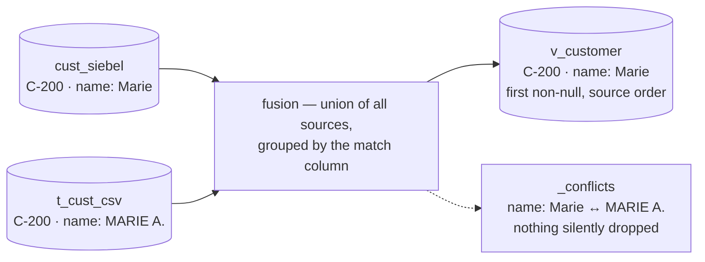

# kind: Entity — canonical fusion

> An entity fuses N legacy sources into **one canonical, queryable thing**. Each source keeps
> landing in its own dynamic table; the manifest declares how their columns map onto one
> canonical shape and which column matches rows across systems — the hub compiles that into a
> SQL view, and every disagreement between sources is preserved in a `_conflicts` ledger
> instead of being silently resolved.

## The real manifest (from the WOW demo)

```yaml
--8<-- "docs/demo/wow-customer/customer-entity.yaml"
```

## Fields

| Field | Required | Meaning |
|---|---|---|
| `kind` | yes | must be `Entity` |
| `name` | yes | simple identifier (letters, digits, `_`) — becomes the SQL view `connector.v_<name>` (lower-cased) advertised to the chat |
| `description` | no | free text for humans |
| `match` | yes (≥1) | canonical column(s) that identify the same real-world row across sources (composite if >1) — **every source must map every match column**, same case |
| `sources[]` | yes (≥1) | ordered list — **the order is the merge priority** (first source wins a disagreement) |
| `sources[].table` | yes | the connector dynamic table in the `connector` schema |
| `sources[].map` | yes (≥1) | `source column → canonical column`, per source |
| `scopes` | no | métier scopes whose chat can ask about this entity — an entity with no scopes is simply not discoverable |
| `columns` | no | per-canonical-column [grounding](#the-columns-grounding-block) |

The canonical shape is the ordered union of every source's `map` values. The names
`_conflicts`, `_src` and `_ord` are reserved. Canonical names are case-sensitive SQL
identifiers, so `email` in one source and `Email` in another is refused as an
accidental collision, not silently split into two columns.

## Fusion semantics



The compiled view unions all sources and groups by the `match` column(s):

- a source row whose match column is `NULL` is **excluded** (it cannot be matched to anything);
- for every other column, the representative value is the **first non-null by source
  order** — source 1 wins over source 2, and a source that has no value simply lets the
  next one fill the gap;
- when sources genuinely **disagree** (more than one distinct non-null value), the
  representative still follows source order, and *all* values land in the `_conflicts`
  ledger — nothing is silently dropped.

`_conflicts` is a JSON object, one key per disputed column, empty (`{}`) when everyone
agrees. From the demo, C-200's name disputed between Siebel and the CSV:

```json
{
  "name": [
    { "src": "cust_siebel", "value": "Marie" },
    { "src": "t_cust_csv",  "value": "MARIE A." }
  ]
}
```

The view is compiled `security_invoker`, so it inherits each base table's Row-Level
Security: every tenant sees only its own rows through the fusion, with no per-entity policy.

## The `columns:` grounding block

This is where you teach the surfaces what a column *means* — the input the
[ask guards](transparency/ask-honesty.md) enforce:

| Key | Meaning |
|---|---|
| `label` | human display name — shown by `kind: View` and the schema card instead of the raw canonical name |
| `description` | business meaning, fed to the SQL-generation prompt so the model stops guessing |
| `example` | an example value, same purpose |
| `values` | the allowed domain — a filter on any other value is **refused, not run** (the [domain guard](transparency/ask-honesty.md#6-domain-guard-the-declared-values-contract)) |

A grounded column must exist in the canonical shape (typos are refused at apply), and a
declared value may not be blank or carry leading/trailing whitespace — it would never
exact-match and would silently zero-row.

## Apply

```bash
lm entity apply -f customer-entity.yaml
# → Applied entity "Customer" → connector."v_customer"
```

The CLI posts the YAML to `POST /api/entities/apply` (`lm_admin`, body
`application/yaml`) and receives `{name, view}`. Apply is validate-then-compile: the
manifest is parsed and refused with a `400` on any problem below, then the view is
(re)created and the manifest upserted **atomically** — a manifest that cannot compile is
not saved.

If the entity declares `scopes`, apply also **rediscovers each scope's schema card** for
the calling tenant, so the fused entity is askable in its métiers immediately. This
refresh is best-effort: a discovery failure never fails the apply (the card can be rebuilt
via rediscovery).

## Remove

```bash
lm entity delete Customer
# → deleted: Customer
```

`DELETE /api/entities/{name}` (`lm_admin`) is the inverse of apply: it drops the entity's
view, deletes its manifest, and rediscovers its scopes so the card drops it — atomically,
same asymmetry as apply (a scope-bound integrator must hold **all** the entity's scopes to
remove it). An unknown name is a `404`. Removing the entity is also what frees a connector
whose table feeds it: `lm connector delete` is refused with a `409` naming the entity until
you delete the entity first.

An entity is **shared across tenants** — the manifest and its view are global; only the rows
they expose are tenant-scoped by RLS. So delete, like apply, acts for the whole deployment: a
tenant's `lm_admin` removes the entity everyone sees, and (as with apply) a second hub instance
picks the change up on its next rediscover.

## Read API

```
GET /api/entities/{name}
```

`lm_user`. Returns the fused rows as JSON, every row carrying its `_conflicts` ledger
(as JSON text, `"{}"` when no conflict). Unknown entity → `404`.

- **Scope boundary** — the read is scope-bound like the rest of the app surface: a
  scope-bound user who holds none of the entity's scopes gets the uniform
  `403 {"error":"scope not granted"}` (see [Scopes](rag/scopes.md)).
- **Filters** — `?<canonical-col>=value`, exact match, repeatable across columns (AND).
  Unlike `kind: View` filters, an unknown parameter is **ignored**, not refused;
  `_conflicts` is not filterable.
- **Paging** — `?limit=` (default 100, clamped to 1…1000) and `?offset=` (default 0).
  Rows are ordered by the canonical columns, so pages are deterministic.

```bash
curl -s 'http://localhost:8080/api/entities/customer?city=Lyon&limit=10' \
     -H "Authorization: Bearer $TOKEN" | jq
```

Reads go through the RLS-enforced datasource and the `security_invoker` view — the
response is tenant-scoped by your JWT, nothing else to configure.

## Aggregated conflicts

The read above answers "show me this entity"; this one answers the question the
`_conflicts` ledger raises but a per-row read cannot: **where do my sources still
disagree, across every entity I may read?**

```
GET /api/entities/conflicts
```

`lm_user`. Returns one row per fused record still in dispute, ordered by entity then
match key:

```json
[{"entity": "Customer",
  "key": "C-200",
  "columns": ["name"],
  "conflicts": {"name": [{"src": "t_erp", "value": "Marie"},
                         {"src": "t_csv", "value": "MARIE A."}]}}]
```

- **Scope boundary — silently skipped, never refused.** A scope-bound user's aggregate
  simply omits the entities they hold no scope for. This is the one place the uniform
  `403 {"error":"scope not granted"}` does *not* apply: an aggregate shows what you are
  allowed to see, and a non-granted entity is indistinguishable from a conflict-free one.
- **Paging** — `?limit=` (default 100, clamped 1…1000), spread across entities in order.
- **RLS** — same datasource and `security_invoker` views as the per-entity read; another
  tenant's disagreements are invisible, not filtered.
- An entity whose compiled view is missing (its source table dropped by a direct DB edit —
  `lm connector delete` cannot do this, it is refused while the entity stands) is logged and
  skipped; the rest of the aggregate still answers.

```bash
curl -s 'http://localhost:8080/api/entities/conflicts?limit=20' \
     -H "Authorization: Bearer $TOKEN" | jq
```

From `lm`: `lm conflicts list` for the scriptable view, or the `:conflicts` screen in the
TUI — `ENTITY · KEY · COLUMNS · SOURCES`, with `d` opening the full ledger, which source
said what.

## Validation refusals

Every refusal is a `400` from apply, quoting the exact problem:

| Refusal | Meaning | Fix |
|---|---|---|
| `kind must be 'Entity'` | wrong or missing `kind` | `kind: Entity` |
| `name must be a simple identifier (letters, digits, _) — it becomes the SQL view name v_<name> advertised to the chat: …` | the name flows into SQL and the chat | rename |
| `match must declare at least one column` | v1 needs one match rule | declare the join key |
| `match declares a duplicate column (case-insensitive): …` | the same key listed twice | remove the duplicate |
| `sources must have at least one source` / `source '…' map must have at least one column` | an entity fuses real tables | declare table + map |
| `source '…': canonical column '…' is reserved` | `_conflicts`, `_src`, `_ord` belong to the fusion machinery | pick another canonical name |
| `source '…' maps duplicate canonical column (case-insensitive): …` | two source columns feeding one canonical column in the same source | keep one |
| `canonical column '…' conflicts with '…' across sources (case-insensitive collision); use one consistent case` | `email` vs `Email` would silently become two SQL columns | one consistent spelling |
| `source '…' does not map the match column: …` | every source must produce the match column, **same case** — else its rows could never be matched | add it to that source's `map` |
| `scope must be lowercase, start with a letter, then letters/digits/_/- (max 41): …` | a scope is a name — the same rule as connector scopes, see [Scopes](rag/scopes.md) | rename the scope |
| `columns references unknown canonical column '…' (known: …)` | grounding for a column that doesn't exist — almost always a typo | use a canonical name |
| `column '…' has a blank allowed value` / `column '…' has an allowed value with leading/trailing whitespace (would never exact-match): '…'` | a domain value that can never match makes the guard lie | trim or remove it |

## How to…

### Fuse two systems' customer tables

```bash
lm entity apply -f customer-entity.yaml
# → Applied entity "Customer" → connector."v_customer"

curl -s 'http://localhost:8080/api/entities/customer' \
     -H "Authorization: Bearer $TOKEN" | jq
```

**Result:** one canonical row per `match` key, unioned from every declared source — the
first source in `sources[]` wins a disagreement, and every disagreement is also kept in
that row's `_conflicts` ledger, never silently dropped.

### See where the systems disagree, across every entity at once

```bash
lm conflicts list
```

**Result:** every fused entity's open disagreements in one command — scope and paging rules
are in [Aggregated conflicts](#aggregated-conflicts) above.

```
$ lm conflicts list
ENTITY    KEY    COLUMNS  SOURCES
Customer  C-004  city     t_customers,t_crm_contacts
```

One customer, one column, two sources that disagree. Which source said what is on the
record's detail — through a [`kind: View`](apps/views.md) over the entity:

```
$ lm view C-004 -f customers-view.yaml
Customers / C-004

  Customer code   C-004
  Name            Boulangerie Morel
  City            Lyon
  Segment         GOLD

  (!) Où les sources divergent
  City   t_customers «Lyon» · t_crm_contacts «Villeurbanne»
```

The block under *Où les sources divergent* ("where the sources diverge") is the `_conflicts`
ledger, rendered. The representative value follows source order (`t_customers` is listed
first); the other value is kept, not dropped.

## Troubleshooting

| Symptom | Cause | Gesture |
|---|---|---|
| `404` on `GET /api/entities/{name}` | no entity by that name has been applied (lookup is case-insensitive, so casing isn't it) | check the name against what `apply` reported, or apply the manifest |
| `403 {"error":"scope not granted"}` on a read | you hold none of the entity's `scopes` | ask an integrator to grant one of those `scope:` roles |
| apply refused `409`: `source … — the entity fuses tables its source connectors create; run the source connectors first, then apply again` | a `sources[].table` doesn't exist yet — that source connector never ran | run/apply the source connector, then reapply the entity |
| an entity is missing from `/api/entities/conflicts` | either you hold none of its `scopes` (silently skipped), or its compiled view is gone (e.g. a source connector was deleted) — both are logged, neither refused | check your scope grants, or check the hub log for "compiled view missing" |
| entity applied fine, but chat can't discuss it | no `scopes` declared — an entity with none is simply not discoverable | add `scopes:` and reapply; apply rediscovers each declared scope's card for you |
| `403` with an **empty body** (not `{"error": "…"}` like the scope refusal above) | you don't hold the role the endpoint requires (`lm_admin` for apply, `lm_user` for reads) | check your roles — `GET /api/bff/v1/me` returns them under `roles` — then ask an admin to grant the missing one |

## See also

- [WOW demo](demo/wow-customer/README.md) — the full fusion walkthrough, two legacy sources to one Customer.
- [Ask honesty — the guards](transparency/ask-honesty.md) — what the `columns:` grounding feeds.
- [kind: View](apps/views.md) — see the fused entity; the detail shows one record's `_conflicts` ledger.
- [CLI & TUI reference](cli/lm-reference.md) — `lm conflicts list` and the `:conflicts` screen, every open disagreement at once.
- [Scopes](rag/scopes.md) — the boundary the read API answers within.
