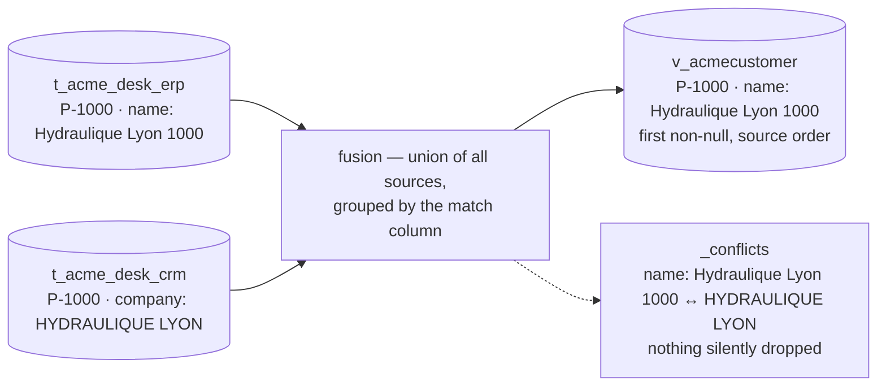

# kind: Entity — fuse

> Fuse N legacy tables into **one canonical, queryable thing**. Each source keeps landing in
> its own table; the manifest says how their columns map onto one shape and which column
> identifies the same real-world row across systems. The hub compiles that into a SQL view —
> and every disagreement between sources is kept in a `_conflicts` ledger on the row, never
> silently resolved.

| | |
|---|---|
| **Kind** | `Entity` |
| **Compiles to** | `connector.v_<name>` — a view; each tenant sees only its own rows |
| **Sources** | any table in the `connector` schema: a CSV, JDBC or Kafka connector's `t_*` |
| **Lookups** | optional `joins[]` — a table that [enriches](#fuse-or-join) the fused rows without adding one |
| **Apply** | `lm entity apply` — `lm_admin`; validate-then-compile, atomic |
| **Read** | [`lm entity get NAME`](#read-api) — `lm_user`, scope-bound; also `lm view`, `lm ask` |
| **Edition** | Open |

The ERP has a customer table, the CRM has another. An entity declares which one wins, exposes one
row per customer, and records per row and per column where the systems disagree.

That ledger is what a [`kind: View`](apps/views.md) shows under *Ambiguïtés et divergences*, and
what `lm conflicts list` lists across every entity you can read.

## Features

- **[Join without collapsing.](#fuse-or-join)** A lookup table enriches each fused row — one row per
  product with its category — and an ambiguous lookup key is *shown*, never guessed.
- **[Priority is the source order, per column.](#fusion-semantics)** The first source that has a
  value wins that column; a source that has none lets the next one fill the gap, which is never
  a conflict.
- **[Nothing is dropped.](#the-_conflicts-ledger)** Two distinct non-null values for one column land
  in the row's `_conflicts` ledger with the source that said each.
- **[Grounding for the surfaces above.](#the-columns-grounding-block)** Labels a view renders,
  descriptions the chat reads, and a `values` domain the filters enforce — refusing what is
  outside it rather than returning an empty table.
- **[Askable immediately.](#askable-immediately)** Applying an entity rediscovers its scopes'
  schema cards; the fused view is in the chat's vocabulary before the next question.
- **[Refused before compiled.](#refusals)** A manifest that cannot compile is not saved, and every
  refusal is a `400` that says exactly what to change.
- **[The delete interlock.](#remove)** A connector whose table feeds an entity cannot be deleted
  until the entity is — a `409` that names both.

## Quickstart

!!! note "Every screen on this page reads the demo desk that ships with the repo"
    Two customer exports that disagree and an order book, under `docs/apps/demo/`. Three
    commands land them; the hand count of what the fusion must give is on
    [The demo desk](apps/demo-desk.md).

```yaml
--8<-- "docs/apps/demo/entities/10-customer.yaml"
```

```
$ lm entity apply -f docs/apps/demo/entities/10-customer.yaml
Applied entity "AcmeCustomer" → connector."v_acmecustomer"
```

There is no `lm entity validate`: apply refuses a manifest that would not compile, before
anything is written. Read the result with `lm entity get` (name lower-cased, `--filter` an exact
match on a canonical column):

```
$ lm entity get acmecustomer --filter city=Lyon -o json
[
  {
    "code": "P-1000",
    "name": "Hydraulique Lyon 1000",
    "city": "Lyon",
    "segment": "GOLD",
    "credit_limit": "500",
    "email": "contact@hydraulique-lyon.example",
    "_conflicts": "{\"name\": [{\"src\": \"t_acme_desk_erp\", \"value\": \"Hydraulique Lyon 1000\"}, {\"src\": \"t_acme_desk_crm\", \"value\": \"HYDRAULIQUE LYON\"}]}"
  },
  {
    "code": "P-1008",
    "name": "Filtration Lyon 1008",
    "city": "Lyon",
    "segment": "GOLD",
    "credit_limit": "1596",
    "email": "contact@filtration-lyon.example",
    "_conflicts": "{\"city\": [{\"src\": \"t_acme_desk_erp\", \"value\": \"Lyon\"}, {\"src\": \"t_acme_desk_crm\", \"value\": \"Villeurbanne\"}]}"
  }
]
```

Two customers in Lyon, and on each the CRM disagrees with the ERP. The ERP is first in
`sources[]`, so its value is in the column; the CRM's is in the ledger.

Fourteen rows in all: twelve from the ERP, two the CRM alone knows. The CRM's row with no customer
code is absent: a `NULL` match key matches nothing.

Where the systems disagree, across every entity at once:

```
$ lm conflicts list
ENTITY        KEY     COLUMNS  SOURCES
AcmeCustomer  P-1000  name     t_acme_desk_erp,t_acme_desk_crm
AcmeCustomer  P-1002  city     t_acme_desk_erp,t_acme_desk_crm
AcmeCustomer  P-1008  city     t_acme_desk_erp,t_acme_desk_crm
```

Three rows in dispute, exactly the three the hand count predicted. P-1005 is not one of them:
the ERP had no city for it, the CRM did, and the fused row simply carries Aarhus.

## The manifest

| Field | Required | Meaning |
|---|---|---|
| `kind` | yes | must be `Entity` |
| `name` | yes | a simple identifier (letters, digits, `_`) — becomes the view `connector.v_<name>`, lower-cased, and the name the chat advertises |
| `label` | no | the entity's human name — a `kind: View` that declares no `title:` is headed with it, and the schema card shows it beside the view name. Without one, both fall back to `name` |
| `description` | no | free text for humans |
| `match` | yes (≥ 1) | the canonical column(s) that identify the same real-world row across sources; several make a composite key. **Every source must map every match column, in the same case** |
| `sources[]` | yes (≥ 1) | ordered — **the order is the merge priority**; the first source wins a disagreement |
| `sources[].table` | yes | the source's dynamic table in the `connector` schema, without the schema prefix (`t_acme_desk_erp`) |
| `sources[].map` | yes (≥ 1) | `source column: canonical column`, per source |
| `joins[]` | no | relational lookups that **enrich** the fused rows — see [Fuse or join](#fuse-or-join). Never fused, never add a row |
| `joins[].table` | yes | the lookup's dynamic table in the `connector` schema; it must not also be a source |
| `joins[].from` | yes | a **canonical** column of the fused entity (it may be a `match` column) — the value looked up |
| `joins[].to` | yes | a **physical** column of the lookup table — the key it is matched on (it need not appear in `map`) |
| `joins[].map` | yes (≥ 1) | `lookup column: canonical column`; the new canonical names must not collide with any source column, any other join, or a reserved name, and none may be a `match` column |
| `scopes` | no | the métier scopes whose chat and views may read this entity — an entity with none is not discoverable by anyone |
| `columns` | no | per-canonical-column [grounding](#the-columns-grounding-block) |

- **Column order:** every `sources[].map` value in source order, then every `joins[].map` value
  in declared order, then `_conflicts`.
- **Reserved names:** `_conflicts`, `_src`, `_ord`, `_entity_id`, `_resolution`, `_source_id`,
  `_handle`, `_canonical_key`.
- **Case:** `email` in one source and `Email` in another is refused, not split into two columns.
- **Every value is `text`, except a date:** `credit_limit` reads `"500"`, not `500`; cast where you
  consume. A column every source holds as a date or a timestamp stays one — see
  [Dates across sources](#dates-across-sources).

The key set is closed: an unknown key such as `scope:` for `scopes:` is refused, not dropped:

```
$ lm entity apply -f docs/apps/demo/entities/63-refused-unknown-key.yaml
Error: API error 400: unknown key(s) in the manifest: scope — kind:Entity honors root {apiVersion, columns, description, joins, kind, label, match, name, resolution, scopes, sources}, sources[] {map, table}, joins[] {from, map, table, to}, resolution {cascade, identity}, resolution.cascade[] {exact, id, propose}, resolution.cascade[].exact {fields, normalize}, resolution.cascade[].propose {acceptAbove, provider, reviewAbove}
```

## Fusion semantics



The compiled view unions every source and groups by the `match` column(s):

- a source row whose match column is `NULL` is **excluded** — it cannot be matched to anything;
- for every other column, the representative is the **first non-null by source order**. The
  choice is made **per column, independently**: a source that wins `name` has no claim on `city`;
- a **`NULL` is not an opinion**: a source with no value lets the next one fill the gap, and that
  is never recorded as a conflict. Only two or more *distinct non-null* values are;
- when sources genuinely **disagree**, the representative still follows source order, and *all*
  the values land in the `_conflicts` ledger.

Flip the order and nothing but the representatives changes. `20-crm-first.yaml` lists the CRM
first over the same two tables:

```
$ lm entity apply -f docs/apps/demo/entities/20-crm-first.yaml
Applied entity "AcmeCustomerCrmFirst" → connector."v_acmecustomercrmfirst"
$ lm entity get acmecustomercrmfirst --filter code=P-1000 -o json
[
  {
    "code": "P-1000",
    "name": "HYDRAULIQUE LYON",
    "city": "Lyon",
    "email": "contact@hydraulique-lyon.example",
    "segment": "GOLD",
    "credit_limit": "500",
    "_conflicts": "{\"name\": [{\"src\": \"t_acme_desk_crm\", \"value\": \"HYDRAULIQUE LYON\"}, {\"src\": \"t_acme_desk_erp\", \"value\": \"Hydraulique Lyon 1000\"}]}"
  }
]
```

Same fourteen rows, same three disputes; P-1000 now reads `HYDRAULIQUE LYON`, and `segment` —
which the CRM does not carry — still comes from the ERP. Each tenant sees only its own rows
through the fusion.

### When a source row changes

Run the connector again after the source changed, and the entity shows the new value. On the demo
desk, the ERP said Milano for P-1002 and the CRM said Milan — one of the three disputes above:

```
$ lm entity get acmecustomer --filter code=P-1002 -o json
[
  {
    "code": "P-1002",
    "name": "Fixations Milano 1002",
    "city": "Milano",
    "segment": "BRONZE",
    "credit_limit": "774",
    "email": "ventes@fixations-milano.example",
    "_conflicts": "{\"city\": [{\"src\": \"t_acme_desk_erp\", \"value\": \"Milano\"}, {\"src\": \"t_acme_desk_crm\", \"value\": \"Milan\"}]}"
  }
]
```

The ERP corrects its export to Milan. Put the new file in place and run the connector:

```bash
docker cp acme-erp.csv lumnik-hub-1:/tmp/acme-desk/acme-erp.csv
lm connector run acme-desk-erp
```

```
$ lm entity get acmecustomer --filter code=P-1002 -o json
[
  {
    "code": "P-1002",
    "name": "Fixations Milano 1002",
    "city": "Milan",
    "segment": "BRONZE",
    "credit_limit": "774",
    "email": "ventes@fixations-milano.example",
    "_conflicts": "{}"
  }
]
$ lm conflicts list
ENTITY                KEY     COLUMNS  SOURCES
AcmeCustomer          P-1000  name     t_acme_desk_erp,t_acme_desk_crm
AcmeCustomer          P-1008  city     t_acme_desk_erp,t_acme_desk_crm
AcmeCustomerCrmFirst  P-1000  name     t_acme_desk_crm,t_acme_desk_erp
AcmeCustomerCrmFirst  P-1008  city     t_acme_desk_crm,t_acme_desk_erp
```

The ERP's old value is gone from the row and from the ledger. The same holds for a `joins[]`
lookup (a renamed category shows its new name) and for a `resolution:` entity. If one export lists
the same customer twice with two different values, both stay in `_conflicts`.

The demo's ERP connector reads **one local file**, so each run is a
[full refresh](connectors/csv.md#one-file-is-the-table-full-refresh). Remove P-1011 from the file and run
again: the customer leaves the source table and the entity.

```
$ lm run get 630cee80
ID        CONNECTOR      ENDPOINT  STATUS     IN  OUT  SKIPPED  DEAD-LETTERS  STARTED           ENDED
630cee80  acme-desk-erp  default   Completed  11  11   0        0             2026-10-19 07:28  2026-10-19 07:28
• 1 row(s) removed — the source no longer holds them
$ lm entity get acmecustomer --filter code=P-1011
no rows
```

Put Milano back in the file and run again: the dispute with the CRM returns.

```
$ lm entity get acmecustomer --filter code=P-1002 -o json
[
  {
    "code": "P-1002",
    "name": "Fixations Milano 1002",
    "city": "Milano",
    "segment": "BRONZE",
    "credit_limit": "774",
    "email": "ventes@fixations-milano.example",
    "_conflicts": "{\"city\": [{\"src\": \"t_acme_desk_erp\", \"value\": \"Milano\"}, {\"src\": \"t_acme_desk_crm\", \"value\": \"Milan\"}]}"
  }
]
```

What happens to a row deleted at the source:

| Source | A row deleted at the source |
|---|---|
| `csv-file`, one local file | removed at the next run (above) |
| `csv-file` drop folder, `sftp`, `s3` | stays — see [CSV & files](connectors/csv.md) |
| `jdbc-generic` | stays — see [Deletes are never propagated](connectors/jdbc.md#deletes-are-never-propagated) |
| `kafka` | stays — a tombstone goes to the dead letters, see [Tombstones](connectors/kafka.md#tombstones-a-deletion-is-not-garbage) |

### Dates across sources

The same business date does not land under the same type from every source:

| Source | Lands as | `1 July 2026` reads |
|---|---|---|
| an Oracle `DATE`, a PostgreSQL `timestamp` (no zone) | a timestamp, its wall clock read in the connection's [`zone`](connectors/jdbc.md#a-time-without-a-time-zone), UTC without one | `2026-07-01 00:00:00+00` |
| a PostgreSQL `timestamptz`, an Oracle `TIMESTAMP WITH TIME ZONE` | a timestamp, the instant | `2026-07-01 00:00:00+00` |
| a PostgreSQL `date`, a CSV column through [`parse-date`](connectors/transformers.md#parse-date-dates-are-31122019) with a date-only format | a date | `2026-07-01` |
| a CSV column left as written, a Kafka field | text | `01/07/2026` |

The fused column follows what its sources hold:

- every source a **date** → the entity's column is a date;
- **dates and timestamps** mixed → a timestamp, a date being its **midnight UTC**. A source that only
  knows the day cannot contradict an hour, so the sources are compared **at the day**: an ERP's
  `2026-07-01 14:30` and a CSV's `2026-07-01` **agree**, a CSV's `2026-07-02` is a conflict. The
  timed sources among themselves still compare to the instant. The value shown is a time before a day,
  whatever the order of `sources`: a day never hides the hour beside it;
- **one source text** → the column stays text, compared as written, as every other text column.
  The hub does not guess whether `01/07` is the first of July or the seventh of January.

A `match:` column follows the same rule: an ERP's `2026-07-01 00:00` and a CSV's `2026-07-01` are
one record.

An ERP's `due_at` (a timestamp) fused with a partner CSV's `due` parsed as `dd/MM/yyyy` (a date), and
both systems' `shipped`, which the CSV leaves as written:

```
$ lm source schema --scope livedesk
…
connector.v_liveorder
  order_no                 text
  due                      timestamp with time zone
  shipped                  text
  status                   text
$ lm entity get liveorder --filter due=2026-07-01 -o json
[
  {
    "order_no": "SO-1",
    "due": "2026-07-01T00:00:00Z",
    "shipped": "2026-07-03 14:30:00+00",
    "status": "open",
    "_conflicts": "{\"shipped\": [{\"src\": \"t_live_erp_orders\", \"value\": \"2026-07-03 14:30:00+00\"}, {\"src\": \"t_live_partner_orders\", \"value\": \"03/07/2026\"}]}"
  }
]
```

`due` agrees: the ERP's midnight and the CSV's day are one instant. `shipped` is text, and two
writings of the same day are a conflict. To type it, the CSV's table must be created again: a table
the hub created keeps its column types, and a new `parse-date` alone changes nothing.

1. `lm entity delete liveorder` — the entity holds the table;
2. `lm connector delete live-partner-orders` — drops its table and data;
3. add `- parse-date: { column: shipped, formats: ["dd/MM/yyyy"] }` to its `cell:` hooks, `lm apply`
   it, and `lm connector run` it;
4. `lm entity apply` the entity again: `shipped` is now `timestamp with time zone`.

Once typed, the CSV's `03/07/2026` and the ERP's `2026-07-03 14:30` agree: the same day.

A time of day has one more trap: the zone it was written in. An ERP's `2026-08-02 23:30` with no
zone lands as `23:30` UTC unless its connection declares one. The same time in a CSV parsed with
`zone: Europe/Paris` lands as `21:30` UTC: two hours apart, a conflict on every such row:

```
$ lm entity get liveorder --filter order_id=1 -o json
[
  {
    "order_id": "1",
    "ordered_at": "2026-08-02T23:30:00Z",
    "_conflicts": "{\"ordered_at\": [{\"src\": \"t_orders\", \"value\": \"2026-08-02 23:30:00+00\"}, {\"src\": \"t_partner\", \"value\": \"2026-08-02 21:30:00+00\"}]}"
  }
]
```

Declare where each source writes: `zone: Europe/Paris` under the ERP's `connection`, the same
`zone` on the CSV's `parse-date`. Once the ERP's table is read again
([the gesture](connectors/jdbc.md#a-time-without-a-time-zone)), both hold the same instant:

```
$ lm entity get liveorder -o json
[
  {
    "order_id": "1",
    "ordered_at": "2026-08-02T21:30:00Z",
    "_conflicts": "{}"
  },
  {
    "order_id": "2",
    "ordered_at": "2026-01-15T22:30:00Z",
    "_conflicts": "{}"
  }
]
```

A date alone has no such trap: both sides are its midnight UTC.

A typed column is a date everywhere the entity is read: a view filters it as a date, `lm ask`
sees its type, an entity read and an export write it in UTC whatever zone the hub runs in.
The decision is taken at **apply**: an entity applied before a source changed type keeps its
columns until it is applied again.

### The `_conflicts` ledger

One JSON object per row, one key per disputed column, `{}` — never `null` — when everyone
agrees:

```json
{
  "city": [
    { "src": "t_acme_desk_erp", "value": "Lyon" },
    { "src": "t_acme_desk_crm", "value": "Villeurbanne" }
  ]
}
```

Where it shows:

- on every read of the entity (`lm entity get`);
- at the foot of a record's detail in a [`kind: View`](apps/views.md);
- across every entity in `lm conflicts list` — see [Aggregated conflicts](#aggregated-conflicts).

The chat cannot query it: *"where do the ERP and the CRM disagree?"* is a question for
`lm conflicts list`, not `lm ask`. An `lm ask` answer that filtered on a disputed value names the
record in a `disputed` block ([Disputed rows](transparency/ask-honesty.md#disputed-rows-a-disclosure-not-a-veto)).


## Fuse or join

Two different things happen between legacy tables, and an entity keeps them apart:

| | **Identity fusion** (`match` + `sources[]`) | **Relational enrichment** (`joins[]`) |
|---|---|---|
| The question | several systems describe the *same* object | one object *references* another |
| Example | the ERP's customer and the CRM's customer | a product and its category |
| Rows | merged into one per `match` key | the primary rows are never collapsed or multiplied |
| Disagreement | kept in `_conflicts`, first source wins the column | none — a lookup is not an opinion |

`match: [category_id]` is **not** enrichment: it would group every product of a category into one
identity and turn their differing names into conflicts. To keep one row per product and bring the
category's fields along, declare the category table as a *lookup*:

```yaml
--8<-- "docs/apps/demo/entities/30-product-with-category.yaml"
```

The fused entity is compiled exactly as before; the lookups are joined onto it afterwards as a
many-to-one `LEFT JOIN`. For each fused row, the lookup rows whose `to` column equals the row's
`from` value (see [how keys are compared](#how-join-keys-are-compared)) decide the outcome:

| Matching lookup rows | The joined columns | `_conflicts` |
|---|---|---|
| none, or `from` is empty | all empty (`NULL`) — the product is **kept** | nothing: an absence is not an opinion |
| exactly one | that row's values | nothing |
| **more than one** | all empty — even when the rows are identical | one entry per joined column, listing **every** duplicate row; a row with no value shows as `null` (`(empty)` on screen) |

`lm view` shows lookup ambiguities under *Ambiguïtés et divergences*, and `lm conflicts list`
lists them with the source conflicts.

#### How join keys are compared

A key is compared as text, except that **a plain decimal number is compared by value**. The rule
reads the value's shape, not the column's type:

| These keys match | These keys do not |
|---|---|
| `1000021` = `1000021.0` = `1000021.0000` | `1000021.5` ≠ `1000021.5001` (nothing is rounded) |
| `1.5` = `1.50` | `01` ≠ `1`, `007` ≠ `7` |
| `'1'` = `'1.0'`, even in a `text` column | `C1` ≠ `c1` |
| | `+5`, `1E7`, more than 38 digits: compared as text |

Two lookup rows whose keys are the same number (`5` and `5.0000`) are one ambiguous key, as in the
table above. The [search index](search/search-indexes.md) of a joined column follows the same rule.

A key whose `from` and `to` are both [dates or times](#dates-across-sources) is compared as dates:

| `from` and `to` | Matches on |
|---|---|
| one of them a date (a lookup keyed by day is a calendar) | the UTC day: `2026-07-01 14:30` finds the row of `2026-07-01` |
| both times | the instant |
| text on either side | the rule above, as text |

A `from` whose sources mix dates and times is a time, so it meets a calendar at the day. Matched at the day, a
lookup whose `to` holds times has one key per day: two of its rows on one day are an ambiguous key, as two equal
numbers are — the joined columns empty, both rows in `_conflicts`.

Rules worth knowing:

- a join is always a many-to-one left join; there is no `type:`;
- `joins[]` is flat and reads only the fused entity's columns, so cycles cannot be declared;
- joined columns are readable, filterable, askable and exportable like any other; the entity's
  `scopes` bound the whole entity;
- a joined column can be indexed by a [`kind: SearchIndex`](search/search-indexes.md); a lookup row
  that arrives later re-projects the rows holding its key;
- on a [`resolution:`](entities-resolution.md) entity, the joins are read on top of the resolved view.

| Apply refusal | When |
|---|---|
| `400` | `from` is not a column the sources produce, a joined name collides, or the lookup is also a source |
| `400` naming the lookup table and column | `to` or a `map` key does not exist in the lookup table |
| `409` *run the source connectors first* | the lookup table does not exist yet |

### Deliver the joined entity to S3

A joined entity exports like any other: its joined columns are canonical columns, so an
[`Export`](apps/exports.md) can name them. The demo ships the whole case — two CSV files, the two
connectors that ingest them, the Entity above and an export of it:

The manifests read `/tmp/acme-catalogue/` on the hub's filesystem; no `lm` command places a file
there, so copy it into the container:

```bash
docker exec lumnik-hub-1 mkdir -p /tmp/acme-catalogue
for f in m_product m_product_category; do docker cp docs/apps/demo/data/$f.csv lumnik-hub-1:/tmp/acme-catalogue/; done
lm apply -f docs/apps/demo/sources/40-products.yaml
lm apply -f docs/apps/demo/sources/50-product-categories.yaml
lm connector run products && lm connector run product-categories
# `connector run` answers once the run is accepted, not finished: wait for both to read Completed
lm run list --connector products
lm run list --connector product-categories
lm entity apply -f docs/apps/demo/entities/30-product-with-category.yaml
```

The join is proven in the terminal, before anything is delivered anywhere:

```
$ lm entity get ProductWithCategory --filter product_id=P1 -o table
PRODUCT_ID  CATEGORY_ID  PRODUCT_NAME  CATEGORY_NAME  CATEGORY_DESCRIPTION        _CONFLICTS
P1          C1           Pump 50       Pumps          Centrifugal and gear pumps  {}
```

`category_name` and `category_description` come from the category lookup, joined on
`category_id`. The four products:

```
$ lm entity get ProductWithCategory
PRODUCT_ID  CATEGORY_ID  PRODUCT_NAME  CATEGORY_NAME  CATEGORY_DESCRIPTION        _CONFLICTS
P1          C1           Pump 50       Pumps          Centrifugal and gear pumps  {}
P2          C1           Pump 80       Pumps          Centrifugal and gear pumps  {}
P3          C9           Spare gasket                                             {}
P4          C2           Valve DN15                                               {"category_name": [{"src": "t_product_categories", "value": "Valves"}, {"src": "t_product_categories", "value": "Valves (old)"}], "category_description": [{"src": "t_product_categories", "value": "Ball valves"}, {"src": "t_product_categories", "value": "Superseded listing"}]}
```

`P3` points at a category the lookup does not have; `P4` at one it lists twice, so its category
cells are empty and the ledger lists both rows.

```bash
lm secret set OUTBOUND_S3_ACCESS_KEY      # prompts without echo; the names the export references
lm secret set OUTBOUND_S3_SECRET_KEY
lm export apply -f docs/apps/exports/30-product-catalogue-s3.yaml   # edit bucket and region first
lm export run product-catalogue --wait
```

```yaml
--8<-- "docs/apps/exports/30-product-catalogue-s3.yaml"
```

- The object has a header line, then one row per product in `product_id` order — the four rows above.
- The run's receipt gives the object's location, row count and SHA-256 of the bytes sent.
- The export's `scope` must be one of the entity's.

## The `columns:` grounding block

This is where you teach the surfaces what a column *means* — the input the
[ask guards](transparency/ask-honesty.md) enforce and the labels a view renders:

| Key | Meaning |
|---|---|
| `label` | the human name — a `kind: View` prints it as the column header and the detail's field name, [Recherche](search/search-indexes.md#human-names-for-fields) shows it on its results; the schema card shows it beside the raw name |
| `description` | the business meaning, fed to the SQL-generation prompt so the model stops guessing |
| `example` | an example value, same purpose |
| `values` | the allowed domain — a filter on any other value is **refused, not run** (the [domain guard](transparency/ask-honesty.md#6-domain-guard-the-declared-values-contract)) |

A terse question such as `status SO-000004` needs an `example` on the identifier column, or the
model abstains: nothing ties that shape to a column. Declare a synthetic one
(`example: SO-000001`); the schema card carries only what you declare.

The rows a question returns are sent to the configured model to phrase the answer — see
[Models](rag/models.md).

After the quickstart's manifest, the scope's card carries the labels:

```
$ lm source schema --scope desk
…
connector.v_acmecustomer
  code                     text           — Code client
  name                     text           — Raison sociale
  city                     text           — Ville
  segment                  text           — Segment
  credit_limit             text           — Encours autorisé
  email                    text           — Email
```

and a filter outside the declared domain is refused wherever the entity is read:

```
$ lm view -f docs/apps/demo/views/10-customers.yaml --filter segment=PLATINUM
Error: API error 400: 'PLATINUM' is not an allowed value for segment (allowed: GOLD, SILVER, BRONZE)
```

A grounded column must exist in the canonical shape (a typo is refused at apply), and a declared
value may not be blank or carry leading or trailing whitespace — it would never exact-match and
would silently zero-row:

```
$ lm entity apply -f docs/apps/demo/entities/64-refused-domain-whitespace.yaml
Error: API error 400: column 'segment' has an allowed value with leading/trailing whitespace (would never exact-match): ' SILVER'
```

## Askable immediately

If the entity declares `scopes`, apply rediscovers each scope's schema card for the calling
tenant, so the fused view is in the chat's vocabulary at once:

```
$ lm ask --scope desk "Combien de clients GOLD sont à Lyon, et quel est leur encours autorisé total ?"
Il y a 2 clients GOLD à Lyon et leur encours autorisé total est de 2096.
  data as of: 2026-10-16T08:43:46.474408Z (last completed run)

  disputed — a source disagrees on a value this answer filtered on:
    P-1008  city = 'Lyon'  counted  t_acme_desk_erp: Lyon · t_acme_desk_crm: Villeurbanne

  GOLD_CUSTOMERS_COUNT  TOTAL_CREDIT_LIMIT
  2                     2096
  1 row returned

  SQL: SELECT COUNT(*) AS gold_customers_count, SUM(CAST(credit_limit AS INTEGER)) AS total_credit_limit
FROM connector."v_acmecustomer"
WHERE city = 'Lyon' AND segment = 'GOLD'
LIMIT 500

  try: lm conflicts list  — where this scope has source conflicts or lookup ambiguities, row by row
```

And when the filter matches nothing, a record the fused view filtered *out* is named too:

```
$ lm ask --scope desk "Quels clients sont à Villeurbanne ?"
La requête n'a renvoyé aucune ligne. Il peut n'y en avoir réellement aucune, ou la requête n'a pas saisi votre question — vérifiez le SQL avant d'affirmer qu'il n'y en a pas.
  data as of: 2026-10-16T08:43:46.474408Z (last completed run)

  disputed — a source disagrees on a value this answer filtered on:
    P-1008  city = 'Villeurbanne'  not counted  t_acme_desk_erp: Lyon · t_acme_desk_crm: Villeurbanne

  no rows returned

  SQL: SELECT v.code, v.name, v.city, v.segment, v.credit_limit, v.email
FROM connector."v_acmecustomer" v
WHERE v.city = 'Villeurbanne'
LIMIT 500

  try: lm conflicts list  — where this scope has source conflicts or lookup ambiguities, row by row
```

- The model answers in the question's language. The hub's own sentences (the zero-row warning
  above) follow `--lang`, else your locale (`fr_FR` here). The SQL and the lines `lm` writes
  (`data as of`, the table, the row count) stay in English.
- The card refresh at apply is best-effort: if a scope is missing from the chat,
  `lm source rediscover --scope <tag>` rebuilds its card.

## Refusals

Every refusal is a `400` from apply, quoting the exact problem. The ones an integrator meets
first, each pinned by a file under `docs/apps/demo/entities/`:

```
$ lm entity apply -f docs/apps/demo/entities/60-refused-no-match-column.yaml
Error: API error 400: source 't_acme_desk_crm' does not map the match column: code
$ lm entity apply -f docs/apps/demo/entities/61-refused-case-collision.yaml
Error: API error 400: canonical column 'email' conflicts with 'Email' across sources (case-insensitive collision); use one consistent case
$ lm entity apply -f docs/apps/demo/entities/62-refused-reserved.yaml
Error: API error 400: source 't_acme_desk_erp': canonical column '_src' is reserved
$ lm entity apply -f docs/apps/demo/entities/65-refused-missing-table.yaml
Error: API error 409: source relation "connector.t_acme_desk_nowhere" does not exist — the entity fuses tables its source connectors create; run the source connectors first, then apply again
```

The last one is a `409`, not a `400`: the manifest is fine, the world is not ready for it yet.

| Refusal | Meaning | Fix |
|---|---|---|
| `kind must be 'Entity'` | wrong or missing `kind` | `kind: Entity` |
| `name must be a simple identifier (letters, digits, _) — it becomes the SQL view name v_<name> advertised to the chat: …` | the name flows into SQL and the chat | rename |
| `match must declare at least one column` | v1 needs one match rule | declare the join key |
| `match declares a duplicate column (case-insensitive): …` | the same key listed twice | remove the duplicate |
| `sources must have at least one source` / `source '…' map must have at least one column` | an entity fuses real tables | declare table + map |
| `source '…': canonical column '…' is reserved` | the name is one of the [reserved names](#the-manifest) | pick another canonical name |
| `source '…' maps duplicate canonical column (case-insensitive): …` | two source columns feeding one canonical column in the same source | keep one |
| `canonical column '…' conflicts with '…' across sources (case-insensitive collision); use one consistent case` | `email` vs `Email` would silently become two SQL columns | one consistent spelling |
| `source '…' does not map the match column: …` | every source must produce the match column, same case — else its rows could never be matched | add it to that source's `map` |
| `scope must be lowercase, start with a letter, then letters/digits/_/- (max 41): …` | a scope is a Keycloak role name — the same rule as connector scopes, see [Scopes](rag/scopes.md) | rename the scope |
| `unknown key(s) in the manifest: …` | a key `kind:Entity` does not honor — `scope:` for `scopes:` | the message lists what it honors |
| `columns references unknown canonical column '…' (known: …)` | grounding for a column that does not exist — almost always a typo | use a canonical name |
| `column '…' has a blank allowed value` / `… has an allowed value with leading/trailing whitespace …` | a domain value that can never match makes the guard lie | trim or remove it |
| `409 source relation "…" does not exist — … run the source connectors first` | a `sources[].table` no connector has created yet | run the source connector, then re-apply |
| `400 source table …: column "…" does not exist — check the sources[].map keys …` | a `sources[].map` key the physical table does not have: a typo, or a column renamed upstream since the last apply | fix the key to the column the connector creates, then re-apply |

## Read API

```
lm entity get NAME [--filter COLUMN=VALUE]… [--limit N] [--offset N] [-o table|json|yaml]
```

`lm_user`. The fused rows, each with its `_conflicts` ledger (`{}` when no conflict). The name is
case-insensitive; an unknown entity is a `404`, an empty result prints `no rows`.

| Option | Effect |
|---|---|
| `--filter COLUMN=VALUE` | exact match on a canonical column; repeatable (AND). `_conflicts` is not filterable |
| `--limit N` | 1..1000, default 100; a full page prints `note: result hit the limit` on stderr |
| `--offset N` | skip N rows, to page further |

A [date column](#dates-across-sources) reads as its UTC instant, `2026-07-01T00:00:00.000500Z`, or
as its day, `2026-07-02`; `--filter due=2026-07-01` is equal as an instant (the day's midnight UTC),
as in a view. Every other column is text and `--filter` matches it exactly; a timestamp held as text
reads in UTC, `2026-07-01 00:00:00+00`, whatever zone the hub runs in.

- A scope-bound user who holds none of the entity's scopes gets `403 scope not granted`
  (see [Scopes](rag/scopes.md)).
- `lm` refuses a filter named `limit`, `offset` or `identity`, a column named twice, and a filter
  naming no column (when the page has rows to prove it).
- For a `resolution:` entity, the history behind a row is on
  [kind: Entity — resolve](entities-resolution.md).
- From a script or another system: `GET /api/entities/{name}`, with `?<column>=value`, `?limit=`,
  `?offset=`. Over HTTP an unknown parameter is ignored, not refused.

### Aggregated conflicts

**Where do my entities hold a source conflict or a lookup ambiguity, across every entity I may
read?**

```
$ lm conflicts list
ENTITY        KEY     COLUMNS  SOURCES
AcmeCustomer  P-1000  name     t_acme_desk_erp,t_acme_desk_crm
AcmeCustomer  P-1002  city     t_acme_desk_erp,t_acme_desk_crm
AcmeCustomer  P-1008  city     t_acme_desk_erp,t_acme_desk_crm
```

`lm_user`. One row per record still in dispute, by entity then match key; `--limit N` (default 100,
up to 1000). The TUI's `:conflicts` page shows the full ledger under `d`.

- A `resolution:` entity's key is the record's entity id, or `<source table>:<source id>` while
  nothing has resolved it.
- A scope-bound user's list **omits** the entities they hold no scope for, without a `403`.
- An entity whose view is missing or fails when read (5-second timeout) is skipped and logged; the
  rest of the list still answers.
- Over HTTP: `GET /api/entities/conflicts?limit=N`.

## Remove

```
$ lm connector delete acme-desk-erp
Error: API error 409: table connector.t_acme_desk_erp feeds entity acmecustomer — remove the entity first (lm entity delete acmecustomer)
$ lm entity delete acmecustomer
Type 'delete' to delete entity acmecustomer — its view, for every tenant: delete
deleted: acmecustomer
$ lm connector delete acme-desk-erp
Error: API error 409: table connector.t_acme_desk_erp feeds entity acmecustomercrmfirst — remove the entity first (lm entity delete acmecustomercrmfirst)
$ lm entity delete acmecustomercrmfirst
Type 'delete' to delete entity acmecustomercrmfirst — its view, for every tenant: delete
deleted: acmecustomercrmfirst
$ lm connector delete acme-desk-erp
Type 'delete' to delete connector acme-desk-erp (csv-file) — 11 rows of connector.t_acme_desk_erp, its run history and RAG chunks: delete
deleted: acme-desk-erp
```

The `409` names one entity at a time: delete each entity that reads the table, then the connector.

- `lm entity delete` (`lm_admin`) drops the view, the manifest and every search index over the
  entity, and removes it from its scopes' cards. The prompt names the search indexes when there
  are some.
- An entity is declared once for the whole hub: deleting it removes it **for every tenant**.
- In a script, pass `--force`; without it and without a keyboard nothing is deleted:
  `aborted: no confirmation read (EOF) — pass --force in a script`.
- A scope-bound integrator must hold **all** the entity's scopes. An unknown name is a `404`.

## How to…

### Fuse two systems' customer tables

```bash
lm entity apply -f docs/apps/demo/entities/10-customer.yaml
lm entity get acmecustomer -o json
```

**Result:** one canonical row per `match` key, unioned from every declared source — the first
source in `sources[]` wins a disagreement, and every disagreement is kept in that row's
`_conflicts` ledger.

### See which source said what, on one record

```
$ lm view P-1008 -f docs/apps/demo/views/10-customers.yaml
Clients ACME / P-1008

  Code client        P-1008
  Raison sociale     Filtration Lyon 1008
  Ville              Lyon
  Segment            GOLD
  Encours autorisé   1596

  (!) Ambiguïtés et divergences
  Ville   t_acme_desk_erp «Lyon» · t_acme_desk_crm «Villeurbanne»
```

**Result:** the record's ledger, rendered under *Ambiguïtés et divergences* ("ambiguities and
divergences"); a record with neither ends with *✓ aucune ambiguïté ni divergence* instead. The
view is [`kind: View`](apps/views.md), one file over the entity.

### Give the fusion a third opinion

Add a third entry to `sources[]` — a legacy table, a Kafka topic's `t_*` — mapping the match
column and whatever else it knows. **Result:** columns only that source has appear in the shape;
a three-way disagreement lists three entries in the ledger; the source that wins one column has
no claim on another.

## Troubleshooting

| Symptom | Cause | Gesture |
|---|---|---|
| `404` on `lm entity get NAME` (or `GET /api/entities/{name}`) | no entity by that name has been applied (lookup is case-insensitive, so casing is not it) | check the name against what `apply` reported, or apply the manifest |
| `403 {"error":"scope not granted"}` on a read | you hold none of the entity's `scopes` | ask an integrator to grant one of those `scope:` roles |
| apply refused `409`: `source relation … does not exist` | a `sources[].table` does not exist yet — that source connector never ran | run the source connector, then re-apply |
| `lm connector delete` refused `409`: `table … feeds entity …` | the interlock — the entity still fuses that table | `lm entity delete <name>` first |
| a row you expected is missing from the fusion | its match column is `NULL` in that source — excluded by construction | give it a key at the source, or accept that it cannot be matched |
| the wrong system's value shows | source order is the priority, per column | reorder `sources[]`; the other value is in `_conflicts` either way |
| a number is a string (`"500"`) | every fused value is `text`, a [date column](#dates-across-sources) excepted | cast where you consume; `lm ask` does it by itself |
| a date is a string, or two sources "disagree" on the same day | one source holds the date as text (a CSV left as written) | type that column with [`parse-date`](connectors/transformers.md#parse-date-dates-are-31122019): [four steps](#dates-across-sources), its table is created again |
| an entity is missing from `lm conflicts list` | you hold none of its `scopes`, or its view is gone or fails when read | check your grants, or the hub log for "compiled view missing" / "compiled view unreadable" |
| entity applied fine, but chat cannot discuss it | no `scopes` declared | add `scopes:` and re-apply; apply rediscovers the cards for you |
| `403` with an **empty body** | you do not hold the role the command requires (`lm_admin` for apply and delete, `lm_user` for reads) | no `lm` command lists your roles: `GET /api/bff/v1/me` returns them under `roles` |

## See also

- [kind: Entity — resolve](entities-resolution.md) — when the systems share no key: rules, review, corrections
- [The demo desk](apps/demo-desk.md) — the sources every screen here reads, and the hand count
- [kind: View](apps/views.md) — see the fused entity; the detail shows one record's ledger
- [WOW demo](demo/wow-customer/README.md) — the full fusion walkthrough, two legacy sources to one Customer
- [Ask honesty — the guards](transparency/ask-honesty.md) — what the `columns:` grounding feeds
- [Scopes](rag/scopes.md) — the boundary the read API answers within
- [CLI & TUI reference](cli/lm-reference.md) — `lm conflicts list` and the `:conflicts` screen
