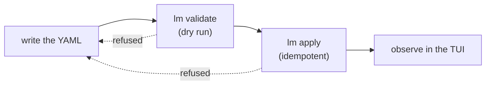

# How lumnik works

> Everything you configure is a YAML **manifest**: apply it, then observe it land in the
> TUI. Every apply is checked first — refused naming the exact field, or upserted,
> idempotently. `kind: Connector` additionally has a dry-run, `lm validate`; the other
> kinds run the same checks at apply time.

This page is the **apply-time** story — what happens when you declare. The **runtime**
story — what happens when a row changes and who gets warned — is
[How lumnik breathes](respiration.md).

## The kubectl parallel

If you know `kubectl`, you already know most of `lm`: declarative objects, an idempotent
`apply -f`, a dry-run check before you commit (`lm validate` — Connector manifests), a schema reference before
you write a line of YAML ([`lm describe connector-type <kind>`](cli/lm-reference.md)), and
contexts to point the CLI at different hubs ([`lm config use-context`](cli/lm-reference.md#context-auth)).

That schema-reference command is connector-only, though: `lm describe` covers the five
connector types, not the app kinds. For `Entity`, `View`, `Process` and `Workflow` the
schema lives on each kind's own page (the Fields table) and in the TUI's `:new` screen,
which opens a living, valid example of the kind you pick straight into `$EDITOR` — see
[CLI & TUI reference](cli/lm-reference.md).

**One place the parallel stops: `lm apply` never reconciles.** It is a
one-shot validate-then-upsert transaction, not a background loop.

Kubernetes controllers watch a cluster forever, pulling it back toward the declared
state whenever something drifts. lumnik does not: apply it once, and it stays applied
until you apply again. Nothing watches your source systems or the hub's own tables
afterwards to "correct" drift.

The one declared exception is a `Workflow`'s optional
[dormancy sweep](apps/workflows.md#dormancy-the-memory-of-the-breathing): it
periodically *observes* a document's state and *alerts*
(`decision.dormant.<workflow>`) when it has sat too long — but it never rewrites the
manifest or the data.

## Seven kinds, two families

Every manifest starts with `kind:` — seven kinds, grouped into two families by what they
build, not by a shared envelope: `apiVersion` is required and validated for `Connector`,
strictly validated for `Export`, declared-but-not-yet-enforced for the other four app
kinds (accepted today for forward compatibility), and simply absent from `Entity`'s
schema.

| `kind:` | `apiVersion:` | What it declares | Apply command | Owning page |
|---|---|---|---|---|
| `Connector` | `connectors.lumnik.io/v1` — required, validated | ingestion from one legacy source | `lm apply -f` | [Connectors — Overview](connectors/index.md) |
| `Entity` | not part of this manifest's schema | canonical fusion of N sources into one thing | `lm entity apply -f` | [Entities](entities.md) |
| `View` | `apps.lumnik.io/v1` — accepted, ignored | a read-only list a métier sees | `lm view apply -f` | [Views](apps/views.md) |
| `App` | `apps.lumnik.io/v1` — accepted, ignored | a métier app's own title, scope, icon and theme | `lm app apply -f` | [The métier PWA](apps/pwa.md) |
| `Process` | `apps.lumnik.io/v1` — accepted, ignored | a declared reaction to a row landing | `lm process apply -f` | [Processes](apps/processes.md) |
| `Workflow` | `apps.lumnik.io/v1` — accepted, ignored | a declared document lifecycle over a status column | `lm workflow apply -f` | [Workflows](apps/workflows.md) |
| `Export` | `apps.lumnik.io/v1` — required, validated | a managed delivery of an entity's rows to a destination | `lm export apply -f` | [Exports](apps/exports.md) |

`Connector` and `Entity` ingest and fuse; `View`, `App`, `Process`, `Workflow` and `Export`
build the [app ladder](apps/views.md) on top of what's been fused. Note the one CLI
irregularity: `lm apply -f` (no prefix) is `Connector`'s own command — every other kind
uses its own prefixed `apply` (`lm entity apply`, `lm view apply`, `lm app apply`,
`lm process apply`, `lm workflow apply`, `lm export apply`), as the
[CLI reference](cli/lm-reference.md) documents.

### Living with your objects

`apply` is only the write half — what you can list, fetch, or remove afterward differs
by kind (verified against the `lm` CLI source, `lm/internal/cli/`):

| Kind | `list` | `get NAME` | `delete NAME` |
|---|---|---|---|
| `Connector` | yes | yes | yes |
| `View` | yes | yes | no |
| `Workflow` | yes | yes | no |
| `Process` | yes | no | no |
| `Export` | yes | yes | no |
| `Entity` | no | yes | yes |
| `App` | no | no | no |

`Entity` has no `list` — `lm entity apply`, [`lm entity get NAME`](entities.md#read-api)
and `lm entity delete NAME` are its CLI surface; `lm entity get` is a thin facade over
[`GET /api/entities/{name}`](entities.md#read-api), the door to reach for only when the CLI
cannot express what you need. `Export` has no `delete` — there is no door that removes a
stored export manifest; `lm export apply` without `spec.schedule` lifts a previously
declared schedule, the same upsert posture a `Connector`'s own `schedule` key has. `App`
has no `list`/`get`/`delete` at all — `lm app apply` is its only CLI surface, and the
registry is read back through [`GET /api/apps`](cli/lm-reference.md) (`lm_user`, scope-bound), which is
how the PWA discovers its own identity at load.
There is no single command that lists every kind at once — each shelf keeps its own
`list`. See [CLI & TUI reference](cli/lm-reference.md) for the full command tables.

## One lifecycle

Write, apply, observe — every kind, same shape (plus a `lm validate` dry-run for
Connector manifests). A refusal at either check sends
you back to the file, not into a retry loop.

Manifests are files in **your** repository — version them there, the same way you'd
version a Kubernetes manifest. The hub stores the applied copy alongside its own state,
and [`lm view get NAME`](cli/lm-reference.md) / [`lm workflow get NAME`](cli/lm-reference.md)
re-extract that stored copy verbatim if your local file is ever lost.

## The little languages inside the YAML

A manifest's fields are plain YAML, but several of them hold a small syntax of their own.
Each one is documented in full on the page that owns it — this table is the map, not the
manual.

| Language | One-line syntax note | Where it shows up |
|---|---|---|
| JSONPath | `$` is the response root — `$.data[-1:].id` reads "the `id` of the last element of `data`" | REST/GraphQL/SOAP pagination + `promote` fields — [REST](connectors/rest.md) |
| cron | 5 fields (UNIX crontab dialect), evaluated in **UTC** by the hub's own scheduler — no OS cron involved | any connector's `spec.schedule` — [Connectors Overview](connectors/index.md) |
| glob | `*` and `?` only, in the **final filename segment** — no `**` recursion | CSV local/sftp/s3 `transport.path` — [CSV & files](connectors/csv.md) |
| date patterns | `dd/MM/yyyy` — capital `MM` is month, lowercase `mm` is minutes; add `H`/`h`/`m`/`s` only when the value carries a time | `parse-date` — [Transformers](connectors/transformers.md) |
| regex | full-match vs find semantics — differs per hook | `regex-extract` / `regex-replace` / `filter-where` — [Transformers](connectors/transformers.md) |
| `{{env:NAME}}` / `{{secret:NAME}}` | resolved from the **hub's own process environment** (OS env var, JVM system property as dev/test fallback) — **not** the `lm secret` registry; unresolved fails the run fast | SOAP body/header templates — [SOAP](connectors/soap.md) |
| `${now}` | resolves once, to the ingestion instant | `enrich-context` — [Transformers](connectors/transformers.md) |
| Kotlin `.kts` | the escape hatch — full JVM trust, no sandbox/timeout/memory cap, classpath-only scripts | mapping hooks ([Transformers](connectors/transformers.md)) and platform lifecycle/action hooks (developer SPI, documented beside the code) |

## Refusability as a feature

Every `apply` runs the same check that `validate` does first — a refusal names the exact
field, not a stack trace. That is not a shortcoming to work around; it is the same posture
the rest of lumnik carries: a refusal costs you a retry, a silent half-applied
manifest would cost you a lot more. See [Architecture — Declared over inferred](architecture.md#declared-over-inferred)
for the why, and [Connectors — Validate before apply](connectors/index.md#validate-before-apply)
for what a real refusal (and a real warning) look like on the wire.

## See also

- [Quickstart](quickstart/installer.md) — show value with a real connector in under a minute.
- [Connectors — Overview](connectors/index.md) — the ingestion half of the manifest model.
- [Views](apps/views.md) · Apps · [Processes](apps/processes.md) · [Workflows](apps/workflows.md) — the app ladder built on `apps.lumnik.io/v1`.
- [Glossary](glossary.md) — every lumnik word, one breath each.
