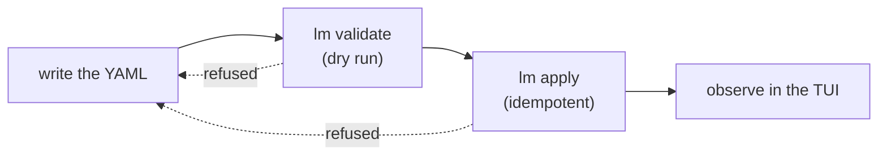

# How lumnik works

> Everything you configure is a YAML **manifest**. Apply it, then see it in `lm` or the TUI.
> Every apply is checked first: refused with the exact field named, or saved.

This page covers what happens when you apply. What happens when a row changes is
[How lumnik breathes](respiration.md).

## The kubectl parallel

If you know `kubectl`, you know most of `lm`:

- declarative objects and an idempotent `apply -f`;
- a dry run for connectors: `lm validate -f`;
- a schema reference for connector types: [`lm describe connector-type <type>`](cli/lm-reference.md);
- contexts for several hubs: [`lm config use-context`](cli/lm-reference.md#context-auth).

For the other kinds, the fields are on each kind's page, and the TUI's `:new` opens a valid
example of the kind you pick in `$EDITOR`.

**`lm apply` never reconciles.** Apply once and it stays applied until you apply again;
nothing pulls the hub or your sources back toward the manifest. The one watcher is a
`Workflow`'s [dormancy sweep](apps/workflows.md#dormancy-the-memory-of-the-breathing): it
raises an alert, and never changes the manifest or the data.

## Eight kinds, three families

| `kind:` | `apiVersion:` to write | What it declares | Apply | Owning page |
|---|---|---|---|---|
| `Connector` | `connectors.lumnik.io/v1` | ingestion from one source | `lm apply -f` | [Connectors](connectors/index.md) |
| `Entity` | — (none) | one thing fused from N sources | `lm entity apply -f` | [Entities](entities.md) |
| `View` | `apps.lumnik.io/v1` | a read-only list for one scope | `lm view apply -f` | [Views](apps/views.md) |
| `App` | `apps.lumnik.io/v1` | a business app's title, scope, icon and theme | `lm app apply -f` | [The PWA](apps/pwa.md) |
| `Process` | `apps.lumnik.io/v1` | a reaction to a row landing | `lm process apply -f` | [Processes](apps/processes.md) |
| `Workflow` | `apps.lumnik.io/v1` | a document lifecycle over a status column | `lm workflow apply -f` | [Workflows](apps/workflows.md) |
| `Export` | `apps.lumnik.io/v1` | a managed delivery of an entity's rows | `lm export apply -f` | [Exports](apps/exports.md) |
| `SearchIndex` | `search.lumnik.io/v1` | which entity columns an optional Search provider indexes | `lm search apply -f` | [Search](search/search-indexes.md) |

- **Ingest and fuse:** `Connector`, `Entity`.
- **Apps:** `View`, `App`, `Process`, `Workflow`, `Export`.
- **Search:** `SearchIndex`.

`Connector` is the only kind applied with the bare `lm apply -f`; every other kind has its
own prefixed `apply`.

### Living with your objects

| Kind | List | Read one | Remove | Also |
|---|---|---|---|---|
| `Connector` | `lm connector list` | `lm connector get NAME` (stored fields) | `lm connector delete NAME` | `run`, `pause`, `resume`, `scope` |
| `Entity` | `lm entity list` | `lm entity get NAME` (rows) | `lm entity delete NAME` | `export`, `resolve`, `ambiguous` |
| `View` | `lm view list` | `lm view get NAME` (manifest) | `lm view rm NAME` | `lm view NAME` renders it |
| `App` | `lm app list` | `lm app get NAME` (manifest) | `lm app rm NAME` | |
| `Process` | `lm process list` | — | `lm process rm NAME` | `enable`, `disable` |
| `Workflow` | `lm workflow list` | `lm workflow get NAME` (manifest) | `lm workflow rm NAME` | `enable`, `disable` |
| `Export` | `lm export list` | `lm export get NAME` (manifest) | — | `run`, `runs`, `status`, `retry` |
| `SearchIndex` | `lm search status` | `lm search status NAME` | `lm search rm NAME` | `query`, `rebuild`, `cancel` |

- An `Export` cannot be removed. Re-applying it without `spec.schedule` lifts its schedule.
- No single command lists every kind; each kind keeps its own `list`.

Full command tables: [CLI & TUI reference](cli/lm-reference.md).

## One lifecycle



Write, apply, observe — every kind. A refusal at either check sends you back to the file.

Keep manifests in **your** repository and version them there. If a local file is lost,
`lm view get`, `lm app get`, `lm workflow get` and `lm export get` print the stored manifest back.

## The little languages inside the YAML

A manifest's fields are plain YAML, but several of them hold a small syntax of their own.
Each one is documented in full on the page that owns it — this table is the map, not the
manual.

| Language | One-line syntax note | Where it shows up |
|---|---|---|
| JSONPath | `$` is the response root — `$.data[-1:].id` reads "the `id` of the last element of `data`" | REST/GraphQL/SOAP pagination + `promote` fields — [REST](connectors/rest.md) |
| cron | 5 fields (UNIX crontab dialect), evaluated in **UTC** | any connector's `spec.schedule` — [Connectors Overview](connectors/index.md) |
| glob | `*` and `?` only, in the **final filename segment** — no `**` recursion | CSV local/sftp/s3 `transport.path` — [CSV & files](connectors/csv.md) |
| date patterns | `dd/MM/yyyy` — capital `MM` is month, lowercase `mm` is minutes; add `H`/`h`/`m`/`s` only when the value carries a time | `parse-date` — [Transformers](connectors/transformers.md) |
| regex | Java syntax; each hook says whether the pattern must match the whole value | `regex-extract` / `regex-replace` / `filter-where` — [Transformers](connectors/transformers.md) |
| `{{secret:NAME}}` / `{{env:NAME}}` | `secret:` reads the `lm secret` registry, then the hub's environment; `env:` reads the environment only; unresolved fails the run fast | SOAP body/header templates — [SOAP](connectors/soap.md) |
| `${now}` | resolves once, to the ingestion instant | `enrich-context` — [Transformers](connectors/transformers.md) |
| Kotlin `.kts` | the escape hatch: runs with all of the hub's rights. The operator puts scripts in the hub's hooks directory; a manifest only names them | `csv-file` connectors only — [Kotlin hooks](connectors/kotlin-hooks.md) |

## Refusability as a feature

Every `apply` runs the same checks as `validate`. A refusal names the field and the fix:

```
$ lm validate -f acme-nightly.yaml
✗ acme-nightly.yaml — 1 error(s), 0 warning(s)

  ERROR    spec.archive_path
          archive_path is required when after_process=move
          → Set archive_path: /path/to/archive/

Fix errors above before running 'lm apply -f acme-nightly.yaml'.
Error: validation failed: 1 error(s)
```

More refusals and warnings: [Connectors — Validate before apply](connectors/index.md#validate-before-apply).

## See also

- [Quickstart](quickstart/installer.md) — show value with a real connector in under a minute.
- [Connectors — Overview](connectors/index.md) — the ingestion half of the manifest model.
- [Views](apps/views.md) · [Apps](apps/pwa.md) · [Processes](apps/processes.md) · [Workflows](apps/workflows.md) · [Exports](apps/exports.md) — the app kinds.
- [Glossary](glossary.md) — every lumnik word, one breath each.
