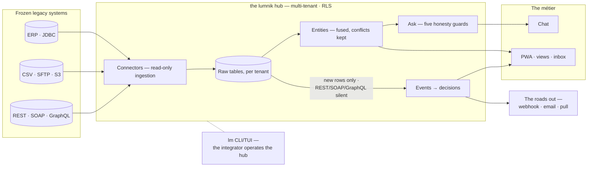

# lumnik — defrost the enterprise

<section class="lm-hero" markdown>

Documentation

Your information systems — the ERP, the LIMS, the exports nobody dares to touch — hold twenty years of history nobody can question any more. lumnik un-freezes that data, **read-only**.

Then someone asks it a question in plain language, from a phone. The answer cites its sources — or declines and says why.

<strong>Read-only first</strong>

Your source system is never written to. Ingest first, risk nothing.

<strong>Fuse, conflicts kept</strong>

Conflicts are preserved in a `_conflicts` ledger, never silently resolved away.

<strong>Ask with guards</strong>

Answers cite their sources — or decline. The guards refuse to invent.

<strong>Operate for real</strong>

Deploy, connect, scope, and run day-2 operations from one docs set.

[See the WOW](wow.md){ .lm-button .lm-button--primary } [Deploy lumnik](deploy.md){ .lm-button .lm-button--ghost } [Follow the guided path](parcours.md){ .lm-button .lm-button--ghost }

</section>

## Choose your starting path

<article class="lm-card lm-card--accent" markdown>

Start here

<h3>See the WOW</h3>

Watch two legacy sources become one canonical customer, then ask it a question in French.

[Open the walkthrough](wow.md){ .lm-link }
</article>
<article class="lm-card" markdown>

Install

<h3>Deploy the hub</h3>

Run the self-host stack, wire OIDC, and get to a healthy local hub without guesswork.

[Open deploy docs](deploy.md){ .lm-link }
</article>
<article class="lm-card" markdown>

First value

<h3>Quickstart in 60 seconds</h3>

Build `lm`, point it at the hub, and show value on CSV, REST, or SFTP data.

[Open quickstart](quickstart/installer.md){ .lm-link }
</article>
<article class="lm-card" markdown>

Guided onboarding

<h3>Walk the full path</h3>

Go from an empty machine to scoped métier apps, dormancy alerts, and day-2 operations.

[Open parcours](parcours.md){ .lm-link }
</article>

## The system in one glance

Frozen data flows one way — left to right, read-only at the door. On the right it meets
people, and it leaves again: what changed becomes an event, then a decision, then a message
in your own tools. Every page in this documentation sits somewhere on this map:

## The product surface

<article class="lm-card" markdown>

Ingest

<h3>The hub</h3>

[Declarative](how-it-works.md) connectors ingest JDBC, CSV, files, and REST (GraphQL and SOAP are request shapes on the same REST engine) — plus Kafka event brokers in [lumnik Pro](editions.md) — into a multi-tenant PostgreSQL where **isolation lives in the database** (Row-Level Security), not in the URL. [Transformers](connectors/transformers.md) repair the freezer's damage — mojibake, legacy dates — right at the door.

[Connector overview](connectors/index.md){ .lm-link }
</article>
<article class="lm-card" markdown>

Fuse

<h3>Entities</h3>

N legacy sources become one canonical, queryable thing. Disagreements stay visible in the `_conflicts` ledger.

[Open entities](entities.md){ .lm-link }
</article>
<article class="lm-card" markdown>

Ask

<h3>Answers that cite — or refuse</h3>

Per-métier chat and read-only text-to-SQL over the live hub, fenced by five deterministic honesty guards and métier scopes.

[See the five guards](transparency/ask-honesty.md){ .lm-link }
</article>
<article class="lm-card" markdown>

Act

<h3>Apps, workflows, and the roads out</h3>

Views, processes, workflows, inbox, and the métier PWA turn the hub into operational surfaces — on a phone, where the work actually happens. And what changed [leaves again](respiration.md): a decision reaches your own tools by [signed webhook](outputs.md) or [email](email.md).

[Browse apps](apps/views.md){ .lm-link }
</article>

## First session map

<article class="lm-step" markdown>

1

<h3>Watch first</h3>

Use the [WOW](wow.md) before reading feature lists. Seeing one fused customer beats absorbing ten abstractions.

**You know it landed when:** you understand what a connector, an entity, and a sourced answer look like in one run.

</article>
<article class="lm-step" markdown>

2

<h3>Deploy and log in</h3>

[Run the hub locally](deploy.md), point `lm` at it, and verify your first authenticated call succeeds.

**You know it worked when:** `lm login` succeeds and `lm connector list` answers.

</article>
<article class="lm-step" markdown>

3

<h3>Choose your shelf</h3>

Once the system is alive, branch into Connectors, Apps, Security, or Operations depending on what you need next.

**Best next shelves:** [Connectors](connectors/index.md), [Workflows](apps/workflows.md), [Security](security/role-management.md), [Operations](operations/backup-restore.md).

</article>

## Reference shelves

<article class="lm-card" markdown>
<h3>Connectors</h3>

[Overview](connectors/index.md) · [transformers](connectors/transformers.md) · [CSV & files](connectors/csv.md) · [JDBC](connectors/jdbc.md) · [REST](connectors/rest.md) · [GraphQL](connectors/graphql.md) and [SOAP](connectors/soap.md) — both request shapes on the REST engine, not connector types of their own · [Kafka](connectors/kafka.md) (Pro)
</article>
<article class="lm-card" markdown>
<h3>Ask your data</h3>

[The five guards](transparency/ask-honesty.md) · [scopes](rag/scopes.md) · [models & providers](rag/models.md) · [HTTP API](rag/http-api.md)
</article>
<article class="lm-card" markdown>
<h3>Apps &amp; outputs</h3>

[Views](apps/views.md) · [processes](apps/processes.md) · [workflows](apps/workflows.md) · [inbox](apps/inbox.md) · [PWA](apps/pwa.md) · [the roads out](outputs.md) · [email](email.md) · [how lumnik breathes](respiration.md)
</article>

If you want the full newcomer sequence rather than the shelf model, go straight to [Parcours](parcours.md).
