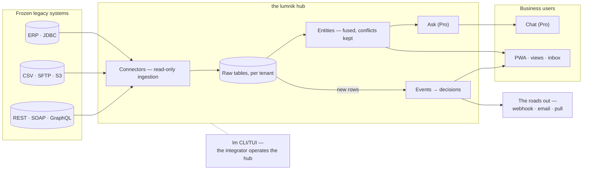

# lumnik — defrost the enterprise

<section class="lm-hero" markdown>

Documentation

lumnik reads the data in your ERP, LIMS and exports — **read-only**. It fuses the data, shows it to the right team, and answers questions in plain language (Pro). An answer shows its sources, or declines.

<strong>Read-only first</strong>

Your source system is never written to. Ingest first, risk nothing.

<strong>Fuse, conflicts kept</strong>

Conflicts are preserved in a `_conflicts` ledger, never silently resolved away.

<strong>Ask with guards</strong>

Answers cite their sources — or decline. The guards refuse to invent.

<strong>Not a migration, not BI</strong>

The ERP stays. lumnik reads it, and puts its data to work beside it.

[Deploy lumnik](deploy.md){ .lm-button .lm-button--primary } [See the WOW](wow.md){ .lm-button .lm-button--ghost } [Follow the guided path](parcours.md){ .lm-button .lm-button--ghost }

</section>

## Your first day, in order

<article class="lm-step" markdown>

1

<h3>Prepare the machine</h3>

[Prerequisites](quickstart/prerequisites.md): Docker, a few tools, and Ollama for Pro.

</article>
<article class="lm-step" markdown>

2

<h3>Deploy the hub</h3>

[Deploy](deploy.md): one command starts the hub, its database and its login server.

</article>
<article class="lm-step" markdown>

3

<h3>Load a first export</h3>

[Quickstart](quickstart/installer.md): install `lm`, log in, load a CSV, see the rows.

**You know it worked when:** `lm connector list` answers. On a fresh hub, with headers only.

</article>
<article class="lm-step" markdown>

4

<h3>Run the WOW</h3>

[The WOW](wow.md): two legacy systems become one customer, then a view, a decision, a lifecycle.

</article>

The full path, day by day: [Guided path](parcours.md).

## The system in one glance

The system in one picture — data flows left to right, read-only at the door:

## The product surface

<article class="lm-card" markdown>

Ingest

<h3>The hub</h3>

- **Sources:** JDBC, CSV and files, REST, GraphQL, SOAP — plus Kafka in [lumnik Pro](editions.md) — through [declarative](how-it-works.md) connectors.
- **Tenants:** each tenant sees only its own rows ([RLS](security/rls.md)).
- **Repair at the door:** [transformers](connectors/transformers.md) fix mojibake and legacy dates.

[Connector overview](connectors/index.md){ .lm-link }
</article>
<article class="lm-card" markdown>

Fuse

<h3>Entities</h3>

N legacy sources become one canonical, queryable thing. Disagreements stay visible in the `_conflicts` ledger.

[Open entities](entities.md){ .lm-link }
</article>
<article class="lm-card" markdown>

Ask

<h3>Answers that cite — or refuse</h3>

Scoped chat and read-only text-to-SQL over the live hub, protected by query guards (lumnik Pro).

[When Ask refuses](transparency/ask-honesty.md){ .lm-link }
</article>
<article class="lm-card" markdown>

Act

<h3>Apps, workflows, and the roads out</h3>

Views, processes, workflows, inbox, and the PWA turn the hub into operational surfaces — on a phone, where the work actually happens. And what changed [leaves again](respiration.md): a decision reaches your own tools by [signed webhook](outputs.md) or [email](email.md).

[Browse apps](apps/views.md){ .lm-link }
</article>

