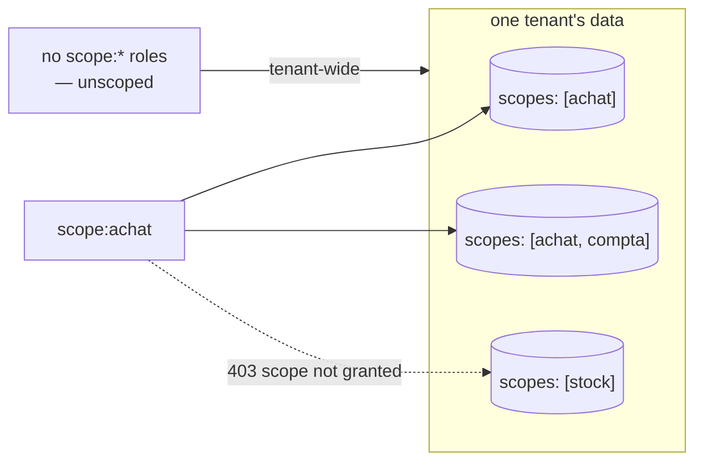

# Scopes — per-métier boundaries for ask

> A scope is declared on the connector — `metadata.scopes` — no object to create, no admin
> screen. By default it keeps every answer on-topic for a métier; opt-in `scope:<name>`
> Keycloak roles turn it into a need-to-know boundary too.

Every `lm ask` example passes `--scope`. This page defines what a scope actually is, how one
comes to exist, and what it guarantees.

## A scope is declared on the connector

There is **no separate scope object** to create or administer. A scope is a name a connector
manifest declares about itself:

```yaml
metadata:
  name: crm-customers
  connector_type: csv-file
  scopes: [clients]     # ← this IS the scope
```

Every table and chunk the connector ingests carries its scopes; the set of scopes in a tenant
is simply the union across its connectors — and its fused entities, which declare `scopes` the
same way ([Entities](../entities.md)). `metadata.scopes` is the only place: an older manifest
that still says `metadata.tags` or `target.tags` is refused at validate, with the line to
paste. A connector that declares none is valid but not askable in any métier — validate warns.

A scope **name** is lowercase, starts with a letter, then letters, digits, `_` or `-`, at most
41 characters — the same rule on every door that writes one (connector apply, entity apply,
`lm connector scope set`), because the name becomes the case-sensitive Keycloak role
`scope:<name>` and the `--scope` a person types.

## Using scopes

```bash
lm scopes                       # list scopes in this tenant (chunks, connectors, last indexed)
lm ask --scope clients "how many customers in Lyon?"
lm scope                        # show your default scope (fallback: 'system')
lm scope set clients            # set your default; empty string clears it
lm ask "how many customers in Lyon?"   # no --scope: asks your default
```

```
$ lm scopes
SCOPE   CONNECTORS  CHUNKS  LAST INDEXED
demo    0           2       2026-09-02 16:01
retail  0           2       2026-09-05 05:39
$ lm scope set retail
default scope set: retail
$ lm ask "how many customers are in Lyon?"
There are 3 customers in Lyon.
  data as of: 2026-09-05T03:40:51.916305Z (last completed run)

  SQL: SELECT COUNT(*)
FROM connector.t_customers
WHERE city = 'Lyon'
LIMIT 500
```

`lm scopes` counts what the RAG corpus holds per scope, so a scope appears only once a connector
has **indexed** content into it: a scope whose connectors are declared but have not run yet — or
ran and indexed nothing — is not listed. That is deliberate: `lm scopes` answers "what can I ask?",
not "what is declared". To see a connector's declared scopes before its first run, use
`lm connector scope ls <connector>`; `lm source schema --scope <tag>` is the view of what is askable.
The default is a preference, not a grant: a scope-bound user whose default names a scope they
do not hold is refused exactly as `--scope` would be (`403 scope not granted`).

In the TUI the header shows the session scope — seeded from your default ([TUI](../cli/tui.md)).

## What a scope guarantees — and what it doesn't

- **Tenant isolation is beneath scopes**, enforced by PostgreSQL Row-Level Security. A scope
  never crosses a tenant.
- **Within a tenant**, the scope is the métier boundary on analytic SQL: the
  [leak guard](../transparency/ask-honesty.md#4-leak-guard-the-metier-boundary) refuses any
  generated query that reads a table not declared in the scope (see the guard page for the
  refusal message).
- **By default a scope is a working boundary, not a security boundary between users**: a user
  with no scope grants may ask any scope — scopes keep *answers faithful to a métier's data*.
  To make it a need-to-know boundary too, bind the user (next section).

## Binding users to scopes (opt-in)

A grant is a Keycloak realm role named `scope:<name>` — nothing else to create or administer.

- A user with **no** `scope:*` roles is *unscoped*: tenant-wide access, exactly the default
  behavior above. (This is why admins need no special case — they simply carry no grants.)
- A user with **one or more** `scope:*` roles is *scope-bound*:
  - asking or searching a scope they don't hold → **403 scope not granted**;
  - `--scope all` (or none, on search) is rewritten onto their granted set — never unfiltered;
  - on chat, none means your default scope, if set, before that rewrite;
  - analytic `ask` requires them to *name* a granted scope (no silent `system` fallback);
  - `lm scopes` lists only their métiers.

The boundary covers the **whole read surface**, not just the chat: `kind:View`
render/detail/generate, saved-view discovery (`GET /api/views`), and the fused-entity REST
read all answer the same uniform `403 {"error":"scope not granted"}` outside the granted
set.

**Writing is stricter than reading.** A bound user may *see* a resource holding any one of
its scopes, but may *publish* one — `lm apply` of a connector, an entity apply — only while
holding **every** scope it declares; a scopeless manifest is refused too, since its author
could never see it. Same `403`, same body. End users reach the chat through their own door, `POST /api/rag/chat` (`lm_user`) —
`/api/platform/rag/chat` stays the integrator surface.

**Checking *someone else's* grants:** lumnik cannot show you this. The grant is a Keycloak
realm role, read straight off each request's own JWT into a thread-local
(`CurrentRolesHolder`, populated by the hub's auth filter) — nothing is persisted or queryable
on lumnik's side. `GET /api/bff/v1/me` answers for **you**: your tenant, your roles — including your
`scope:<name>` grants — and the modules you can reach. It has no equivalent for anyone else, and
no `lm` command or admin endpoint looks up another user's roles. So you can check your own in
one call; for hers, open Keycloak's own admin console — realm → **Users** → the user →
**Role mapping** — that is where `scope:<name>` grants actually live.

The same table can live in several métiers: declare `scopes: [achat, compta]` on the connector
and a `scope:achat` user sees it while a `scope:stock` user does not:



## Scoping and the ladder

The same scope name runs the whole ladder: a `kind: View` renders a scope's table, a `kind: Process`
watches a scope's raw ingest table, and a [`kind: Workflow`](../apps/workflows.md) declares a
lifecycle whose corpus chunk carries that same scope — so a bound user retrieves the
declared graph only for the métiers they hold. One name, one métier, end to end.

## See also

- [Ask honesty — the five guards](../transparency/ask-honesty.md)
- [CSV & files](../connectors/csv.md) / [JDBC](../connectors/jdbc.md) /
  [REST](../connectors/rest.md) manifests — every kind declares `metadata.scopes` the same way.
- [Role management — the three confusable 403s](../security/role-management.md#troubleshooting) —
  `scope not granted` is one of three different-looking 403s; the table there tells them apart.
