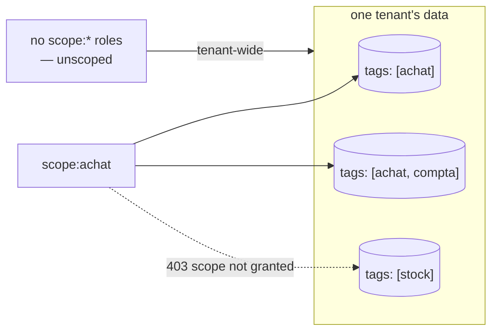

# Scopes — per-métier boundaries for ask

> A scope is nothing but a connector tag — no object to create, no admin screen. By default it
> keeps every answer on-topic for a métier; opt-in `scope:<tag>` Keycloak roles turn it into a
> need-to-know boundary too.

Every `lm ask` example passes `--scope`. This page defines what a scope actually is, how one
comes to exist, and what it guarantees.

## A scope is a connector tag

There is **no separate scope object** to create or administer. A scope is a tag that rode in on
a connector manifest:

```yaml
spec:
  target:
    tags: [clients]     # ← this IS the scope
```

When the connector runs, its chunks and tables carry the tag; the set of scopes in a tenant is
simply the set of tags seen across its ingested data. `metadata.tags` on the manifest merge into
the same set.

## Using scopes

```bash
lm scopes                       # list scopes in this tenant (chunks, connectors, last indexed)
lm ask --scope clients "how many customers in Lyon?"
lm scope                        # show your default scope (fallback: 'system')
lm scope set clients            # set your default; empty string clears it
```

In the TUI, `:scopes` lists them; `Enter` sets the active scope (shown in the header, used by
`:ask`).

## What a scope guarantees — and what it doesn't

- **Tenant isolation is beneath scopes**, enforced by PostgreSQL Row-Level Security. A scope
  never crosses a tenant.
- **Within a tenant**, the scope is the métier boundary on analytic SQL: the
  [leak guard](../transparency/ask-honesty.md#4-leak-guard-the-metier-boundary) refuses any
  generated query that reads a table not declared in the scope (see the guard page for the
  refusal message).
- **By default a scope is a working boundary, not a security boundary between users**: a user
  with no scope grants may ask any scope — scopes keep *answers faithful to a métier's data*.
  To make it a need-to-know boundary too, bind the user (next section).

## Binding users to scopes (opt-in)

A grant is a Keycloak realm role named `scope:<tag>` — nothing else to create or administer.

- A user with **no** `scope:*` roles is *unscoped*: tenant-wide access, exactly the default
  behavior above. (This is why admins need no special case — they simply carry no grants.)
- A user with **one or more** `scope:*` roles is *scope-bound*:
  - asking or searching a scope they don't hold → **403 scope not granted**;
  - `--scope all` (or none, on search/chat) is rewritten onto their granted set — never
    unfiltered;
  - analytic `ask` requires them to *name* a granted scope (no silent `system` fallback);
  - `lm scopes` lists only their métiers.

The boundary covers the **whole read surface**, not just the chat: `kind:View`
render/detail/generate, saved-view discovery (`GET /api/views`), and the fused-entity REST
read all answer the same uniform `403 {"error":"scope not granted"}` outside the granted
set. End users reach the chat through their own door, `POST /api/rag/chat` (`lm_user`) —
`/api/platform/rag/chat` stays the integrator surface.

**Checking *someone else's* grants:** lumnik cannot show you this. The grant is a Keycloak
realm role, read straight off each request's own JWT into a thread-local
(`CurrentRolesHolder`, populated by the hub's auth filter) — nothing is persisted or queryable
on lumnik's side. `GET /api/bff/v1/me` answers for **you**: your tenant, your roles — including your
`scope:<tag>` grants — and the modules you can reach. It has no equivalent for anyone else, and
no `lm` command or admin endpoint looks up another user's roles. So you can check your own in
one call; for hers, open Keycloak's own admin console — realm → **Users** → the user →
**Role mapping** — that is where `scope:<tag>` grants actually live.

The same table can live in several métiers: tag the connector `tags: [achat, compta]` and a
`scope:achat` user sees it while a `scope:stock` user does not:



## Scoping and the ladder

The same tag scopes the whole ladder: a `kind: View` renders a scope's table, a `kind: Process`
watches a scope's raw ingest table, and a [`kind: Workflow`](../apps/workflows.md) declares a
lifecycle whose corpus chunk is tagged with that same scope — so a bound user retrieves the
declared graph only for the métiers they hold. One tag, one métier, end to end.

## See also

- [Ask honesty — the five guards](../transparency/ask-honesty.md)
- [CSV & files](../connectors/csv.md) / [JDBC](../connectors/jdbc.md) /
  [REST](../connectors/rest.md) manifests — where `target.tags` lives.
- [Role management — the three confusable 403s](../security/role-management.md#troubleshooting) —
  `scope not granted` is one of three different-looking 403s; the table there tells them apart.
