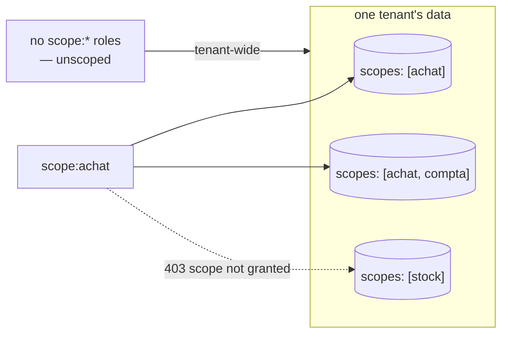

# Scopes — business-data boundaries for Ask

> A scope is declared on the connector — `metadata.scopes` — no object to create, no admin
> screen. By default it keeps every answer inside one declared scope; opt-in `scope:<name>`
> Keycloak roles turn it into a need-to-know boundary too.

Every `lm ask` example passes `--scope`. This page defines what a scope actually is, how one
comes to exist, and what it guarantees.

## A scope is declared on the connector

There is **no separate scope object** to create or administer. A scope is a name a connector
manifest declares about itself:

```yaml
metadata:
  name: crm-customers
  connector_type: csv-file
  scopes: [clients]     # ← this IS the scope
```

- Every table and chunk the connector ingests carries its scopes. A tenant's scopes are those of
  its connectors and its [fused entities](../entities.md).
- `metadata.scopes` is the only place: `metadata.tags` or `target.tags` is refused at validate,
  with the line to paste instead.
- A connector that declares none is valid but not askable in any scope; validation warns.
- A scope **name** is lowercase, starts with a letter, then letters, digits, `_` or `-`, at most
  41 characters — the same rule on every door that writes one. It becomes the case-sensitive Keycloak
  role `scope:<name>`.

## Using scopes

```bash
lm scopes                       # list scopes in this tenant (chunks, connectors, last indexed)
lm ask --scope clients "how many customers in Lyon?"
lm scope                        # show your default scope (fallback: 'system')
lm scope set clients            # set your default; empty string clears it
lm ask "how many customers in Lyon?"   # no --scope: asks your default
```

```
$ lm scopes
SCOPE   CONNECTORS  CHUNKS  LAST INDEXED
demo    0           1       2026-10-24 21:59
desk    0           2       2026-10-24 23:35
retail  0           1       2026-10-24 21:55
$ lm scope set desk
default scope set: desk
$ lm ask "combien de clients à Lyon ?"
Il y a 2 clients à Lyon.
  data as of: 2026-10-24T21:35:11.811114Z (last completed run)
…
  SQL: SELECT COUNT(*) FROM "connector"."v_acmecustomer" WHERE "city" = 'Lyon'
LIMIT 500
```

- `lm scopes` lists the scopes the chat has indexed content in. `CHUNKS` is what the chat can
  cite. `CONNECTORS` counts only connectors whose rows the chat indexed: it often reads `0`.
- `lm connector scope ls <connector>` shows a connector's declared scopes, run or not;
  `lm source schema --scope <tag>` shows what is askable.
- Moving a connector to another scope moves its tables between the two scopes' schema cards at once
  ([capture](../quickstart/installer.md#what-makes-a-scope-answerable)). Its indexed chat chunks keep
  their old scopes until `lm connector scope sync`.
- The default is a preference, not a grant: a scope-bound user whose default names a scope they do
  not hold gets `Error: access refused (403): scope not granted`.

In the TUI the header shows the session scope — seeded from your default ([TUI](../cli/tui.md)).

## What a scope guarantees — and what it doesn't

- **Tenant isolation is beneath scopes**, enforced by PostgreSQL Row-Level Security. A scope
  never crosses a tenant.
- **Within a tenant**, the scope is the business-scope boundary on analytic SQL: the
  [leak guard](../transparency/ask-rules.md#4-leak-guard-the-business-scope-boundary) refuses any
  generated query that reads a table not declared in the scope (see the guard page for the
  refusal message).
- **By default a scope is a working boundary, not a security boundary between users**: a user
  with no scope grants may ask any scope — scopes keep answers inside the selected data set.
  To make it a need-to-know boundary too, bind the user (next section).

## Binding users to scopes (opt-in)

A grant is a Keycloak realm role named `scope:<name>` — nothing else to create or administer.

- A user with **no** `scope:*` roles is *unscoped*: tenant-wide access, exactly the default
  behavior above. (This is why admins need no special case — they simply carry no grants.)
- A user with **one or more** `scope:*` roles is *scope-bound*:
  - asking or searching a scope they do not hold: `Error: access refused (403): scope not granted`;
  - `lm ask` needs a scope they hold: named with `--scope`, or set as their default. `all` is
    refused;
  - search and chat without a scope read only their scopes;
  - `lm scopes` lists only their granted scopes.

The boundary covers every read, not only the chat:

| Surface | A bound user sees |
|---|---|
| views, entities, search | only their scopes; another one answers `scope not granted` |
| the inbox (`lm inbox`, *Inbox*) | only decisions in their scopes; an id from another scope is a `404` |
| workflows and their tape | only workflows in their scopes |
| connectors, runs, dead letters | only connectors whose every scope they hold — [the details](../security/role-management.md#troubleshooting) |

**Writing is stricter than reading.** A bound user may *see* a resource holding any one of its
scopes, but may *publish* one (`lm apply`, `lm entity apply`) only while holding **every** scope it
declares. A scopeless manifest is refused too. Here the caller holds `scope:sales` and the manifest
declares `scopes: [desk]`:

```
$ lm apply -f docs/apps/demo/sources/10-erp.yaml
Error: access refused (403): scope not granted
```

**Administering a connector follows the writing rule.** A bound integrator sees, runs and changes
only the connectors whose every scope they hold, and their runs and dead letters. The details, with
captures: [A scope-bound integrator](../security/role-management.md#a-scope-bound-integrator).

**Checking grants.** lumnik does not store them: a grant is a Keycloak realm role, read from each
request's token.

- Your own: no `lm` command shows them; `GET /api/bff/v1/me` returns your tenant, roles (with your
  `scope:<name>` grants) and modules.
- Someone else's: Keycloak's admin console — realm → **Users** → the user → **Role mapping**.

The same table can belong to several scopes: declare `scopes: [achat, compta]` on the connector
and a `scope:achat` user sees it while a `scope:stock` user does not:



## Scoping and the ladder

The same scope name runs the whole ladder: a `kind: View` renders a scope's table, a `kind: Process`
watches a scope's raw ingest table, and a [`kind: Workflow`](../apps/workflows.md) declares a
lifecycle whose corpus chunk carries that same scope — so a bound user retrieves the
declared graph only for the scopes they hold. One scope name, end to end.

## See also

- [When Ask refuses](../transparency/ask-honesty.md)
- [CSV & files](../connectors/csv.md) / [JDBC](../connectors/jdbc.md) /
  [REST](../connectors/rest.md) manifests — every kind declares `metadata.scopes` the same way.
- [Role management — the three confusable 403s](../security/role-management.md#troubleshooting) —
  `scope not granted` is one of three different-looking 403s; the table there tells them apart.
