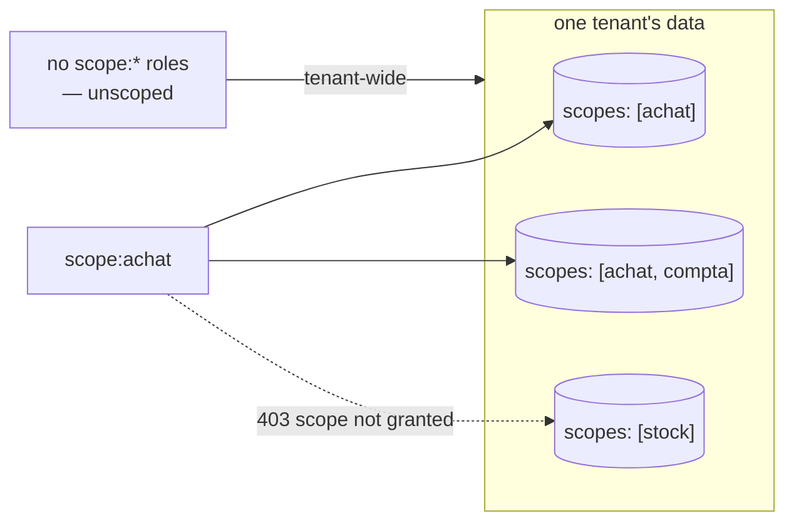

# Scopes — per-métier boundaries for ask

> A scope is declared on the connector — `metadata.scopes` — no object to create, no admin
> screen. By default it keeps every answer on-topic for a métier; opt-in `scope:<name>`
> Keycloak roles turn it into a need-to-know boundary too.

Every `lm ask` example passes `--scope`. This page defines what a scope actually is, how one
comes to exist, and what it guarantees.

## A scope is declared on the connector

There is **no separate scope object** to create or administer. A scope is a name a connector
manifest declares about itself:

```yaml
metadata:
  name: crm-customers
  connector_type: csv-file
  scopes: [clients]     # ← this IS the scope
```

- Every table and chunk the connector ingests carries its scopes. A tenant's scopes are those of
  its connectors and its [fused entities](../entities.md).
- `metadata.scopes` is the only place: `metadata.tags` or `target.tags` is refused at validate,
  with the line to paste instead.
- A connector that declares none is valid but not askable in any métier; validate warns.
- A scope **name** is lowercase, starts with a letter, then letters, digits, `_` or `-`, at most
  41 characters — the same rule on every door that writes one. It becomes the case-sensitive Keycloak
  role `scope:<name>`.

## Using scopes

```bash
lm scopes                       # list scopes in this tenant (chunks, connectors, last indexed)
lm ask --scope clients "how many customers in Lyon?"
lm scope                        # show your default scope (fallback: 'system')
lm scope set clients            # set your default; empty string clears it
lm ask "how many customers in Lyon?"   # no --scope: asks your default
```

```
$ lm scopes
SCOPE   CONNECTORS  CHUNKS  LAST INDEXED
demo    0           2       2026-09-02 16:01
retail  0           2       2026-09-05 05:39
$ lm scope set retail
default scope set: retail
$ lm ask "how many customers are in Lyon?"
There are 3 customers in Lyon.
  data as of: 2026-09-05T03:40:51.916305Z (last completed run)

…
  1 row returned

  SQL: SELECT COUNT(*)
FROM connector.t_customers
WHERE city = 'Lyon'
LIMIT 500
```

- `lm scopes` lists a scope only once a connector has **indexed** content into it: a connector that
  has not run yet does not show.
- `lm connector scope ls <connector>` shows a connector's declared scopes, run or not;
  `lm source schema --scope <tag>` shows what is askable.
- Moving a connector to another scope moves its tables between the two scopes' schema cards at once
  ([capture](../quickstart/installer.md#what-makes-a-scope-answerable)). Its indexed chat chunks keep
  their old scopes until `lm connector scope sync`.
- The default is a preference, not a grant: a scope-bound user whose default names a scope they do
  not hold gets `403 scope not granted`.

In the TUI the header shows the session scope — seeded from your default ([TUI](../cli/tui.md)).

## What a scope guarantees — and what it doesn't

- **Tenant isolation is beneath scopes**, enforced by PostgreSQL Row-Level Security. A scope
  never crosses a tenant.
- **Within a tenant**, the scope is the métier boundary on analytic SQL: the
  [leak guard](../transparency/ask-honesty.md#4-leak-guard-the-metier-boundary) refuses any
  generated query that reads a table not declared in the scope (see the guard page for the
  refusal message).
- **By default a scope is a working boundary, not a security boundary between users**: a user
  with no scope grants may ask any scope — scopes keep *answers faithful to a métier's data*.
  To make it a need-to-know boundary too, bind the user (next section).

## Binding users to scopes (opt-in)

A grant is a Keycloak realm role named `scope:<name>` — nothing else to create or administer.

- A user with **no** `scope:*` roles is *unscoped*: tenant-wide access, exactly the default
  behavior above. (This is why admins need no special case — they simply carry no grants.)
- A user with **one or more** `scope:*` roles is *scope-bound*:
  - asking or searching a scope they don't hold → **403 scope not granted**;
  - `--scope all` (or none, on search) is rewritten onto their granted set — never unfiltered;
  - on chat, none means your default scope, if set, before that rewrite;
  - analytic `ask` requires them to *name* a granted scope (no silent `system` fallback);
  - `lm scopes` lists only their métiers.

The boundary covers the **whole read surface**, not just the chat: `kind:View`
render/detail/generate, saved-view discovery (`GET /api/views`), and the fused-entity REST
read all answer the same uniform `403 {"error":"scope not granted"}` outside the granted
set. The decision inbox (`lm inbox`, the PWA's *Décisions* tab) lists only the decisions of the
granted métiers, and another métier's decision id is a plain `404`. The workflow tape
(`lm observations list`, `stats`) shows only the workflows of the granted métiers.

**Writing is stricter than reading.** A bound user may *see* a resource holding any one of its
scopes, but may *publish* one (`lm apply`, `lm entity apply`) only while holding **every** scope it
declares. A scopeless manifest is refused too. Here the caller holds `scope:sales` and the manifest
declares `scopes: [desk]`:

```
$ lm apply -f docs/apps/demo/sources/10-erp.yaml
Error: access refused (403): scope not granted
```

**Administering a connector follows the writing rule.** Every connector command (`get`, `apply`,
`run`, `pause`, `resume`, `delete`, `scope`, and the endpoint commands) acts only on a connector
whose scopes the bound integrator holds **all** of. `lm connector list` shows only those, so a
connector of another métier, a connector spanning a métier you do not hold, or a scopeless one
is simply not found. Moving a connector you hold into a scope you don't hold is refused:

```
$ lm connector list
NAME           TYPE         TENANT  SCHED  WINDOW  STATUS  LAST RUN
orders-ventes  hello-world  1
$ lm connector pause stock-magasin
Error: connector "stock-magasin" not found
$ lm connector scope add orders-ventes magasin
Error: access refused (403): scope not granted
$ lm connector scope ls orders-ventes
ventes
```

The same hub, listed by an integrator with no `scope:*` role, shows `stock-magasin` too:
unbound integrators keep administering the whole tenant.

**What a connector left behind follows the same rule.** A run carries counts, table names and
the error message, and a dead letter carries the rejected row's values. A bound integrator's
`lm run list` and `lm dlq list` show only the connectors whose scopes they hold all of.
`lm run get`/`cancel`, `lm dlq get`/`discard`/`replayed`, and `--connector`/`--run` filters
naming another métier's connector answer `403`.

The `lm source` doors create or reuse connectors, so they follow the writing rule:

- `lm csv ingest` refuses a `--scope` you do not hold. Without `--scope` the one-shot lands in
  `system`, which you need to hold too.
- Re-ingesting under the name of another métier's one-shot is refused rather than moving it
  into yours.
- `lm source jdbc add` creates its connectors without scopes, so a bound integrator is refused
  before the source database is contacted. Declare the connector in a manifest with `scopes:`
  and `lm apply` it instead.
- `lm source jdbc list-tables` lists only the connectors you hold.
- `lm source rest probe` answers only for a connector you hold.
- `lm source rest from-openapi` writes nothing to the hub. It drafts a manifest, and
  `lm apply` then judges its `scopes:`.

The capture below shows the same hub as above with two csv connectors, `commandes-ventes`
(`scopes: [ventes]`) and `stock-magasin` (`scopes: [magasin]`), each run once with one malformed
row. The caller is an integrator holding `scope:ventes`:

```
$ lm run list
ID        CONNECTOR         ENDPOINT  STATUS     IN  OUT  SKIPPED  DEAD-LETTERS  STARTED           ENDED
0893cee7  commandes-ventes  default   Completed  2   1    1        1             2026-10-18 15:37  2026-10-18 15:37
$ lm dlq list
ID        CONNECTOR         RUN       REASON           ATTEMPTS  MESSAGE
f8b2118f  commandes-ventes  0893cee7  MalformedSource  1         data/commandes.csv:3 — Record has 3 values but only 2 column…
$ lm dlq get 95b20b87-d992-43e2-b08b-f50806a4d131
Error: access refused (403): scope not granted
$ lm dlq discard 95b20b87-d992-43e2-b08b-f50806a4d131
Error: access refused (403): scope not granted
$ lm run get b93a9839-862e-49ea-a397-f13a46751c57
Error: access refused (403): scope not granted
$ lm csv ingest inventaire.csv --name inventaire --scope ventes
Error: access refused (403): scope not granted
$ lm csv ingest inventaire.csv --name inventaire-bis --scope magasin
Error: access refused (403): scope not granted
$ echo "$PGPASSWORD" | lm source jdbc add erp --url jdbc:postgresql://erp-db:5432/erp --user lumnik_reader --tables orders --password-stdin
Error: access refused (403): scope not granted
```

The two ids refused above are `stock-magasin`'s dead letter and run, which an unbound
integrator sees in the same lists. `inventaire` is a `magasin` one-shot. Re-ingesting it under
`--scope ventes` would have moved it into `ventes`, and its rows with it.

**Checking grants.** lumnik does not store them: a grant is a Keycloak realm role, read from each
request's token.

- Your own: no `lm` command shows them; `GET /api/bff/v1/me` returns your tenant, roles (with your
  `scope:<name>` grants) and modules.
- Someone else's: Keycloak's admin console — realm → **Users** → the user → **Role mapping**.

The same table can live in several métiers: declare `scopes: [achat, compta]` on the connector
and a `scope:achat` user sees it while a `scope:stock` user does not:



## Scoping and the ladder

The same scope name runs the whole ladder: a `kind: View` renders a scope's table, a `kind: Process`
watches a scope's raw ingest table, and a [`kind: Workflow`](../apps/workflows.md) declares a
lifecycle whose corpus chunk carries that same scope — so a bound user retrieves the
declared graph only for the métiers they hold. One name, one métier, end to end.

## See also

- [Ask honesty — the five guards](../transparency/ask-honesty.md)
- [CSV & files](../connectors/csv.md) / [JDBC](../connectors/jdbc.md) /
  [REST](../connectors/rest.md) manifests — every kind declares `metadata.scopes` the same way.
- [Role management — the three confusable 403s](../security/role-management.md#troubleshooting) —
  `scope not granted` is one of three different-looking 403s; the table there tells them apart.
