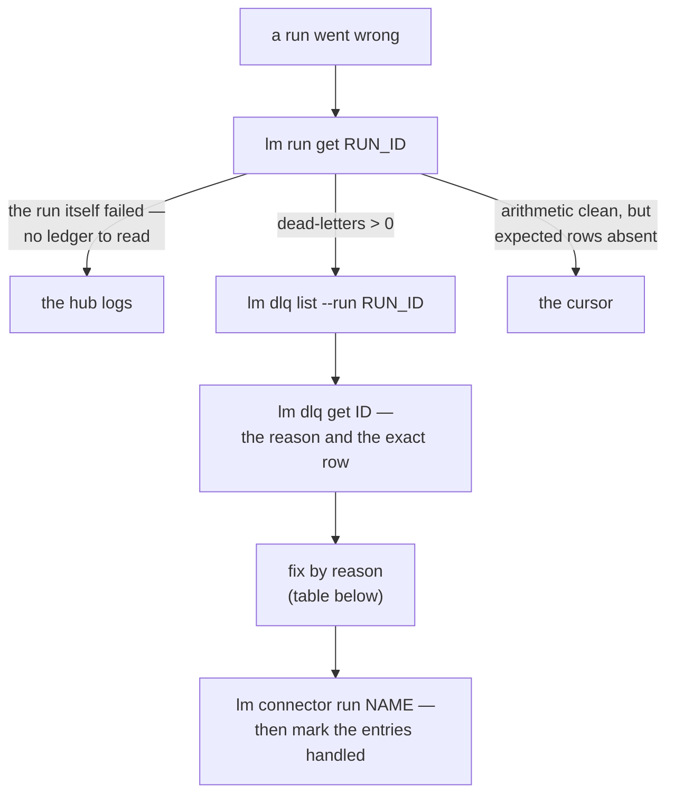

# Diagnosing a failed run

> A run went wrong — read the ledger, not the logs, first: `lm run get` and `lm dlq` tell you
> exactly which rows fell out and why before you go looking for a stack trace.

A run reports a failure, or fewer rows arrived than you expected. Follow this walk:



## 1. Read the run

```bash
lm run list --connector orders    # newest first — find yours
lm run get <RUN_ID>               # IN, OUT, SKIPPED, DEAD-LETTERS
```

The 8-character id from the table is enough. A run that failed outright:

```
$ lm run get 0c5618e6
ID        CONNECTOR  ENDPOINT  STATUS  IN  OUT  SKIPPED  DEAD-LETTERS  STARTED           ENDED
0c5618e6  products   default   Failed  0   0    0        0             2026-10-19 01:39  2026-10-19 01:39
✖ run failed: SFTP connect failed: DefaultConnectFuture[lumnik@sftp.example.internal/<unresolved>:22]: Failed (UnresolvedAddressException) to execute: null — UnresolvedAddressException.
```

It never read a row: the SFTP host name does not resolve. Fix the network or the manifest.

A run that completed but set rows aside:

```
$ lm run get 6e52921c
ID        CONNECTOR  ENDPOINT  STATUS     IN  OUT  SKIPPED  DEAD-LETTERS  STARTED           ENDED
6e52921c  orders     default   Completed  10  8    2        2             2026-10-19 01:38  2026-10-19 01:38
⚠ 2 rows quarantined — see: lm dlq list --run 6e52921c-4168-437c-81d6-55d8bcd2a24c
```

What `lm run get` tells you, and where to go next:

| You see | Meaning | Next |
|---|---|---|
| `✖ run failed: …` (or `• run cancelled: …`) | the run itself failed: connection, credentials, source gone | read the message; if it is not enough, [the hub logs](logs.md) |
| `⚠ N rows quarantined` | rows were dead-lettered, each with a reason | [step 2](#2-read-the-quarantine) |
| `⚠ N cell(s) a hook did not deliver as declared — the rows were still written` | a [transformer](../connectors/transformers.md) left a value blank or changed; the row is there | the table below |
| `• N row(s) removed — the source no longer holds them` | the source no longer holds those rows; the table shrank | the source |
| clean arithmetic, rows still missing | an incremental connector only fetches past its cursor | `lm endpoint reset-cursor <connector>/<endpoint>` — the next run is a full refresh |

A cell warning, as it appears:

```
$ lm run get 4aaff94f
ID        CONNECTOR  ENDPOINT  STATUS     IN  OUT  SKIPPED  DEAD-LETTERS  STARTED           ENDED
4aaff94f  invoices   default   Completed  4   4    0        0             2026-10-19 01:39  2026-10-19 01:39
⚠ 1 cell(s) a hook did not deliver as declared — the rows were still written
```

Here `parse-date` with format `yyyy-MM-dd` met `03/09/2026` and wrote the cell empty.
The same count is `cellErrors` in `lm run get -o json` and `cell_errors:` in the TUI describe panel.

| Hook | What it does to a value it cannot handle |
|---|---|
| `parse-date`, `parse-number`, `parse-email`, `parse-phone`, `lookup` | empties the cell |
| `split` | leaves the value in place; some `into` columns stay empty |
| `fix-mojibake` | leaves the value as it arrived |
| `to-uuid` with `on-invalid: generate` | replaces it with a generated id |
| `map-columns` | overwrites a column the row already had |

## 2. Read the quarantine

```bash
lm dlq list --run <RUN_ID>    # every quarantined row: reason, attempts, resolution, message
lm dlq get <ID>               # the full detail — including the offending payload
```

Both take the 8-character ids from the tables.

```
$ lm dlq list --run 6e52921c
ID        CONNECTOR  RUN       REASON           ATTEMPTS  RESOLUTION  MESSAGE
9d07dd36  orders     6e52921c  MalformedSource  1                     /tmp/exports/orders.csv:9 — Index for header 'status' is 2 b…
da3dc703  orders     6e52921c  MalformedSource  1                     /tmp/exports/orders.csv:8 — Record has 6 values but only 5 c…

$ lm dlq get 9d07dd36
ID:        9d07dd36-53b3-406b-8fad-52dc769b5766
Connector: orders (ea9011bf-393d-4926-a405-8e3568d155a7)
Run:       6e52921c-4168-437c-81d6-55d8bcd2a24c
Reason:    MalformedSource
Attempts:  1
Message:   /tmp/exports/orders.csv:9 — Index for header 'status' is 2 but CSVRecord only has 2 values!
Detail:    {"file":"/tmp/exports/orders.csv","line":9,"message":"Index for header 'status' is 2 but CSVRecord only has 2 values!"}
Payload:   {"raw":["ORD-1008","C-006"],"file":"/tmp/exports/orders.csv","line":9}
```

Line 9 stopped after two values. The payload is the row as the source sent it: the fix is in the export.

| Reason | What it means | Where to look |
|---|---|---|
| `MalformedSource` | the source row itself is broken — encoding, truncated line | the file or export; a [transformer](../connectors/transformers.md) can often repair it at the door |
| `MappingFailed` | a hook emitted nothing for this row without declaring a drop | the connector's [hooks](../connectors/transformers.md) against the row `lm dlq get` shows |
| `ValidationFailed` | the row broke a declared expectation | the manifest's declaration against the data |
| `WriteFailed` | the database write failed | the target table — types, drift; the [hub logs](logs.md) have the SQL error |

A hook that throws does not land here: it fails the run.
Declared skips (`Duplicate`, `PolicyExcluded`) are counted in SKIPPED but never dead-lettered
([ingestion honesty](../transparency/ingestion-honesty.md)).

## 3. Fix, re-run, close the loop

Fix the source, then run the connector again. A jdbc or CSV run resumes on its cursor
([how jdbc cursors resume](../connectors/jdbc.md#cursors-resume-restart-reset)); a REST run upserts
on its key, so a re-run does not duplicate rows ([REST storage](../connectors/rest.md#storage-layout)).

```
$ lm connector run orders
run scheduled: 8778809f-36b6-45e8-bc62-717359e137a2

$ lm run list --connector orders
ID        CONNECTOR  ENDPOINT  STATUS     IN  OUT  SKIPPED  DEAD-LETTERS  STARTED           ENDED
8778809f  orders     default   Completed  10  10   0        0             2026-10-19 01:39  2026-10-19 01:39
6e52921c  orders     default   Completed  10  8    2        2             2026-10-19 01:38  2026-10-19 01:38
```

Then mark each entry handled — replayed by the new run, or not wanted:

```
$ lm dlq replayed 9d07dd36 --new-run-id 8778809f
marked replayed: 9d07dd36-53b3-406b-8fad-52dc769b5766

$ lm dlq discard da3dc703
discarded: da3dc703-b1b7-4a84-a2e1-6ee8ed241cf1
```

`--new-run-id` takes the 8 characters `lm run list` shows, like `--run`.

Handled entries stay in `lm dlq list --run`, their RESOLUTION filled in; `lm dlq list --connector`
shows only the ones still pending:

```
$ lm dlq list --run 6e52921c
ID        CONNECTOR  RUN       REASON           ATTEMPTS  RESOLUTION  MESSAGE
9d07dd36  orders     6e52921c  MalformedSource  1         REPLAYED    /tmp/exports/orders.csv:9 — Index for header 'status' is 2 b…
da3dc703  orders     6e52921c  MalformedSource  1         DISCARDED   /tmp/exports/orders.csv:8 — Record has 6 values but only 5 c…
```

In the TUI: `:runs` and `:dlq` update live; on `:dlq`, `^R` marks replayed and `^D` discards.
