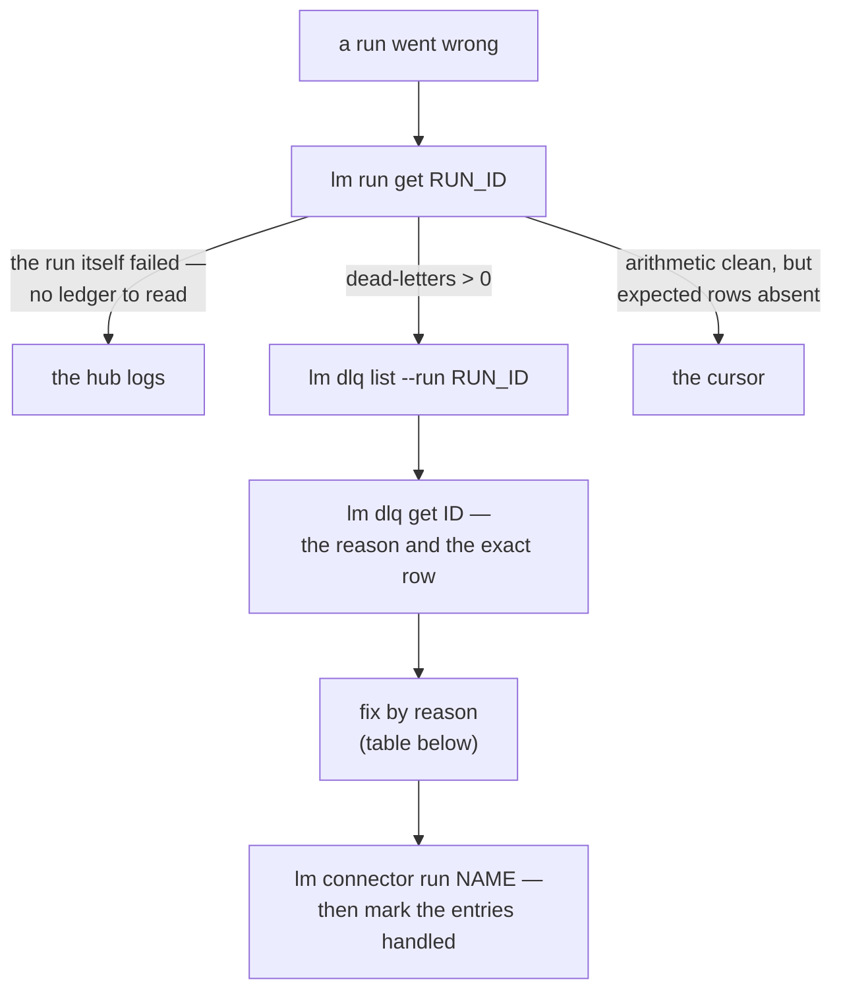

# Diagnosing a failed run

> A run went wrong — read the ledger, not the logs, first: `lm run get` and `lm dlq` tell you
> exactly which rows fell out and why before you go looking for a stack trace.

A run went wrong: it reports a failure, or fewer rows arrived than you expected.
The good news is that a run can never *hide* what happened — its arithmetic always
closes, and every quarantined row keeps its reason and its payload. The diagnosis is
a short walk:



## 1. Read the run

```bash
lm run list --connector my-erp    # newest first — find yours
lm run get <RUN_ID>               # IN, OUT, SKIPPED, DEAD-LETTERS
```

Two of those, as the terminal shows them — a run that failed outright, and a run that
completed but set rows aside:

```
$ lm run get 3ccd21eb
ID        CONNECTOR  ENDPOINT  STATUS  IN  OUT  SKIPPED  DEAD-LETTERS  STARTED           ENDED
3ccd21eb  products   default   Failed  0   0    0        0             2026-09-05 05:38  2026-09-05 05:38
✖ run failed: SFTP connect failed: DefaultConnectFuture[lumnik@sftp.example.internal/<unresolved>:22]: Failed (UnresolvedAddressException) to execute: null

$ lm run get f0466804
ID        CONNECTOR  ENDPOINT  STATUS     IN  OUT  SKIPPED  DEAD-LETTERS  STARTED           ENDED
f0466804  orders     default   Completed  10  8    2        2             2026-09-05 05:38  2026-09-05 05:38
⚠ 2 rows quarantined — see: lm dlq list --run f0466804-0824-4eb4-8aa2-54e263dccafe
```

The first one never read a row: the SFTP host name does not resolve — a network or manifest
problem, fixed outside the hub. The second read everything and quarantined two rows.

Three shapes of trouble, three directions:

- **The run itself failed** (connection refused, credentials, the source gone) —
  there is no row-level story to read, but `lm run get` already prints the reason on stderr
  (`✖ run failed: …`, or `• run cancelled: …` if you stopped it yourself — the label follows
  the actual status). If that message isn't enough, go to [the hub logs](logs.md).
- **Dead-letters > 0** — rows were quarantined, each with a reason. Continue below.
- **The arithmetic is clean but rows you expected are absent** — an incremental
  connector only fetches *past its cursor*. `lm endpoint reset-cursor
  <connector>/<endpoint>` makes the next run a full refresh.
- **A value inside a row is blank, but the row itself is there** — a
  [transformer](../connectors/transformers.md) cell hook (`parse-date`, `parse-number`,
  `parse-email`, `parse-phone`, `lookup`) may have failed to read it and nulled the cell
  rather than dropping the row. Check `cell_errors`: `lm run get <RUN_ID>` prints a
  stderr warning only when the count is above zero, `-o json` carries the key
  `cellErrors`, and the TUI describe panel shows a `cell_errors:` line.

## 2. Read the quarantine

```bash
lm dlq list --run <RUN_ID>    # every quarantined row: reason, attempts, message
lm dlq get <ID>               # the full detail — including the offending payload
```

`--run` takes the run's **full** id — the one `lm run get` prints in its warning (the 8-character
prefix from the table is refused with `invalid UUID`). `dlq get` accepts the prefix — keep
the same `--run` on it, so the prefix is resolved against the list you just read.

```
$ lm dlq list --run f0466804-0824-4eb4-8aa2-54e263dccafe
ID        CONNECTOR  RUN       REASON           ATTEMPTS  MESSAGE
66384fc7  487ed9d1   f0466804  MalformedSource  1         /tmp/exports/orders.csv:9 — Index for header 'status' is 2…
c58de40c  487ed9d1   f0466804  MalformedSource  1         /tmp/exports/orders.csv:8 — Record has 6 values but only 5…

$ lm dlq get 66384fc7 --run f0466804-0824-4eb4-8aa2-54e263dccafe
ID:        66384fc7-cf2e-4ad9-bc0a-6d09376ca8c7
Reason:    MalformedSource
Attempts:  1
Message:   /tmp/exports/orders.csv:9 — Index for header 'status' is 2 but CSVRecord only has 2 values!
Detail:    {"file":"/tmp/exports/orders.csv","line":9,"message":"Index for header 'status' is 2 but CSVRecord only has 2 values!"}
Payload:   {"raw":["ORD-1008","C-006"],"file":"/tmp/exports/orders.csv","line":9}
```

Line 9 stopped after two values. The payload is the row as the source sent it — the fix is
in the export.

| Reason | What it means | Where to look |
|---|---|---|
| `MalformedSource` | the source row itself is broken — encoding, truncated line | the file or export; a [transformer](../connectors/transformers.md) can often repair it at the door |
| `MappingFailed` | a [hook](../connectors/transformers.md) emitted nothing for this row without declaring a drop — the engine's net against silent drops. A hook that *throws* never lands here: it fails the chunk, and the run | `lm mapping get` — the template and its overrides |
| `ValidationFailed` | the row broke a declared expectation | the manifest's declaration vs. the data's reality |
| `WriteFailed` | the database write failed | the target table — types, drift; the hub logs have the SQL error |

Benign skips (`Duplicate`, `PolicyExcluded`) are **not** here — a skip is not a loss,
and it is not counted as one. The distinction is the point:
[ingestion honesty](../transparency/ingestion-honesty.md).

## 3. Fix, re-run, close the loop

Re-running after a failure is safe by design: a jdbc/CSV run resumes on its cursor — no
duplicates, no gaps ([how jdbc cursors resume](../connectors/jdbc.md#cursors-resume-restart-reset));
a REST run re-reads and upserts idempotently.

```bash
lm connector run my-erp                    # run again after the fix
lm dlq replayed <ID> --new-run-id <NEW_RUN_ID>    # link the entry to the run that replayed it
lm dlq discard <ID>                        # or: this row is not wanted — say so
```

Marking entries handled is not bookkeeping for its own sake: the DLQ is the list of
rows the hub still accounts for as *not* ingested. An empty DLQ is a claim —
keep it true.

In the TUI: `:runs` and `:dlq` live-update (`^R` marks replayed, `^D` discards) —
you can watch the re-run absorb the fix as it happens.
