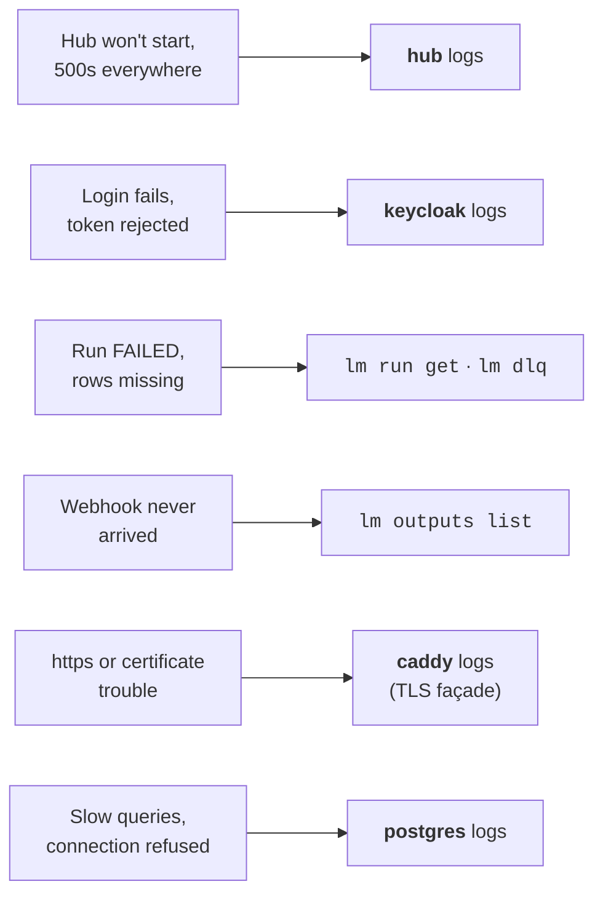

# Reading the logs

> Where each service's log lives — self-host, Kubernetes, dev mode — how to shape a JSON log
> line into something readable, and when the answer isn't in the logs at all.

Something is wrong and you want to see what the system saw. Where to look depends on
two things: **how you run the hub** (self-host Docker, Kubernetes, dev mode) and
**what kind of wrong it is** — because not every failure lands in the hub's log.
Ingestion failures leave a better trail in the run ledger and the dead-letter queue,
and outbound deliveries keep their own journal. Start from the symptom:



!!! tip "Health before logs"
    Restart decisions (what is safe, what it costs, the commands) live in the
    [on-call runbook](../operations/oncall-runbook.md).
    Before reading anything, ask the hub how it feels — it often answers in one line
    what an hour of log-scrolling would:

    ```bash
    curl -s http://localhost:8080/q/health
    ```

    `DOWN` with a named check (e.g. the database connections check) points you straight
    at the right service. While migrations run, the hub does not serve `/q/health` at
    all yet — no response is itself the "migrations still running" signal. The full endpoint list is on the
    [observability page](../operations/observability.md).

## Where the logs live

### Self-host stack (Docker Compose)

The stack started by `deploy/selfhost/up.sh` has three services: `hub`, `postgres`,
`keycloak` (plus `caddy` if you run the TLS façade). All commands run from the repo
root:

```bash
# The short form — follow the hub live (Ctrl-C stops following, not the hub)
./deploy/selfhost/logs.sh hub

# The explicit form takes any docker compose logs flag: a time window, timestamps
docker compose -f docker-compose.selfhost.yml logs --since 10m -t hub

# Another service: keycloak, postgres
./deploy/selfhost/logs.sh keycloak

# Everything at once (noisy, but shows cross-service ordering)
./deploy/selfhost/logs.sh
```

Running the TLS façade? `caddy` lives in the overlay file, not in the base stack —
name both files to reach it:

```bash
docker compose -f docker-compose.selfhost.yml -f docker-compose.tls.yml logs -f caddy
```

### Kubernetes (Helm)

The chart names its workloads `<release>-hub` and `<release>-keycloak`; the default
release is `lumnik`:

```bash
kubectl logs -f deploy/lumnik-hub          # follow the hub
kubectl logs --since=10m deploy/lumnik-hub # recent window only
kubectl logs --previous deploy/lumnik-hub  # the crashed container, after a restart
kubectl logs -f deploy/lumnik-keycloak     # auth trouble
```

Add `-n <namespace>` if you installed into one.

### Dev mode

`mvn quarkus:dev -pl lumnik-hub -am` logs straight to the terminal it runs in —
nothing to fetch, and changes to log levels hot-reload.

## Anatomy of a hub log line

The hub speaks two formats. **The packaged stack — what Docker and Kubernetes run —
emits one JSON object per line**, built for log collectors and for `jq`:

```json
{"timestamp":"2026-08-18T09:41:24+02:00","level":"ERROR","loggerName":"io.lumnik.hub.connector.runtime.ChunkExecutor","threadName":"executor-thread-1","mdc":{"tenantId":"12"},"message":"chunk 4 failed: …"}
```

`mdc.tenantId` is the **tenant id** carried on every request-path line — `0` is the
cross-tenant system sentinel, absent means the work happened outside any request. Slice
the stream along the axes you actually search by (`--no-log-prefix` strips compose's
`hub-1 |` prefix so `jq` can parse; `fromjson? // empty` skips any non-JSON line):

```bash
LOGS="docker compose -f docker-compose.selfhost.yml logs --no-log-prefix"

# Errors only, human-readable
$LOGS hub | jq -rR 'fromjson? // empty | select(.level=="ERROR") | "\(.timestamp) \(.loggerName): \(.message)"'

# One tenant's story
$LOGS hub | jq -rR 'fromjson? // empty | select(.mdc.tenantId=="12") | .message'

# One subsystem — everything the connector runtime said
$LOGS hub | jq -rR 'fromjson? // empty | select(.loggerName | startswith("io.lumnik.hub.connector")) | .message'
```

(No `jq` on the box? `grep '"level":"ERROR"'` still works on JSON lines.)

**Dev mode** (`mvn quarkus:dev`) keeps the human one-line format:

```
14:03:27 ERROR [io.lu.hu.co.ru.ChunkExecutor] (executor-thread-1) 12 chunk 4 failed: ...
   │      │            │                            │             │
   time  level   logger (abbreviated)             thread      tenant id
```

Same information, shaped for eyes: the logger category is abbreviated (two letters per
package segment) and the number after the thread is the same tenant id.

## Turning up the volume

Quarkus log levels are plain configuration, so any of them can be set from the
environment. The two useful knobs:

| Env var | Effect |
|---|---|
| `QUARKUS_LOG_CATEGORY__IO_LUMNIK__LEVEL=DEBUG` | debug for lumnik code only — the usual choice |
| `QUARKUS_LOG_LEVEL=DEBUG` | debug for *everything*, frameworks included — a firehose |

Self-host: add the variable under the `hub:` service's `environment:` block in
`docker-compose.selfhost.yml`, then `docker compose -f docker-compose.selfhost.yml up -d`
(only the hub restarts). Kubernetes:

```bash
kubectl set env deploy/lumnik-hub QUARKUS_LOG_CATEGORY__IO_LUMNIK__LEVEL=DEBUG
```

!!! warning "Turn it back down"
    DEBUG is for the minutes you are actively looking. It is chatty enough to drown
    the signal — and the log may echo data you would rather not keep. Remove the
    variable the same way you added it.

## When the answer is not in the logs

An ingestion problem usually isn't a stack trace — it's *"why did only 4,980 of my
5,000 rows arrive?"*. The hub answers that question with its per-run ledger, not with
log lines. Every run conserves its arithmetic (`records in = out + skipped`): quality
failures — a `validate-row` rejection, a malformed row — land in the dead-letter queue
with their reason and the offending payload; a declared filter is a counted skip with
no DLQ entry at all. Dead-letters are a subset of skips, never the whole of them:

```bash
lm run list --connector my-erp     # runs, newest first, records in/out/skip at a glance
lm run get <RUN_ID>                # one run's full transparency report
lm dlq list --run <RUN_ID>         # exactly which rows fell out, and why
lm outputs list                    # outbound deliveries, failures first
```

In the TUI the same trail is `:runs`, `:dlq` and `:outputs` — the first two
live-update, so you can watch a run while it happens. The full command surface is in
the [CLI & TUI reference](../cli/lm-reference.md), and the thinking behind the ledger
in [ingestion honesty](../transparency/ingestion-honesty.md).
