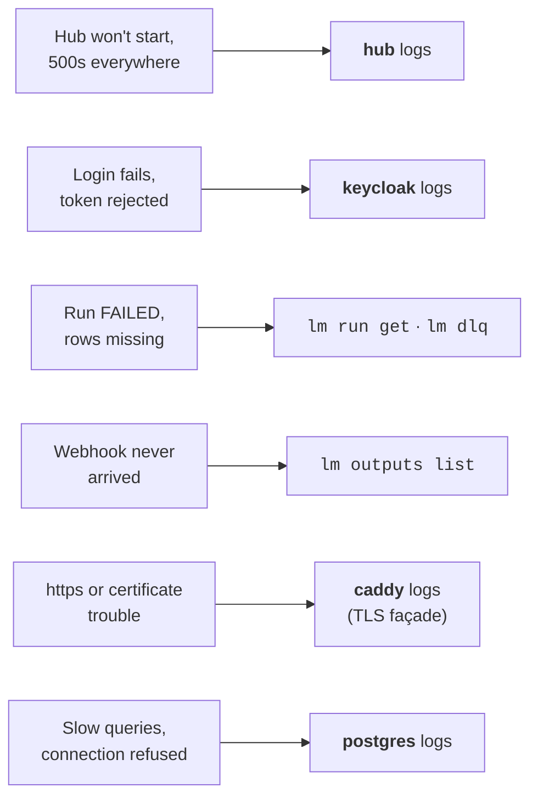

# Reading the logs

> Where each service's log lives — self-host or Kubernetes — how to shape a JSON log
> line into something readable, and when the answer isn't in the logs at all.

Start from the symptom: not every failure lands in the hub's log.



!!! tip "Health before logs"
    Restart decisions (what is safe, what it costs, the commands) live in the
    [on-call runbook](../operations/oncall-runbook.md). Ask the hub first (no `lm` command reads this):

    ```
    $ curl -s http://localhost:8080/q/health
    {
        "status": "UP",
        "checks": [
            {
                "name": "Database connections health check",
                "status": "UP",
                "data": {
                    "readonly": "UP",
                    "<default>": "UP",
                    "admin": "UP"
                }
            }
        ]
    }
    ```

    A `DOWN` names the failing check. While migrations run at boot, `/q/health` may not
    answer yet; the hub log shows the `Migrating schema …` lines. All endpoints:
    [observability](../operations/observability.md).

## Where the logs live

### Self-host stack (Docker Compose)

The stack started by `deploy/selfhost/up.sh` has three services: `hub`, `postgres`,
`keycloak` (plus `caddy` with the TLS façade). Run these from the repo root:

```bash
# Follow the hub live (Ctrl-C stops following, not the hub)
./deploy/selfhost/logs.sh hub

# Any docker compose logs flag: a time window, timestamps
docker compose -f docker-compose.selfhost.yml logs --since 10m -t hub

# Another service: keycloak, postgres
./deploy/selfhost/logs.sh keycloak

# Everything at once (noisy, but shows cross-service ordering)
./deploy/selfhost/logs.sh
```

`caddy` lives in the TLS overlay file; name both files to reach it:

```bash
docker compose -f docker-compose.selfhost.yml -f docker-compose.tls.yml logs -f caddy
```

### Kubernetes (Helm)

The chart names its workloads `<release>-hub` and `<release>-keycloak`; the default
release is `lumnik`:

```bash
kubectl logs -f deploy/lumnik-hub          # follow the hub
kubectl logs --since=10m deploy/lumnik-hub # recent window only
kubectl logs --previous deploy/lumnik-hub  # the crashed container, after a restart
kubectl logs -f deploy/lumnik-keycloak     # auth trouble
```

Add `-n <namespace>` if you installed into one.

## Anatomy of a hub log line

The packaged hub (Docker, Kubernetes) writes one JSON object per line:

```json
{"timestamp":"2026-08-18T09:41:24+02:00","level":"ERROR","loggerName":"io.lumnik.hub.connector.runtime.ChunkExecutor","threadName":"executor-thread-1","mdc":{"tenantId":"12","runId":"66541f10-0dc7-4534-85b0-942668020fb1"},"message":"chunk 4 failed: …"}
```

| Field | Meaning |
|---|---|
| `level` | `ERROR`, `WARN`, `INFO`, `DEBUG` |
| `loggerName` | the component; ingestion lines start with `io.lumnik.hub.connector` |
| `mdc.tenantId` | the tenant the line belongs to |
| `mdc.runId` | the run id (as in `lm run list`) — on every line a run wrote, absent elsewhere |

Slice the stream with `jq` (`--no-log-prefix` strips compose's `hub-1 |` prefix;
`fromjson? // empty` skips any non-JSON line):

```bash
LOGS="docker compose -f docker-compose.selfhost.yml logs --no-log-prefix"

# Errors only, human-readable
$LOGS hub | jq -rR 'fromjson? // empty | select(.level=="ERROR") | "\(.timestamp) \(.loggerName): \(.message)"'

# One tenant's story
$LOGS hub | jq -rR 'fromjson? // empty | select(.mdc.tenantId=="12") | .message'

# One run's story, warnings included — the id comes from `lm run list`
$LOGS hub | jq -rR 'fromjson? // empty | select(.mdc.runId=="66541f10-0dc7-4534-85b0-942668020fb1") | "\(.level) \(.message)"'

# Everything the connector runtime said
$LOGS hub | jq -rR 'fromjson? // empty | select(.loggerName | startswith("io.lumnik.hub.connector")) | .message'
```

No `jq` on the box? `grep '"level":"ERROR"'` still works on JSON lines.

## Turning up the volume

| Env var | Effect |
|---|---|
| `QUARKUS_LOG_CATEGORY__IO_LUMNIK__LEVEL=DEBUG` | debug for lumnik code only — the usual choice |
| `QUARKUS_LOG_LEVEL=DEBUG` | debug for *everything*, frameworks included — a firehose |

**Self-host.** The hub container only receives the variables listed in
`docker-compose.selfhost.yml`; a line in `.env` does not reach it. Add an override file
next to it, so the shipped file stays untouched:

```yaml
# debug.yml
services:
  hub:
    environment:
      QUARKUS_LOG_CATEGORY__IO_LUMNIK__LEVEL: DEBUG
```

```bash
docker compose -f docker-compose.selfhost.yml -f debug.yml up -d hub
```

Also name every overlay file you started with (`-f docker-compose.tls.yml`, `-f docker-compose.search.yml`),
or the hub restarts without it.
To turn it back down, run the same command without `-f debug.yml`.

**Kubernetes.**

```bash
kubectl set env deploy/lumnik-hub QUARKUS_LOG_CATEGORY__IO_LUMNIK__LEVEL=DEBUG
```

Turn it down with `kubectl set env deploy/lumnik-hub QUARKUS_LOG_CATEGORY__IO_LUMNIK__LEVEL-`.

!!! warning "Turn it back down"
    DEBUG is for the minutes you are actively looking. It drowns the signal, and the log
    may echo data you would rather not keep.

## When the answer is not in the logs

Missing rows and failed runs are answered by the run ledger and the dead-letter queue, not by
log lines: [Diagnosing a failed run](diagnose-a-run.md). Outbound deliveries: `lm outputs list`.
In the TUI: `:runs`, `:dlq` and `:outputs`.
