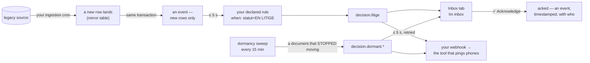

# How lumnik breathes — from frozen rows to decisions

> **What happens when something changes in the source, and who is told.**

## The moment this page is about

A commande slips into *EN LITIGE* in the 02:00 batch. The row lands, a declared rule turns it
into a **decision** seconds later, and your webhook pings the team's phone at 02:01 — before the
client calls at 9:04.

## The chain, end to end

The chain in one picture:



- **Only new rows emit.** A re-ingested, unchanged row emits nothing. A table emits only once
  a rule, a webhook or a notification subscribes to it.
- **jdbc, CSV and kafka connectors emit.** Tables ingested over REST, GraphQL or SOAP emit no
  event: a rule on them never fires.
- **Every rule emits `decision.<your-name>`** — the prefix is enforced at apply.

| Clock | Value |
|---|---|
| rule, webhook and email consumers | every **5 s** |
| webhook retry sweep | every **30 s**, **3 attempts** in total; journal in `lm outputs list` |
| dormancy sweep | every **15 min** |
| your ingestion | the connector's own `spec.schedule` — the slow clock |

## Where a human meets it — the channels

| Channel | What it does | Mode |
|---|---|---|
| **Inbox tab** (PWA, phone & desktop) | the pile, newest first, badge on open; a treated decision stays visible, dimmed **✓ acknowledged** | **pull** — it waits for you to open it |
| **`lm inbox`** / TUI inbox page | the same pile for keyboard people (untreated only, by default) | same pull |
| **Your webhook** (n8n, Make, your own endpoint) | every subscribed event, in seconds, retried, journaled, replayable — the road to a Teams message or an SMS | **push**. `lm integration add`; forwards from registration onward, never retroactively |
| **Email** (`lm notify add`) | one mail per matching event, payload included | live once the deploy sets the SMTP knobs ([Email notifications](email.md)); a failed send is not retried |

**The inbox is per scope, not per person.** Everyone holding a scope sees all of its
decisions; a user with no `scope:*` role sees every decision. There is no assignment, escalation
or out-of-office.

```
$ lm inbox
ID  WHEN   PROCESS             MESSAGE                             ENTITY_KEY
8   10min  lyon-client-arrive  Nouveau client Camille Roux à Lyon  ff1027320a1acbe2646ce1b2d1e4a42111868a75bb30825dc4609d785e6aaa7f
$ lm inbox ack 8
acked.
$ lm inbox
ID  WHEN  PROCESS  MESSAGE  ENTITY_KEY
```

## The gesture: what ✓ Acknowledge is, and is not

- **It clears the decision from everyone's untreated pile** and shows who took it.
- **It is an event** — `annotation.decision.acked`, timestamped, with who — that a webhook can forward.
- **It never writes to your source system** ([Reversibility](reversibility.md)): the correction
  itself is made in the legacy screen.

## Silence also emits

Rules catch what *happens*. The [dormancy sweep](apps/workflows.md#dormancy-the-memory-of-the-breathing)
catches what *stopped happening*: a declared workflow watches every document, and one that
sits non-terminal past its threshold becomes `decision.dormant.<workflow>`.

- The threshold counts **from lumnik's first observation** of the document, not from the source's history.
- `lm workflow apply` names every status value your manifest missed, with its row count. An
  undeclared status is watched too.

```
$ lm observations stats
WORKFLOW            WATCHED  DORMANT  MEDIAN_DETECTION_S
commande-lifecycle  7        5        900
```

`MEDIAN_DETECTION_S` is the median time, in seconds, from a document's observed last move to its alert.

## What remains, three months later

Events — decisions *and* acks — are kept **30 days** by default (`LUMNIK_EVENTS_RETENTION_DAYS`).
Three things outlive that window:

| What | Where to look |
|---|---|
| the **observation tape**: every watched document — first seen, in its state since, alerted when | `lm observations list` (`--workflow NAME` for one); per workflow: `lm observations stats` |
| your **webhook target**: forward `decision.*` and `annotation.*` to the tool that keeps your proof | your tool, on your retention |
| the ingested tables themselves | `lm entity get`, `lm view` |

!!! tip "Wire the webhook on day one"
    It forwards from registration onward, never retroactively. If an auditor may ask "prove this
    alert was handled", register it the day you deploy.

## Named limits, in one place

- **No push to user surfaces** — the tab and the CLI are pull; the webhook is the road
  to tools that push. (An event stream does exist for integrators, on the platform API.)
- **The inbox is per scope**, time-ordered, without assignment or severity.
- **✓ Acknowledge never writes to the source.**
- **Webhooks forward from registration onward**, never retroactively.
- **REST/GraphQL/SOAP-ingested tables emit no events** — only jdbc, CSV and kafka ingestion does.
- **Declared status aliases** (encours/EC…) serve the dormancy watch and the chat's
  background knowledge, not the chat's SQL or view filters: those match the literal values
  in the column.
- **Email is best-effort** — a failed send is logged and skipped: no retry, no journal.
  Delivery stays mocked until the deploy sets the SMTP knobs. Webhooks retry and journal.
- **No usage/adoption dashboard** — operational metrics (`/q/metrics`) are the only
  proxy, per endpoint, if your ops scrape them.

## See also

[Outputs — the roads out](outputs.md) — the wiring manual for every channel on this page ·
[Processes — react](apps/processes.md) · [Inbox — decide](apps/inbox.md) ·
[Workflows — declare](apps/workflows.md) · [The PWA](apps/pwa.md) ·
[The WOW, step by step](wow.md) — Act 2 runs this whole chain on the demo dataset,
EN LITIGE included.
