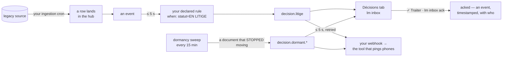

# How lumnik breathes — from frozen rows to decisions

> **What happens when something changes in the source, and who is told.**

## The moment this page is about

A commande slips into *EN LITIGE* in the 02:00 batch. The row lands, a declared rule turns it
into a **decision** seconds later, and your webhook pings the team's phone at 02:01 — before the
client calls at 9:04.

## The chain, end to end

The chain in one picture:



- **A new row emits.** So does a row changed at the source, when its table has a key. A REST
  table always has one (`unique_key`).
- **A row read again unchanged emits nothing.**
- **A table emits only once something listens to it:** a rule, a webhook or an email rule. The rows
  that landed before stay silent.
- **jdbc, CSV, kafka and REST connectors emit.** A REST, GraphQL or SOAP endpoint lands in the
  table its manifest names (usually `ext.*`). A rule names that table.
- **Every rule emits `decision.<your-name>`.** The apply refuses any other prefix.

| Clock | Value |
|---|---|
| rule, webhook and email consumers | every **5 s** |
| webhook and email retry sweeps | every **30 s**, **3 attempts** in total. Journals: `lm outputs list`, `lm notify deliveries` |
| dormancy and due-date sweeps | every **15 min** |
| your ingestion | the connector's own `spec.schedule` — the slow clock |

## Where a human meets it — the channels

| Channel | What it does | Mode |
|---|---|---|
| **Décisions tab** (PWA, phone & desktop) | the pile, newest first, with a badge counting what waits. **✓ Traiter** treats one; it stays visible, dimmed, marked **✓ traité** | **pull** — it waits for you to open it |
| **`lm inbox`** / TUI `:inbox` | the same pile for keyboard people. Untreated only, unless `--all` | same pull |
| **Your webhook** (n8n, Make, your own endpoint) | every subscribed event, in seconds. Retried, journaled, replayable — the road to a Teams message or an SMS | **push**. `lm integration add`. Forwards from registration onward, never retroactively |
| **Email** (`lm notify add`) | one mail per matching event, through a template. Retried, journaled in `lm notify deliveries` | live once the deploy sets the SMTP knobs ([Email notifications](email.md)) |

**The inbox is per scope, not per person.**

- Everyone holding a scope sees all of its decisions.
- A user with no `scope:*` role sees every decision.
- There is no assignment, escalation or out-of-office.

```
$ lm inbox
ID  WHEN   PROCESS             MESSAGE                             ENTITY_KEY
8   10min  lyon-client-arrive  Nouveau client Camille Roux à Lyon  ff1027320a1acbe2646ce1b2d1e4a42111868a75bb30825dc4609d785e6aaa7f
$ lm inbox ack 8
acked.
$ lm inbox
ID  WHEN  PROCESS  MESSAGE  ENTITY_KEY
```

## The gesture: what ✓ Traiter is, and is not

**✓ Traiter** in the PWA and `lm inbox ack ID` are the same gesture.

- **It clears the decision from everyone's untreated pile.**
- **It is an event**, `annotation.decision.acked`, timestamped, carrying who acked. A webhook can
  forward it.
- **It never writes to your source system** ([Reversibility](reversibility.md)). The correction
  itself is made in the legacy screen.

## Silence also emits

Rules catch what *happens*. The [dormancy sweep](apps/workflows.md#dormancy-the-memory-of-the-breathing)
catches what *stopped happening*. A watched workflow follows every document. One that stays in a
non-terminal state past its threshold becomes `decision.dormant.<workflow>`.

- The threshold counts **from lumnik's first observation** of the document, not from the source's history.
- `lm workflow apply` names every status value your manifest missed, with its row count. An
  undeclared status is watched too.
- A workflow can also declare a deadline column. A document still in one of the states you list
  when its date passes becomes `decision.overdue.<workflow>`: [Due date](apps/workflows.md#due-date-a-deadline-the-data-carries).

```
$ lm observations stats
WORKFLOW            WATCHED  DORMANT  MEDIAN_DETECTION_S
commande-lifecycle  7        5        900
```

`MEDIAN_DETECTION_S` is the median time, in seconds, from a document's observed last move to its alert.

## What remains, three months later

Events — decisions *and* acks — are kept **30 days** by default (`LUMNIK_EVENTS_RETENTION_DAYS`).
Three things outlive that window:

| What | Where to look |
|---|---|
| the **observation tape**: every watched document — first seen, in its state since, alerted when | `lm observations list` (`--workflow NAME` for one); per workflow: `lm observations stats` |
| your **webhook target**: forward `decision.*` and `annotation.*` to the tool that keeps your proof | your tool, on your retention |
| the ingested tables themselves | `lm entity get`, `lm view` |

!!! tip "Wire the webhook on day one"
    It forwards from registration onward, never retroactively. If an auditor may ask "prove this
    alert was handled", register it the day you deploy.

## Named limits, in one place

- **No push to user surfaces.** The tab and the CLI are pull. The webhook is the road to tools
  that push. Integrators also have a live event stream on the platform API.
- **The inbox is per scope**, time-ordered, without assignment or severity.
- **✓ Traiter never writes to the source.**
- **Webhooks forward from registration onward**, never retroactively.
- **A Process does not evaluate rows that existed before it was applied.** Only later inserts and
  source changes can trigger it.
- **Declared status aliases** (encours/EC…) serve the dormancy watch and the chat's
  background knowledge. The chat's SQL and the view filters match the literal values in the
  column.
- **Email stays mocked** until the deploy sets the SMTP knobs.
- **No usage dashboard.** The only proxy is the operational metrics at `/q/metrics`, per
  endpoint, if your ops scrape them.

## See also

[Outputs — the roads out](outputs.md) — the wiring manual for every channel on this page ·
[Processes — react](apps/processes.md) · [Inbox — decide](apps/inbox.md) ·
[Workflows — declare](apps/workflows.md) · [The PWA](apps/pwa.md) ·
[The WOW, step by step](wow.md) — Act 2 runs this whole chain on the demo dataset,
EN LITIGE included.
