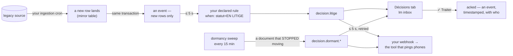

# How lumnik breathes — from frozen rows to decisions

> Ingestion answers "what is in my legacy system?". This page answers the other question — the one a
> métier team actually lives with: **what happens when something changes, and what do I do
> about it?**

## The moment this page is about

A commande slips into *EN LITIGE* during the night batch. Nobody declared that status —
it's fifteen years of habits. This morning, nobody knows. The client will call at 9:04,
furious, and the chef des ventes will learn about the litige from him.

With a breathing hub, the same night goes differently: the row lands at 02:00, becomes an
**event** in the same transaction, and a declared rule turns it into a **decision** seconds
later. It is sitting in the Décisions tab before 02:01 — and because you wired your webhook
on day one, the message that *does* buzz a phone (your Teams channel, your on-call SMS
gateway) went out at 02:01 too. The client still calls at 9:04 — but this time the answer
starts with *"it was flagged at two in the morning — here's where it stands."*

That is the respiration: your frozen system stops merely answering questions and **starts
warning you**.

## The chain, end to end

The story in one picture — for your integrator; the paragraphs above and below tell the
same thing in words:

Four mechanics behind the arrows:

- **Only genuinely new rows emit.** A re-ingested, unchanged row is event-silent by design
  (content-hash dedup) — the spine carries change, not noise. And events flow only once at
  least one subscription exists (a rule, a webhook): an unwatched table costs nothing.
- **The respiration rides table-target ingestion** — jdbc, CSV and kafka connectors, whose
  rows land in mirror tables. Rows ingested over **REST/GraphQL/SOAP** land in hybrid
  tables that are **event-silent today**: a rule on them never fires. Named on the product
  register, not hidden here — if your source is reachable only over REST, ask your integrator
  about this line first.
- **The clocks, summed.** The reaction consumers tick every **5 seconds**; the distance
  from *row landed* to *decision in the inbox* is seconds, and to your webhook seconds
  more (**3 delivery attempts in total** on failure, with a journal you can read:
  `lm outputs list`). The slow clock is your own ingestion cron — lumnik reacts at machine
  speed to what it ingests at the rhythm you chose.
- **The taxonomy is governed.** Every rule emits `decision.<your-name>` — the prefix is
  enforced at apply, so your inbox and your webhooks speak one vocabulary, and your eye
  can find *your* decisions in a mixed pile.

## Where a human meets it — the channels

| Channel | What it does | State today |
|---|---|---|
| **Décisions tab** (PWA, phone & desktop) | the pile, newest first, badge on open; a treated decision stays visible, dimmed **✓ traité** | **pull** — it waits for you to open it |
| **`lm inbox`** / TUI inbox page | the same pile for keyboard people (untreated only, by default) | same pull |
| **Your webhook** (n8n, Make, your own endpoint) | every subscribed event, delivered in seconds, retried, journaled, replayable — **the road to the Teams message or SMS that actually buzzes a phone at 02:01** | the active channel. Registered by your admin (`lm integration add`, or the HTTP API), **not retroactive**: it forwards from registration onward |
| **Email** (`lm notify add`) | events matching a rule's pattern arrive as one mail per event, payload included — the channel for people who live in their mailbox, not in a tool | live once the deploy sets the SMTP knobs ([Email notifications](email.md)); mocked until then, and the boot log states the posture. **Best-effort**: a failed send is logged and skipped — the webhook is the channel with retries and a journal |

One model to know before you plan on it: **the inbox is tenant-wide**. Everyone with app
access sees every decision; there is no per-métier fence on this surface, no assignment,
no escalation, no out-of-office. "Who handles it while she's on congés?" answers itself —
everyone still sees it — but "only the ADV sees ADV alerts" is not this surface's promise.

## The gesture: what ✓ Traiter is, and is not

**The click clears it from everyone's untreated pile and marks, for the whole team, that
you took it** — that is what it does for you. Under the hood it is an event
(`annotation.decision.acked`, timestamped, carrying who), which is exactly what makes it
proof rather than a checkbox. It is **not** a write to your source system: lumnik is a read-only
mirror by doctrine ([Reversibility](reversibility.md)), so the correction itself still
happens in the legacy screen, by the person who owns it.

That division of labour is the point, not a limitation: **lumnik removes the hunt, not the
correction.** The ADV's five morning filters, **declared once as `kind: Process` rules by
your integrator**, become the pile; her morning stops being *export → filters → copy order
numbers into a mail* and becomes *open the pile → decide → correct in the ERP → ✓*.

## Silence also emits

Rules catch what *happens*. The [dormancy sweep](apps/workflows.md#dormancy-the-memory-of-the-breathing)
catches what *stopped happening*: a declared workflow watches every document, and one that
sits non-terminal past its threshold becomes `decision.dormant.<workflow>` — the 80 k€
devis nobody relanced surfaces by itself, named, with *immobile depuis le…*.

Two details to plan around: the threshold is measured **from first observation** — the watch
starts counting when you deploy it, so a before/after story needs the watch running from
month one. And dirty statuses don't escape it: the apply's data-truth report **names**
every value your manifest missed, with its row count — and even an undeclared state is
watchable, counted, never hidden.

## What it removes — the DAF's list

- The **morning anomaly hunt**: the hand-filtered export becomes decisions pushed to the
  pile.
- The **status call**: "où en est la commande Durand?" is the fiche on the phone, and the
  chat for the odd question — with [refusal instead of invention](transparency/ask-honesty.md)
  when the data can't answer.
- The **watching by eye**: dormant documents surface themselves.
- The **accidental discovery** of systems disagreeing: the fiche's `_conflicts` panel
  shows which source said what.

And the two things it deliberately does **not** remove: the correction in the ERP (yours,
by design), and the judgment call on each decision (the pile is ordered by time, not by
severity — your eye ranks it).

## What remains, three months later

The inbox shows what retention keeps: events — decisions *and* acks — live **30 days** by
default, then the purge takes them. Three memories outlive that window:

- the **observation ledger**: every watched document, timestamped — first seen, in-state
  since, alerted when — kept deliberately. `lm observations list` shows the tape;
  `lm observations stats` aggregates it per workflow: watched documents, currently
  dormant, median detection delay — the "detected at J+N" figure, computed;
- your **webhook target**: forward `decision.*` and `annotation.*` into the tool where
  your team already keeps proof, and the trail is yours, on your retention;
- the mirror itself, of course — the data keeps its history of hashes and `_ingested_at`.

!!! tip "Deployment guidance, not a footnote: wire the webhook on day one"
    If an auditor will ever ask "prove this alert was handled" — or a phone must ever buzz
    at 02:01 — register the webhook the day you deploy. It forwards from that day onward,
    never retroactively.

## Named limits, in one place

- **No push to métier surfaces** — the tab and the CLI are pull; the webhook is the road
  to tools that push. (An event stream does exist for integrators, on the platform API.)
- **The inbox is tenant-wide**, time-ordered, without assignment or severity.
- **✓ Traiter never writes to the source** — by doctrine.
- **Webhooks forward from registration onward**, never retroactively.
- **REST/GraphQL/SOAP-ingested tables are event-silent today** — the respiration rides
  jdbc/CSV/kafka ingestion (on the register).
- **Declared status aliases** (encours/EC…) serve the dormancy watch and the chat's
  background knowledge, **not yet** the chat's SQL or view filters — the chat matches the
  literal values sitting in the column, so mixed spellings need naming or cleaning.
- **Email is best-effort** — a failed send is logged and skipped, no retry, no journal;
  delivery stays mocked until the deploy sets the SMTP knobs. The webhook is the
  guaranteed-effort channel.
- **No usage/adoption dashboard** — operational metrics (`/q/metrics`) are the only
  proxy, per endpoint, if your ops scrape them.

## See also

[Outputs — the roads out](outputs.md) — the wiring manual for every channel on this page ·
[Processes — react](apps/processes.md) · [Inbox — decide](apps/inbox.md) ·
[Workflows — declare](apps/workflows.md) · [The métier PWA](apps/pwa.md) ·
[The WOW, step by step](wow.md) — Act 2 runs this whole chain on the demo dataset,
EN LITIGE included.
