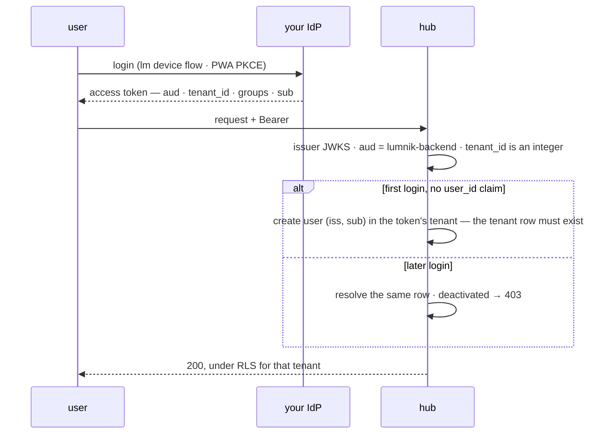

# Bring your own IdP

> The hub validates any OIDC issuer generically; there is no Keycloak-specific code. Your IdP
> authenticates, lumnik creates the user at first login into a tenant you seeded.

!!! note "Edition"
    JIT provisioning ships in **lumnik Pro** only. On **lumnik Open** every token needs a
    `user_id` claim naming a hub row, which a customer IdP does not know.
    [Editions](../editions.md#feature-by-feature)



## The model

- **Validation**: discovery and JWKS at your issuer URL, `aud` pinned to `lumnik-backend`.
- **Tenant**: the mandatory `tenant_id` claim scopes every query through RLS.
- **Identity key**: tenant + issuer + subject, created at first login. The same subject in two
  tenants is two users. No password lives in lumnik; no user list is synced up front.
- **JIT creates users, never tenants.** A token naming a tenant with no row fails the first
  login.
- **Departures ride [SCIM](scim.md).** JIT never reactivates a deactivated identity.

## Before the first login

1. **Create the tenant row**: `POST /api/tenants` as `lm_superadmin`
   ([the gesture](identity-admin.md#onboard-a-new-tenant)); it returns the new id, from 1000 up.
   Ids `1` (`default`) and `11` (`hubadmin`) are seeded at install and taken. Check what exists:
   ```
   lumnik=# SELECT id, code, name FROM identity.tenant ORDER BY id;
    id |   code   |       name
   ----+----------+------------------
     1 | default  | Default Tenant
    11 | hubadmin | Hub Admin Tenant
   ```
2. **Register a client per surface**: one for `lm` (device flow) and, if you use the PWA, the
   SPA client (public + PKCE). Mind the [audience mapper](#the-pwa-client-lumnik-spa).
3. **Map the claims** onto the *access* token:

| Claim | Required | Carries |
|---|---|---|
| `aud` | **yes** | exactly `lumnik-backend`; without it the token never gets past the OIDC layer (401) |
| `tenant_id` | **yes** | the seeded tenant id, as an integer |
| `groups` | **yes** | the role array: `lm_user`, `lm_integrator`, `lm_admin`, plus `scope:<tag>` grants. Literal lumnik names, flat. [Roles](role-management.md) |
| `user_id` | no | lumnik's internal user id, only if your IdP knows it (the bundled realm does). Absent: JIT resolves the user by issuer + subject. Present but naming no row: see [troubleshooting](#troubleshooting) |
| `name`, `email` | no | profile fields, used at first-login creation only |

- The subject side of the key is `sub` by default; `OIDC_SUBJECT_CLAIM` names another claim
  (see Entra below). The shipped compose file and Helm chart do not pass this variable to the hub.
- Malformed claims are **rejected, never repaired**: a non-integer `tenant_id`, an oversized
  issuer or subject each fail with their own 401 ([troubleshooting](#troubleshooting)). A bad
  *profile* claim never blocks a login: a long name is clamped, an invalid email dropped.
- The bundled accounts occupy `(tenant 1, integrator)` and `(tenant 11, hubadmin)` on every
  hub. An IdP whose subject is a username must not reuse those logins in those tenants.

## What JIT creates, and what it refuses

- **Creates**, on first login without `user_id`: one user in the token's tenant. Login =
  subject, display name from `name` (fallback: subject), optional email.
- **Resolves** the same row on every later login.
- **Refuses** a deactivated identity with `403 {"error":"user is deactivated"}`. Only an admin,
  or a SCIM re-activation you control, brings a user back.

## Keycloak walkthrough

The shipped realm is the working reference; copy its mapper shapes onto your client:

| Step | Configuration |
|---|---|
| **1. Realm roles** | create `lm_user`, `lm_integrator`, `lm_admin`, and `scope:<tag>` roles if you restrict users by scope. Assign them to users or groups; the hub matches names flat |
| **2. `tenant_id` mapper** | *User Attribute* mapper: attribute `tenant_id`, claim `tenant_id`, JSON type **long**, on the access token |
| **3. `groups` mapper** | *User Realm Role* mapper: claim name `groups`, multivalued, on the access token |
| **4. Audience mapper** | *Audience* mapper adding `lumnik-backend` to the access token, on **every** client that calls the hub |
| **5. `lm` client** | OIDC client with device flow; point the CLI at it: `lm config set-context … --oidc-issuer https://idp.example.com/realms/corp --oidc-client-id <client>` |

## Okta / Entra ID notes

- **One layer moves to your IdP**: the bundled realm throttles password guessing
  (brute-force detection on). With your own IdP, lockout is your IdP's policy; lumnik never
  sees a password attempt.
- Tested with Keycloak only. Okta and Entra need only discovery, JWKS and the claims above;
  neither has been run against a live hub.
- **Okta**: custom claims and a custom audience need a *custom authorization server*. Map
  `groups` to the lumnik role names, not Okta group ids.
- **Entra ID**: `sub` is pairwise per app registration; re-registering the app mints new
  subjects and orphans every JIT identity. Prefer `OIDC_SUBJECT_CLAIM=oid`. Entra's default
  `groups` claim emits GUIDs: use a claims-mapping policy or app roles to carry the literal
  `lm_*` names.
- **SAML-only IdPs** (ADFS and friends): not supported by direct trust. Front them with a
  broker (a Keycloak you or the customer operates) and point lumnik at the broker.

## Kubernetes: `auth.mode=oidc-external`

Cloud edition. Trust the customer's issuer, deploy **no** Keycloak. Set the mode explicitly:
the chart's default, `oidc`, deploys its own Keycloak instead.

```yaml
# deploy/helm/lumnik/values.yaml
auth:
  mode: oidc-external

oidc:
  external:
    issuerUrl: "https://idp.customer.com/realms/corp"   # discovery/JWKS
    tokenIssuer: ""   # token `iss` to validate; defaults to issuerUrl.
                      # Set ONLY when it differs (a port-forward split on kind).
```

- The chart **fails fast**: a typo'd `auth.mode` aborts `helm install`; `oidc-external` with an
  empty `issuerUrl` refuses to render.
- Both `oidc` and `oidc-external` run the hub in production mode (dev-bypass off).
- Rehearse it locally, with a stand-in "customer IdP" in its own namespace and no Keycloak in
  the release:

```bash
make k8s-up-oidc-external
```

A real customer IdP is then an `issuerUrl` swap. Leave `tokenIssuer` empty in real deployments.

## The PWA client (`lumnik-spa`)

!!! warning "The audience mapper"
    The hub pins `aud: lumnik-backend`, and a freshly created SPA client emits **no** audience
    by default. Symptom: every PWA call is a 401 while `lm` works fine. Register the SPA client
    as public + PKCE (S256), redirect URI `https://<hub-origin>/app/*`, **and** the audience
    mapper on the access token. [The PWA](../apps/pwa.md)

## Keep the same public address

**Pick the hub's public address once, before the first real login.**

- lumnik knows a user by the issuer URL + the subject in the token.
- Change the scheme (http → https), the hostname or the issuer path, and the issuer changes. The
  same person then logs in as a **new** user, detached from their history.
- This bites on a move to TLS, a new hostname, or a restore onto another address.

Moved anyway? Point the old users at the new issuer, once, before they log in again:

```bash
docker compose -f docker-compose.selfhost.yml exec postgres psql -U lumnik -d lumnik -c \
  "UPDATE identity.app_user SET idp_issuer = 'https://new.example/realms/lumnik'
   WHERE idp_issuer = 'http://localhost:8180/realms/lumnik'"
```

Users who already logged in under the new issuer have a second row: archive it first, or accept
that they start fresh.

## Troubleshooting

| Symptom | Cause | Fix |
|---|---|---|
| `401 {"error":"missing or invalid tenant_id claim"}` | No `tenant_id` on the access token, or a non-integer value | Add or fix the `tenant_id` mapper (JSON type long, access token) |
| 401 with no lumnik error body | Rejected by the OIDC layer: wrong or missing `aud`, or `iss` ≠ the configured issuer | Add the audience mapper; check `issuerUrl`/`tokenIssuer` match the token's `iss` |
| `401 {"error":"missing subject/issuer claim"}` | No `user_id` claim *and* no subject claim | Check `OIDC_SUBJECT_CLAIM` names a claim the IdP emits |
| `401 {"error":"no external identity resolution in this edition (user_id claim required)"}` | No `user_id` claim on a lumnik Open build | Run lumnik Pro, or emit `user_id` |
| `401 {"error":"subject/issuer claim too long"}` | `iss` or subject exceeds 255 characters; never truncated, that would change the identity | Use a shorter stable claim (Entra `oid`) |
| `404 {"error":"no user record on this hub for user_id N"}` on `lm scope` | The IdP emits a `user_id` that names no hub row | Point it at an existing row, or drop it so JIT resolves the user (Pro) |
| First login 500, logs show `fk_user_tenant` | Tenant row not seeded | Seed the tenant, retry |
| `403 {"error":"user is deactivated"}` | Identity exists but was deactivated (a SCIM departure) | Reactivate via admin or SCIM; JIT never resurrects |
| 403 on every endpoint despite a valid login | `groups` missing, or carrying IdP-native names | Map roles into `groups` as literal `lm_*` names |
| Login error after moving to TLS or a new hostname | The issuer changed | [Keep the same public address](#keep-the-same-public-address) |

## See also

- [Tenants, users & scopes](identity-admin.md): the console gestures on the bundled realm.
- [Roles & permissions](role-management.md) · [Scopes](../rag/scopes.md#binding-users-to-scopes-opt-in)
- [SCIM deprovisioning](scim.md): the departure side of the same identity key.
- [Deploy](../deploy.md): pointing `lm` at the hub.
