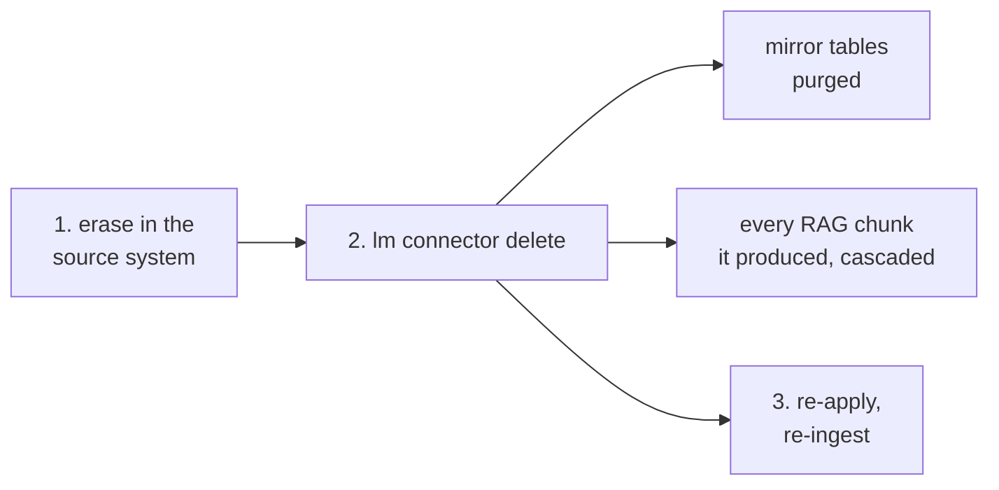

# GDPR & personal data

> Where personal data can live in a lumnik installation, what erasure does today, and what GDPR
> compliance would still need that is not built.

lumnik is self-hosted software, not a service. It runs on your infrastructure and no data reaches
a lumnik cloud; there isn't one. You remain the controller or processor of the data it touches.
This page is an engineering map, not legal advice.

## The posture, in three sentences

- **Nothing leaves your infrastructure by default.** Chat and embeddings run on a local model
  runtime (Ollama). Switching to a cloud LLM provider is an explicit configuration *you* make,
  and from that moment questions and grounding chunks are sent to that provider.
- **lumnik is a read-only mirror.** Ingestion never writes back; the source stays the system of
  record. Ask-to-SQL runs under a read-only database role behind
  [five guards](../transparency/ask-honesty.md), including a leak guard that refuses a query
  reading a table outside the scope's declared card. The hub keeps no conversation history.
- **Isolation is enforced in the database itself.** PostgreSQL Row-Level Security per tenant
  ([RLS](rls.md)); chat, search and entity reads additionally scope-bound per métier.

## Where personal data can live

| Store | What lands there | Lifecycle |
|---|---|---|
| `identity` schema | user accounts: login, display name, email | archive or soft-delete; the row stays until an operator deletes it |
| `connector.t_*` mirror tables | whatever your sources contain | upserted by content hash; **a deletion at the source does not propagate** |
| `rag.chunk` corpus | text chunks and embeddings derived from ingested rows | **append-and-dedup**: a changed row adds a chunk, the old one stays. Deleting the connector cascades to every chunk it produced |
| Dead letters | the raw payload of rows that failed mapping, kept for diagnosis | every read surface hides soft-deleted rows; setting that flag is a database operation |
| Event outbox | entity name, a **key hash**, the operation; **no row content** | purged nightly past `lumnik.events.retention-days` (default 30) |
| Audit trail | user and secret writes, view and workflow applies, entity reads, each with the acting user. [What it records](index.md#the-audit-trail) | purged nightly past `LUMNIK_AUDIT_RETENTION_DAYS` (default 365, `0` = forever). No per-row erasure |
| Webhook deliveries | the column values a `kind: Process` template references, posted to the target URL the tenant configured (n8n, Make, your endpoint): HMAC-signed when a secret is set, **not encrypted beyond that URL's TLS** | leaves lumnik; retention is the receiver's. The delivery history row keeps status and attempts only |
| Keycloak | its own user store: credentials, sessions | your realm, your policies |
| Backups | whatever you back up | yours entirely |

## The rights, in practice

**Access and portability**

- Entity reads (`GET /api/entities/{name}`) and read-only SQL give structured access to
  everything lumnik holds about a person.
- **No one-click DSAR export.** Assembling an answer is a query your integrator writes.

**Rectification**

- Fix the data in the source; the mirror follows on the next run.
- The corpus gains a chunk for the corrected row **and keeps the chunk carrying the old value**
  until the connector is deleted and re-ingested (the erasure gesture below).
- lumnik offers no way to edit ingested rows: a mirror that can be edited stops being evidence
  of what the source said.

**Erasure of a person in your data**

- Erase in the source first; it is the system of record.
- Deletions do not propagate, so **delete the connector and re-ingest**. `lm connector delete`
  purges its dynamic tables and registry rows, and the same delete cascades to every chunk the
  connector produced. The erased row's text and embeddings die with it.
- Removing rows from `connector.t_*` by hand is **not enough**: nothing re-indexes ingested
  data, so a hand-deleted row's chunk survives until the connector itself is deleted.

**Erasure of a lumnik user account**

- `DELETE /api/tenants/{tid}/users/{id}` **archives** (`archived_at`); SCIM `DELETE`
  **soft-deletes** (`deleted_at`). Two states, [why they differ](scim.md#the-scimv2users-contract).
- Either way the very next request is refused with `403`, valid token or not, and the account
  drops out of listings.
- Neither is a deletion: the row remains until an operator removes it.
- Neither removes anything from the audit trail. What bounds those copies is time: the nightly
  purge past `LUMNIK_AUDIT_RETENTION_DAYS`.

## Not built yet, recorded not hidden

The rule this product applies to its chat, abstain rather than answer confidently wrong, applies
to this page too. The following do **not** exist today:

- **No automated hard-delete or pseudonymisation of user accounts.** An archived or
  soft-deleted user persists in the `identity` schema until an operator deletes the row.
- **No DSAR export endpoint.** Access is real but manual.
- **No deletion propagation** from sources to mirror tables. Erasure is the rebuild above.
- **No API to erase a dead-letter payload.** The read seam honours the soft-delete flag;
  setting it is a database operation.
- **The audit trail is narrow.** User and secret writes, applies and entity reads; not SCIM
  writes, not other entities; no read surface, no per-row erasure.
  [The audit trail](index.md#the-audit-trail)

If one of these gaps blocks a real obligation you have, say so. They are unbuilt because no
deployment has needed them yet, not because they are hard.
