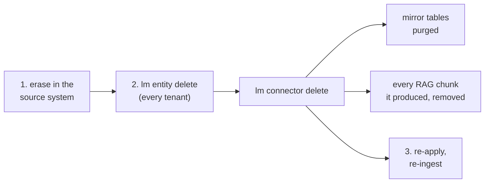

# GDPR & personal data

> Where personal data can live in a lumnik installation, what erasure does today, and what is
> not built.

lumnik is self-hosted software, not a service: no data reaches a lumnik cloud. You remain the
controller or processor of the data it touches. This page is an engineering map, not legal
advice.

## The posture, in three sentences

- **Nothing leaves your infrastructure by default.** Chat and embeddings run on a local model
  runtime (Ollama). Once you configure a cloud LLM provider, questions and grounding chunks are
  sent to it.
- **lumnik is a read-only mirror.** Ingestion never writes back. Ask-to-SQL runs under a
  read-only database role behind [five guards](../transparency/ask-honesty.md). The hub keeps no
  conversation history.
- **Isolation is enforced in the database.** PostgreSQL Row-Level Security per tenant
  ([RLS](rls.md)); chat, search and entity reads are also bound per métier scope.

## Where personal data can live

| Store | What lands there | Lifecycle |
|---|---|---|
| `identity` schema | user accounts: login, display name, email | archive or soft-delete; the row stays until an operator deletes it |
| `connector.t_*` mirror tables | whatever your sources contain | kept until the connector is deleted; see the per-type list below |
| `rag.chunk` corpus | text chunks and embeddings derived from ingested rows | a changed row adds a chunk, the old one stays; deleting the connector removes every chunk it produced |
| Dead letters | the raw payload of rows that failed mapping | kept with the connector; `lm dlq discard` marks an entry handled and keeps the payload |
| Event outbox | entity name, a key hash, the operation | purged nightly past `LUMNIK_EVENTS_RETENTION_DAYS` (default 30) |
| Audit trail | the acting user and what they wrote, read or exported. [What it records](index.md#the-audit-trail) | purged nightly past `LUMNIK_AUDIT_RETENTION_DAYS` (default 365, `0` = forever). No per-row erasure |
| Webhook payloads | the column values a `kind: Process` template references, posted to the tenant's target URL (n8n, Make, your endpoint); HMAC-signed when a secret is set, otherwise protected only by that URL's TLS | leaves lumnik; retention is the receiver's |
| Webhook delivery history | the posted payload and the receiver's response body, plus status and attempts | purged nightly past `LUMNIK_WEBHOOKS_DELIVERY_RETENTION_DAYS` (default 90, `0` = forever) |
| Keycloak | its own user store: credentials, sessions | your realm, your policies |
| Backups | whatever you back up | yours entirely |

How a change at the source reaches the mirror tables:

| Connector | Changed row | Row deleted at the source |
|---|---|---|
| `jdbc-generic` | replaced by source key | stays in the mirror |
| `csv-file` reading one local file (no glob) | upserted | removed by the next run that reads the whole file; a run that would remove more than 30 % of the rows is refused |
| every other type | upserted by content | stays in the mirror |

## The rights, in practice

**Access and portability**

- `lm entity get` gives structured access to one person's rows; read-only SQL covers the rest.

    ```
    $ lm entity get Customer --filter email=jeanne.martin@example.com
    CUSTOMER_ID  NAME           EMAIL                      CITY  _CONFLICTS
    C-1001       Jeanne Martin  jeanne.martin@example.com  Lyon  {}
    ```

- **No one-click DSAR export.** Assembling an answer is a query your integrator writes.

**Rectification**

- Fix the data in the source; the mirror follows on the next run.
- The corpus gains a chunk for the corrected row **and keeps the chunk carrying the old value**
  until the connector is deleted and re-ingested (below).
- Ingested rows cannot be edited in lumnik.

**Erasure of a person in your data**



1. Erase in the source first; it is the system of record.
2. Delete every entity that reads the connector's tables (`lm connector delete` names it), then
   delete the connector.
3. Re-apply the connector, the entity and its SearchIndex, then re-ingest.

!!! danger "An entity is shared by every tenant"
    Deleting it drops its view and every SearchIndex over it **in all tenants**, until step 3
    re-applies them. Views, app screens and Search over that entity are empty in the meantime.

```
$ lm connector delete erp-customers --dry-run
Error: API error 409: table connector.t_erp_customers feeds entity customer — remove the entity first (lm entity delete customer)
$ lm entity delete customer
Type 'delete' to delete entity customer — its view, for every tenant, and search index customers: delete
deleted: customer
$ lm connector delete erp-customers
Type 'delete' to delete connector erp-customers (csv-file) — 3 rows of connector.t_erp_customers, its run history and RAG chunks: delete
deleted: erp-customers
```

```
lumnik=# SELECT count(*) FROM connector.t_erp_customers;
ERROR:  relation "connector.t_erp_customers" does not exist
```

- A table another connector also writes keeps that connector's rows.
- Deleting rows from `connector.t_*` by hand is **not enough**: their chunks stay until the
  connector itself is deleted.

**Erasure of a lumnik user account**

- `DELETE /api/tenants/{tid}/users/{id}` **archives** (`archived_at`); SCIM `DELETE`
  **soft-deletes** (`deleted_at`). `lm` has no command for either.
  [Deactivate vs erase](scim.md#the-scimv2users-contract)
- Either way the next request is refused with `403`, valid token or not, and the account drops
  out of listings.
- Neither deletes the row, and neither removes anything from the audit trail. Audit rows go
  only with the nightly retention purge.

## Not built yet, recorded not hidden

- **No automated hard-delete or pseudonymisation of user accounts.** An archived or
  soft-deleted user stays in the `identity` schema until an operator deletes the row.
- **No DSAR export endpoint.** Access is manual.
- **No deletion propagation** from sources to mirror tables. Erasure is the rebuild above.
- **No API to erase a dead-letter payload.**
- **The audit trail is narrow**: no SCIM writes, nothing outside its table, no read surface, no
  per-row erasure.
  [Not recorded](index.md#not-recorded)
