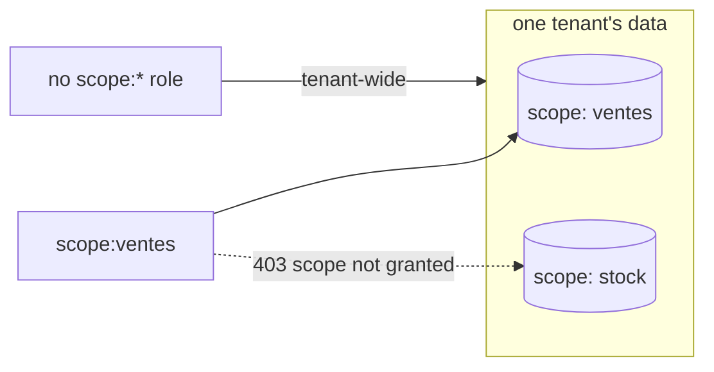

# Tenants, users & scopes

> Identity lives in Keycloak, not in lumnik. Creating a human, granting a role, fencing a métier
> are console gestures; the hub follows the token.

## How lumnik identifies a user

lumnik trusts four claims from the access token:

| Claim | Purpose |
|---|---|
| `aud` | identifies the intended API — must contain `lumnik-backend` |
| `tenant_id` | which tenant the user belongs to |
| `groups` | the realm roles: `lm_*` open surfaces, `scope:*` fence métiers |
| `user_id` | optional — binds the token to an existing hub row |

The bundled realm `lumnik` already maps the `tenant_id` and `user_id` user attributes onto those
claims. You set attributes and roles; nothing else.

### Users with a `user_id`

The account is bound to that existing hub row; lumnik never provisions another one for it. The
bundled `integrator` (`user_id=1`) has its row seeded at install.

### Users without a `user_id`

!!! note "Edition"
    - **lumnik Open** (no JIT): the token is refused —
      `401 {"error":"no external identity resolution in this edition (user_id claim required)"}`
    - **lumnik Pro**: the first successful login creates the hub row — this is JIT provisioning.

For provisioning and deprovisioning from an external IdP, see [Bring your own IdP](byo-idp.md)
and [SCIM](scim.md).

## The console

- `http://localhost:8180`, realm **lumnik**, admin credentials from your `.env`.
- Brute-force detection is **on**: temporary lockout at Keycloak's defaults. Tune it under
  *Realm settings → Security defenses*.
- **Local-only by design.** The compose pins Keycloak to `127.0.0.1`, and the
  [TLS façade](../deploy.md#one-https-origin-the-tls-facade) proxies only the OIDC endpoints,
  never the admin console. On a remote host, use an SSH tunnel:
  [reach the hub from another machine](../deploy.md#reach-the-hub-from-another-machine).

## How to…

### Add a user

1. **Users → Add user**: username, email, **Create**.
2. **Credentials** tab: set a password, or let your IdP federation handle it.
3. **Attributes** tab: `tenant_id` = the tenant's numeric id.
4. **Role mapping** tab → **Assign role** → `lm_user`, plus any `scope:*` role.

!!! note "Edition"
    - **lumnik Open** (no JIT): without a `user_id` attribute, the token is refused —
      `401 {"error":"no external identity resolution in this edition (user_id claim required)"}`
    - **lumnik Pro**: nothing else to do — the first login creates the hub row.

For lumnik Open, complete the mapping yourself:

1. Create the hub row: `POST /api/tenants/{tid}/users`, as `lm_admin`.
2. Note the id it returns.
3. Add it as the account's `user_id` attribute.

### Grant (or revoke) a métier scope

Scope roles are created on demand. The shipped realm has none: zero `scope:*` roles means
unscoped, tenant-wide.

1. **Realm roles → Create role**: name it `scope:ventes`, the tag your manifests use in `spec.scope`.
2. **Users →** the user → **Role mapping → Assign role** → `scope:ventes`.

To revoke, remove that role from the same **Role mapping** tab.

From their next token the user is **bound**: chat, search, views and entity reads answer only
inside granted scopes. Anything else refuses with `403 {"error":"scope not granted"}`.

!!! warning "Removing the last scope role widens access, not narrows it"
    A user with no `scope:*` roles has tenant-wide access. Revoking their last scope role
    doesn't lock them out — it restores access to every scope in the tenant.



### Make someone admin, integrator, superadmin

Same **Role mapping** gesture. Roles are separate, not ranked: an integrator is not
automatically an admin. [Roles & permissions](role-management.md)

| Role | Unlocks |
|---|---|
| `lm_user` | the app surface: entities, views, chat, inbox, the PWA |
| `lm_integrator` | the platform surface `lm` drives: connectors, runs, manifests, `views/apply`, `workflows/apply` |
| `lm_admin` | tenant administration: users, integrations, notification rules, business lists, SCIM tokens |
| `lm_superadmin` | cross-tenant: tenant list, tenant CRUD, impersonation |

### Onboard a new tenant

**1. Create the tenant**, as superadmin:

```bash
TOKEN=$(awk '/^ *access:/ {print $2; exit}' ~/.lm/config.yaml)
curl -s -X POST https://your-hub.example.com/api/tenants \
  -H "Authorization: Bearer $TOKEN" -H "Content-Type: application/json" \
  -d '{"code": "ACME", "name": "Acme Corp"}'    # both required; note the returned id
```

**2. Create its first administrator** — the same gesture as [Add a user](#add-a-user), with:

1. `tenant_id` = the id returned above.
2. Roles `lm_user` + `lm_admin`.
3. The edition-specific mapping completed as usual.

That admin's first login lands in the new tenant. RLS fences every read and write to it from
the first request.

### Offboard someone

**Archive the hub record.**

- **lumnik Pro**: your IdP can set `active: false` through [SCIM](scim.md).
- Either edition: an `lm_admin` can call `DELETE /api/tenants/{tid}/users/{id}` — despite the
  HTTP method, this archives the record. Their very next request is refused, valid token or not:
  `403 {"error":"user is deactivated"}`.

**Disable the Keycloak account.** This stops new logins and refreshes, but a live access token
stays valid until it expires (up to one hour on the bundled realm) — this is why the hub record
must also be archived, not just the account disabled.

The integrator has a checklist of its own: [Offboarding the integrator](offboarding.md).

## One surface not to misread

`POST /api/tenants/{tid}/users` creates a **hub row, not a login**. It carries no IdP identity,
so nobody can authenticate as it. On lumnik Pro JIT creates rows by itself; on lumnik Open the
row is what a `user_id` attribute points at. The users API is a mirror, not an onboarding path.

## See also

- [Roles & permissions](role-management.md) · [Bring your own IdP](byo-idp.md)
- [SCIM](scim.md) · [Offboarding](offboarding.md) · [Scopes](../rag/scopes.md)
