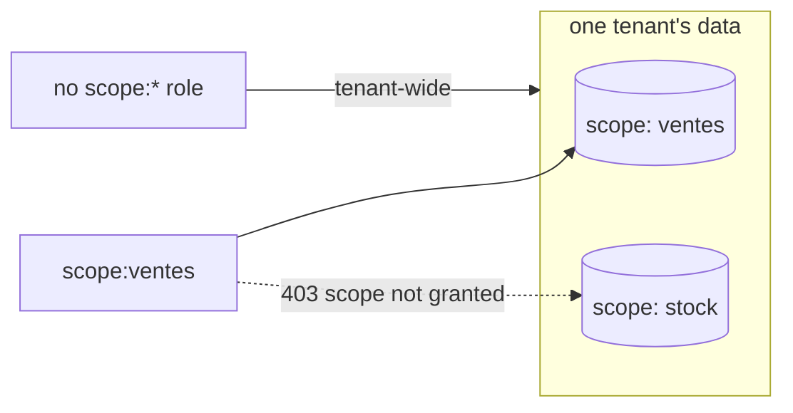

# Tenants, users & scopes

> Identity lives in Keycloak, not in lumnik. Creating a human, granting a role, fencing a métier
> are console gestures; the hub follows the token. `lm` has no command for users, roles or
> tenants.

## How lumnik identifies a user

lumnik trusts four claims from the access token:

| Claim | Purpose |
|---|---|
| `aud` | identifies the intended API — must contain `lumnik-backend` |
| `tenant_id` | which tenant the user belongs to |
| `groups` | the realm roles: `lm_*` open surfaces, `scope:*` fence métiers |
| `user_id` | optional — binds the token to an existing hub row |

The bundled realm `lumnik` already maps the `tenant_id` and `user_id` user attributes onto those
claims. You set attributes and roles; nothing else.

- **With a `user_id`**: the account is bound to that existing hub row. The bundled
  `integrator` (`user_id=1`) has its row seeded at install.
- **Without a `user_id`**: depends on the edition, see [Add a user](#add-a-user).

For an external IdP, see [Bring your own IdP](byo-idp.md) and [SCIM](scim.md).

## The console

- `http://localhost:8180`, realm **lumnik**, admin credentials from your `.env`.
- Brute-force detection is **on**: temporary lockout at Keycloak's defaults. Tune it under
  *Realm settings → Security defenses*.
- **Local only.** The compose pins Keycloak to `127.0.0.1`, and the
  [TLS façade](../deploy.md#one-https-origin-the-tls-facade) proxies only the OIDC endpoints,
  never the admin console. On a remote host, use an SSH tunnel:
  [reach the hub from another machine](../deploy.md#reach-the-hub-from-another-machine).

## How to…

### Add a user

1. **Users → Add user**: username, email, **Create**.
2. **Credentials** tab: set a password, or let your IdP federation handle it.
3. **Attributes** tab: `tenant_id` = the tenant's numeric id.
4. **Role mapping** tab → **Assign role** → `lm_user`, plus any `scope:*` role.

!!! note "Edition"
    - **lumnik Pro**: nothing else to do. The first login creates the hub row (JIT provisioning).
    - **lumnik Open** (no JIT): without a `user_id` attribute the token is refused —
      `401 {"error":"no external identity resolution in this edition (user_id claim required)"}`.
      Complete the mapping yourself:
        1. Create the hub row: `POST /api/tenants/{tid}/users`, as an `lm_admin` of that tenant.
        2. Note the `id` it returns.
        3. Add it as the account's `user_id` attribute.

`POST /api/tenants/{tid}/users` creates a **hub row, not a login**: nobody can authenticate as
it until a Keycloak account points at it.

### Grant (or revoke) a métier scope

Scope roles are created on demand. The shipped realm has none: zero `scope:*` roles means
unscoped, tenant-wide.

1. **Realm roles → Create role**: name it `scope:ventes`, the tag your manifests use in `spec.scope`.
2. **Users →** the user → **Role mapping → Assign role** → `scope:ventes`.

To revoke, remove that role from the same **Role mapping** tab.

From their next token the user is **bound**:

- chat, search, views and entity reads answer only inside granted scopes; anything else is
  `403 {"error":"scope not granted"}`;
- the decision inbox lists only the granted métiers' decisions; another métier's id is a `404`;
- an integrator administers only the connectors whose scopes they hold all of.
  [What they see](role-management.md#troubleshooting)

!!! warning "Removing the last scope role widens access"
    A user with no `scope:*` roles has tenant-wide access. Revoking their last scope role
    restores access to every scope in the tenant.



### Make someone admin, integrator, superadmin

Same **Role mapping** gesture. Roles are separate, not ranked: an integrator is not
automatically an admin. What each one opens: [Roles & permissions](role-management.md).

### Onboard a new tenant

**1. Create the tenant**, as `lm_superadmin` (the bundled `hubadmin` account):

```bash
curl -s -X POST https://your-hub.example.com/api/tenants \
  -H "Authorization: Bearer $TOKEN" -H "Content-Type: application/json" \
  -d '{"code": "ACME", "name": "Acme Corp"}'    # both required; note the returned id
```

`$TOKEN` is a `hubadmin` token: mint it as in [Test the API](../recipes/test-the-api.md#mint-a-token),
with `username=hubadmin` and `HUBADMIN_PASSWORD`.

**2. Create its first administrator**: a Keycloak account as in [Add a user](#add-a-user), with
`tenant_id` = the id returned above and the roles `lm_user` + `lm_admin`.

| Edition | Then |
|---|---|
| lumnik Pro | Leave `user_id` unset. The first login creates the hub row in the new tenant. |
| lumnik Open | The account needs a hub row in the new tenant, and `POST /api/tenants/{tid}/users` answers `403` (empty body) to any token whose `tenant_id` is not `{tid}`, `hubadmin` included. |

On lumnik Open, that call passes only for a token holding `lm_superadmin` and `lm_admin` plus
an `acting_as_tenant: <tid>` claim ([impersonation](../admin-console-guide.md#act-on-behalf-of-a-tenant-impersonation)).
The bundled realm maps no such claim.

RLS fences every read and write of the new tenant's users to it from their first request.

### Offboard someone

Archive the hub row, then disable the Keycloak account. The users API's
`DELETE /api/tenants/{tid}/users/{id}` (as `lm_admin`) archives; the next request is refused:
`403 {"error":"user is deactivated"}`. Why both, and how fast each acts:
[The clock](offboarding.md#the-clock).

## See also

- [Roles & permissions](role-management.md) · [Bring your own IdP](byo-idp.md)
- [SCIM](scim.md) · [Offboarding](offboarding.md) · [Scopes](../rag/scopes.md)
