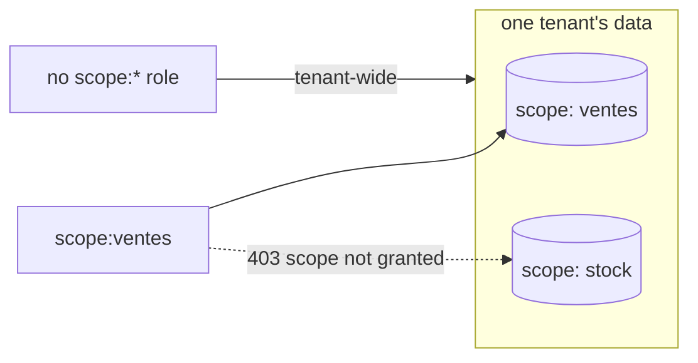

# Tenants, users & scopes

> Identity lives in Keycloak, not in lumnik. Creating a human, granting a role, fencing a métier
> are console gestures; the hub follows the token.

**The model**

- The hub trusts four claims: `aud` (must be `lumnik-backend`), `tenant_id` (which tenant),
  `groups` (the realm roles: `lm_*` for surfaces, `scope:*` for métier fences) and, optionally,
  `user_id` (which hub row).
- The bundled realm `lumnik` already maps the user attributes `tenant_id` and `user_id` onto
  those claims. You set attributes and roles; nothing else.
- A user **with** a `user_id` is bound to that hub row and never provisioned. The bundled
  `integrator` (`user_id=1`) has its row seeded at install.
- A user **without** one is created at first login (JIT) on lumnik Pro; SCIM deprovisions it.
  lumnik Open has neither. [BYO IdP](byo-idp.md) · [SCIM](scim.md)

**The console**

- `http://localhost:8180`, realm **lumnik**, admin credentials from your `.env`.
- Brute-force detection is **on**: temporary lockout at Keycloak's defaults. Tune it under
  *Realm settings → Security defenses*.
- **Local-only by design.** The compose pins Keycloak to `127.0.0.1`, and the
  [TLS façade](../deploy.md#one-https-origin-the-tls-facade) proxies only the OIDC endpoints,
  never the admin console. On a remote host, use an SSH tunnel:
  [reach the hub from another machine](../deploy.md#reach-the-hub-from-another-machine).

## How to…

### Add a user

1. **Users → Add user**: username, email, **Create**.
2. **Credentials** tab: set a password, or let your IdP federation handle it.
3. **Attributes** tab: `tenant_id` = the tenant's numeric id.
4. **Role mapping** tab → **Assign role** → `lm_user`, plus any `scope:*` role.

- **lumnik Pro**: the first login creates the hub row. Nothing to do on the lumnik side.
- **lumnik Open**: there is no JIT. Also add a `user_id` attribute pointing at an existing hub
  row (`POST /api/tenants/{tid}/users`, as `lm_admin`). A token without it is refused with 401.

### Grant (or revoke) a métier scope

Scope roles are created on demand. The shipped realm has none: zero `scope:*` roles means
unscoped, tenant-wide.

1. **Realm roles → Create role**: name it `scope:ventes`, the tag your manifests use in `spec.scope`.
2. **Users →** the user → **Role mapping → Assign role** → `scope:ventes`.

From their next token the user is **bound**: chat, search, views and entity reads answer only
inside granted scopes. Anything else refuses with `403 {"error":"scope not granted"}`.
Revoking is the same gesture in reverse; removing the last scope role makes them tenant-wide again.



### Make someone admin, integrator, superadmin

Same **Role mapping** gesture. Roles are separate, not ranked: an integrator is not
automatically an admin. [Roles & permissions](role-management.md)

| Role | Unlocks |
|---|---|
| `lm_user` | the app surface: entities, views, chat, inbox, the PWA |
| `lm_integrator` | the platform surface `lm` drives: connectors, runs, manifests, `views/apply`, `workflows/apply` |
| `lm_admin` | tenant administration: users, integrations, notification rules, business lists, SCIM tokens |
| `lm_superadmin` | cross-tenant: tenant list, tenant CRUD, impersonation |

### Onboard a new tenant

1. Create the tenant row, as superadmin:
   ```bash
   TOKEN=$(awk '/^ *access:/ {print $2; exit}' ~/.lm/config.yaml)
   curl -s -X POST https://your-hub.example.com/api/tenants \
     -H "Authorization: Bearer $TOKEN" -H "Content-Type: application/json" \
     -d '{"code": "ACME", "name": "Acme Corp"}'    # both required; note the returned id
   ```
2. In Keycloak, create its first admin (gesture above) with `tenant_id` = the returned id and
   roles `lm_user` + `lm_admin`.

That admin's first login lands in the new tenant. RLS fences every read and write to it from
the first request.

### Offboard someone

- A métier user: `active: false` from your IdP via [SCIM](scim.md) (lumnik Pro), or
  `DELETE /api/tenants/{tid}/users/{id}` as `lm_admin` (both editions). Either archives the hub
  row, and the very next request is refused, valid token or not.
- Disabling the account in Keycloak alone stops new logins and refreshes; a live access token
  stays valid until it expires (1 hour on the bundled realm). Do both.
- The integrator: a checklist of its own, [Offboarding the integrator](offboarding.md).

## One surface not to misread

`POST /api/tenants/{tid}/users` creates a **hub row, not a login**. It carries no IdP identity,
so nobody can authenticate as it. On lumnik Pro JIT creates rows by itself; on lumnik Open the
row is what a `user_id` attribute points at. The users API is a mirror, not an onboarding path.

## See also

- [Roles & permissions](role-management.md) · [Bring your own IdP](byo-idp.md)
- [SCIM](scim.md) · [Offboarding](offboarding.md) · [Scopes](../rag/scopes.md)
