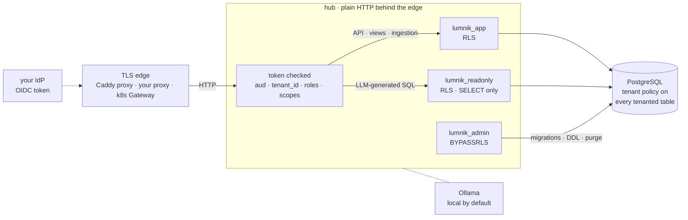

# Security

> Self-hosted, read-only towards your sources, tenant isolation enforced by PostgreSQL itself.
> This page is for the person who signs off: what holds, how to check it in five minutes, and
> what is not built yet.

<div class="lm-meta" markdown>
<div class="lm-meta-item" markdown>
<strong>Self-hosted</strong>

The hub, the database, the model runtime: all on your infrastructure. There is no lumnik cloud.
</div>
<div class="lm-meta-item" markdown>
<strong>Read-only mirror</strong>

Ingestion reads your ERP and never writes back. The source stays the system of record.
</div>
<div class="lm-meta-item" markdown>
<strong>Isolated by RLS</strong>

Row-Level Security on every tenanted table. The request-path role cannot bypass it.
</div>
<div class="lm-meta-item lm-meta-item--accent" markdown>
<strong>Read-only role under LLM SQL</strong>

Generated queries run as `lumnik_readonly`: `SELECT` only, one statement, `LIMIT 500`.
</div>
</div>

## Before you expose the hub

!!! danger "Two doors that answer without a login"
    - **`/q/metrics`, `/q/openapi`, `/q/swagger-ui`** need no token, and `/q/metrics` names your
      connectors. The [TLS proxy](../deploy.md#one-https-origin-the-tls-proxy) forwards them. On a
      public address, block `/q/*` at your proxy or firewall.
    - **A Helm install set to `auth.mode=dev-bypass`** (cloud edition): the hub checks no token,
      every caller is superadmin and picks any tenant. The chart defaults to `oidc` and renders
      dev-bypass only with `auth.iUnderstandNoAuth=true` as well. Never expose such a hub. The
      self-host stack (`up.sh`) always requires a login.

## The trust boundaries



| Boundary | What holds | Details |
|---|---|---|
| The token | `aud` = `lumnik-backend`; `tenant_id` picks the tenant; `groups` carries `lm_*` roles and `scope:<tag>` grants; optional `user_id`. A malformed claim is refused. | [Bring your own IdP](byo-idp.md) |
| The database roles | `lumnik_admin` owns every table and alone bypasses RLS. `lumnik_app` owns nothing. | [RLS & database roles](rls.md) |
| TLS | Stops at the edge. Hub↔PostgreSQL, hub↔Ollama and proxy↔hub are plain on your internal network. | [Where TLS stops](rls.md#data-in-transit-where-tls-stops) |
| Scopes | A `scope:<tag>` role narrows chat, search, views, entity reads and the decision inbox to one data scope: `403 {"error":"scope not granted"}`. | [Scopes](../rag/scopes.md#binding-users-to-scopes-opt-in) |

PostgreSQL enforces the tenant. Inside a tenant, the business-scope boundary on generated SQL is the
leak guard (tables outside the scope's card are refused), not a database policy.

## Verify it yourself, in five minutes

Run these on the self-host stack, from the clone directory.

**No tenant set means zero rows.** Open a session as the request-path role:

```
$ docker compose -f docker-compose.selfhost.yml exec postgres psql -U lumnik -d lumnik
lumnik=# SET ROLE lumnik_app;
lumnik=> SELECT count(*) FROM connector.t_orders;
 count
-------
     0
lumnik=> BEGIN;
lumnik=*> SET LOCAL app.current_tenant = '1';
lumnik=*> SELECT count(*) FROM connector.t_orders;
 count
-------
    10
lumnik=*> COMMIT;
lumnik=> BEGIN;
lumnik=*> SET LOCAL app.current_tenant = '2';
lumnik=*> SELECT count(*) FROM connector.t_orders;
 count
-------
     0
lumnik=*> COMMIT;
```

**The role under LLM-generated SQL cannot write**, and reads only the tenant set:

```
lumnik=> SET ROLE lumnik_readonly;
lumnik=> INSERT INTO connector.t_orders DEFAULT VALUES;
ERROR:  permission denied for table t_orders
lumnik=> BEGIN;
lumnik=*> SET LOCAL app.current_tenant = '2';
lumnik=*> SELECT count(*) FROM connector.t_orders;
 count
-------
     0
```

**A stored secret is ciphertext** (pgcrypto, AES-256):

```
$ lm secret list
NAME                           ROTATED_AT                     DESCRIPTION
ACME_API_KEY                   -
ACME_BASIC_PW                  -
SFTP_ERP_PASSWORD              -
```

```
lumnik=# SELECT name, left(encode(value_encrypted, 'hex'), 32) || '…' AS value_encrypted
         FROM platform.secret ORDER BY name LIMIT 2;
     name      |          value_encrypted
---------------+-----------------------------------
 ACME_API_KEY  | c30d04090302ab5278c2332e2a006cd2…
 ACME_BASIC_PW | c30d040903020d2a00713ded0a517fd2…
```

**No token, no answer:**

```
$ curl -si http://localhost:8080/api/platform/health | head -1
HTTP/1.1 401 Unauthorized
```

**A user token does not open the provisioning surface.** SCIM has its own bearer tokens:

```
$ curl -s http://localhost:8080/scim/v2/Users -H "Authorization: Bearer $TOKEN"
{"schemas":["urn:ietf:params:scim:api:messages:2.0:Error"],"detail":"invalid SCIM token","status":"401"}
```

## Which build is this? {#which-edition-the-full-answer}

```
$ lm module list
NAME      VERSION  SCHEMA              STATUS    REASON
core      0.1.0    Platform            ACTIVE
identity  0.1.0    Identity & Tenancy  ACTIVE
llm       0.1.0    Model provider      INACTIVE  disabled:lumnik.ai.enabled
rag       0.1.0    Platform RAG        INACTIVE  disabled:lumnik.ai.enabled
```

| You see | It means |
|---|---|
| `core`, `identity` only | lumnik Open |
| `llm` and `rag` as well | lumnik Pro |
| `search_pg` or `search_opensearch` | a build with a [Search provider](../search/search-indexes.md#choosing-a-provider) |
| `INACTIVE`, `disabled:lumnik.ai.enabled` | Pro with the AI switched off: installed, not absent. [Switching the AI off](../rag/models.md#switching-the-ai-off) |

Which edition you run decides the rows marked *edition* below. [Editions](../editions.md#feature-by-feature)

## What an auditor asks

| Question | Answer, in short | Page |
|---|---|---|
| What stops tenant A reading tenant B? | PostgreSQL Row-Level Security on every tenanted table; the request role cannot bypass it. | [RLS](rls.md) |
| Can we plug in our own IdP? | Any OIDC issuer. Tested with Keycloak only. *Edition:* first login needs JIT provisioning, absent from lumnik Open. | [BYO IdP](byo-idp.md) |
| Is password guessing throttled? | The shipped realm has brute-force detection on. With your own IdP it is your IdP's policy. | [Users & scopes](identity-admin.md) |
| Does a departure cut access, and how fast? | Archive the hub row: the next request is refused. Disable in the IdP alone: a live token keeps working until it expires (1 hour on the bundled realm). | [Offboarding](offboarding.md#the-clock) |
| Are stored credentials encrypted? | pgcrypto AES-256 under two keys held in `.env`. No key rotation tooling. | [Secrets at rest](rls.md#secrets-at-rest-the-master-key) |
| Is our ingested data encrypted at rest? | **No.** Mirror tables and the RAG corpus are plaintext columns. Disk and backup encryption are your layer. | [Data at rest](rls.md#data-at-rest-what-is-encrypted-and-what-is-not) |
| Is traffic encrypted end to end? | TLS at the edge only. Plain HTTP behind it, on your internal network. | [Data in transit](rls.md#data-in-transit-where-tls-stops) |
| Can we honour access and erasure requests? | Access is manual. Erasure of ingested data is a rebuild: delete the entity (for every tenant) and the connector, re-apply, re-ingest. | [GDPR](gdpr.md#the-rights-in-practice) |
| Who did what, when? | Configuration applies and deletes, entity reads, direct searches and data leaving the hub; not questions, SQL, SCIM or webhook settings. | [The audit trail](#the-audit-trail) |
| Can one tenant exhaust our capacity? | Chat, RAG search, view generation and direct search are capped per tenant per minute. Single node only. | [Rate limits](../operations/rate-limits.md) |
| Can we recover from data loss? | Scripted hot PostgreSQL dump at the cron interval you choose. No point-in-time recovery. | [Backup & restore](../operations/backup-restore.md) |
| How long are ingested rows kept? | Until the connector is deleted. | [GDPR](gdpr.md#where-personal-data-can-live) |
| Does the hub log personal data? | At the default level the login path logs no subject or issuer, and chat logs counts, never a question or a row. `DEBUG` may echo data. There is no written log-content policy. | [Reading the logs](../recipes/logs.md) |
| Can the model write, or read another tenant? | No. Generated SQL runs as `lumnik_readonly` under RLS: one `SELECT`, `LIMIT 500`. No conversation history is stored. Nothing leaves your network unless you configure a cloud provider. | [Ask honesty](../transparency/ask-honesty.md) |
| How do we report a vulnerability? | Email `contact@lumnik.fr`, subject `[lumnik security]`, never a public issue. Acknowledgment within 72 hours, fix or mitigation within 14 days. Supported: the latest `v1.x`. | `SECURITY.md`, at the root of every edition |

## The audit trail

Rows land in `core.audit_event`, each with the acting user and the tenant, within about two
seconds of the gesture. A gesture lands once, also when several hub replicas run: the replica that
copies it into the trail holds it until that copy is committed, and the others pass over it.

| `entity_type` | `operation` | `changes` carries | Written by |
|---|---|---|---|
| `User` | `CREATE`, `UPDATE` | `login`, `email`, `locked`, `defaultScope`, after the write | the users API, `lm scope set`, JIT first login (with no actor); not SCIM |
| `Secret` | `CREATE`, `UPDATE`, `DELETE` | `name`, `description`, `rotatedAt`; never the value | `lm secret set`, `lm secret rm` |
| `Connector` | `APPLY`, `DELETE` | `name`, `type`, `tags`, `via`; `manifest_sha256` when `via` = `manifest`. Never the configuration | see `via` below |
| `Entity` | `APPLY`, `DELETE` | `scopes`; `manifest_sha256` on `APPLY` | `lm entity apply`, `lm entity delete` |
| `Entity` | `READ` | nothing | `lm entity get`, the entity API |
| `Entity` | `EGRESS` | rows, bytes, SHA-256 of the file | `lm entity export` |
| `SearchIndex` | `APPLY`, `DELETE`, `REBUILD`, `CANCEL` | `DELETE` by an entity delete names that entity and lands in the tenant that owned the index; `REBUILD`/`CANCEL` carry the run id | `lm search …`, `lm entity delete` |
| `Search` | `READ` | entities hit, hit count; never the query text | `lm search query`, the PWA's Search tab |
| `SavedView` | `APPLY`, `DELETE` | `scope`; `manifest_sha256` on `APPLY` | `lm view apply`, `lm view rm` |
| `WorkflowManifest` | `APPLY`, `UPDATE`, `DELETE` | `scope`; `table`, `column` and `manifest_sha256` on `APPLY`; `enabled` on `UPDATE` | `lm workflow apply`, `disable`, `enable`, `rm` |
| `Process` | `APPLY`, `UPDATE`, `DELETE` | `scope`; `table` and `manifest_sha256` on `APPLY`; `enabled` on `UPDATE` | `lm process apply`, `disable`, `enable`, `rm` |
| `AppRegistration` | `APPLY`, `DELETE` | `scope`, `manifest_sha256`, `demoted_default` (the app that lost the default flag) | `lm app apply`, `lm app rm` |
| `Export` | `APPLY` | `scope`, entity, `manifest_sha256` | `lm export apply` |
| `Export` | `EGRESS` | entity, rows, bytes, SHA-256 of the file, destination kind and location | each delivered export run |

The `via` of a `Connector` row names the gesture:

| `via` | Gesture |
|---|---|
| `manifest` | `lm apply` |
| `api` | `lm connector apply`, `lm connector delete`, the TUI's edit |
| `scope` | `lm connector scope set` |
| `csv-ingest` | `lm csv ingest` (row carries `via`, `table`, `tags`, `refreshed`) |
| `jdbc-add` | `lm source jdbc add` |

A write the hub refused leaves no row. A `Connector` `DELETE` also drops the connector's tables
and run history. App rows land in the tenant of the integrator who wrote them.

A connector and an entity applied, the entity read, then both deleted:

```
$ lm apply -f erp-customers.yaml
Applied connector "erp-customers" — 1 endpoint
$ lm entity apply -f customer.yaml
Applied entity "Customer" → connector."v_customer"
$ lm entity get Customer --filter email=jeanne.martin@example.com
CUSTOMER_ID  NAME           EMAIL                      CITY  _CONFLICTS
C-1001       Jeanne Martin  jeanne.martin@example.com  Lyon  {}
$ lm entity delete customer
Type 'delete' to delete entity customer — its view, for every tenant: delete
deleted: customer
$ lm connector delete erp-customers
Type 'delete' to delete connector erp-customers (csv-file) — 3 rows of connector.t_erp_customers, its run history and RAG chunks: delete
deleted: erp-customers
```

```
lumnik=# SELECT entity_type, operation, changes FROM core.audit_event
         WHERE changes->>'name' = 'erp-customers' OR entity_key = 'Customer' ORDER BY id;
 entity_type | operation |                                                                                  changes
-------------+-----------+----------------------------------------------------------------------------------------------------------------------------------------------------------------------------
 Connector   | APPLY     | {"via": "manifest", "name": "erp-customers", "tags": ["sales"], "type": "csv-file", "manifest_sha256": "0c34eee4a4c25cb505267a808b61c1ae9402bc1609fb3926eeb1c9ee9f59c9a6"}
 Entity      | APPLY     | {"scopes": ["sales"], "manifest_sha256": "38817cb644e0b38066f8cf07f869397bbeedb01430844b891340b5cb2a44a467"}
 Entity      | READ      | {}
 Entity      | DELETE    | {"scopes": ["sales"]}
 Connector   | DELETE    | {"via": "api", "name": "erp-customers", "tags": ["sales"], "type": "csv-file"}
(5 rows)
```

To prove which file was applied, compare `manifest_sha256` with the file's digest. It matches a
UTF-8 file sent as it is, which is what `lm apply` does:

```
$ shasum -a 256 erp-customers.yaml
0c34eee4a4c25cb505267a808b61c1ae9402bc1609fb3926eeb1c9ee9f59c9a6  erp-customers.yaml
```

### Not recorded

- Anything not in the table above, e.g. webhook targets, notification rules, SCIM tokens,
  tenants, orgs, hook toggles.
- Questions asked, the SQL that ran, chat and RAG searches.
- Connector runs (they have their own [run ledger](../connectors/index.md)), a connector's
  endpoint edits, pause and resume.
- SCIM-driven user writes, deprovisioning included.
- Archiving a user: it is an ordinary `User` / `UPDATE`, indistinguishable from any other edit.

### Retention and integrity

- A nightly purge deletes rows older than `LUMNIK_AUDIT_RETENTION_DAYS` (default 365; `0` keeps
  forever). There is no per-row erasure.
- No read surface: query the table directly, as above, as `lumnik_admin` or as `lumnik_app`
  inside the tenant.
- Append-only for `lumnik_app`: `UPDATE`, `DELETE` and `TRUNCATE` are revoked. Only
  `lumnik_admin`, which runs the purge, can delete.

### Refusals

Refusals are logged, not audited. Each leaves one `WARN` line, never a token; point your SIEM at
them. [Reading the logs](../recipes/logs.md)

| Gate | Log line |
|---|---|
| role | `Access denied: required=[…], actual=[…], method=…` |
| scope | `Access denied: scope not granted, granted=[…]` |
| SCIM | `SCIM auth refused: GET /scim/v2/… reason=missing` or `reason=unknown-or-revoked` |
| token | `JWT auth rejected: <reason>` |
| deactivated user | `login denied: user is deactivated` or `login denied: external identity is deactivated` |

## Not built yet

Collect these for your risk register.

**Keys & data at rest**

- No master-key rotation. Changing `LUMNIK_SECRET_MASTER_KEY` or `LUMNIK_CRYPTO_SECRET_KEY`
  makes every secret it protects undecryptable; losing it makes them unrecoverable.
- The backup script does not cover `.env`: back both keys up separately.
- The keys sit in `.env` on the host, in clear. A copy of `.env` plus a database dump decrypts
  every stored secret.
- Ingested data, the RAG corpus and backups are plaintext.

**Personal data**

- No DSAR export endpoint. No automated hard-delete of user accounts. No deletion propagation
  from sources to mirror tables. No API to erase a dead-letter payload.
  [GDPR](gdpr.md#not-built-yet-recorded-not-hidden)

**Database trust boundary**

- Whoever holds `lumnik_admin` or the superuser reads every tenant. Code on the admin datasource
  filters by tenant itself; RLS will not catch a bug there.
- RLS trusts the tenant the hub resolved from the JWT.
- Saved views and entity manifests are hub-wide definitions, bound by scope grants. The data
  they render still goes through RLS.
- The business-scope boundary inside a tenant is a guard on generated SQL, not a database policy.

**Capacity & recovery**

- Rate limiting is in-memory: N replicas means up to N× the configured limit. SCIM is not
  rate-limited; its bearer is 256 bits of randomness.
- A dump at your cron interval, no point-in-time recovery: the RPO is that interval.
- Changing the hub's public origin re-keys every JIT identity: pick it once, early.
  [Keep the same public address](byo-idp.md#keep-the-same-public-address)

**Identity**

- `lm_integrator` gates the whole platform API but is absent from the roles catalog
  (`GET /api/platform/roles` lists `lm_superadmin`, `lm_admin`, `lm_user`). An RBAC inventory
  taken from that catalog misses it. [Roles & permissions](role-management.md#after-each-upgrade-the-roles-catalog)
- The permission catalog is declarative: endpoints are gated by role name.
- SCIM writes skip the audit trail.
- Disabling an account in the IdP does not revoke a live access token: archive the hub row.
  [Offboarding](offboarding.md#the-clock)

**Edition boundary**

- lumnik Open: no JIT provisioning, no SCIM. A token without a `user_id` claim is refused:
  `401 {"error":"no external identity resolution in this edition (user_id claim required)"}`.
- lumnik Open: the `view-generate` and `search` rate-limit buckets exist; the three chat and RAG
  search buckets do not, nor do their endpoints.

**Supply chain**

- The hub image is published without a signature or an SBOM attestation.

**The model**

- No filter sits between ingested text and the model: a source row carrying instructions can
  steer an answer. It cannot widen the SQL's rights: the query still runs as `lumnik_readonly`,
  under RLS, behind the guards.
- The hub keeps no conversation history; a cloud provider, if you configure one, keeps its own.

## See also

- [RLS & database roles](rls.md) · [Roles & permissions](role-management.md) ·
  [Tenants, users & scopes](identity-admin.md)
- [Bring your own IdP](byo-idp.md) · [SCIM deprovisioning](scim.md) ·
  [Offboarding the integrator](offboarding.md) · [GDPR & personal data](gdpr.md)
- [Ask honesty](../transparency/ask-honesty.md): the guards between a question and a query.
