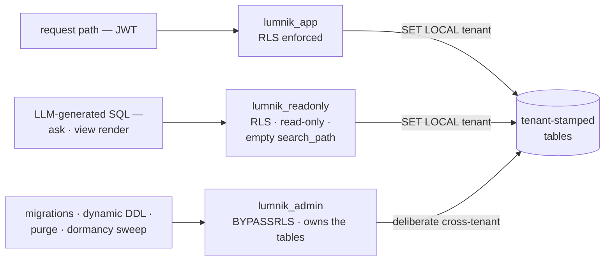

# Row-Level Security & database roles

> Every tenant's rows are isolated by PostgreSQL Row-Level Security, not by application code —
> the request-path database role cannot bypass it.

The first question a security reviewer asks of a multi-tenant hub: *what stops tenant A
from reading tenant B's rows?* In lumnik the answer is PostgreSQL itself — every tenanted
table carries a Row-Level Security policy, and the application connects as a role that
cannot bypass it.

## The three database roles

Created **outside Flyway** by `infra/postgres/init/01-roles.sh` (superuser context —
the migration user intentionally lacks `CREATEROLE`):

| Role | Privileges | Purpose |
|------|-----------|---------|
| `lumnik_app` | `SELECT/INSERT/UPDATE/DELETE` on tables, `USAGE/SELECT/UPDATE` on sequences (via `ALTER DEFAULT PRIVILEGES` from `lumnik_admin`). **Subject to RLS.** | The default datasource — every request-path query. |
| `lumnik_admin` | `LOGIN` + **`BYPASSRLS`**. Owns every table (Flyway runs as it; dynamic connector tables are created through the admin datasource too). | Migrations and deliberate cross-tenant work: GDPR purge, dynamic-table DDL, secret resolution, the workflow dormancy sweep. JTA enlistment is disabled on this datasource (`application.properties`) so it is never picked up by accident inside a request transaction. |
| `lumnik_readonly` | `SELECT` only, `default_transaction_read_only = on`, `USAGE` on schema `connector` (`connector/V15__schema_card_and_readonly.sql` + per-table grants from the dynamic writers). **Subject to RLS.** | The physical firewall under LLM-generated SQL: ask-to-SQL and `kind:View` render/detail run **only** through this datasource. |

`lumnik_app` owns nothing — table ownership sits with `lumnik_admin`, so the
owner-bypasses-own-RLS rule of PostgreSQL never applies to the request path.



## How a query gets its tenant

The policy predicate reads a transaction-local GUC, `app.current_tenant`:

- **Default datasource** — `TenantConnectionInterceptor` (an Agroal pool interceptor)
  issues `SET LOCAL app.current_tenant = '<id>'` once per JTA transaction, from the
  tenant resolved off the JWT. `SET LOCAL` dies with the transaction — nothing leaks
  onto the pooled connection. Background/system work sets the sentinel `'0'`; a
  *request* claiming tenant `<= 0` is rejected (sentinel-spoofing guard, fail closed).
- **Readonly datasource** — `TenantRlsScope.applyTo(connection, tenantId)` (one shared
  entry point) marks the connection read-only, sets the GUC, and empties `search_path`
  so a bare table name cannot sidestep the schema-qualified leak guard.

## The policy shape

Since `core/V21__rls_tenant_nullif_guard.sql`, every **statically migrated** tenant
policy reads:

```sql
USING (tenant_id = NULLIF(current_setting('app.current_tenant', true), '')::bigint)
```

No tenant set (or set to `''`) → the predicate is `NULL` → **zero rows**, not an error
and never all rows. (Before V21, an empty GUC crashed the query with `22P02`; the guard
made the failure mode "no data" instead.) System-shared tables (`core.event_outbox`,
`connector.*` run bookkeeping — `V4`, `V22`, `V24`) additionally accept the `'0'`
sentinel.

Dynamically created connector tables (`connector.t_*`, `ext.*`, mapping-target schemas)
get the same guarded policy at creation time (`DynamicTableWriter` / `HybridJsonbWriter`),
and `core/V31__rls_dynamic_tables_nullif_guard.sql` healed every dynamic table created
before the guard — surgically, by predicate shape, leaving the `'0'`-sentinel system
policies untouched.

Original policies: `core/V2__rls_policies.sql`, `identity/V6__rls_policies.sql`.

## Credentials

Each datasource's credentials are env-overridable (`application.properties`):
`LUMNIK_APP_DB_USERNAME` / `LUMNIK_APP_DB_PASSWORD`, `LUMNIK_ADMIN_DB_USERNAME` /
`LUMNIK_ADMIN_DB_PASSWORD`, `LUMNIK_READONLY_DB_USERNAME` / `LUMNIK_READONLY_DB_PASSWORD`;
all three share one `DB_URL`. Both deploy paths generate all three per install:
self-host `up.sh` writes them into `.env` and **aligns the live roles to `.env` on
every run** — so rotation is one gesture: put a new value in `.env`, re-run `up.sh`.
The Helm path injects them through the release Secret (`secrets.appDbPassword` /
`adminDbPassword` / `readonlyDbPassword`), consumed by the init script at first boot
and by the hub's datasources at every boot; on a cluster with an existing data volume,
rotate at the database (`ALTER ROLE … PASSWORD`) and upgrade with the matching values.
Installs older than this mechanism rotate automatically the first time `up.sh` runs
with the new keys in `.env`.

## What RLS does NOT protect against

- **The admin datasource.** `lumnik_admin` is `BYPASSRLS` by design; every code path
  using it must filter explicitly (`WHERE tenant_id = ?` — e.g. `PgcryptoSecretResolver`).
  A bug there is a cross-tenant bug RLS will not catch.
- **The database superuser**, or anyone holding the `lumnik_admin` credentials.
- **A wrong GUC.** RLS trusts `app.current_tenant`; the tenant resolution upstream
  (JWT claim → `TenantContextFilter`) is part of the trusted computing base.

## Secrets at rest: the master key

!!! danger "One key. No rotation. No recovery."
    Back up **`LUMNIK_SECRET_MASTER_KEY`** somewhere safe, today — it is not in the backup
    script. **Change it** and every stored secret becomes undecryptable. **Lose it** and they
    are unrecoverable. There is no re-encryption tooling, so a key change means re-entering
    every secret by hand.

Tenant secrets are encrypted in the database with pgcrypto — AES-256, under one symmetric
master key.

| | |
|---|---|
| **What is encrypted** | tenant secrets — `platform.secret` (`platform/V14__platform_secret.sql`) |
| **How** | pgcrypto `pgp_sym_encrypt`, AES-256 |
| **The key** | `lumnik.secret.master-key`, injected via env **`LUMNIK_SECRET_MASTER_KEY`** |
| **Who creates it** | the self-host and k8s installers, `openssl rand -base64 32`, at install time (into `.env` / a Helm secret) |
| **Refuses to boot** | `MasterKeyValidator`, on a blank, placeholder, or short (< 16 chars) key |

**Rotating one secret's value — supported.** Re-apply it; `rotated_at` is stamped.

**Rotating the master key — not supported today.** See the warning above.

**A second key behaves identically.** `LUMNIK_CRYPTO_SECRET_KEY`
(`lumnik.crypto.secret-key`, `SecretCipher`) covers connector and webhook credentials, with
the same no-rotation posture and the same AES-256. Credentials stored by builds that predate
the AES-256 switch were written AES-128; they stay readable (the algorithm travels in the PGP
header) and move to AES-256 the next time the credential is re-saved.

## Data at rest: what is encrypted, and what is not

**Your own ingested data is not encrypted at the application layer.** Encryption there is
scoped to two stores only — tenant secrets and connector/webhook credentials, the same
master-key-protected stores described above.

`DynamicTableWriter` builds `connector.t_*` with plain `CREATE TABLE` DDL, no cipher
column in sight, and `RagWriter` inserts chunk text and embeddings into `rag.chunk` the
same way. Whatever your source systems hold — names, emails, order history, anything —
lands in PostgreSQL as plaintext columns, readable to anyone who can query the database
directly (the `lumnik_admin`/superuser caveat above applies here too).

That is a defensible posture for self-hosted software the customer's own infrastructure
runs, not an oversight: volume/disk encryption and backup encryption are the operator's
layer, same as for any other database. Encrypt the PostgreSQL volume and the backup
artifacts at the infrastructure level if your data classification requires it — lumnik
does not do that for you, and does not claim to.

## Data in transit: where TLS stops

The hub itself speaks plain HTTP: `quarkus.http.port=8080`
(`lumnik-hub/src/main/resources/application.properties:2`), with no
`quarkus.http.ssl.*` setting anywhere in that file — there is no `https://` origin
baked into the application. Both shipped deploy paths put something in front of it:

- **Self-host** — the *optional* TLS façade (`deploy/tls/Caddyfile`) terminates HTTPS
  at `$LUMNIK_TLS_HOST` and reverse-proxies to `hub:8080` and `keycloak:8180` over the
  compose's internal Docker network: browser↔façade is HTTPS, façade↔hub and
  façade↔Keycloak are plain HTTP inside the container network. Skip the façade and the
  hub answers in the clear on whatever you exposed port 8080 to.
- **Kubernetes** — the Gateway resource
  (`deploy/helm/lumnik/templates/gateway.yaml:11-20`) terminates TLS from a secret
  (`gateway.tlsSecretName`, self-signed by `up.sh` unless you supply your own); the hop
  from the Gateway to the hub pod is, same as self-host, plain HTTP inside the cluster
  network.

**Nothing behind the TLS edge is encrypted.** TLS terminates at whichever edge you put in
front of the stack — the Caddy façade, your own reverse proxy, or the k8s Gateway.
Everything behind that edge — hub↔PostgreSQL, hub↔Ollama, façade↔hub — rides your internal
network in the clear.

Neither hub↔PostgreSQL nor hub↔Ollama is configured for TLS: the JDBC URLs
(`application.properties:10-11`, `%dev`/`%prod`) carry no `sslmode` parameter, and
`OLLAMA_BASE_URL` defaults to `http://localhost:11434`
(`lumnik-llm-langchain/src/main/resources/application.properties:5`) — plain HTTP,
container-to-container or container-to-host.

Securing that internal network (a private VPC/VLAN, no public exposure of the DB/Ollama
ports) is the operator's job, same as the disk encryption above. No new promise here
either.

## Troubleshooting

| Symptom | Cause | Fix |
|---|---|---|
| Hub refuses to boot: `lumnik.secret.master-key is not set` / `is still the placeholder` / `is too short (< 16 chars)` | `MasterKeyValidator` rejects a blank, placeholder, or short `LUMNIK_SECRET_MASTER_KEY` before the app starts | Generate a real key (`openssl rand -base64 32`) and export it as `LUMNIK_SECRET_MASTER_KEY` |
| A secret fails to resolve at runtime: `SecretResolver failed for name=… tenant=…` | `LUMNIK_SECRET_MASTER_KEY` was changed or lost since the secret was encrypted — `pgp_sym_decrypt` cannot open it with the current key | Restore the original key from backup; there is no re-encryption path (see [Secrets at rest](#secrets-at-rest-the-master-key)) |
| A query through `lumnik_app`/`lumnik_readonly` returns zero rows, though `lumnik_admin`/`psql` shows the data is there | `app.current_tenant` was never set on that connection (a manual `psql` session, or code that skipped the normal request/readonly path) — the RLS predicate evaluates to `NULL`, not an error | Confirm the query went through `TenantConnectionInterceptor` or `TenantRlsScope`, not a raw connection |

## See also

- [Roles & permissions](role-management.md) — the application-layer RBAC above this.
- [Scopes](../rag/scopes.md) — the métier boundary layered on top of tenant isolation.
