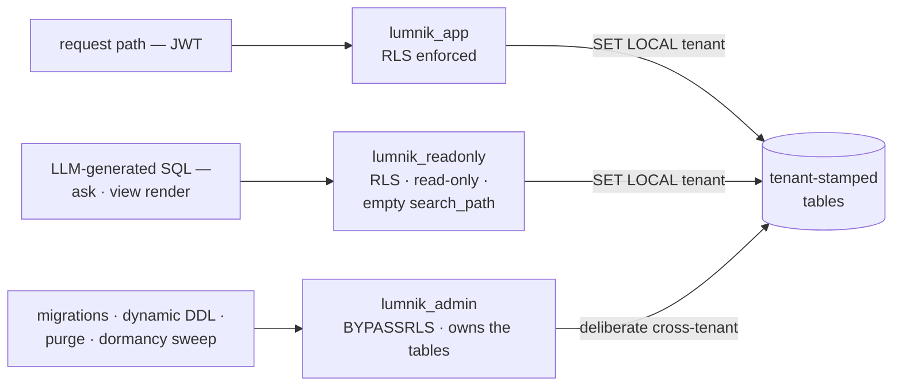
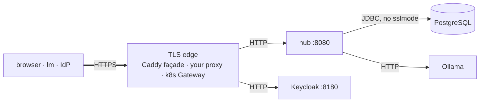

# Row-Level Security & database roles

> Every tenant's rows are isolated by PostgreSQL itself. The role the hub uses for requests
> cannot bypass the policy, and the role under LLM-generated SQL cannot write.

| | |
|---|---|
| **Roles** | `lumnik_app` (requests) · `lumnik_readonly` (LLM-generated SQL, views) · `lumnik_admin` (migrations, DDL, purge) |
| **Policy** | `tenant_id = current tenant`; no tenant set means **zero rows**, never an error, never every row |
| **Coverage** | every tenanted table, including the `connector.t_*` tables ingestion creates |
| **Encrypted at rest** | tenant secrets, connector and webhook credentials only; ingested data is plaintext |
| **TLS** | terminates at the edge you put in front; plain HTTP behind it |



## The three database roles

Created at install by the PostgreSQL init script, outside the migrations:

| Role | Can | Cannot | Used for |
|---|---|---|---|
| `lumnik_app` | read and write rows, **under RLS** | bypass a policy; own a table | every request the hub serves |
| `lumnik_readonly` | `SELECT`, **under RLS**; the session is read-only | write anything; resolve an unqualified table name | ask-to-SQL and `kind:View` render and detail |
| `lumnik_admin` | everything; **bypasses RLS**; owns every table | be enlisted in a request transaction by accident | migrations, dynamic table DDL, GDPR purge, secret resolution, the workflow dormancy sweep |

- `lumnik_app` owns nothing. PostgreSQL lets a table's owner bypass its own policies; that rule
  never applies to a request.
- See the roles answer a query live: [Verify it yourself](index.md#verify-it-yourself-in-five-minutes).

## How a query gets its tenant

- The hub resolves the tenant from the JWT's `tenant_id` claim, then issues
  `SET LOCAL app.current_tenant = '<id>'` once per transaction. `SET LOCAL` dies with the
  transaction; nothing leaks onto the pooled connection.
- Background work runs as the system sentinel `'0'`. A **request** claiming a tenant of `0` or
  below is rejected, so the sentinel cannot be spoofed from a token.
- On the read-only datasource the same tenant is set, the session is marked read-only, and
  `search_path` is emptied: a bare table name cannot resolve, so every query must say which
  schema it reads.

## The policy shape

```sql
USING (tenant_id = NULLIF(current_setting('app.current_tenant', true), '')::bigint)
```

- No tenant set, or set to `''`: the predicate is `NULL` and the query returns **zero rows**.
- A handful of hub-wide bookkeeping tables (run ledger, event outbox) also accept the `'0'`
  sentinel, so background work can see across tenants on purpose.
- Tables ingestion creates on the fly (`connector.t_*` and the mapping targets) get the same
  policy the moment they are created.
- Saved views and entity manifests carry no `tenant_id`: they are hub-wide definitions, bound to
  users by [scope grants](../rag/scopes.md#binding-users-to-scopes-opt-in). The rows they render
  still pass through RLS.

## Credentials

- All three passwords are generated **per install** and injected as environment variables:
  `LUMNIK_APP_DB_PASSWORD`, `LUMNIK_ADMIN_DB_PASSWORD`, `LUMNIK_READONLY_DB_PASSWORD`.
- **Self-host rotation is one gesture**: put the new value in `.env`, re-run `up.sh`. The script
  realigns the live roles with `.env` on every run.
- **Helm**: the release Secret carries the three values. On a cluster with an existing volume,
  rotate at the database (`ALTER ROLE … PASSWORD`) and upgrade with the matching values.

## What RLS does NOT protect against

- **The admin datasource.** `lumnik_admin` bypasses RLS by design. Every code path using it
  filters by tenant itself; a bug there is a cross-tenant bug RLS will not catch.
- **The database superuser**, or anyone holding the `lumnik_admin` credentials.
- **A wrong tenant upstream.** RLS trusts `app.current_tenant`. The request filter that resolves
  it from the JWT is part of the trusted computing base.

## Secrets at rest: the master key

!!! danger "One key. No rotation. No recovery."
    Back up **`LUMNIK_SECRET_MASTER_KEY`** somewhere safe, today. It is not in the backup
    script. **Change it** and every stored secret becomes undecryptable. **Lose it** and they
    are unrecoverable. A key change means re-entering every secret by hand.

| | |
|---|---|
| **What is encrypted** | tenant secrets, the `lm secret` store |
| **How** | pgcrypto `pgp_sym_encrypt`, AES-256 |
| **The key** | `LUMNIK_SECRET_MASTER_KEY`, generated at install with `openssl rand -base64 32` |
| **Refuses to boot on** | a blank, placeholder, or short (< 16 characters) key |
| **Rotating one secret's value** | supported: re-apply it, `rotated_at` is stamped |
| **Rotating the master key** | not supported |

- A second key, `LUMNIK_CRYPTO_SECRET_KEY`, protects connector and webhook credentials with the
  same algorithm and the same no-rotation posture.
- Credentials written by older builds under AES-128 stay readable and move to AES-256 the next
  time they are saved.

```
$ lm secret set SFTP_ERP_PASSWORD
Value for SFTP_ERP_PASSWORD:
Created secret "SFTP_ERP_PASSWORD"
$ lm secret list
NAME                           ROTATED_AT                     DESCRIPTION
ACME_API_KEY                   -
ACME_BASIC_PW                  -
SFTP_ERP_PASSWORD              -
```

## Data at rest: what is encrypted, and what is not

- **Encrypted**: tenant secrets and connector/webhook credentials, under the two keys above.
- **Plaintext**: everything you ingest. `connector.t_*` mirror tables and the `rag.chunk` corpus
  are ordinary PostgreSQL columns, readable to anyone who can query the database directly.
- Disk, volume and backup encryption are the operator's layer, as for any database. lumnik does
  not do it for you and does not claim to.

## Data in transit: where TLS stops



- The hub itself speaks plain HTTP on port 8080. There is no `https://` origin in the application.
- **Self-host**: the optional [TLS façade](../deploy.md#one-https-origin-the-tls-facade)
  terminates HTTPS and proxies to the hub and Keycloak over the compose network. Skip it and the
  hub answers in the clear on whatever you exposed port 8080 to.
- **Kubernetes**: the Gateway terminates TLS from a secret (self-signed by `up.sh` unless you
  supply your own); Gateway→pod is plain HTTP inside the cluster.
- **Behind the edge nothing is encrypted**: hub↔PostgreSQL, hub↔Ollama, façade↔hub. Keep the
  database and model ports on a private network; that is the operator's job.

## Troubleshooting

| Symptom | Cause | Fix |
|---|---|---|
| Hub refuses to boot: `lumnik.secret.master-key is not set` / `is still the placeholder` / `is too short (< 16 chars)` | The master key is blank, the placeholder, or under 16 characters | `openssl rand -base64 32`, export it as `LUMNIK_SECRET_MASTER_KEY` |
| A secret fails at runtime: `SecretResolver failed for name=… tenant=…` | The master key changed or was lost since the secret was encrypted | Restore the original key from your backup; there is no re-encryption path |
| A query as `lumnik_app` or `lumnik_readonly` returns zero rows, `lumnik_admin` shows the data | `app.current_tenant` was never set on that connection (a manual `psql` session) | `SET LOCAL app.current_tenant = '<id>'` inside a transaction, as in [the live check](index.md#verify-it-yourself-in-five-minutes) |

## See also

- [Roles & permissions](role-management.md): the application-layer RBAC above this.
- [Scopes](../rag/scopes.md): the métier boundary layered on top of tenant isolation.
- [Security overview](index.md): the auditor's grid and the gap register.
