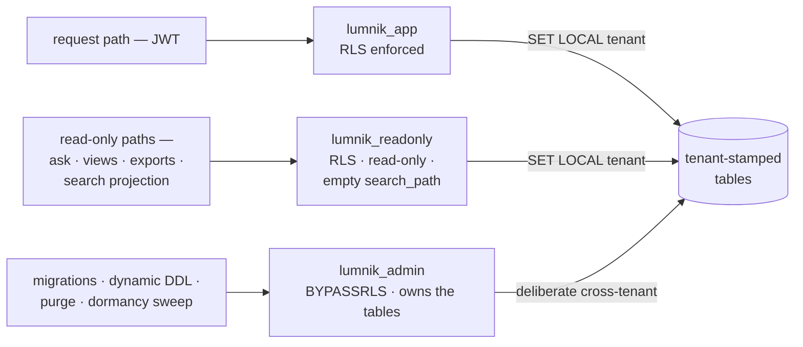
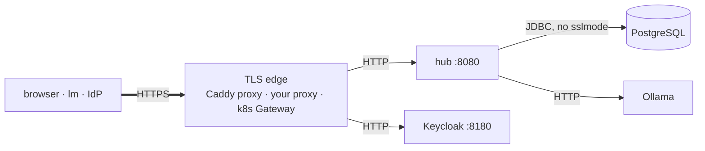

# Row-Level Security & database roles

> Every tenant's rows are isolated by PostgreSQL itself. The role the hub uses for requests
> cannot bypass the policy, and the role under LLM-generated SQL cannot write.

| | |
|---|---|
| **Roles** | `lumnik_app` (requests) · `lumnik_readonly` (LLM-generated SQL, views, exports) · `lumnik_admin` (migrations, DDL, purge) |
| **Policy** | `tenant_id = current tenant`; no tenant set means **zero rows**, never an error, never every row |
| **Coverage** | every tenanted table, including the `connector.t_*` tables ingestion creates |
| **Encrypted at rest** | tenant secrets, connector and webhook credentials only; ingested data is plaintext |
| **TLS** | terminates at the edge you put in front; plain HTTP behind it |



## The three database roles

Created at install by the PostgreSQL init script, outside the migrations:

| Role | Can | Cannot | Used for |
|---|---|---|---|
| `lumnik_app` | read and write rows, **under RLS** | bypass a policy; own a table | every request the hub serves |
| `lumnik_readonly` | `SELECT`, **under RLS**; the session is read-only | write anything; resolve an unqualified table name; [change its tenant](#what-the-read-only-role-cannot-call) | ask-to-SQL, `kind:View` render and detail, workflow data checks, the Search projection, export runs, `lm entity export` |
| `lumnik_admin` | everything; **bypasses RLS**; owns every table | be enlisted in a request transaction by accident | migrations, dynamic table DDL, retention purges, connector delete, secret resolution, the workflow dormancy sweep |

- `lumnik_app` owns nothing. PostgreSQL lets a table's owner bypass its own policies; that rule
  never applies to a request.
- See the roles answer a query live: [Verify it yourself](index.md#verify-it-yourself-in-five-minutes).

## How a query gets its tenant

- The hub resolves the tenant from the JWT's `tenant_id` claim, then issues
  `SET LOCAL app.current_tenant = '<id>'` once per transaction. `SET LOCAL` dies with the
  transaction; nothing leaks onto the pooled connection.
- Background work runs as the system sentinel `'0'`. A token claiming a tenant of `0` or below
  is not refused: the hub sets no tenant on its connections, so the request runs and sees
  **zero rows**. It is never elevated to the sentinel.
- On the read-only datasource the same tenant is set, the session is read-only, and
  `search_path` is empty: every query must name the schema it reads.

## What the read-only role cannot call

Ask runs SQL written by a model, as `lumnik_readonly`. The install takes from that role every right
that would let such a query:

- switch to another tenant;
- run SQL hidden inside a text value;
- see or stop other people's questions;
- read connector settings, secrets or rejected rows;
- wait, signal other sessions, or read a large object.

The server also stops each Ask query after 5 seconds, and the hub refuses an Ask result larger than
16 MB. Ask then says the result is too large, and shows no row.

The full list is in `infra/postgres/init/02-extensions.sql`; the hub completes it when it starts. The hub's other
roles keep their rights, and so do monitoring roles (`pg_monitor`).

### What you do

| Your install | What to do |
|---|---|
| Self-host (`deploy/selfhost/up.sh`) | Nothing. Every start applies it. |
| Helm with `LUMNIK_PG_MODE=external` | Nothing. Every `up.sh` applies it. |
| Helm with the bundled database, the dev `docker-compose.yml`, or your own PostgreSQL | Once after each upgrade that changes the list, such as the one that adds the large-object functions (below). |

```bash
psql -U <superuser> -d lumnik -f infra/postgres/init/02-extensions.sql
```

A backup role that is not a superuser loses `set_config`, and `pg_dump` needs it. Give it back:

```sql
GRANT EXECUTE ON FUNCTION pg_catalog.set_config(text,text,boolean) TO <backup role>;
```

On a managed database (RDS, Cloud SQL, Azure), the file stops with
`lumnik_readonly can still call set_config`. The administrator role there cannot change
PostgreSQL's own functions. Ask your provider how to do it.

### How you know

Until it is applied, Ask is off. The rest of the hub works. An analytic question to
`POST /api/rag/chat` gets a `503`:

```json
{"error": "analytic ask is unavailable: the readonly database role is not hardened",
 "hint": "an operator must harden the readonly database role: docs/security/rls.md#what-the-read-only-role-cannot-call"}
```

`/api/platform/health` says why:

```json
    "ask": {
        "status": "inactive",
        "reason": "readonly-role-not-hardened"
    }
```

| `reason` | Do this |
|---|---|
| `readonly-role-not-hardened` | Run the file above. If it still says so, read the hub log. |
| `readonly-role-check-failed` | The hub cannot query as `lumnik_readonly`. Check `LUMNIK_READONLY_DB_PASSWORD` and that the database answers. |

The hub log names what is left:

```text
Ask is closed: the readonly role still holds [set_config(text,text,boolean)]. See docs/security/rls.md#what-the-read-only-role-cannot-call for how to remove each.
```

| The log lists | Do this as the superuser |
|---|---|
| a function, or `pg_catalog.pg_stat_activity` | Run the file above. |
| the same, after the file ran | `lumnik_readonly` is a member of a role that has it: `REVOKE <that role> FROM lumnik_readonly;` |
| a `connector.…` table | `REVOKE SELECT ON <that table> FROM lumnik_readonly;` |
| `the role itself: superuser or BYPASSRLS` | Point `LUMNIK_READONLY_DB_USERNAME` at a plain role. |

Then ask again. No restart is needed: the log says `Ask is open`.

## The policy shape

```sql
USING (tenant_id = NULLIF(current_setting('app.current_tenant', true), '')::bigint)
```

- No tenant set, or set to `''`: the predicate is `NULL` and the query returns **zero rows**.
- A handful of hub-wide bookkeeping tables (run ledger, event outbox) also accept the `'0'`
  sentinel, so background work can see across tenants on purpose.
- Tables ingestion creates on the fly (`connector.t_*` and the mapping targets) get the same
  policy the moment they are created.
- Saved views and entity manifests carry no `tenant_id`: they are hub-wide definitions, bound to
  users by [scope grants](../rag/scopes.md#binding-users-to-scopes-opt-in). The rows they render
  still pass through RLS.

## Credentials

- All three passwords are generated **per install** and injected as environment variables:
  `LUMNIK_APP_DB_PASSWORD`, `LUMNIK_ADMIN_DB_PASSWORD`, `LUMNIK_READONLY_DB_PASSWORD`.
- **Self-host rotation**: put the new value in `.env`, re-run `deploy/selfhost/up.sh` with the
  flags you installed with. Every run sets the three roles' passwords to the `.env` values. On a
  TLS install, run the [overlay command](../deploy.md#one-https-origin-the-tls-proxy) again
  afterwards.
- **Helm**: the release Secret carries the three values. On a cluster with an existing volume,
  rotate at the database (`ALTER ROLE … PASSWORD`) and upgrade with the matching values.

## Two tenants, one table name { #two-tenants-one-table-name }

A hub table is named after its source. Two tenants that ingest the same source write one table.

- **Rows:** each tenant reads only its own.
- **Columns:** each tenant sees only the columns its own data brought: in Ask, whatever the question asks for, and in
  the entities it applies. Another one is answered as a column that does not exist.
- **Types:** one tenant's data can widen a column for both. A fraction turns a whole-number column into `numeric`.
  Every value still reads. A value the column cannot hold is refused, and a column never narrows.
- **What a tenant never sees:** the other tenant's columns, and its values. Tables ingested before this release are
  the exception: see the [upgrade note](../operations/upgrade.md#two-tenants-on-one-table-name-see-only-their-own-columns).

**The gesture:** none. To keep two tenants' tables apart, give each connector its own target table.

## What RLS does NOT protect against

- **The admin datasource.** `lumnik_admin` bypasses RLS. Code using it filters by tenant
  itself; a bug there is a cross-tenant bug RLS will not catch.
- **The database superuser**, or anyone holding the `lumnik_admin` credentials.
- **A wrong tenant upstream.** RLS trusts `app.current_tenant`. The request filter that resolves
  it from the JWT is part of the trusted computing base.

## Secrets at rest: the master key

!!! danger "Two keys. No rotation. No recovery."
    Back up **`LUMNIK_SECRET_MASTER_KEY`** and **`LUMNIK_CRYPTO_SECRET_KEY`** somewhere safe,
    today: both live in `.env`, which the backup script does not copy. **Change one** and the
    secrets it protects become undecryptable. **Lose one** and they are unrecoverable. A key
    change means re-entering every secret by hand.

| | |
|---|---|
| **What is encrypted** | tenant secrets, the `lm secret` store |
| **How** | pgcrypto `pgp_sym_encrypt`, AES-256 |
| **The key** | `LUMNIK_SECRET_MASTER_KEY`, generated at install with `openssl rand -base64 32` |
| **Refuses to boot on** | a blank, placeholder, or short (< 16 characters) key |
| **Changing one secret's value** | supported: `lm secret set NAME` again prints `Updated secret "NAME"` |
| **Changing a key** | not supported |

- The second key, `LUMNIK_CRYPTO_SECRET_KEY`, protects connector and webhook credentials the
  same way.

```
$ lm secret set SFTP_ERP_PASSWORD
Value for SFTP_ERP_PASSWORD:
Created secret "SFTP_ERP_PASSWORD"
$ lm secret list
NAME                           ROTATED_AT                     DESCRIPTION
ACME_API_KEY                   -
ACME_BASIC_PW                  -
SFTP_ERP_PASSWORD              -
```

## Data at rest: what is encrypted, and what is not

- **Encrypted**: tenant secrets and connector/webhook credentials, under the two keys above.
- **Plaintext**: everything you ingest. `connector.t_*` mirror tables and the `rag.chunk` corpus
  are ordinary PostgreSQL columns, readable to anyone who can query the database directly.
- Disk, volume and backup encryption are the operator's layer, as for any database.

## Data in transit: where TLS stops



- The hub itself speaks plain HTTP on port 8080. There is no `https://` origin in the application.
- **Self-host**: the optional [TLS proxy](../deploy.md#one-https-origin-the-tls-proxy)
  terminates HTTPS and proxies to the hub and Keycloak over the compose network. Skip it and the
  hub answers in the clear on whatever you exposed port 8080 to.
- **Kubernetes**: the Gateway terminates TLS from a secret (self-signed by `up.sh` unless you
  supply your own); Gateway→pod is plain HTTP inside the cluster.
- **Behind the edge nothing is encrypted**: hub↔PostgreSQL, hub↔Ollama, proxy↔hub. Keep the
  database and model ports on a private network; that is the operator's job.

## Troubleshooting

| Symptom | Cause | Fix |
|---|---|---|
| `docker compose` refuses to start: `required variable LUMNIK_SECRET_MASTER_KEY is missing a value` (or `LUMNIK_CRYPTO_SECRET_KEY`) | The key is missing from `.env` | `openssl rand -base64 32`, put it in `.env` — only on a fresh install; on an existing one, restore the original key |
| Hub refuses to boot: `lumnik.secret.master-key is too short (< 16 chars)` | The key is under 16 characters | Same fix |
| A secret fails at runtime: `reading secret <NAME> (tenant <id>) failed (SQLSTATE 39000)` | The master key changed or was lost since the secret was encrypted | Restore the original key from your backup; there is no re-encryption path |
| A query as `lumnik_app` or `lumnik_readonly` returns zero rows, `lumnik_admin` shows the data | `app.current_tenant` was never set on that connection (a manual `psql` session) | `SET LOCAL app.current_tenant = '<id>'` inside a transaction, as in [the live check](index.md#verify-it-yourself-in-five-minutes) |

## See also

- [Roles & permissions](role-management.md): the application-layer RBAC above this.
- [Scopes](../rag/scopes.md): the business-scope boundary layered on top of tenant isolation.
- [Security overview](index.md): the auditor's grid and the gap register.
