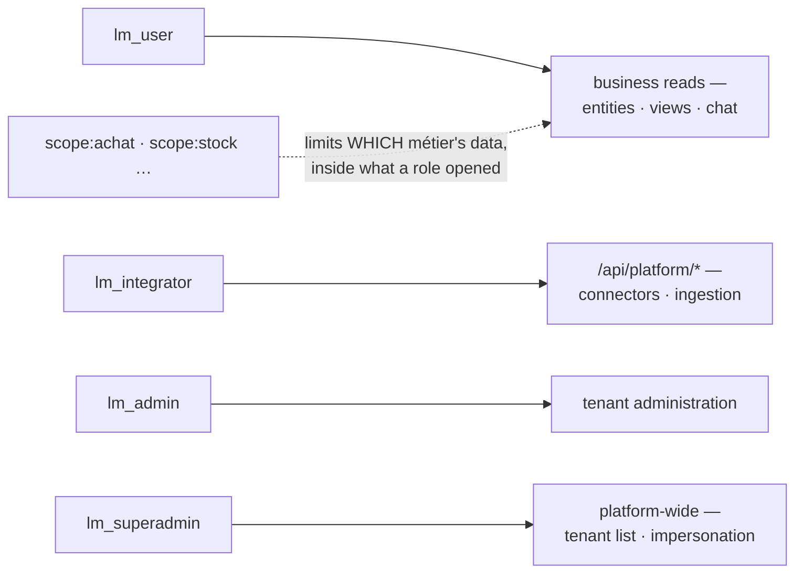

# Role management

> Four `lm_*` realm roles gate which surfaces a user can reach; `scope:<tag>` grants narrow which
> métier's data those surfaces show — flat matching, no hierarchy, so every role a user needs
> must be granted explicitly.

Operator guide for the lumnik RBAC catalog.

## Conceptual model

Everything a user may do rides in on their Keycloak **realm roles** — four `lm_*`
roles that open surfaces, plus any number of `scope:<tag>` grants that limit *which
métier's data* those surfaces show:



| Role | Opens |
|---|---|
| `lm_user` | the business read surfaces — `/api/entities/*`, views, chat |
| `lm_integrator` | connectors and ingestion — the `/api/platform/*` surface |
| `lm_admin` | tenant administration |
| `lm_superadmin` | platform-wide: tenant list + impersonation — the only role with `wildcard: true` |

**No hierarchy.** The interceptor matches role names flat — `lm_admin` does **not**
imply `lm_user`. Grant every role a user needs explicitly. The self-host demo realm
does: `integrator` carries integrator+admin+user, `hubadmin` admin+user+superadmin
(the native-claims k8s variant grants `hubadmin` only `lm_admin`).

**Scope grants are realm roles too**, by naming convention: `scope:<tag>`
(e.g. `scope:achat`). They are opt-in — a user with none is unscoped (tenant-wide),
one or more binds them to exactly those métiers. No entry in `roles.yaml` is needed;
see [Scopes](../rag/scopes.md#binding-users-to-scopes-opt-in).

Beneath the roles sits a second layer: **permissions**, declared per module in
`META-INF/module-manifest.yaml` (e.g. `repair.read`, `request.manage`). The
role→permission mapping lives in `lumnik-hub/src/main/resources/META-INF/roles.yaml`
and is exposed in the admin console under **Rôles** (`/admin/{tid}/roles`).

!!! note "Current enforcement model"
    `@RequiresPermission(...)` annotations on REST resources still reference **realm
    roles** as magic strings (e.g. `@RequiresPermission("lm_admin")`). The permission
    catalog is **declarative metadata** — it documents the mapping but does not (yet)
    drive the interceptor. A future plan will resolve permissions through
    `RoleRegistry`.

## Adding a new role

1. Edit `lumnik-hub/src/main/resources/META-INF/roles.yaml` and add the role under `roles:`.
2. Declare the role in the Keycloak realm `lumnik` (or your environment's equivalent).
3. Restart the platform. Boot logs should show `Roles loaded: N roles from M roles.yaml files`.
4. Visit `/admin/{tid}/roles` and confirm the new role appears.

If the platform refuses to start with a message like
`Role 'lm_foo' references unknown permission 'bar.baz'`, either remove the permission from
the role grant or add it to the relevant module's `module-manifest.yaml`.

## Adding a new permission

1. Add the permission id to the relevant `module-manifest.yaml`:
   ```yaml
   permissions:
     - id: invoice.export
       label:
         en: "Export invoices"
         fr: "Exporter les factures"
   ```
2. Grant the permission to the roles that should have it by adding the id under
   `roles.yaml` → `roles[].permissions`.
3. Restart the platform. If the permission is not yet granted by any role, you will see a
   WARN log: `Orphan permissions (declared by modules, granted by no role): [invoice.export]`.
4. Use the permission id in a `@RequiresPermission` annotation. **Today**, until the
   interceptor refactor lands, this still resolves against realm roles — so the
   annotation value must remain the realm role name (`lm_admin` etc.). The permission
   catalog is only metadata at this stage ([Conceptual model → current enforcement
   model](#conceptual-model)).

## Dev-bypass

Setting `lumnik.security.dev-bypass=true` in `application.properties` (or via the env var
`LUMNIK_SECURITY_DEV_BYPASS=true`) injects the three realm roles
`{lm_superadmin, lm_admin, lm_user}` into every request. This is enabled by default in
`%dev` and `%test` profiles.

To test access refusals locally, set the flag to `false` and provide a valid JWT with the
required roles in the `groups` claim. There is no header that overrides roles — dev-bypass
grants the fixed set above (identity comes from `X-Tenant-ID` / `X-User-ID` headers); in
production the roles always come from the JWT.

## The entity-read scope gate

Realm roles answer *may this user call the endpoint*; scope grants answer *which métier's
data may they see there*. A scope-bound user (one or more `scope:<tag>` realm roles)
hitting a read surface outside their granted set gets the uniform refusal:

```json
403 {"error":"scope not granted"}
```

The check is `ScopeGrants.allowsAny(...)` (`lumnik-common`) against the scope tags on the
resource — e.g. `EntityReadResource` refuses `GET /api/entities/{name}` when the entity
manifest's scopes don't intersect the user's grants. The same gate covers saved-view
discovery, view render/detail/generate, and chat.

Unscoped users (no `scope:*` role) pass everything — the boundary is opt-in.
Full semantics: [Scopes → Binding users to scopes](../rag/scopes.md#binding-users-to-scopes-opt-in).

## Troubleshooting

Three different refusals all read as "a 403", and they come from three different gates:

| Symptom | Cause | Fix |
|---|---|---|
| `403` with an **empty body** | `PermissionInterceptor` — the caller's roles include none of the endpoint's `@RequiresPermission(...)` values (e.g. `/api/views/apply`, `/api/workflows/apply` both require `lm_integrator` this way) | Grant the missing role; check the endpoint's `@RequiresPermission` value |
| `403 {"error":"scope not granted"}` | The métier-scope gate (above) — the caller has one or more `scope:<tag>` roles but none intersect the resource's scopes | Grant the missing `scope:<tag>`, or remove all scope roles to go unscoped ([The entity-read scope gate](#the-entity-read-scope-gate)) |
| `403` plain text `missing role lm_integrator` | `PlatformApiAuthFilter` gates every `/api/platform/*` path directly, ahead of any `@RequiresPermission` the resource itself declares | Grant `lm_integrator`; this is a *separate* gate from the empty-body case above — same missing role, different mechanism |
| No `403` at all, even for an obviously wrong role, in dev/test | `lumnik.security.dev-bypass=true` (default in `%dev`/`%test`) injects the fixed set `{lm_superadmin, lm_admin, lm_user}` on every request | Set it `false` and supply a real JWT to test refusals ([Dev-bypass](#dev-bypass)) |

## Release security checklist

Before each release, walk through the catalog at `/admin/{tid}/roles` and confirm:

- The list of roles matches what is declared in Keycloak.
- Only `lm_superadmin` carries the `wildcard: true` flag.
- No permission is declared by a module without being granted by at least one role (the boot
  log will warn — investigate each orphan).
- Every `@RequiresPermission` annotation in the codebase uses a role id present in
  `roles.yaml`:
  ```bash
  grep -rn '@RequiresPermission' lumnik-*/src/main/java
  ```

!!! warning "This item fails today: `lm_integrator`"
    `lm_integrator` is used directly by `@RequiresPermission("lm_integrator")`
    (`WorkflowApplyResource.java:35`, `ViewApplyResource.java:30`) and by `PlatformApiAuthFilter`
    for every `/api/platform/*` path, but it is declared in **neither** `roles.yaml`
    (checked: `lumnik-hub`, `lumnik-rag`) — it is a Keycloak realm role
    (`infra/keycloak/lumnik-realm.json`) with no entry in the RBAC catalog, and will not appear
    at `/admin/{tid}/roles`.

## Audit logging

`PermissionInterceptor` (in `io.lumnik.hub.security`) logs every access denial at
WARN level with the required roles, the caller's roles, and the method name. SIEM consumers
should subscribe to these log lines for security monitoring. The interceptor does not
currently write to a structured audit table — that is on the roadmap.

## See also

- The role → permission mapping: `lumnik-hub/src/main/resources/META-INF/roles.yaml`
- The bundled demo realm (roles + users): `infra/keycloak/lumnik-realm.json`
- The database layer beneath RBAC: [RLS & database roles](rls.md)
