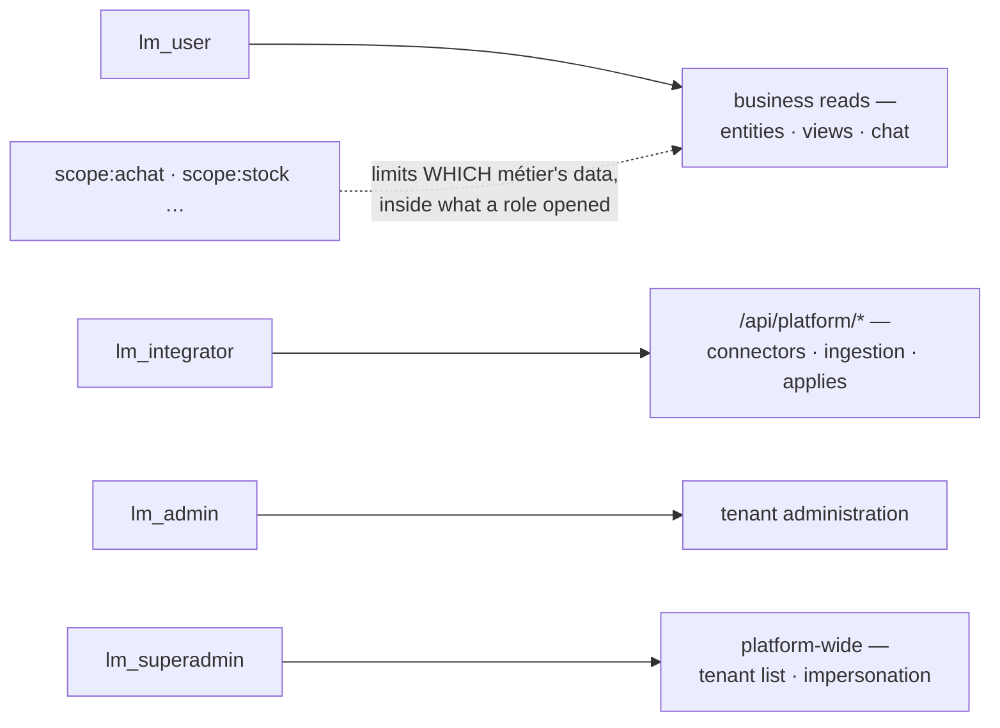

# Roles & permissions

> Four `lm_*` realm roles open surfaces; `scope:<tag>` roles narrow which métier's data those
> surfaces show. Matching is flat, no hierarchy: every role a user needs is granted explicitly.



| Role | Opens |
|---|---|
| `lm_user` | the app surface: entities, views, chat, inbox, the PWA |
| `lm_integrator` | the platform surface `lm` drives: connectors, runs, manifests, `views/apply`, `workflows/apply` |
| `lm_admin` | tenant administration: users, integrations, notification rules, SCIM tokens |
| `lm_superadmin` | cross-tenant: tenant list, tenant CRUD, impersonation; the only role with `wildcard: true` |
| `scope:<tag>` | not a surface: a fence. One or more binds the user to those métiers; none means tenant-wide. [Scopes](../rag/scopes.md#binding-users-to-scopes-opt-in) |

- **No hierarchy.** `lm_admin` does not imply `lm_user`. The bundled realm grants `integrator`
  three roles (integrator, admin, user) for that reason.
- **Roles live in the IdP.** Granting one is a Keycloak gesture:
  [Tenants, users & scopes](identity-admin.md#make-someone-admin-integrator-superadmin).
- **Three gates, three refusals.** Which one answered tells you what to grant; see
  [Troubleshooting](#troubleshooting).

## Dev-bypass

- `LUMNIK_SECURITY_DEV_BYPASS=true` injects `{lm_superadmin, lm_admin, lm_user}` into every
  request. It is on by default in the `dev` and `test` profiles, **off in production**.
- To test a refusal locally, set it to `false` and present a real JWT. There is no header that
  overrides roles.

## Release security checklist

Before each release, read the roles catalog. There is no `lm` command for it; it needs
`lm_admin` and `lm_integrator`:

```
$ TOKEN=$(awk '/^ *access:/ {print $2; exit}' ~/.lm/config.yaml)
$ curl -s https://your-hub.example.com/api/platform/roles -H "Authorization: Bearer $TOKEN" \
    | jq -c '.roles[] | {id, wildcard}'
{"id":"lm_superadmin","wildcard":true}
{"id":"lm_admin","wildcard":false}
{"id":"lm_user","wildcard":false}
```

Confirm:

- The roles listed match what the realm declares.
- Only `lm_superadmin` carries `wildcard: true`.
- The boot log shows no `Orphan permissions (declared by modules, granted by no role)` line.

!!! warning "One item fails: `lm_integrator`"
    `lm_integrator` gates the whole `/api/platform/*` surface plus the view and workflow
    applies, but it has **no entry in the roles catalog**. An RBAC inventory taken from the
    catalog misses a role that grants real access.

The catalog is declarative: endpoints are gated by realm role name, not by its permission ids.

## Audit logging

Every refusal leaves one `WARN` line naming roles and grants, never a row or a token. No
refusal is written to the audit table. [Refusals](index.md#refusals)

## Troubleshooting

| What `lm` prints | Gate | Fix |
|---|---|---|
| `Error: API error 403: missing role lm_integrator` | the platform gate, in front of every `/api/platform/*` path | Grant `lm_integrator` |
| `Error: API error 403 (forbidden): no details from the server — your account may lack the required role` | the endpoint's role gate (an empty-body `403`); `lm view apply` and `lm workflow apply` want `lm_integrator` this way | Grant the missing role |
| `Error: access refused (403): scope not granted` | the scope gate: the caller holds `scope:*` roles and none matches the resource | Grant the matching `scope:<tag>`, or remove all scope roles to go tenant-wide |
| `scope not granted` on `lm integration`, `lm notify` or `lm outputs` | outputs are tenant-wide: the caller holds any `scope:*` role | Wire outputs as an admin with no `scope:*` role ([Outputs](../outputs.md)) |
| `Error: connector "orders" not found` from `lm connector`, though an unscoped account sees it | the caller holds `scope:*` roles but not every scope of that connector | Grant every scope the connector carries, or use an account with no scope role |
| `scope not granted` on `lm connector scope` | the caller is moving the connector into a scope they do not hold | Same fix |
| An empty `lm run list` or `lm dlq list` | runs and dead letters of a connector whose scopes the caller does not all hold are hidden | Same fix |
| `scope not granted` on `lm run get`, `lm run cancel`, `lm run list --connector`, `lm dlq list --run`/`--connector`, `lm dlq get`/`discard`/`replayed` | the run, connector or dead letter belongs to a connector whose scopes the caller does not all hold | Same fix |
| `scope not granted` on `lm csv ingest` | the ingest asks for a scope the caller does not hold; without `--scope` it asks for `system` | Pass `--scope <tag>` with a granted tag |
| `scope not granted` on `lm source jdbc add` | the guided add creates a scopeless connector | Declare the connector in a manifest with `scopes:`, or use an account with no scope role |
| `Error: API error 404: no user record on this hub for user_id N` on `lm scope` | the token's `user_id` names no hub user row | [BYO IdP](byo-idp.md#troubleshooting) |
| No `403` at all in dev, even for a wrong role | dev-bypass is on | Set `LUMNIK_SECURITY_DEV_BYPASS=false` and present a real JWT |

An integrator bound to `scope:desk`, on a hub whose connectors all carry `sales`:

```
$ lm connector list
NAME  TYPE  TENANT  SCHED  WINDOW  STATUS  LAST RUN
$ lm connector get orders
Error: connector "orders" not found
$ lm csv ingest /tmp/customers.csv
Error: access refused (403): scope not granted
$ lm run get 9eb29f11-f25c-40bb-808c-4aae3c444e2c
Error: access refused (403): scope not granted
```

## See also

- [Tenants, users & scopes](identity-admin.md): the Keycloak gestures behind each role.
- [RLS & database roles](rls.md): the database layer beneath RBAC.
- [Scopes](../rag/scopes.md): what a `scope:<tag>` fences.
