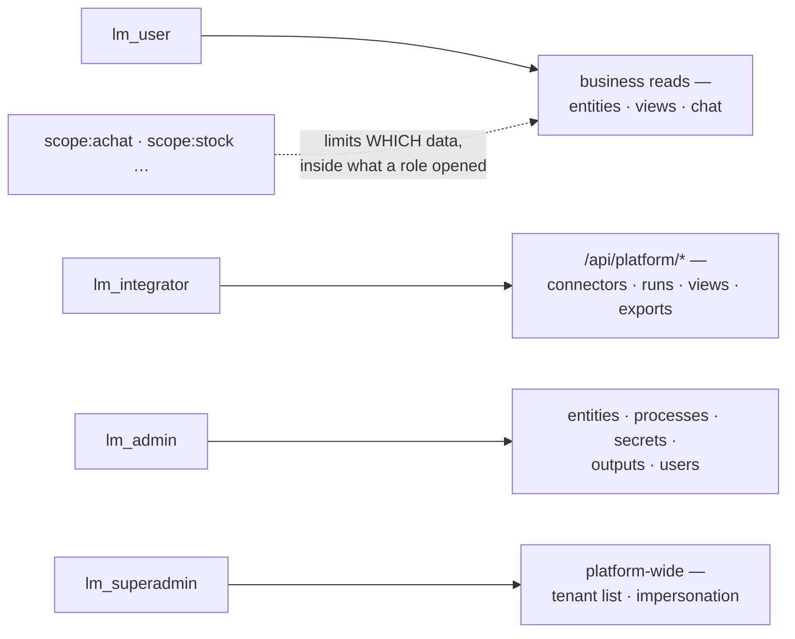

# Roles & permissions

> Four `lm_*` realm roles open surfaces; `scope:<tag>` roles narrow which data those
> surfaces show. Matching is flat, no hierarchy: every role a user needs is granted explicitly.



| Role | Opens |
|---|---|
| `lm_user` | the app surface: entities, views, chat, inbox, the PWA |
| `lm_integrator` | the platform surface `lm` drives: connectors, runs, dead letters, views, apps, workflows, search indexes, exports |
| `lm_admin` | entities, processes, secrets (write), the guided JDBC flow, schema discovery, workflow observations, outputs, email rules, users, SCIM tokens |
| `lm_superadmin` | cross-tenant: tenant list, tenant CRUD, impersonation; the only role with `wildcard: true` |
| `scope:<tag>` | not a surface: a fence. One or more binds the user to those scopes; none means tenant-wide. [Scopes](../rag/scopes.md#binding-users-to-scopes-opt-in) |

- **No hierarchy.** `lm_admin` does not imply `lm_user`. The bundled realm grants `integrator`
  three roles (integrator, admin, user) for that reason. **An integrator needs all three**:
  with `lm_integrator` alone, `lm entity apply` already answers `403`.
- **Roles live in the IdP.** Granting one is a Keycloak gesture:
  [Tenants, users & scopes](identity-admin.md#make-someone-admin-integrator-superadmin).
- **Three gates, three refusals.** Which one answered tells you what to grant; see
  [Troubleshooting](#troubleshooting).

## Which role for which gesture

| You run | Roles it needs |
|---|---|
| `lm connector …`, `lm run …`, `lm dlq …`, `lm endpoint …`, `lm csv ingest`, `lm apply -f` (connector) | `lm_integrator` |
| `lm view apply`, `lm app apply`, `lm workflow …`, `lm search …` (but `query`), `lm export …`, `lm hook scripts`, `lm secret list` | `lm_integrator` |
| `lm entity apply`, `lm entity delete`, `lm entity resolve`, `lm entity assert-same`, `lm entity assert-distinct` | `lm_admin` |
| `lm process …` (every subcommand, list included) | `lm_admin` |
| `lm secret set`, `lm secret rm` | `lm_integrator` **and** `lm_admin` |
| `lm source jdbc …`, `lm source schema`, `lm source rediscover`, `lm rag status`, `lm hook get` | `lm_integrator` **and** `lm_admin` |
| `lm observations …` | `lm_integrator` **and** `lm_admin` |
| `lm integration …`, `lm outputs …` | `lm_integrator` **and** `lm_admin` |
| `lm notify …`, user and SCIM token administration | `lm_admin` |
| `lm entity get`, `lm view …` (read), `lm inbox`, `lm ask`, `lm chat`, `lm search query`, the PWA | `lm_user` |

The bundled `integrator` account holds the three roles, so every line works with it. Check this
table when the client's own IdP grants the roles.

## A hub with no login: dev-bypass

A hub in **dev-bypass** checks no token: every caller is `lm_superadmin`, `lm_admin` and `lm_user`,
and picks any tenant with the `X-Tenant-ID` header.

- The self-host stack (`up.sh`) never runs in dev-bypass.
- The Helm chart (cloud edition) defaults to `auth.mode: oidc`. It renders dev-bypass only with
  `auth.iUnderstandNoAuth=true` as well; `make k8s-up` sets both, on a local kind cluster. Never
  expose such a hub.
- To check a refusal, use a hub with a real login and present a real token. No header overrides
  roles.

## After each upgrade: the roles catalog

Read the roles catalog for your RBAC inventory. There is no `lm` command for it; it needs
`lm_admin` and `lm_integrator`. Mint `$TOKEN` as in
[Test the API](../recipes/test-the-api.md#mint-a-token), then:

```
$ curl -s https://your-hub.example.com/api/platform/roles -H "Authorization: Bearer $TOKEN" \
    | jq -c '.roles[] | {id, wildcard}'
{"id":"lm_superadmin","wildcard":true}
{"id":"lm_admin","wildcard":false}
{"id":"lm_user","wildcard":false}
```

Confirm:

- The roles listed match what the realm declares.
- Only `lm_superadmin` carries `wildcard: true`.

!!! warning "One item fails: `lm_integrator`"
    `lm_integrator` gates the whole `/api/platform/*` surface plus the view and workflow
    applies, but it has **no entry in the roles catalog**. An RBAC inventory taken from the
    catalog misses a role that grants real access.

## Audit logging

Every refusal leaves one `WARN` line naming roles and grants, never a row or a token. No
refusal is written to the audit table. [Refusals](index.md#refusals)

## A scope-bound integrator

**Administering a connector follows the writing rule.** Every connector command (`get`, `apply`,
`run`, `pause`, `resume`, `delete`, `scope`, and the endpoint commands) acts only on a connector
whose scopes the bound integrator holds **all** of. `lm connector list` shows only those, so a
connector outside those scopes, a connector spanning a scope you do not hold, or a scopeless one
is simply not found. Moving a connector you hold into a scope you don't hold is refused:

```
$ lm connector list
NAME           TYPE         TENANT  SCHED  WINDOW  STATUS  LAST RUN
orders-ventes  hello-world  1
$ lm connector pause stock-magasin
Error: connector "stock-magasin" not found
$ lm connector scope add orders-ventes magasin
Error: access refused (403): scope not granted
$ lm connector scope ls orders-ventes
ventes
```

The same hub, listed by an integrator with no `scope:*` role, shows `stock-magasin` too:
unbound integrators keep administering the whole tenant.

**What a connector left behind follows the same rule.** A run carries counts, table names and
the error message, and a dead letter carries the rejected row's values. A bound integrator's
`lm run list` and `lm dlq list` show only the connectors whose scopes they hold all of.
`lm run get`/`cancel`, `lm dlq get`/`discard`/`replayed`, and `--connector`/`--run` filters
naming a connector outside those scopes answer `403`.

The `lm source` doors create or reuse connectors, so they follow the writing rule:

- `lm csv ingest` refuses a `--scope` you do not hold. Without `--scope` the one-shot lands in
  `system`, which you need to hold too.
- Re-ingesting under the name of another scope's one-shot is refused rather than moving it
  into yours.
- `lm source jdbc add` creates its connectors without scopes, so a bound integrator is refused
  before the source database is contacted. Declare the connector in a manifest with `scopes:`
  and `lm apply` it instead.
- `lm source jdbc list-tables` lists only the connectors you hold.
- `lm source rest probe` answers only for a connector you hold.
- `lm source rest from-openapi` writes nothing to the hub. It drafts a manifest, and
  `lm apply` then judges its `scopes:`.

The capture below shows the same hub as above with two csv connectors, `commandes-ventes`
(`scopes: [ventes]`) and `stock-magasin` (`scopes: [magasin]`), each run once with one malformed
row. The caller is an integrator holding `scope:ventes`:

```
$ lm run list
ID        CONNECTOR         ENDPOINT  STATUS     IN  OUT  SKIPPED  DEAD-LETTERS  STARTED           ENDED
0893cee7  commandes-ventes  default   Completed  2   1    1        1             2026-10-18 15:37  2026-10-18 15:37
$ lm dlq list
ID        CONNECTOR         RUN       REASON           ATTEMPTS  RESOLUTION  MESSAGE
f8b2118f  commandes-ventes  0893cee7  MalformedSource  1                     data/commandes.csv:3 — Record has 3 values but only 2 column…
$ lm dlq get 95b20b87-d992-43e2-b08b-f50806a4d131
Error: access refused (403): scope not granted
$ lm dlq discard 95b20b87-d992-43e2-b08b-f50806a4d131
Error: access refused (403): scope not granted
$ lm run get b93a9839-862e-49ea-a397-f13a46751c57
Error: access refused (403): scope not granted
$ lm csv ingest inventaire.csv --name inventaire --scope ventes
Error: access refused (403): scope not granted
$ lm csv ingest inventaire.csv --name inventaire-bis --scope magasin
Error: access refused (403): scope not granted
$ echo "$PGPASSWORD" | lm source jdbc add erp --url jdbc:postgresql://erp-db:5432/erp --user lumnik_reader --tables orders --password-stdin
Error: access refused (403): scope not granted
```

The two ids refused above are `stock-magasin`'s dead letter and run, which an unbound
integrator sees in the same lists. `inventaire` is a `magasin` one-shot. Re-ingesting it under
`--scope ventes` would have moved it into `ventes`, and its rows with it.

## Troubleshooting

| What `lm` prints | Gate | Fix |
|---|---|---|
| `Error: API error 403: missing role lm_integrator` | the platform gate, in front of every `/api/platform/*` path | Grant `lm_integrator` |
| `Error: API error 403 (forbidden): no details from the server — your account may lack the required role` | the endpoint's role gate (an empty-body `403`) | Grant the role the gesture needs: [the table above](#which-role-for-which-gesture) |
| `Error: access refused (403): scope not granted` | the scope gate: the caller holds `scope:*` roles and none matches the resource | Grant the matching `scope:<tag>`, or remove all scope roles to go tenant-wide |
| `scope not granted` on `lm integration`, `lm notify` or `lm outputs` | outputs are tenant-wide: the caller holds any `scope:*` role | Wire outputs as an admin with no `scope:*` role ([Outputs](../outputs.md)) |
| `Error: connector "orders" not found`, an empty `lm run list` or `lm dlq list`, or `scope not granted` on `lm connector scope`, `lm run …`, `lm dlq …` — though an unscoped account sees the connector | the caller holds `scope:*` roles, but not every scope that connector carries | Grant every scope the connector carries, or use an account with no scope role |
| `scope not granted` on `lm csv ingest` | the ingest asks for a scope the caller does not hold; without `--scope` it asks for `system` | Pass `--scope <tag>` with a granted tag |
| `scope not granted` on `lm source jdbc add` | the guided add creates a scopeless connector | Declare the connector in a manifest with `scopes:`, or use an account with no scope role |
| `Error: API error 404: no user record on this hub for user_id N` on `lm scope` | the token's `user_id` names no hub user row | [BYO IdP](byo-idp.md#troubleshooting) |
| No `403` at all, even for a wrong role or no token | the hub runs in [dev-bypass](#a-hub-with-no-login-dev-bypass) | Helm: install with `auth.mode=oidc` (the default) or `oidc-external` |

An integrator bound to `scope:desk`, on a hub whose connectors all carry `sales`:

```
$ lm connector list
NAME  TYPE  TENANT  SCHED  WINDOW  STATUS  LAST RUN
$ lm connector get orders
Error: connector "orders" not found
$ lm csv ingest /tmp/customers.csv
Error: access refused (403): scope not granted
$ lm run get 9eb29f11-f25c-40bb-808c-4aae3c444e2c
Error: access refused (403): scope not granted
```

## See also

- [Tenants, users & scopes](identity-admin.md): the Keycloak gestures behind each role.
- [RLS & database roles](rls.md): the database layer beneath RBAC.
- [Scopes](../rag/scopes.md): what a `scope:<tag>` fences.
