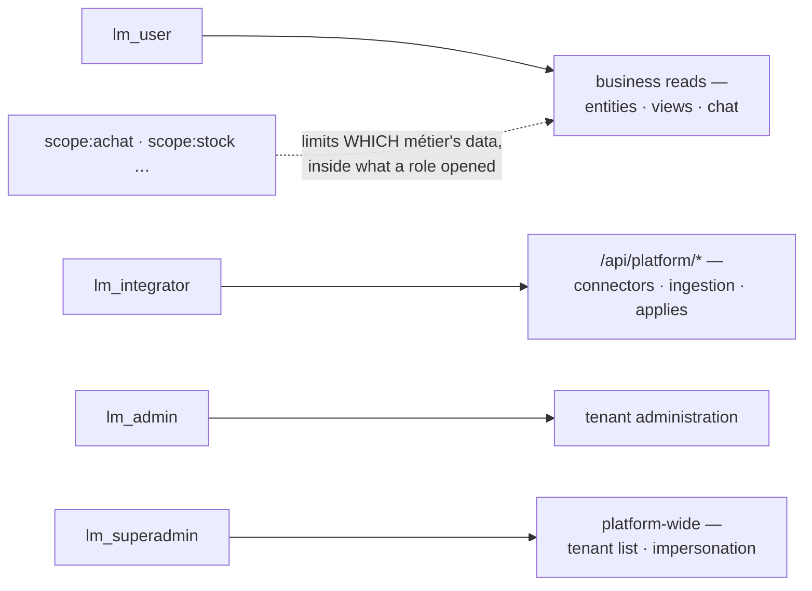

# Roles & permissions

> Four `lm_*` realm roles open surfaces; `scope:<tag>` roles narrow which métier's data those
> surfaces show. Matching is flat, no hierarchy: every role a user needs is granted explicitly.

| Role | Opens |
|---|---|
| `lm_user` | the app surface: entities, views, chat, inbox, the PWA |
| `lm_integrator` | the platform surface `lm` drives: connectors, runs, manifests, `views/apply`, `workflows/apply` |
| `lm_admin` | tenant administration: users, integrations, notification rules, business lists, SCIM tokens |
| `lm_superadmin` | cross-tenant: tenant list, tenant CRUD, impersonation; the only role with `wildcard: true` |
| `scope:<tag>` | not a surface: a fence. One or more binds the user to those métiers; none means tenant-wide. [Scopes](../rag/scopes.md#binding-users-to-scopes-opt-in) |

- **No hierarchy.** `lm_admin` does not imply `lm_user`. The bundled realm grants `integrator`
  three roles (integrator, admin, user) for that reason.
- **Roles live in the IdP.** Granting one is a Keycloak gesture:
  [Tenants, users & scopes](identity-admin.md#make-someone-admin-integrator-superadmin).
- **Three gates, three refusals.** Which one answered tells you what to grant; see
  [Troubleshooting](#troubleshooting).

## Dev-bypass

- `LUMNIK_SECURITY_DEV_BYPASS=true` injects `{lm_superadmin, lm_admin, lm_user}` into every
  request. It is on by default in the `dev` and `test` profiles, **off in production**.
- To test a refusal locally, set it to `false` and present a real JWT. There is no header that
  overrides roles.

## Release security checklist

Before each release, open the catalog at `/admin/{tid}/roles` and confirm:

- The roles listed match what the realm declares.
- Only `lm_superadmin` carries `wildcard: true`.
- The boot log shows no orphan permission (declared by a module, granted by no role).

!!! warning "One item fails today: `lm_integrator`"
    `lm_integrator` gates the whole `/api/platform/*` surface plus the view and workflow
    applies, but it is a realm role with **no entry in the roles catalog**. It does not appear
    at `/admin/{tid}/roles`. An RBAC inventory taken from that screen is missing a role that
    grants real access.

## Audit logging

- Every refusal leaves one `WARN` line. Point your SIEM at them:
    - role gate: `Access denied: required=[…], actual=[…], method=…`
    - scope gate: `Access denied: scope not granted, granted=[…]`
    - SCIM: `SCIM auth refused: GET /scim/v2/… reason=missing` or `reason=unknown-or-revoked`
- A line names roles and grants, never a row and never a token.
- No denial is written to the audit table. [The audit trail](index.md#the-audit-trail)

??? note "For module developers: the permission catalog"
    - Each module declares permission ids in its `META-INF/module-manifest.yaml`
      (`repair.read`, `request.manage`…). The role → permission mapping lives in
      `lumnik-hub/src/main/resources/META-INF/roles.yaml` and renders under **Rôles** in the
      admin console.
    - A role granting an unknown permission stops the boot:
      `Role 'lm_foo' references unknown permission 'bar.baz'`. A permission no role grants
      logs `Orphan permissions (declared by modules, granted by no role): […]`.
    - **The catalog is declarative today.** Endpoints are gated by realm role name; the
      per-permission mapping documents the intent but does not drive the check yet.

## Troubleshooting

| Symptom | Cause | Fix |
|---|---|---|
| `403` with an **empty body** | The endpoint's role gate: none of the caller's roles match (`/api/views/apply` and `/api/workflows/apply` want `lm_integrator` this way) | Grant the missing role |
| `403` plain text `missing role lm_integrator` | The platform gate: every `/api/platform/*` path is checked before the endpoint itself | Grant `lm_integrator`; same role as above, different gate |
| `403 {"error":"scope not granted"}` | The scope gate: the caller holds `scope:*` roles and none intersect the resource's scopes | Grant the matching `scope:<tag>`, or remove all scope roles to go tenant-wide |
| `404 {"error":"no user record on this hub for user_id N"}` on `lm scope` | The token's `user_id` names a hub user row that does not exist | Point the attribute at an existing row, or drop it so first login creates the row (lumnik Pro): [BYO IdP](byo-idp.md#troubleshooting) |
| No `403` at all in dev, even for a wrong role | Dev-bypass is on | Set `LUMNIK_SECURITY_DEV_BYPASS=false` and present a real JWT |

## See also

- [Tenants, users & scopes](identity-admin.md): the Keycloak gestures behind each role.
- [RLS & database roles](rls.md): the database layer beneath RBAC.
- [Scopes](../rag/scopes.md): what a `scope:<tag>` fences.
