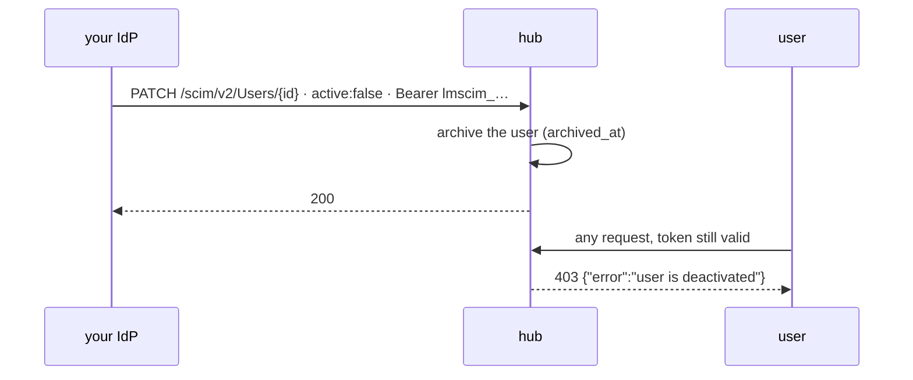

# SCIM deprovisioning

> Your IdP pushes `active: false`; lumnik archives the user; the very next request is refused,
> even with a still-valid token. The departure half of the identity loop.

!!! note "Edition"
    The whole `/scim/v2/*` surface and its token endpoints ship in **lumnik Pro**, the image the
    deploy scripts pull. They are absent from **lumnik Open**.
    [Editions](../editions.md#feature-by-feature)



## Why

- JIT creates a user at first login ([BYO IdP](byo-idp.md)); SCIM archives the same row when
  your IdP deprovisions them. JIT never reactivates an archived user.
- The integrator's departure is a different checklist: [Offboarding](offboarding.md).

## The auth model

- SCIM requests carry **no user JWT**. Each tenant mints opaque bearer tokens
  (`lmscim_` + 32 random bytes, base64url: 256 bits); your IdP presents one on every call. The
  surface is not rate-limited.
- **Minting needs `lm_admin`**, for your own tenant only. The plaintext is returned **once**;
  only its SHA-256 hash is stored, never logged, never shown again.
- A token is scoped to one **tenant** and one **issuer**: it cannot see local users, another
  IdP's users, or another tenant's. Such lookups answer a SCIM `404`, not a leak.
- Missing, unknown, revoked, or a user JWT instead of a SCIM token: `401`, same body in every
  case. The application log tells them apart:
  `SCIM auth refused: GET /scim/v2/… reason=missing` or `reason=unknown-or-revoked`.

```
$ curl -s https://<hub>/scim/v2/Users -H "Authorization: Bearer <a user JWT>"
{"schemas":["urn:ietf:params:scim:api:messages:2.0:Error"],"detail":"invalid SCIM token","status":"401"}
```

## Wiring your IdP

`lm` has no command for SCIM or its tokens: the gestures below are HTTP calls.

1. **Mint a token**, as an `lm_admin` of the tenant. `issuer` must be the *exact* `iss` your IdP
   puts in its JWTs, byte for byte, or SCIM manages a parallel set of users logins never hit:

    ```bash
    curl -X POST "https://<hub>/api/tenants/<tid>/scim-tokens" \
      -H "Authorization: Bearer <your lm_admin JWT>" \
      -H "Content-Type: application/json" \
      -d '{"issuer": "https://idp.example.com/realms/acme", "label": "okta-prod"}'
    # → 201 {"id":1,"issuer":"…","label":"okta-prod","token":"lmscim_…"}   ← save the token NOW
    ```

2. **Configure the IdP's SCIM app**: base URL `https://<hub>/scim/v2`, authentication
   *Bearer token* with the `lmscim_…` value, content type `application/scim+json`
   (PATCH also accepts `application/json`).
3. **Map attributes**: `externalId` = the JWT subject claim (`sub` by default); it is the join
   key. `userName`, `displayName`/`name` and the primary `emails` entry are synced as profile.
4. **Verify**: most IdPs test `GET /scim/v2/ServiceProviderConfig`, then a dedup lookup
   `GET /scim/v2/Users?filter=userName eq "jdoe"` before creating.

## The `/scim/v2/Users` contract

| Verb | Path | Does |
|---|---|---|
| `POST` | `/Users` | find-or-create by `(issuer, externalId)`, then apply `active` + profile. `201`. `externalId` required. Revives a soft-deleted user (see below); with `active: true` it also re-activates a user archived through the users API |
| `GET` | `/Users/{id}` | one user by lumnik id. `404` if absent, deleted, or keyed to another issuer |
| `GET` | `/Users?filter=…` | **only** `externalId eq "x"` and `userName eq "x"`; 0 or 1 result. Any other filter answers an **empty list**. Soft-deleted excluded, deactivated included |
| `PUT` | `/Users/{id}` | full replace: `active`, display name, primary email |
| `PATCH` | `/Users/{id}` | **the deprovisioning operation**: `replace` of top-level `active` only. A non-boolean `active`, or another op on it, is `400`. Other paths are ignored |
| `DELETE` | `/Users/{id}` | **soft**-delete, `204`. The row stays, keeping the key occupied so a later login resolves to it and is refused |

**Deactivate vs erase**

- **`active: false` archives.** The row and its history stay; `archived_at` is stamped. The
  next request is refused, with or without a `user_id` claim. SCIM `active: true` brings the
  user back.
- **`DELETE` soft-deletes.** A re-POST of the same `(issuer, externalId)` revives the user.
- **Neither is a GDPR erasure.** The row remains until an operator removes it:
  [GDPR & personal data](gdpr.md#the-rights-in-practice).
- **A SCIM write leaves no audit row**, deprovisioning included.
  [The audit trail](index.md#not-recorded)

## Not supported

- **Groups**: no `/scim/v2/Groups`. Roles are managed in the IdP realm, not pushed over SCIM.
- **Bulk, sorting, etags, changePassword**: declared unsupported in `ServiceProviderConfig`.
- **Pagination**: the only list forms are the two `eq` filters above.
- **The full PATCH path grammar**: `emails[type eq "work"].value` is ignored; use `PUT`.
- **`/Schemas` and `/ResourceTypes`**: IdPs that require schema discovery need their mappings
  configured by hand.
- **Unfiltered `GET /Users`** answers an empty list, not the tenant's population.

## Token lifecycle

All three need `lm_admin` and your own tenant id in the path:

```bash
# Mint — plaintext in the response ONCE, never retrievable again
POST   /api/tenants/{tid}/scim-tokens          {"issuer": "<idp iss>", "label": "okta-prod"}

# List active tokens — id, issuer, label, createdAt; never the hash, never the plaintext
GET    /api/tenants/{tid}/scim-tokens

# Revoke — effective immediately, 204
DELETE /api/tenants/{tid}/scim-tokens/{id}
```

Rotation is mint-then-revoke: several tokens can be active at once (`label` tells them apart),
so switching the IdP over needs no provisioning outage.

## Troubleshooting

| Symptom | Likely cause |
|---|---|
| Plain `404` on every `/scim/v2/*` call, not the SCIM-shaped body above | lumnik Open: the SCIM surface is not in that build |
| `401 invalid SCIM token` | Missing `Authorization: Bearer`, a token never minted for this hub, a revoked one, or a user JWT. Identical response in every case |
| `403` when minting, listing or revoking | Your JWT lacks `lm_admin`, or the `{tenantId}` in the path is not your own tenant |
| `404` on `GET/PUT/PATCH/DELETE /Users/{id}` | No such user, soft-deleted, **or the user's issuer differs from the token's**: the most common wiring mistake. Compare the token's `issuer` with the exact `iss` of your IdP's JWTs (scheme, host, port, path) |
| Dedup search finds nothing, then `POST` returns an existing user | Normal: filters exclude soft-deleted rows, `POST` is find-or-create |
| Deactivated user can still call the API | A request already executing finishes; every request after it is denied. If later calls still succeed, confirm the PATCH landed (`GET /Users/{id}` → `"active": false`) and the issuer matches |

## See also

- [Bring your own IdP](byo-idp.md): the arrival side, issuer and subject configuration.
- [Offboarding the integrator](offboarding.md) · [GDPR & personal data](gdpr.md)
